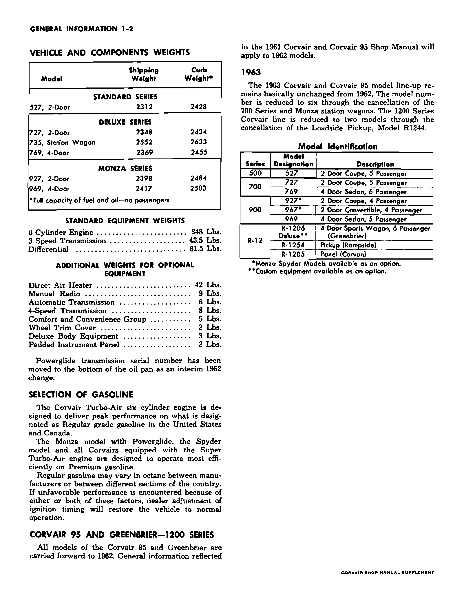
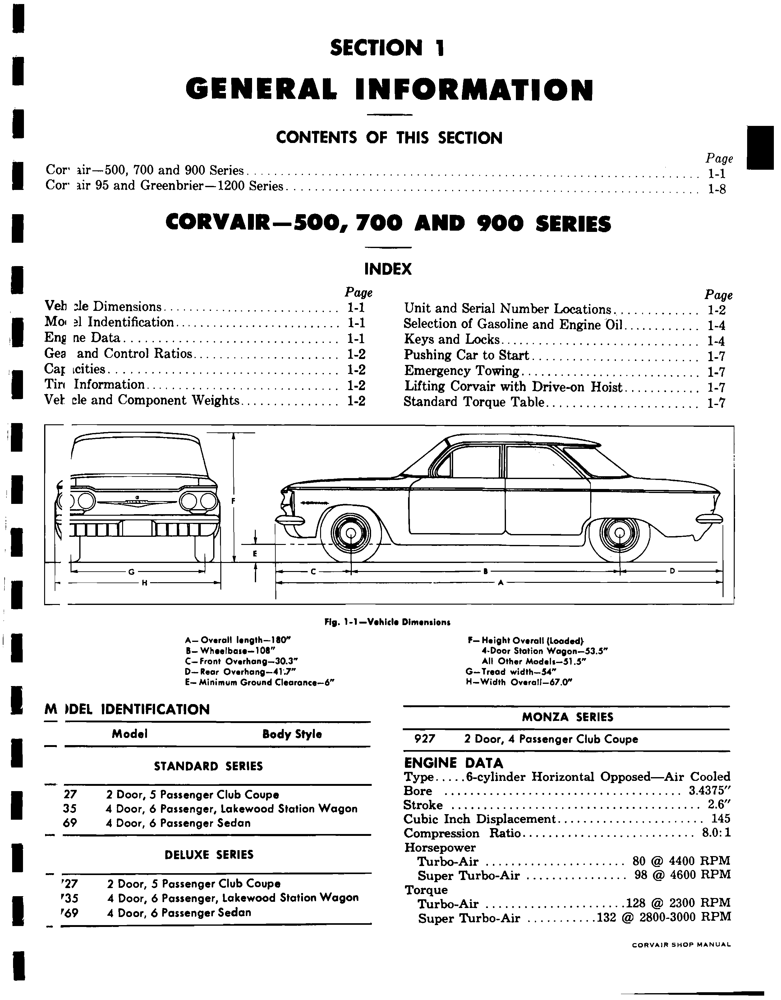
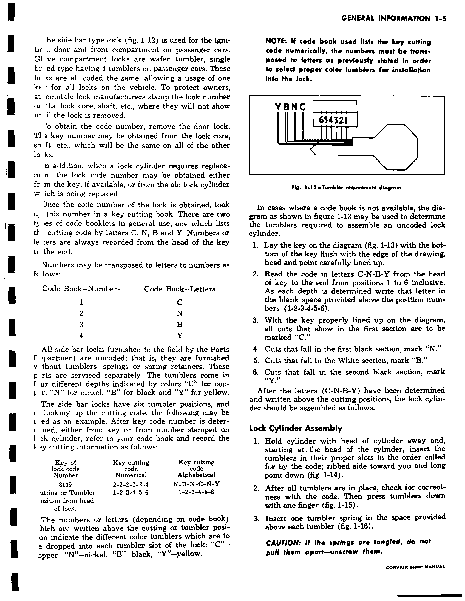
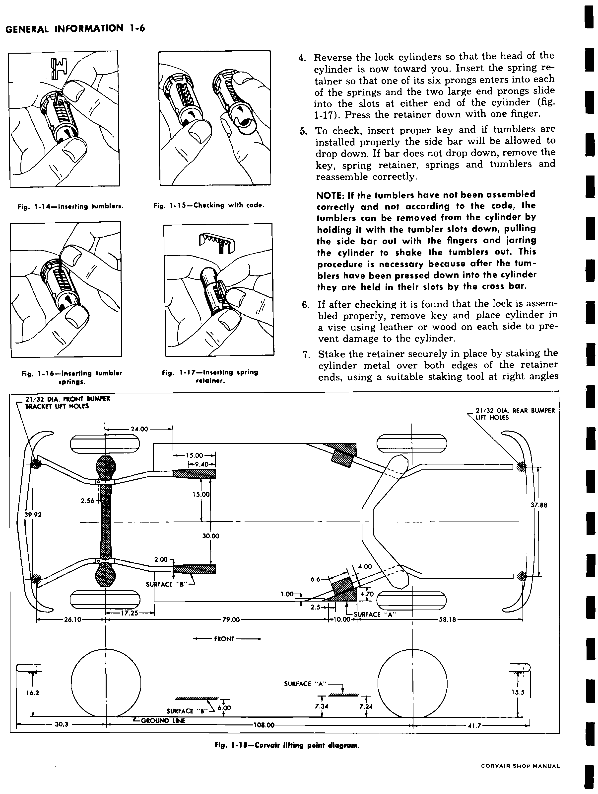
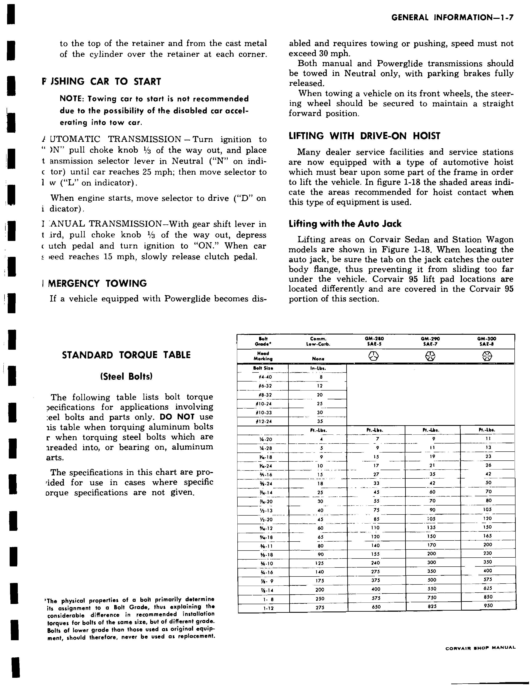

# General Information — 1963 Passenger Cars

<!-- INCOMPLETE -->

The 1961 manual supplies the base passenger-car information. Its procedures
and values carry forward through 1962 and 1963 unless the supplement changes
them. A 1963-specific entry takes precedence over a shared entry. The 1962
weights and gasoline guidance in the supplement therefore carry forward for
models and equipment still offered in 1963. Corvair 95 material and canceled
passenger variants are excluded. Remaining tables in this chapter still need
comparison with the supplement's later sections.

Source files: `1-Gen_info-61.pdf` (base, physical/combined PDF pp. 1–11)
and `1-Gen_info-62-63.pdf` (supplement, physical pp. 1–2, combined
pp. 532–533). Each block below carries its original printed page and a link
to the corresponding combined PDF page image.

## 1963 passenger-car models

 **[PDF p.533](../page-images/p0533.png)** <!-- SOURCE id=supplement-1962-63 page=1-2 years=1963 scope=passenger -->

The 1963 lineup has six passenger-car model designations. The 700 and Monza
station wagons were canceled. Monza Spyder was available as an option for the
models marked by the factory table.

| Series | Model designation | Factory description | Spyder option |
| --- | --- | --- | --- |
| 500 | 527 | 2-door coupe, 5 passenger | — |
| 700 | 727 | 2-door coupe, 5 passenger | — |
| 700 | 769 | 4-door sedan, 6 passenger | — |
| 900 | 927 | 2-door coupe, 4 passenger | Available |
| 900 | 967 | 2-door convertible, 4 passenger | Available |
| 900 | 969 | 4-door sedan, 5 passenger | — |

Source: Chevrolet, *1962–63 Corvair Shop Manual Supplement*, Section 1, printed
p. 1-2; original file `1-Gen_info-62-63.pdf`, physical PDF p. 2. The same
table lists excluded Corvair 95 models.

## Passenger-car dimensions carried from the base manual

 **[PDF p.2](../page-images/p0002.png)** <!-- SOURCE id=base-1961 page=1-1 years=1961,1962,1963 scope=passenger -->

Factory fig. 1-1 gives these dimensions for the passenger-car body. Its
station-wagon height belongs to a canceled 1963 variant and is excluded. The
"all other models" height covers the base coupe and sedan bodies; the figure
does not show the later convertible separately.

| Dimension | Base value carried forward | Diagram key |
| --- | --- | --- |
| Overall length | 180″ | A |
| Wheelbase | 108″ | B |
| Front overhang | 30.3″ | C |
| Rear overhang | 41.7″ | D |
| Minimum ground clearance | 6″ | E |
| Overall loaded height, coupe and sedan | 51.5″ | F |
| Tread width | 54″ | G |
| Overall width | 67.0″ | H |

<!-- NEEDS REVIEW: Fig. 1-1 predates the convertible; verify its 1963 loaded height and any body-specific dimensions before applying the base diagram to model 967. -->

## Carryover vehicle and equipment weights

 **[PDF p.533](../page-images/p0533.png)** <!-- SOURCE id=supplement-1962-63 page=1-2 years=1962,1963 scope=passenger -->

The supplement gives these weights in its 1962 column and no replacement
weights in its 1963 column. They carry forward for the five listed passenger
models that remain in the 1963 lineup. Model 967 convertible has no weight in
this table. Curb weight includes full fuel and oil but no passengers.

| 1963 model | Body | Shipping weight | Curb weight |
| --- | --- | --- | --- |
| 527 | 2-door coupe | 2312 lb. | 2428 lb. |
| 727 | 2-door coupe | 2348 lb. | 2434 lb. |
| 769 | 4-door sedan | 2369 lb. | 2455 lb. |
| 927 | 2-door coupe | 2398 lb. | 2484 lb. |
| 969 | 4-door sedan | 2417 lb. | 2503 lb. |

The same page gives **348 lb.** for the six-cylinder engine, **43.5 lb.** for
the three-speed transmission, and **61.5 lb.** for the differential. Its
additional weights for offered equipment are:

| Equipment | Additional weight |
| --- | --- |
| Direct-air heater | 42 lb. |
| Manual radio | 9 lb. |
| Automatic transmission | 6 lb. |
| Four-speed transmission | 8 lb. |
| Comfort and convenience group | 5 lb. |
| Wheel trim cover | 2 lb. |
| Deluxe body equipment | 3 lb. |
| Padded instrument panel | 2 lb. |

These are factory carryover figures, not newly measured 1963 weights.
<!-- NEEDS REVIEW: No factory weight is listed here for 1963 model 967 convertible; do not infer one from a coupe or sedan. -->

## Factory gasoline selection

 **[PDF p.533](../page-images/p0533.png)** <!-- SOURCE id=supplement-1962-63 page=1-2 years=1962,1963 scope=passenger -->

The supplement's gasoline guidance carries forward where the equipment is
offered in 1963: the Turbo-Air six-cylinder engine is designed for **Regular**
grade gasoline in the United States and Canada. It specifies **Premium** for
the Monza with Powerglide, Spyder, and any Corvair with the Super Turbo-Air
engine. It notes that Regular octane varies by maker and region and describes
dealer adjustment of ignition timing if performance suffers.

## Unit and serial number locations

 **[PDF p.3](../page-images/p0003.png)** <!-- SOURCE id=base-1961 page=1-2 years=1963 scope=passenger -->

Include a component unit-number prefix when recording identification; it
identifies the manufacturing plant. The base manual's pictured vehicle serial
number is a **1960 example**, not a 1963 decoding chart.

 **[PDF p.4](../page-images/p0004.png)** <!-- SOURCE id=base-1961 page=1-3 years=1963 scope=passenger -->

| Identification | Location shown in the base manual | Factory figure |
| --- | --- | --- |
| Body identification tag | Left rear wheel-house inner panel, inside engine compartment | 1-2 |
| Vehicle serial-number tag | Left front lock pillar | 1-3 |
| Differential number | Lower left side of casting | 1-4 |
| Engine number | Top of engine block, immediately forward of generator–oil-filter adapter | 1-5 |
| Manual-transmission unit number | Side of upper left differential mounting boss | 1-9 |
| Battery number | Top of middle cell, next to positive terminal | 1-10 |

The base manual places the Powerglide unit number on the right side of the
casting (fig. 1-8). The supplement supersedes that location with a move to
the **bottom of the oil pan as an interim 1962 change**. For the later
carryover unit, inspect the pan bottom; the casting location is the earlier
reference.

The base manual's engine-number example `T0430-Z` decodes Tonawanda plant,
April 30, Powerglide. It is a 1961-book example, **not** a complete 1963
engine-code list.

## Passenger-car keys and locks

 **[PDF p.5](../page-images/p0005.png)** <!-- SOURCE id=base-1961 page=1-4 years=1963 scope=passenger -->

The base manual says service lock cylinders are supplied uncoded. Its
passenger-car side-bar design is used for the ignition, doors, and front
compartment; the glove-compartment lock is a single-bitted wafer-tumbler type
with four tumblers. The locks share one key code. The lock number is concealed
until a lock is removed.

 **[PDF p.6](../page-images/p0006.png)** <!-- SOURCE id=base-1961 page=1-5 years=1963 scope=passenger -->

Obtain the key-cutting code from the key or old cylinder. The base procedure
removes the door lock to read its concealed number when needed, then uses a
key-cutting book. Read all six cut positions from **key head to tip**.

| Numeric cutting code | Letter | Tumbler color |
| --- | --- | --- |
| 1 | C | Copper |
| 2 | N | Nickel |
| 3 | B | Black |
| 4 | Y | Yellow |

Transpose a numerical code before selecting tumblers. The printed example,
lock code `8109`, gives cuts `2-3-2-1-2-4`, or `N-B-N-C-N-Y`, in positions
`1-2-3-4-5-6`. Without a code book, align the key head and tip on factory
fig. 1-13 with the bottom of the key flush with the diagram edge. Reading
head to tip, the first open band is C, first black band N, white band B, and
second black band Y.

### Assemble an uncoded side-bar cylinder

 **[PDF p.7](../page-images/p0007.png)** <!-- SOURCE id=base-1961 page=1-6 years=1963 scope=passenger -->

1. Hold the cylinder with its head away from you. Starting at the head,
   install the tumblers in code order, ribbed side toward you and long point
   down (fig. 1-14).
2. Check the installed sequence against the code, then press the tumblers
   down with a finger (fig. 1-15).
3. Put one spring in the space above each tumbler (fig. 1-16).

   > **CAUTION:** If springs are tangled, unscrew them; do not pull them apart.

4. Reverse the cylinder so its head faces you. Fit the retainer with each of
   its six prongs in a spring and its two large end prongs in the cylinder-end
   slots. Press the retainer down (fig. 1-17).
5. Insert the proper key. Correct tumblers let the side bar drop. If it does
   not drop, remove the key, retainer, springs, and tumblers and reassemble.
   To release pressed-down tumblers, hold the slots downward, pull out the
   side bar, and jar the cylinder until the tumblers fall out.
6. When the check succeeds, remove the key and clamp the cylinder in a vise
   between leather or wood protectors.
7. Stake the retainer at both end edges and each corner, using a suitable
   tool at right angles to its top. This step continues onto printed p. 1-7.

 **[PDF p.8](../page-images/p0008.png)** <!-- SOURCE id=base-1961 page=1-7 years=1963 scope=passenger -->

The completed stake includes cylinder metal over the retainer at each corner.
Factory assembly figs. 1-14 through 1-17 appear on [PDF p.7](../page-images/p0007.png).

## Starting and recovering a disabled passenger car

 **[PDF p.8](../page-images/p0008.png)** <!-- SOURCE id=base-1961 page=1-7 years=1963 scope=passenger -->

The base manual does not recommend towing a car to start it: the disabled car
may accelerate into the tow car. Where its procedure is used, it gives these
transmission-specific steps.

### Push-start with Powerglide

1. Turn ignition **ON**, pull the choke knob **1/3 of the way out**, and leave
   the selector in **N** until the car reaches **25 mph**.
2. Move the selector to **L**. When the engine starts, move it to **D**.

### Push-start with manual transmission

1. Select **third gear**, pull the choke knob **1/3 of the way out**, depress
   the clutch, and turn ignition **ON**.
2. At **15 mph**, slowly release the clutch pedal.

### Emergency towing

For a disabled Powerglide car, the base manual limits towing or pushing to
**30 mph**. Tow both manual and Powerglide cars in **Neutral** with the parking
brake fully released. If the car travels on its front wheels, secure the
steering wheel straight ahead.

## Lifting points

 **[PDF p.7](../page-images/p0007.png)** <!-- SOURCE id=base-1961 page=1-6 years=1963 scope=passenger -->

Factory fig. 1-18 identifies shaded contact areas for a drive-on hoist on the
passenger-car body. For the vehicle jack, engage its tab with the outer body
flange so it cannot slide too far under the car. The diagram predates the
1963 convertible; its application to that variant is unverified.
<!-- NEEDS REVIEW: Confirm fig. 1-18 lift-contact geometry for 1963 passenger variants, especially convertible, before treating the 1961 diagram as a complete lifting specification. -->

The Corvair 95 lift-pad instructions and figs. 1-20 and 1-21 are excluded.

## General steel-bolt torque chart

 **[PDF p.8](../page-images/p0008.png)** <!-- SOURCE id=base-1961 page=1-7 years=1961,1962,1963 scope=passenger -->

This factory chart applies when a procedure gives **no more specific torque**.
It covers steel bolts and steel parts only. **Do not use it for aluminum bolts
or for steel bolts threaded into, or bearing on, aluminum parts.** Use the
grade of the actual bolt, and never replace an original bolt with a lower
grade. The later supplement's component torque values take precedence.

| Bolt size | Commercial low-carbon, no head mark (in.-lb.) |
| --- | --- |
| #4-40 | 8 |
| #6-32 | 12 |
| #8-32 | 20 |
| #10-24 | 25 |
| #12-24 | 35 |

<!-- NEEDS REVIEW: The scan's fifth machine-screw thread designation is ambiguous (#10-32 or #10-33); its torque row is intentionally withheld from the 1963 lookup until checked against another factory copy. -->

| Bolt size | Commercial low-carbon (ft.-lb.) | GM-280 / SAE-5 (ft.-lb.) | GM-290 / SAE-7 (ft.-lb.) | GM-300 / SAE-8 (ft.-lb.) |
| --- | --- | --- | --- | --- |
| ¼-20 | 4 | 7 | 9 | 11 |
| ¼-28 | 5 | 9 | 11 | 13 |
| 5⁄16-18 | 9 | 15 | 19 | 23 |
| 5⁄16-24 | 10 | 17 | 21 | 26 |
| ⅜-16 | 15 | 27 | 35 | 42 |
| ⅜-24 | 18 | 33 | 42 | 50 |
| 7⁄16-14 | 25 | 45 | 60 | 70 |
| 7⁄16-20 | 30 | 55 | 70 | 80 |
| ½-13 | 40 | 75 | 90 | 105 |
| ½-20 | 45 | 85 | 105 | 120 |
| 9⁄16-12 | 60 | 110 | 135 | 150 |
| 9⁄16-18 | 65 | 120 | 150 | 165 |
| ⅝-11 | 80 | 140 | 170 | 200 |
| ⅝-18 | 90 | 155 | 200 | 230 |
| ¾-10 | 125 | 240 | 300 | 350 |
| ¾-16 | 140 | 275 | 350 | 400 |
| ⅞-9 | 175 | 375 | 500 | 575 |
| ⅞-14 | 200 | 400 | 550 | 625 |
| 1-8 | 250 | 575 | 750 | 850 |
| 1-12 | 275 | 650 | 825 | 950 |

## Deferred general specifications

The 1961 Section 1 pages also contain ratios, capacities, tire pressures,
and oil intervals. Those base
values carry forward **only until a supplement entry changes them**. For
example, Section 12 changes tire guidance and some 1963 drivetrain ratios;
Section 2 changes the 1963 oil schedule. Consult the [1963 specifications](12-specifications.md)
and the cited source page images while these tables are reconciled. Do not
use a base value where a later source gives a different 1963 value.
<!-- NEEDS REVIEW: Reconcile the 1961 ratios, capacities, tire and oil guidance with the supplement's later sections before transcribing them into the 1963 lookup. -->
