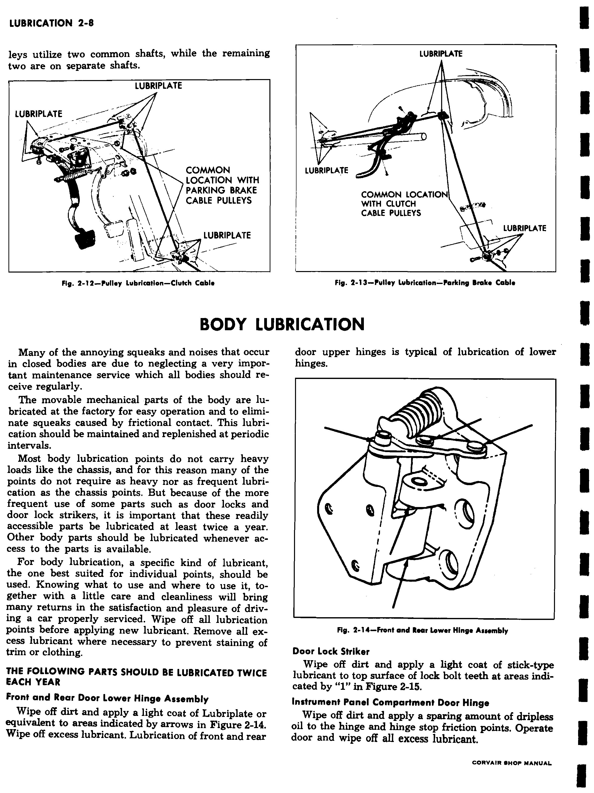
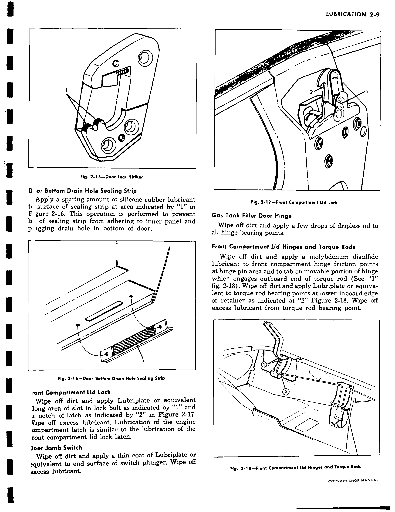
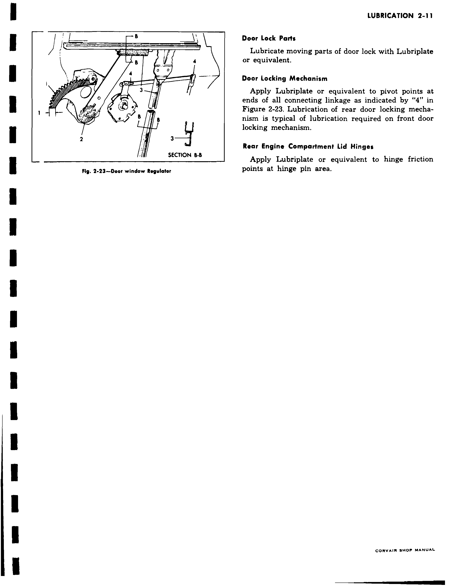
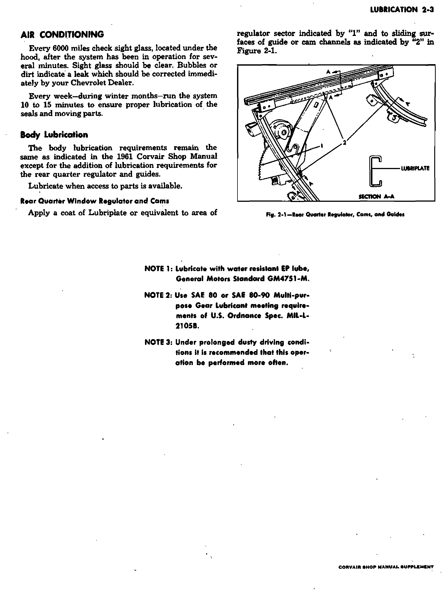

# Lubrication — 1963 Passenger Cars

The 1963 schedule in the factory supplement supersedes earlier intervals.
Unchanged passenger-car methods and body lubrication points come from the
1961 base manual. Intervals are guides; the factory calls for more frequent
service under prolonged dusty, heavy-duty, high-speed, or other adverse use.
Corvair 95 commercial service points are excluded.

Source files: `2-lubric-61.pdf` (physical pp. 1–11, combined pp. 130–140)
and `2-lubric-62-63.pdf` (physical pp. 1–3, combined pp. 637–639).
The base file's physical pp. 12–16 concern Corvair 95 or superseded
lubrication diagrams and are not used as the 1963 passenger-car schedule.

## Engine oil and filter

 **[PDF p.130](../page-images/p0130.png)** <!-- SOURCE id=base-1961 page=2-1 years=1961,1962,1963 scope=passenger -->

The base crankcase capacities are **4 qt.** for a refill, **½ qt.** extra for
an oil-filter change, and **5½ qt.** dry. Avoid spilling oil onto the engine
shrouding; the base manual warns that this may cause fumes in the passenger
compartment.

 **[PDF p.637](../page-images/p0637.png)** <!-- SOURCE id=supplement-1962-63 page=2-opening years=1963 scope=passenger -->

The engine leaves the factory with break-in oil. For operation at **60°F and
higher**, drain it after **500 miles** and refill with oil selected from the
factory viscosity chart. The earlier base procedure supplies the lower
temperature interval below.

 **[PDF p.131](../page-images/p0131.png)** <!-- SOURCE id=base-1961 page=2-2 years=1961,1962,1963 scope=passenger -->

When temperatures are **below 60°F**, the base break-in interval is **1,000
miles**. Maintain the correct level in either break-in period.

 **[PDF p.637](../page-images/p0637.png)** <!-- SOURCE id=supplement-1962-63 page=2-opening years=1963 scope=passenger -->

| Lowest anticipated temperature while oil is in crankcase | Single-viscosity oil | Multiviscosity oil |
| --- | --- | --- |
| 32°F | SAE 30 | SAE 10W-30 |
| −10°F | SAE 10W | SAE 10W-30 |
| Below −10°F | SAE 5W | SAE 5W-20 |

The supplement recommends oil labeled for **service MS** that also passes
car makers' tests or meets **GM 4745-M**. Check the dipstick frequently and
keep the level between **Add Oil** and **Full**. Do not overfill. Drain and
refill every **6,000 miles or 60 days**, whichever occurs first. Change the
filter element every **6,000 miles or six months**, whichever occurs first.
During prolonged dusty use, perform the oil and filter service more often.
When checking or adding oil, keep it off the engine shrouding.

### Change the oil-filter cartridge

 **[PDF p.133](../page-images/p0133.png)** <!-- SOURCE id=base-1961 page=2-4 years=1961,1962,1963 scope=passenger -->

1. Unscrew the cartridge-container center bolt and remove the cartridge.
2. Clean the container and remove the **old seal**. The manual warns that a
   retained old seal can block oil flow through the filter.
3. Install a new gasket in the filter-body casting and the new cartridge.
4. Tighten the center bolt to **9–15 ft. lb.** Clean up spilled oil; oil on
   the blower belt can cause slip and reduce generator operation and cooling.

The **1963 interval above** replaces the base manual's earlier filter interval.

## Cooling air, ventilation, and intake air

 **[PDF p.637](../page-images/p0637.png)** <!-- SOURCE id=supplement-1962-63 page=2-opening years=1963 scope=passenger -->

- **Engine oil cooler:** Every **12,000 miles**, remove its cover and brush
  or blow out accumulated dirt.
- **Crankcase ventilation valve:** At every oil change, test its function and
  replace it when necessary.
- **Air cleaners:** Turbo-Air and Super Turbo-Air engines have **two**, one
  for each carburetor; the turbocharged engine has **one**. Every **6,000
  miles**, remove each element from its screen, wash it in a nonchlorinated
  solvent such as kerosene, and squeeze it dry. Dip it in engine oil and
  squeeze out the excess. Wrap it in a clean, dry cloth and squeeze again.
  **Do not shake or wring the element.** Service more often in prolonged dust.

## Electrical and fuel-system service

 **[PDF p.637](../page-images/p0637.png)** <!-- SOURCE id=supplement-1962-63 page=2-opening years=1963 scope=passenger -->

- **Battery:** Every **6,000 miles**, clean and oil terminals and the felt
  washer. Clean the battery top with diluted ammonia or soda solution, then
  flush with clean water. Check charge especially in freezing weather; an
  undercharged battery may freeze and break.
- **Generator:** Every **12,000 miles**, fill both oilers with light engine
  oil. Do not over-oil the oiler nearest the fan belt.

 **[PDF p.638](../page-images/p0638.png)** <!-- SOURCE id=supplement-1962-63 page=2-2 years=1963 scope=passenger -->

- **Distributor cam lubricator:** Rotate it **180° every 12,000 miles**;
  replace it every **24,000 miles**.
- **Standard carburetor-inlet fuel filters:** Replace only if flooding occurs.
- **Spyder fuel filter:** The separate unit on the air-cleaner support bracket
  to the left of the air cleaner is replaced every **12,000 miles**. Clean
  the carburetor-inlet screen at the same interval.

 **[PDF p.134](../page-images/p0134.png)** <!-- SOURCE id=base-1961 page=2-5 years=1961,1962,1963 scope=passenger -->

For a distributor equipped with the base-style hinge-cap oiler, fill that
oiler with light engine oil every **1,000 miles** (fig. 2-6). Add a few drops
of light engine oil to the breaker-lever pivot during distributor service.
The earlier **5,000-mile cam-greasing** instruction is superseded by the
supplement's cam-lubricator schedule above.

## Chassis, steering, bearings, and universal joints

 **[PDF p.638](../page-images/p0638.png)** <!-- SOURCE id=supplement-1962-63 page=2-2 years=1963 scope=passenger -->

Every **6,000 miles or six months**, lubricate passenger-car chassis points
with water-resistant EP lubricant meeting **GM 4751-M** (supplement Note 1).
The passenger-car list has **four front-suspension fittings**, **four
steering-linkage fittings**, and **one clutch cross-shaft fitting** where a
manual clutch is fitted. The different Corvair 95 fitting counts do not apply.

- **Steering gear:** Every **6,000 miles or six months**, remove the filler
  plug and check that lubricant reaches its hole; add steering-gear lubricant
  as needed. The base manual says its factory all-season fill need not be
  drained for seasonal changes.
- **Universal joints:** Every **30,000 miles**, clean and repack with
  high-melting-point wheel-bearing lubricant.
- **Front wheel bearings:** Every **30,000 miles**, clean and repack with
  high-melting-point wheel-bearing lubricant and replace grease seals.

 **[PDF p.135](../page-images/p0135.png)** <!-- SOURCE id=base-1961 page=2-6 years=1961,1962,1963 scope=passenger -->

The base bearing method removes the wheel and hub and cleans **all old
lubricant** from bearings and hub before repacking. Do not mix bearing
lubricants, pack the cavity between inner and outer bearings, or pack the hub
cap: excess can reach the brake drums and linings. Use a high-melting-point,
water-resistant front-wheel-bearing lubricant. Use the
[1963 bearing adjustment](03-suspension.md#front-wheel-bearing-adjustment).

## Transmission, rear axle, and controls

 **[PDF p.638](../page-images/p0638.png)** <!-- SOURCE id=supplement-1962-63 page=2-2 years=1963 scope=passenger -->

### Powerglide fluid level

Every **6,000 miles**, check the dipstick at the right front of the engine
compartment with the engine idling, selector in **Neutral**, parking brake
set, and transmission at operating temperature. Add small amounts of Type
**A** automatic-transmission fluid bearing **AQ-ATF**, a number, and suffix
**A**, checking after each addition. Fill to the dipstick's **Full** mark;
**do not overfill**. The distance from **Add Oil** to **Full** represents
**1 pint** of fluid. On cars equipped with a transmission oil cooler, clean
it every **12,000 miles** through the battery access door.

 **[PDF p.136](../page-images/p0136.png)** <!-- SOURCE id=base-1961 page=2-7 years=1961,1962,1963 scope=passenger -->

The base lubrication prose gives a dry fill range that differs from the
base Section 12 approximate figure. This chapter does not promote either
to a precise 1963 dry-fill quantity; establish the final level by the
supplement's dipstick procedure.
<!-- NEEDS REVIEW: Base Lubrication p. 2-7 prints 13–14 pints dry, while base Specifications p. 12-10 says approximately 13 pints; resolve the distinction before indexing a 1963 Powerglide dry-fill quantity. -->

### Manual transmission and rear axle

 **[PDF p.638](../page-images/p0638.png)** <!-- SOURCE id=supplement-1962-63 page=2-2 years=1963 scope=passenger -->

Every **6,000 miles**, check rear-axle lubricant **at operating temperature**
and keep it level with the filler-plug hole. If low, also check the three-
or four-speed transmission. The supplement directs the manual-transmission
service to this rear-axle method. Use **SAE 80 or SAE 80-90 multipurpose gear
lubricant** meeting **MIL-L-2105B** (supplement Note 2). The 1961 manual's
drain interval and combined refill quantity are superseded by later guidance
and must not be used for 1963.

### Shift linkage, parking brake, and clutch cables

 **[PDF p.638](../page-images/p0638.png)** <!-- SOURCE id=supplement-1962-63 page=2-2 years=1963 scope=passenger -->

- Every **12,000 miles**, pull back the rubber boot around the manual
  transmission connector and lubricate the connector and surrounding area
  with Note 1 lubricant. Remove the tunnel cover and lubricate the gearshift
  lever ball and socket with Lubriplate.
- Every **12,000 miles**, lubricate parking-brake and clutch pulleys under the
  dash. Remove the tunnel cover and lubricate pulleys and cable bearing
  points with Note 1 lubricant; lubricate the gearshift ball and socket at
  the same time.

 **[PDF p.137](../page-images/p0137.png)** <!-- SOURCE id=base-1961 page=2-8 years=1961,1962,1963 scope=passenger -->

Factory figs. 2-12 and 2-13 locate the clutch- and parking-brake-cable
pulleys. Their **1961 mileage interval is superseded** by the supplement's
12,000-mile schedule above.

## Brake master cylinder

 **[PDF p.638](../page-images/p0638.png)** <!-- SOURCE id=supplement-1962-63 page=2-2 years=1963 scope=passenger -->

Every **6,000 miles**, check fluid level and maintain it **¼″ below the
opening** with **G.M. Hydraulic Brake Fluid Super No. 11**. This replaces the
base manual's earlier check interval and level instruction.

## Air conditioning, if equipped

 **[PDF p.639](../page-images/p0639.png)** <!-- SOURCE id=supplement-1962-63 page=2-3 years=1963 scope=passenger -->

Every **6,000 miles**, after running the system several minutes, check the
under-hood sight glass. It should be clear; the factory describes bubbles
or dirt as indicating a leak requiring correction. During winter, run the
system **10–15 minutes each week** to lubricate seals and moving parts.

## Body lubrication

 **[PDF p.137](../page-images/p0137.png)** <!-- SOURCE id=base-1961 page=2-8 years=1961,1962,1963 scope=passenger -->

The supplement expressly retains the base body-lubrication requirements,
adding the rear-quarter regulator below. Before applying lubricant, wipe
each point clean and remove excess afterward to protect trim and clothing.
The base schedule services readily accessible parts **twice each year** and
other points whenever access is available.

### Twice-yearly body points

| Point | Factory lubricant and application | Source |
| --- | --- | --- |
| Front and rear door lower hinges | Light coat of Lubriplate or equivalent on the indicated hinge areas; wipe excess | Fig. 2-14, p. 2-8 |
| Door-lock striker | Light coat of stick-type lubricant on top of lock-bolt teeth | Fig. 2-15, p. 2-8 |
| Instrument-panel compartment door hinge and stop | Small amount of dripless oil on friction points; operate door and wipe excess | p. 2-8 |

 **[PDF p.138](../page-images/p0138.png)** <!-- SOURCE id=base-1961 page=2-9 years=1961,1962,1963 scope=passenger -->

| Point | Factory lubricant and application |
| --- | --- |
| Door bottom drain-hole sealing strip | Sparing silicone-rubber lubricant on strip surface to prevent adhesion and blocked drain |
| Front compartment lid lock | Lubriplate or equivalent on lock-bolt slot and latch notch; engine-compartment latch is similar |
| Door-jamb switch | Thin Lubriplate coat on end of plunger |
| Fuel-tank filler door hinge | A few drops of dripless oil on all hinge bearing points |
| Front compartment lid hinges | Molybdenum-disulfide lubricant at hinge-pin friction points and torque-rod engaging tab |
| Front compartment torque-rod bearings | Lubriplate or equivalent at lower inboard retainer edge; wipe excess |

 **[PDF p.139](../page-images/p0139.png)** <!-- SOURCE id=base-1961 page=2-10 years=1961,1962,1963 scope=passenger -->

| Point | Factory lubricant and application |
| --- | --- |
| Folding rear-seat support links, where fitted | A few drops of dripless oil at bearing points; operate seat, remove excess |
| Folding rear-seat filler-panel hinge, where fitted | A few drops of dripless oil at friction areas; wipe excess |
| Door weatherstrip | Sparing silicone-rubber lubricant on the weatherstrip surface |
| Engine-compartment lid support | Lubriplate or equivalent on channel portions |

### Body points serviced when accessible

 **[PDF p.139](../page-images/p0139.png)** <!-- SOURCE id=base-1961 page=2-10 years=1961,1962,1963 scope=passenger -->

- **Outside door handle:** Light Lubriplate coat on the end of the lock-cylinder
  shaft where it contacts the bell crank (fig. 2-22).
- **Door-window regulator and cams:** Lubriplate on the regulator sector,
  arm-bearing surface, and sliding guide-channel and cam surfaces (fig. 2-23).

 **[PDF p.140](../page-images/p0140.png)** <!-- SOURCE id=base-1961 page=2-11 years=1961,1962,1963 scope=passenger -->

- **Door lock and linkages:** Lubriplate on moving lock parts and at the
  pivot points at both ends of the connecting linkage (fig. 2-23).
- **Rear engine-compartment lid hinges:** Lubriplate on hinge-pin friction
  points.

 **[PDF p.639](../page-images/p0639.png)** <!-- SOURCE id=supplement-1962-63 page=2-3 years=1963 scope=passenger -->

- **Rear-quarter window regulator and cams, where fitted:** Lubriplate or
  equivalent on the regulator sector marked **1** and sliding surfaces of
  guide or cam channels marked **2** in supplement fig. 2-1.

