# Suspension — 1963 Passenger Cars

The 1962–63 supplement explicitly carries forward the passenger-car design
and service operations in the 1961 manual except where it revises rear
alignment, steering-knuckle service, ball-joint lubrication, and front-wheel
bearings. This chapter integrates those updates with the base passenger-car
procedures. Corvair 95 procedures on supplement pp. 3-3 and 3-5 and in the
base manual's commercial suspension and wheel sections are excluded; the
base manual's general troubleshooting table is retained.

Source files: `3-suspen-61.pdf` (base, physical pp. 1–38, combined pp.
146–183) and `3-suspen-62-63.pdf` (supplement, physical pp. 1–5,
combined pp. 640–644).

## Suspension layout and 1963 changes

 **[PDF p.146](../page-images/p0146.png)** <!-- SOURCE id=base-1961 page=3-1 years=1961,1962,1963 scope=passenger -->

The passenger car has short–long-arm independent front suspension with
spherical joints between the control arms and steering knuckles. Strut rods
control brake dive and acceleration loads. Independently sprung rear control
arms and universal-jointed axle shafts support the rear suspension.

 **[PDF p.640](../page-images/p0640.png)** <!-- SOURCE id=supplement-1962-63 page=3-opening years=1963 scope=passenger -->

The 1963 ball-stud assemblies have a **large rubber boot at the stud end**.
Their lubrication interval is **6,000 miles or six months**, whichever comes
first. Clean, repack, and adjust front-wheel bearings every **30,000 miles**;
service sooner in extreme dust or other adverse conditions. These replace
the earlier intervals. See [Lubrication](02-lubrication.md#chassis-steering-bearings-and-universal-joints)
for materials and related service.

## Front-wheel bearing adjustment

 **[PDF p.147](../page-images/p0147.png)** <!-- SOURCE id=base-1961 page=3-2 years=1961,1962,1963 scope=passenger -->

The supplement retains the base procedure's steps 1–8 but replaces its step
2 tightening torque. The base text warns against repacking or readjusting
new-car bearings as part of new-car conditioning because it interferes with
their initial mating.

 **[PDF p.640](../page-images/p0640.png)** <!-- SOURCE id=supplement-1962-63 page=3-opening years=1963 scope=passenger -->

1. Raise and secure the front of the car. Remove the hub cap and dust cap,
   then remove the spindle cotter pin.
2. While rotating the wheel, tighten the adjusting nut to **100 in. lb.**
   The base manual's earlier tightening value is superseded for 1963.
3. Back off the nut **one flat** (**1/6 turn**).
4. Insert a cotter pin if the nut slot and spindle hole align. If not, back
   off the nut no more than an additional **½ flat** (**1/12 turn**) to align
   them, then insert the pin.
5. Spin the wheel to confirm free rotation. Spread and bend the cotter pin
   ends to lock it. The base manual calls for **zero preload** and **.000″ to
   .004″ end play** when properly adjusted.
6. Install dust cap and hub cap. Repeat on the other side if needed, then
   lower the car.

## Alignment preparation and rear toe-in

 **[PDF p.148](../page-images/p0148.png)** <!-- SOURCE id=base-1961 page=3-3 years=1961,1962,1963 scope=passenger -->

Use the alignment machine maker's operating instructions. The car must be
level at curb weight, with correct tire pressures and no passengers. The
base manual defines curb height as a full fuel tank, standard equipment in
the front compartment, and tires at correct pressure. Before aligning,
check and correct:

1. Loose or improperly adjusted steering gear or loose gear housing.
2. Spherical-joint play or wear and loose tie-rod or steering connections.
3. Front and rear coil-spring height.
4. Underinflated, overinflated, or unbalanced tires.
5. Wheel-bearing adjustment and shock-absorber operation.

 **[PDF p.640](../page-images/p0640.png)** <!-- SOURCE id=supplement-1962-63 page=3-opening years=1962,1963 scope=passenger -->

The supplement changes **rear toe-in to ⅛″–⅜″ total**. For front alignment,
use the explicit 1963 column in [Specifications](12-specifications.md#front-wheel-alignment-at-curb-weight);
the source scan's 1963 front toe-in fraction remains under review there.

### Front alignment adjustments carried forward

 **[PDF p.149](../page-images/p0149.png)** <!-- SOURCE id=base-1961 page=3-4 years=1961,1962,1963 scope=passenger -->

- **Camber:** Loosen the upper control-arm support shaft bolts at the front
  crossmember. Add or remove equal shims at the front and rear attachments,
  then retighten. Adding shims decreases positive camber. Unequal shimming
  also changes caster; use it only if strut-rod adjustment has exhausted its
  threads or disturbed spring seating, and recheck camber afterward. Never
  heat or bend a steering knuckle to correct camber.
- **Caster:** Adjust the two nuts at the rear of the strut rod. Lengthening
  the rod increases caster; shortening it decreases caster. Check that the
  coil spring remains seated without rubbing its tower.
- **Steering-axis inclination:** Treat this as a check of steering-knuckle
  geometry. A bent knuckle must be replaced, after which caster, camber, and
  toe-in must be rechecked.
- **Front toe-in:** Center the steering gear at its high point and keep the
  steering wheel straight. Loosen both clamps on each tie-rod adjusting
  sleeve, turn the sleeve to adjust toe, and retighten the clamps. The 1961
  toe-in number is superseded; the 1963 value is recorded in
  [Specifications](12-specifications.md#front-wheel-alignment-at-curb-weight).

 **[PDF p.150](../page-images/p0150.png)** <!-- SOURCE id=base-1961 page=3-5 years=1961,1962,1963 scope=passenger -->

The base manual checks cornering-wheel relationship and calls for replacement
of the affected steering arm when the relationship is out of range. Use the
[1963 relationship confirmed by GM's revised chassis sheet](04-steering.md#cornering-wheel-relationship)
in place of the base angles. Keep only
standard equipment and the spare in the front compartment and fill the fuel
tank before final alignment.

### Rear alignment adjustment carried forward

 **[PDF p.150](../page-images/p0150.png)** <!-- SOURCE id=base-1961 page=3-5 years=1961,1962,1963 scope=passenger -->

Check rear toe with correct tire pressures. On drive-on equipment, back the
car onto the rack; a measurement made from the rear of the tires reads toe-in
as toe-out. A tram gauge is another option. Loosen the rear engine support
and add or remove transmission-front shims in **matched pairs**, one on each
side. Adding shims increases rear toe-in; removing them decreases it. Adjust
to the **1962–63 overall range above**, then secure the support. The rear
camber check value comes from the 1963 column in
[Specifications](12-specifications.md#rear-wheel-alignment-at-curb-weight);
there is no rear camber adjustment. An incorrect reading calls for checking
control-arm and crossmember damage or body alignment.

## Passenger-car steering-knuckle service

 **[PDF p.641](../page-images/p0641.png)** <!-- SOURCE id=supplement-1962-63 page=3-2 years=1962,1963 scope=passenger -->

The factory recommends a twin-post hoist that keeps the front coil spring
compressed while the wheel and knuckle remain accessible. With a frame
hoist, support the lower control arm using an adjustable jackstand so the
spring and arm remain at curb height.

### Remove the steering knuckle

1. Raise the car and support the lower control arm as above.
2. Remove hub cap, dust cap, cotter pin, bearing-adjusting nut and washer;
   remove the wheel, tire, hub, and brake-drum assembly from the spindle.
3. Disconnect brake-shoe return springs and retaining clips, then remove
   the shoes. **Keep brake shoes clean and dry.**
4. Remove the brake anchor pin and the two bolts securing the backing plate
   and steering arm to the knuckle.
5. Withdraw the steering arm and backing plate. Wire the backing plate to
   sheet metal; **do not disconnect the brake line**.
6. Remove the upper ball-stud cotter pin and nut. Strike the knuckle's upper
   boss while backing it with another hammer to loosen the stud.
7. Remove the lower ball-stud cotter pin and nut. Free the lower stud in the
   same way, then lift out the knuckle.

### Install the steering knuckle

1. Set the knuckle on the lower ball stud. Tighten its nut to **30–40 ft. lb.**
   and install a new cotter pin.
2. Insert the upper ball stud. Tighten its nut to **30–40 ft. lb.** and
   install a new cotter pin.
3. Assemble the brake backing plate to the knuckle with its anchor bolt.
4. Assemble the steering arm to the knuckle; pass its bolts and locknuts
   through backing plate, knuckle, and arm. **The factory sources disagree
   on the tightening torque; resolve the flagged conflict before tightening.**
5. Tighten the brake anchor bolt to **60–85 ft. lb.**
6. Install brake shoes, retaining clips, and return springs on the backing
   plate and wheel cylinder.
7. Install brake drum, wheel, tire, and hub assembly over the spindle.
8. Install washer and bearing-adjusting nut. Use the **1963 bearing procedure
   above**, then fit a new cotter pin, dust cover, and hub cap.
9. Remove the jackstand and lower the car.
10. Recheck and adjust front alignment as needed.

<!-- NEEDS REVIEW: Supplement Suspension p. 3-2 prints 40–50 ft. lb. for steering-arm bolts/locknuts, but supplement Specifications p. 12-2 prints 29–43 ft. lb. for steering arm to steering knuckle. Both are passenger-car figures; no definitive 1963 torque is indexed. -->

### Inspect lower spherical joints

 **[PDF p.641](../page-images/p0641.png)** <!-- SOURCE id=supplement-1962-63 page=3-2 years=1961,1962,1963 scope=passenger -->

The unloaded lower joint is a loose fit by design. The supplement expressly
applies this wear check to **1961–63 Corvair 500, 700, and 900** passenger cars.

1. Support vehicle weight on the wheels or hubs.
2. On each side, measure from the tip of the lubrication fitting to the
   upper surface of the ball stud with a micrometer or caliper; record it.
3. Support vehicle weight at the outer end of each lower control arm, freeing
   the wheels or hubs, and repeat the measurements.
4. If the difference on either side exceeds **3⁄32″ (.09375″)**, both lower
   joints are excessively worn and should be replaced.

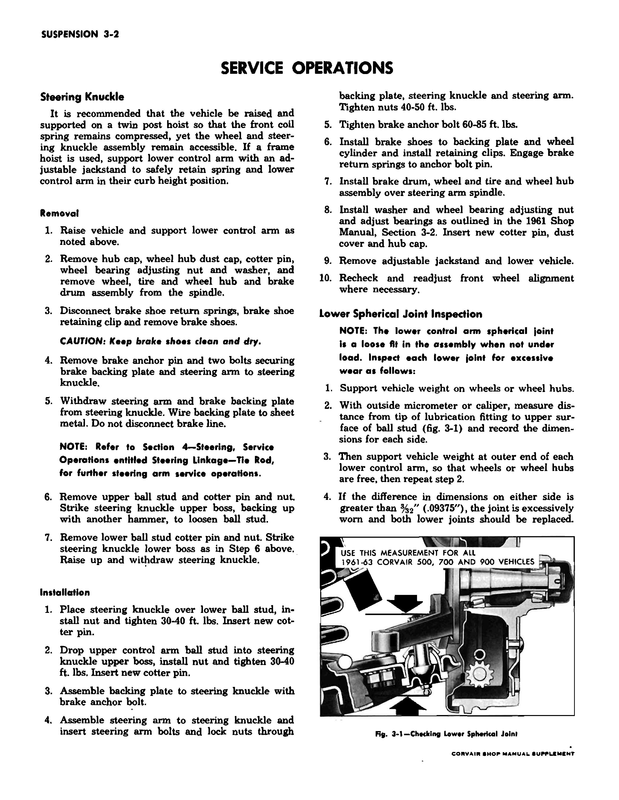

### Inspect upper spherical joints

 **[PDF p.152](../page-images/p0152.png)** <!-- SOURCE id=base-1961 page=3-7 years=1961,1962,1963 scope=passenger -->

The supplement carries forward the base manual's upper-joint rotational
torque check. Support the car's weight at the outer end of the lower control
arm, then remove the wheel. Remove the upper ball-stud cotter pin and nut and
separate the stud from the knuckle with factory tool **J-6627**. Raise the
upper arm clear of the knuckle, put a nut on the stud, and measure the torque
needed to turn the stud in its joint. The factory gives **2 ft. lb. minimum**;
for a well-lubricated joint suspected of being too tight, **5 ft. lb. maximum**.
If upper-joint wear is found, replace both upper and lower joints as the base
procedure directs. Lower the arm, reconnect the stud to the knuckle, fit its
nut and a new cotter pin, reinstall the wheel, and lower the car. Follow the
[steering-knuckle procedure](#passenger-car-steering-knuckle-service) for
ball-stud attachment torque.

 **[PDF p.153](../page-images/p0153.png)** <!-- SOURCE id=base-1961 page=3-8 years=1961,1962,1963 scope=passenger -->

If both upper joints pass, inspect the lower joints with the **supplement's
revised measurement procedure above**. The base manual adds two diagnostic
checks: a liner that partly or fully blocks the cleaned lubrication opening
signals deterioration, and abnormal pressure needed to force lubricant
through the joint can indicate that its lubrication grooves have worn away.
The base also describes a lower-stud fastening check with a looseness
threshold above the supplement's **30–40 ft-lb** installation torque,
so it cannot classify a properly installed 1963 stud.
Use the supplement's explicit **1961–63 displacement check** above for lower-joint
wear; do not use the old torque-threshold diagnostic on a 1963 car.
<!-- RESOLVED SUPERSESSION: Base Section 3 p.3-8 lower-stud looseness threshold (<45 ft-lb) is incompatible with the supplement's 30–40 ft-lb installation torque. Supplement Section 3 p.3-2 expressly applies a 3/32-in. displacement wear check to 1961–63 passenger cars. -->

### Check front riding height and spring sag

 **[PDF p.153](../page-images/p0153.png)** <!-- SOURCE id=base-1961 page=3-8 years=1961,1962,1963 scope=passenger -->

1. Put the car on a smooth, level floor at curb weight, with a full fuel tank
   and nothing but the spare tire in the front compartment.
2. Bounce and rock the car several times; let it settle.
3. Measure vertically from the floor to the bottom of the rocker panel at a
   point **27″ behind the front-wheel centerline**. The factory passenger-car
   height is **9⅜″ ± ½″**. Repeat on the other side; side-to-side difference
   should be within **½″**.
4. Replace sagged coil springs to correct height. The factory says these
   springs lack flat ends and **must not be shimmed**. Check the rear springs
   as well so overall trim stays within **½″**.

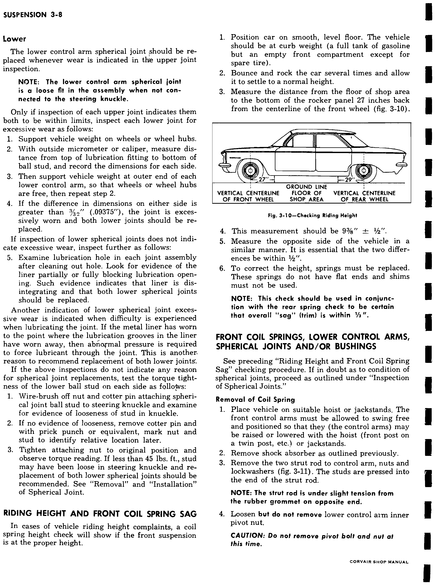

### Remove the front coil spring and lower arm

 **[PDF p.153](../page-images/p0153.png)** <!-- SOURCE id=base-1961 page=3-8 years=1961,1962,1963 scope=passenger -->

1. Put the car on a suitable hoist or stands so the front control arms can
   swing freely while being raised and lowered under control. Remove the
   [front shock absorber](#remove-and-install-the-front-shock-absorber).
2. Remove the two nuts and lockwashers fastening the strut rod to the lower
   arm. Its studs are pressed into the rod; the rear rubber grommet leaves
   slight tension in the rod.
3. Loosen the lower-arm inner pivot nut, **but do not remove its bolt yet**.

 **[PDF p.154](../page-images/p0154.png)** <!-- SOURCE id=base-1961 page=3-9 years=1961,1962,1963 scope=passenger -->

4. Put a jackstand or hoist post beneath the inner end of the arm, at the
   bushing, and take up slight spring compression.
5. Remove the inner pivot nut and lockwasher, then tap out the pivot pin.
6. **Lower the support slowly until spring compression is fully released.**
   Withdraw the spring. The factory suggests a bar through the control arm
   into the spring tower to retain it until free; otherwise keep clear of the
   suspension while it unloads.
7. To remove the lower arm, remove the lower ball-stud cotter pin and nut,
   then tap the arm free of the steering knuckle.

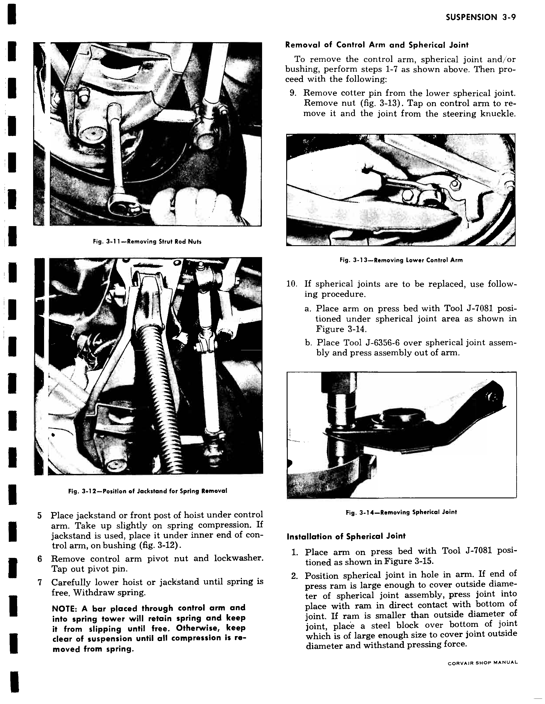

### Renew the lower joint and arm bushing

 **[PDF p.154](../page-images/p0154.png)** <!-- SOURCE id=base-1961 page=3-9 years=1961,1962,1963 scope=passenger -->

With the arm on the press bed and **J-7081** beneath the joint area, use
**J-6356-6** over the old spherical joint to press it out. Support the arm
again on **J-7081** and press the new joint into its hole, loading the full
outside diameter of the joint. If the press ram is narrower, interpose a
steel block large enough to cover the joint and withstand the press load.

 **[PDF p.155](../page-images/p0155.png)** <!-- SOURCE id=base-1961 page=3-10 years=1961,1962,1963 scope=passenger -->

Press until the joint shoulder contacts the arm flange. Put the arm back
with the ball stud through the steering knuckle and fit its nut.

 **[PDF p.641](../page-images/p0641.png)** <!-- SOURCE id=supplement-1962-63 page=3-2 years=1962,1963 scope=passenger -->

Tighten the lower ball-stud nut to **30–40 ft. lb.** and fit a new cotter pin.

 **[PDF p.155](../page-images/p0155.png)** <!-- SOURCE id=base-1961 page=3-10 years=1961,1962,1963 scope=passenger -->

For bushing replacement, the base manual shows the press-tool arrangement
in fig. 3-16. Press or drive the old bushing from the end **without** the
large collar on its outer shell. The new lower-arm bushing enters from the
**front side** of the arm.

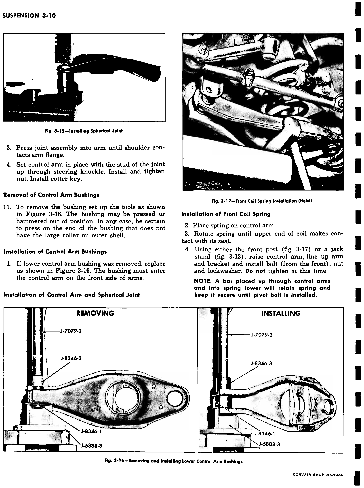

### Refit the front coil spring and arm

 **[PDF p.155](../page-images/p0155.png)** <!-- SOURCE id=base-1961 page=3-10 years=1961,1962,1963 scope=passenger -->

Put the spring on the lower arm and rotate it until its upper end contacts
its seat. Raise the supported arm slowly, align it with the inner bracket,
and insert the pivot bolt from the front with its lockwasher and nut. **Do
not tighten the pivot yet.** A retaining bar through the arm into the spring
tower keeps the spring positioned until the bolt is in place.

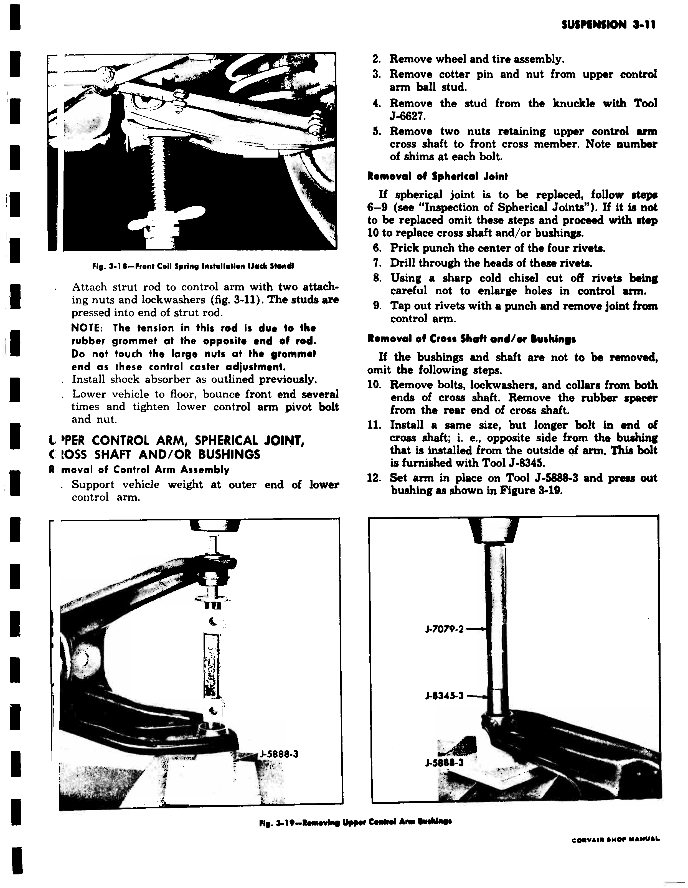

 **[PDF p.156](../page-images/p0156.png)** <!-- SOURCE id=base-1961 page=3-11 years=1961,1962,1963 scope=passenger -->

Fasten the strut rod to the lower arm with its two nuts and lockwashers.
Leave the large nuts at the rod's grommet end alone; those set caster.
Install the shock, lower the car, bounce the front suspension several times
to settle it, then tighten the lower pivot.

 **[PDF p.625](../page-images/p0625.png)** <!-- SOURCE id=supplement-1962-63 page=12-2 years=1962,1963 scope=passenger -->

The passenger-car lower-arm pivot-bolt torque is **90–120 ft. lb.**

### Upper control arm, joint, cross shaft, and bushings

 **[PDF p.156](../page-images/p0156.png)** <!-- SOURCE id=base-1961 page=3-11 years=1961,1962,1963 scope=passenger -->

**Remove the arm:** Support vehicle weight at the outer end of the lower
arm and remove the wheel. Remove the upper ball-stud cotter pin and nut;
separate the stud from the knuckle with **J-6627**. Remove the two nuts
holding the upper-arm cross shaft to the front crossmember. **Record the
number of alignment shims at each attachment** so they can be restored.

For **joint replacement**, center-punch and drill the heads of its four
rivets. Cut off the rivets with a sharp chisel without enlarging the arm
holes, punch them out, and remove the old joint. For **cross-shaft or
bushing replacement**, remove the bolts, lockwashers, and collars at both
shaft ends and the rubber spacer at the rear. The factory uses the longer
bolt supplied with **J-8345**, support **J-5888-3**, driver **J-7079-2**,
and **J-8345-3** to press out the bushings in sequence (fig. 3-19).

 **[PDF p.157](../page-images/p0157.png)** <!-- SOURCE id=base-1961 page=3-12 years=1961,1962,1963 scope=passenger -->

**Install bushings and shaft:** Support the arm on **J-5888-3**. Use
**J-7079-2** and **J-8345-2** to press in the bushing that enters from the
**inside** first. Insert the cross shaft; invert the arm and press in the
second bushing from the **outside**, with **J-8345-1** supporting the arm
against flexing. The shaft should turn by hand. Replace the rear rubber
spacer, collars, lockwashers, and end bolts, but leave those bolts loose
until the suspension is settled.

**Install a replacement joint:** Put it against the upper face of the arm
and fasten it with the four **special alloy bolts and nuts supplied with the
replacement part**. The factory warns to use only those supplied alloy
bolts. Tighten the nuts to **20–25 ft. lb.**

**Refit the arm:** Check that its attaching studs are in place. Put back
the same shim count at each crossmember attachment and fit its nuts and
lockwashers. Fit a new rubber seal to the joint stud, insert the stud in
the knuckle, fasten it, and install a new cotter pin. Refit the wheel,
lower the car, and bounce the front end to center the bushings. Tighten
the cross-shaft **end bolts** to **35–40 ft. lb.** If the joint changed or
the shim counts could not be preserved, recheck caster and camber.

 **[PDF p.625](../page-images/p0625.png)** <!-- SOURCE id=supplement-1962-63 page=12-2 years=1962,1963 scope=passenger -->

The separate **cross-shaft-to-crossmember nuts** take **38–50 ft. lb.**,
and the upper ball-stud-to-knuckle nut takes **30–40 ft. lb.**, followed by
a new cotter pin. These passenger-car supplement torques govern the refit.

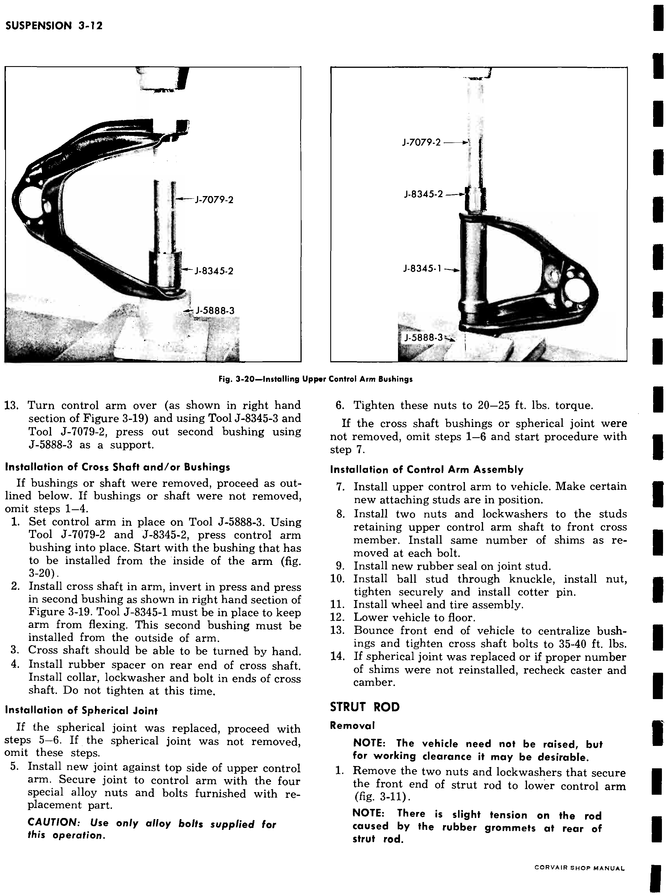

### Remove and install a front strut rod

 **[PDF p.157](../page-images/p0157.png)** <!-- SOURCE id=base-1961 page=3-12 years=1961,1962,1963 scope=passenger -->

The car may remain on the ground if there is sufficient working room. Remove
the two front-end nuts and lockwashers where the strut rod meets the lower
arm. The rod remains under slight tension from its rear rubber grommets.

 **[PDF p.158](../page-images/p0158.png)** <!-- SOURCE id=base-1961 page=3-13 years=1961,1962,1963 scope=passenger -->

Remove the nut, washer, spacer, and grommet at the rod's rear end. Withdraw
the rod from the crossmember bracket, then remove the other grommet, spacer,
washer, and nut. The factory says the rod's pressed-in studs can be replaced
by driving them out and in.

To install, put the forward nut about **1″ from the front end of the
threads**, followed by its washer, spacer, and grommet. Pass the rod through
the crossmember bracket; fit the remaining grommet, spacer, washer, and nut
and snug the rear nut. Reattach the rod to the lower arm with both lockwashers
and nuts. Lower the car if raised, then [reset caster](#front-alignment-adjustments-carried-forward)
and bend the locking washer over two sides of its nut.

 **[PDF p.625](../page-images/p0625.png)** <!-- SOURCE id=supplement-1962-63 page=12-2 years=1962,1963 scope=passenger -->

The passenger-car torque chart specifies **38–50 ft. lb.** for the front
studs and **50–70 ft. lb.** for the rear nut. Recheck the final caster value
against the [1963 alignment table](12-specifications.md#front-wheel-alignment-at-curb-weight).

### Remove and install the front suspension crossmember

 **[PDF p.158](../page-images/p0158.png)** <!-- SOURCE id=base-1961 page=3-13 years=1961,1962,1963 scope=passenger -->

The crossmember can be taken out with the front suspension, wheels, and
brakes attached or after those components are removed. On a bench, spring
removal needs controlled compression and slow release; the factory mentions
large C-clamps or other suitable means.

1. Raise and support the car so the front suspension hangs free.
2. Disconnect both brake pipes from their hoses and remove the hoses from
   the body brackets. Remove the cotter pins and nuts connecting the inner
   tie-rod ends to the relay rod.
3. Support the crossmember from below with a hoist post or another device
   that controls its lowering. Remove its **six body attachment bolts, three
   on each side**; one on each side passes through a strut-rod bracket.

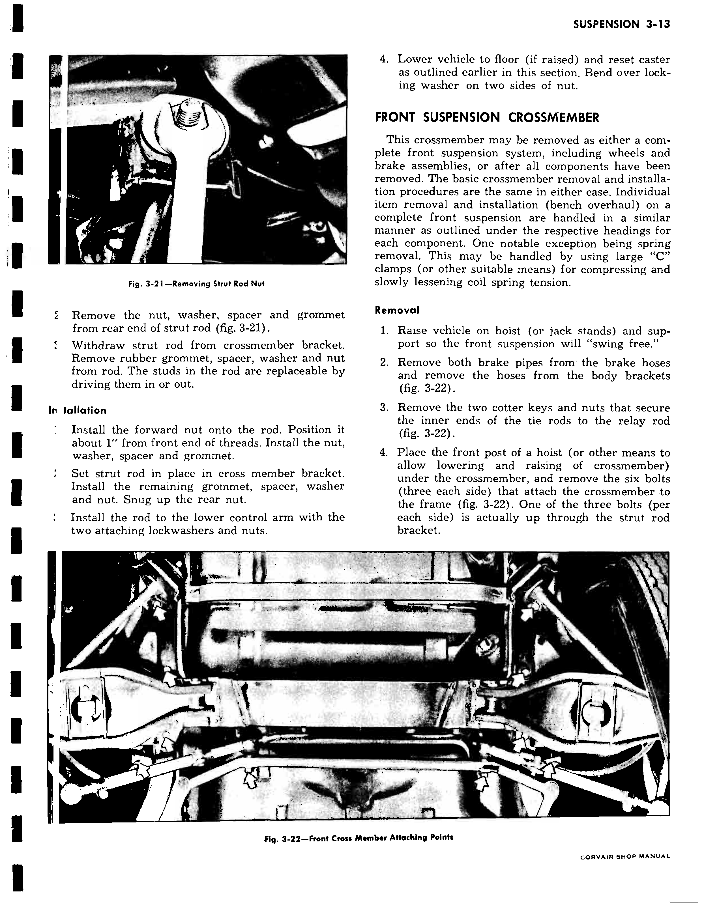

 **[PDF p.159](../page-images/p0159.png)** <!-- SOURCE id=base-1961 page=3-14 years=1961,1962,1963 scope=passenger -->

4. Restrain the crossmember against slipping from its support and lower it
   to the floor. If a captive body nut is damaged, use the body-repair
   procedure in Section 10.
5. To reinstall, raise it into place. Align holes with a tapered punch and
   start all six bolts **before tightening any one of them**.
6. Remove the lifting support. Reconnect the tie-rod studs to the relay rod
   with their nuts and cotter pins. Attach the brake hoses to the body
   brackets and brake pipes to the hoses. **Bleed the brakes** and route the
   hoses as directed in factory Section 5, Brakes.
   Lower the car.

Use the passenger-car front and rear crossmember-bolt torque rows in
[Specifications](12-specifications.md#suspension-bolt-torque). The factory
diagram identifies the fastening points; the torque table separates front
from rear bolts.

## Rear suspension service

### Rear shock absorber and spring-load support

 **[PDF p.159](../page-images/p0159.png)** <!-- SOURCE id=base-1961 page=3-14 years=1961,1962,1963 scope=passenger -->

The rear shock is mounted like the front shock, but it **restrains the rear
spring's extension**. Do not remove it while the rear arm and wheel are
unsupported: the spring can drive the arm down and inward and shift a car
resting on supports. Use a drive-on hoist or support the body at the side
rails just ahead of the rear wheel openings. If the wheels hang free, put a
floor jack under the tire and raise the wheel back to its normal position
before removing the shock. Then follow the [front shock removal steps](#remove-and-install-the-front-shock-absorber).
For installation, follow the [front shock installation steps](#remove-and-install-the-front-shock-absorber)
while controlling rear-arm and spring load.

### Check rear riding height

 **[PDF p.159](../page-images/p0159.png)** <!-- SOURCE id=base-1961 page=3-14 years=1961,1962,1963 scope=passenger -->

At curb weight on a smooth, level floor, with full fuel and only the spare
in the front compartment, bounce the rear of the car and let it settle.
Measure from the floor to the bottom of the rocker panel **29″ ahead of the
rear-wheel centerline** (fig. 3-23). Factory rear height is **9″ ± ½″**;
the sides must agree within **½″**. Correct sag with replacement springs,
**not shims**. Check front and rear trim together; the base manual specifies
overall sag within **½″**.

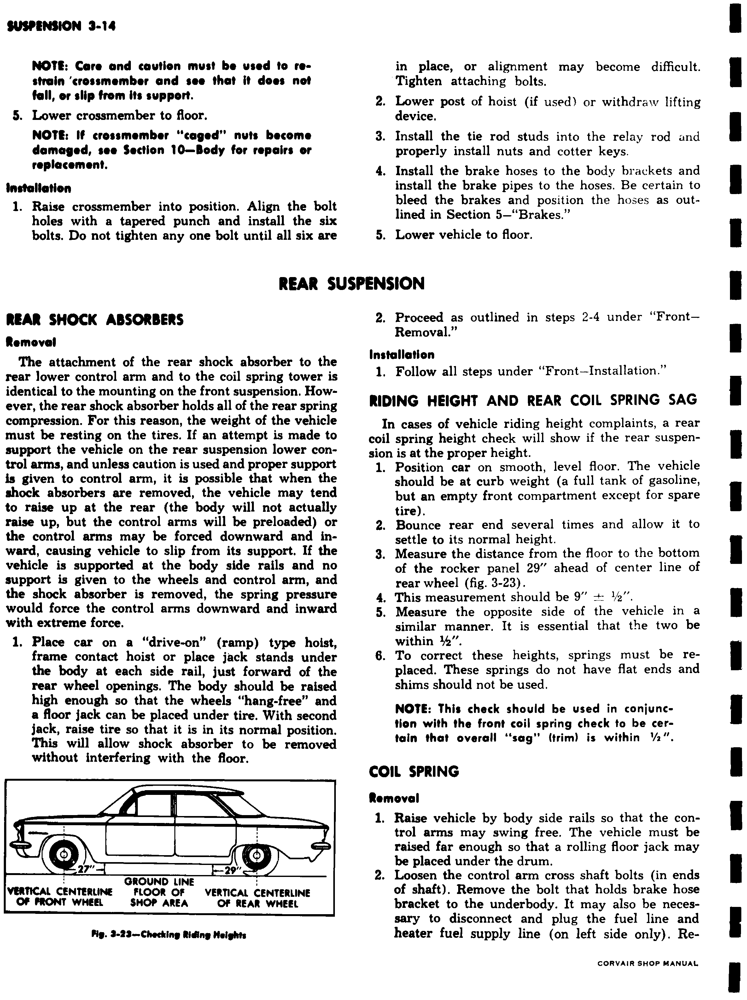

### Remove and install a rear coil spring

 **[PDF p.159](../page-images/p0159.png)** <!-- SOURCE id=base-1961 page=3-14 years=1961,1962,1963 scope=passenger -->

1. Support the car by its body side rails high enough for the rear arms to
   swing freely and a rolling floor jack to fit under the drum.
2. Loosen the end bolts of the rear control-arm cross shaft. Detach the
   brake-hose bracket from the underbody. On the left, disconnect and plug
   the fuel and heater-fuel supply lines if they obstruct travel.

 **[PDF p.160](../page-images/p0160.png)** <!-- SOURCE id=base-1961 page=3-15 years=1961,1962,1963 scope=passenger -->

3. Remove the wheel and tire, but put nuts back on the studs to retain the
   drum. Rotate the axle shaft until the yoke's side face sits **45° to the
   axle-case centerline** (fig. 3-24). This gives the arm enough downward
   travel without the yoke hitting the case or side-bearing adjuster.
4. Put a rolling floor jack beneath the drum and brake flange; raise it
   slightly to load the spring. Remove the shock's two lower bolts and
   lockwashers and its upper nut, washer, and grommet. Withdraw the shock.
5. **Lower the jack slowly** only until the spring is free (fig. 3-25).
   Do not lower farther; that strains the axle shaft or brake hose.
6. For installation, seat the spring on the lower arm and rotate it against
   the step in the crossmember. Extend the shock shaft, pass it through
   arm and spring, and secure its lower end with the two bolts and
   lockwashers. The factory installs the shock early to help restrain the
   assembly if the jack shifts.
7. Raise the arm until the shock's upper grommet, washer, and nut can be
   installed. Reconnect any fuel lines and the brake-hose bracket, remove
   the jack, and fit the wheel and tire.
8. Lower the car, bounce the rear end several times, and tighten the
   cross-shaft **end bolts** with full weight on the suspension to
   **45–55 ft. lb.**

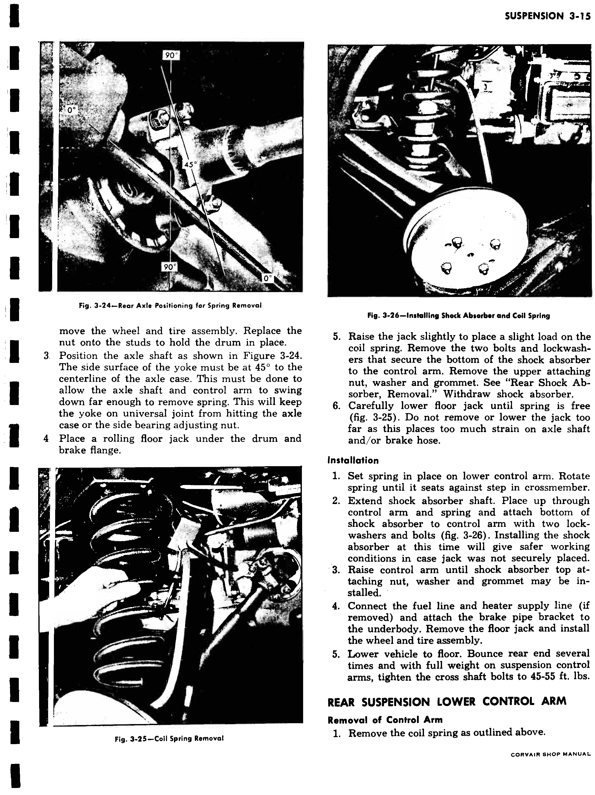

### Remove the rear lower control arm and cross shaft

 **[PDF p.160](../page-images/p0160.png)** <!-- SOURCE id=base-1961 page=3-15 years=1961,1962,1963 scope=passenger -->

First remove the rear coil spring as above.

 **[PDF p.161](../page-images/p0161.png)** <!-- SOURCE id=base-1961 page=3-16 years=1961,1962,1963 scope=passenger -->

1. Before withdrawing the floor jack under the drum, put a suitable stand
   under the control arm. **Do not load or stretch the brake hose.** Remove
   the retaining wheel nuts and brake drum.
2. Move the upper end of the still-assembled brake shoe onto the brake
   anchor, as fig. 3-27 shows, so the axle flange and shaft can pass the
   parking-brake strut.
3. Through the hole in the axle-shaft flange, remove the four nuts and
   lockwashers retaining the brake backing plate to the arm. Pry between
   axle flange and backing plate until the axle shaft and universal joint
   can be pulled from the axle case.
4. Remove the four nuts, lockwashers, and U-bolts retaining the universal
   joint. Remove the bolt, lockwasher, and flat spacer from the axle-shaft
   end. Pull off the universal-joint yoke with factory tool **J-5504** and
   withdraw the axle shaft.
5. Lift the backing plate off the arm studs and wire it to the crossmember.
   Remove the four arm-to-crossmember bolts, nuts, and lockwashers. The
   parking-brake cable bracket shares two of those bolts; retain its position
   for reassembly. Withdraw the arm.

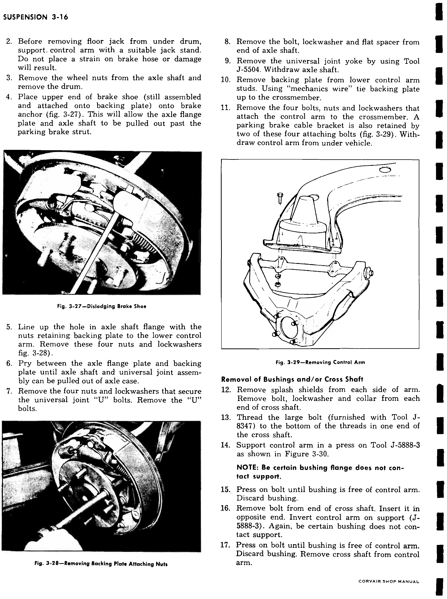

**If renewing the cross-shaft bushings**, remove the arm's splash shields
and the end bolts, lockwashers, and collars. Thread the long bolt supplied
with **J-8347** fully into one shaft end. Support the arm on **J-5888-3**
with the bushing flange clear of the support. Press on the bolt until the
first bushing leaves the arm and discard it. Move the bolt to the other
end, invert the arm, and press out the second bushing. Remove the shaft.

### Reassemble the rear lower arm

 **[PDF p.162](../page-images/p0162.png)** <!-- SOURCE id=base-1961 page=3-17 years=1961,1962,1963 scope=passenger -->

1. Place the cross shaft inside the arm with **J-8347** in position and
   support it on **J-5888-3**. Start a new bushing by hand over the shaft
   end. Set **J-5052-5** over it; ensure the three-piece spacer does not
   overlap the arm's bushing hole. Press until the bushing flange contacts
   the arm. Repeat for the other side, supporting the arm correctly. The
   shaft must still turn by hand.
2. Fit the collars, lockwashers, and end bolts, but leave those bolts loose
   until the suspension bears full vehicle weight.
3. Restore the splash shields and raise the arm to the crossmember. Insert
   the four attaching bolts **from above**. Capture the parking-brake cable
   bracket beneath the **front two** bolts, then fit lockwashers and nuts.
   Support the arm with a stand.
4. Remove the wire supporting the brake backing plate. Fit the axle-shaft
   oil slinger with its **small drain hole at the bottom** and place the
   backing plate on the arm studs. Temporarily retain it with two nuts.
5. Pass the axle shaft through backing plate and arm. Fit the yoke, flat
   spacer, lockwasher, and retaining bolt; the axle-shaft service details
   are in factory Section 6C. Reassemble the universal joint with its
   U-bolts, nuts, and lockwashers.
6. Remove the temporary backing-plate nuts. Protect the axle-case seal while
   inserting the universal-joint spline; move the brake shoe as in fig.
   3-27. Align axle-bearing flange holes with the arm studs and install
   their lockwashers and nuts through the axle-flange access hole.

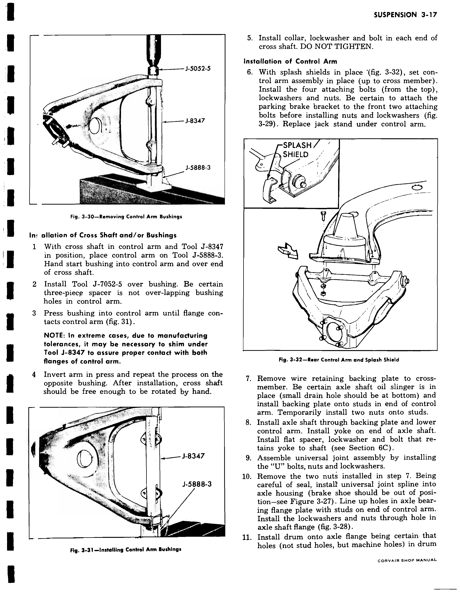

 **[PDF p.163](../page-images/p0163.png)** <!-- SOURCE id=base-1961 page=3-18 years=1961,1962,1963 scope=passenger -->

7. Fit the brake drum so its **machined holes do not align** with the axle
   flange access hole; the factory warns that alignment would admit dirt
   into the brake assembly. Temporarily retain the drum with wheel nuts.
8. Install the rear coil spring and shock as above. Lower the car, settle
   the suspension, then tighten the cross-shaft end bolts to the applicable
   **45–55 ft. lb.** figure from the spring-installation procedure.

For the four **rear lower-arm cross-shaft-to-crossmember attaching bolts**, use
the supplement's passenger-car torque of **45–55 ft. lb.** The base
rear-crossmember installation prints a different torque for these same four
arm-mount bolts; the later 1962–63 specifications table governs the 1963 car.
<!-- RESOLVED SUPERSESSION: Base Section 3 p.3-19, step 10 identifies four control-arm attaching bolts at the crossmember and prints 40–50 ft. lb. Supplement Section 12 p.12-2 identifies the same rear lower-control-arm cross-shaft-to-crossmember joint and specifies 45–55 ft. lb. for 500/700/900 passenger cars. The year-specific supplement supersedes the base value. -->

### Remove and install the rear crossmember

 **[PDF p.163](../page-images/p0163.png)** <!-- SOURCE id=base-1961 page=3-18 years=1961,1962,1963 scope=passenger -->

**Removal**

1. Remove both rear shocks and springs as above, leaving stands under the
   control arms. Disconnect the parking-brake cable at its rear equalizer.
   Disconnect the applicable manual-transmission linkage or clutch cross
   shaft, or the Powerglide linkage, as directed in factory Sections 6B,
   6D, and 6E. Disconnect the brake pipe from each rear hose and detach the
   speedometer-cable bracket from the underbody.
2. Remove the four bolts attaching one control arm to the crossmember and
   let its parking-brake cable bracket hang free. Remove its stand while
   **supporting the arm by hand**, then pull the arm, axle shaft, and brake
   assembly outward together until the axle clears the case. Repeat on
   the other side.
3. Support the power plant under the axle housing with a hydraulic floor
   jack before removing its forward mounting. Remove the two forward
   crossmember-to-body bolts with their thick washers and lower cushions.
   Loosen the two nuts between power-plant mounting bracket and crossmember.
4. Remove the four bracket-to-transmission bolts. **Record the shim count
   at every point.** Remove the bracket's two nuts and lockwashers at the
   crossmember and withdraw the bracket.
5. Remove the bolt, lockwasher, dished washer, and rubber spacer from each
   outer crossmember mounting (fig. 3-34). Lower the crossmember by rolling
   it slightly forward. Move, **without bending**, the transmission
   accelerator control rod if the car has one. Remove damaged mount pieces.

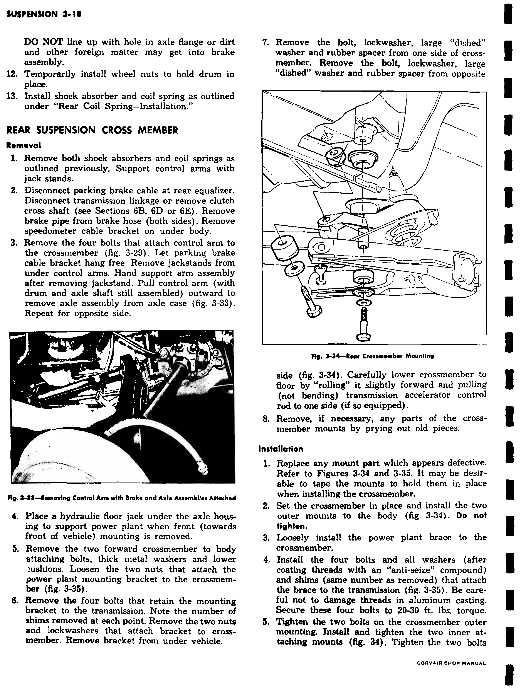

**Installation**

6. Replace defective mount parts. Raise the crossmember and loosely fit
   its two outer body mounts. Loosely attach the power-plant brace to the
   crossmember.
7. Refit all four brace-to-transmission bolts with washers and the **same
   shim count at each point**. Coat bolt threads with anti-seize compound;
   protect the aluminum transmission casting's threads. Tighten these
   four bolts to **20–30 ft. lb.**
8. Tighten the outer crossmember mount bolts, then install and tighten the
   two inner mounts and brace-to-crossmember bolts. Remove the jack under
   the axle housing. Restore the applicable transmission/clutch linkage
   and the speedometer-cable bracket.

 **[PDF p.164](../page-images/p0164.png)** <!-- SOURCE id=base-1961 page=3-19 years=1961,1962,1963 scope=passenger -->

9. Bring both rear-arm assemblies back beneath the car. Guide one
   universal-joint spline into the axle case without damaging the seal;
   support its arm with a stand. Refit the four attaching bolts,
   lockwashers, and nuts, capturing the parking-brake bracket. **Withhold
   final arm-mount torque pending the flagged source conflict above.**
   Route and reconnect that parking-brake cable as the base procedure
   directs. Repeat for the other side.
10. Restore remaining linkage and brake pipes; position rear hoses and
    **bleed the brakes** per factory Section 5. Refit rear springs and
    shocks. Check and adjust rear toe to the **1962–63 overall range**
    stated earlier in this chapter.

The base manual sends suspension-to-body alignment and damaged captive-nut
repair to Section 10, Body. Those body procedures remain to be cleaned.

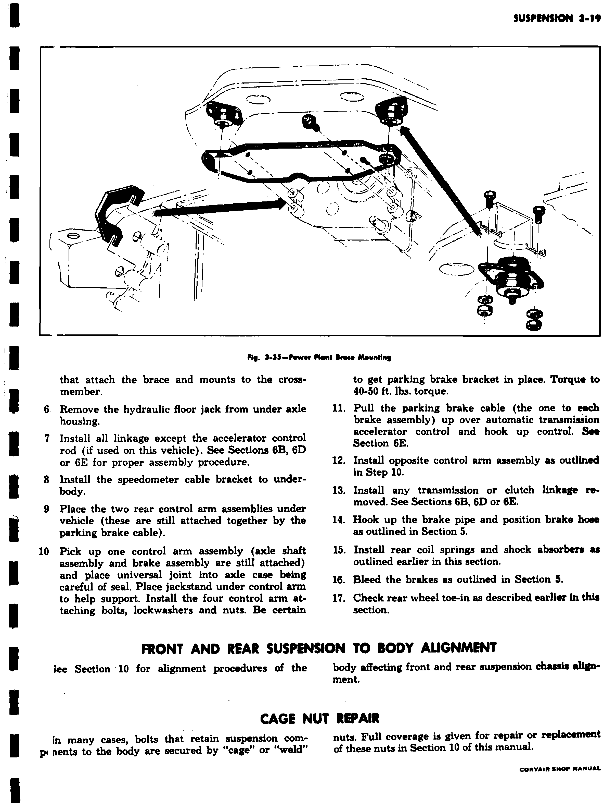

## 1963 passenger wheels and tires

 **[PDF p.643](../page-images/p0643.png)** <!-- SOURCE id=supplement-1962-63 page=3-4 years=1963 scope=passenger -->

The 1963 500, 700, and 900 series use disc-type wheels and **6.50 × 13,
4-ply-rating tubeless tires**, available in blackwall and thin-line
whitewall. Front and rear wheels locate on redesigned, strengthened **hub
pilot diameters** rather than on wheel-stud diameters. The supplement carries
forward the base manual's wheel and tire service operations. Its station-wagon
entry is explicitly 1962-only and is excluded here.

### Tire pressures, puncture checks, and wheel changes

 **[PDF p.165](../page-images/p0165.png)** <!-- SOURCE id=base-1961 page=3-20 years=1961,1962,1963 scope=passenger -->

The passenger car has four wheel studs and nuts at each front hub and rear
axle flange. The spare tire and scissors jack are in the front compartment.
Check inflation regularly and at lubrication service, replace valve caps
after checking, and inspect tread for puncturing objects. Use the verified
**1963 cold and hot pressures** in [Specifications](12-specifications.md#tire-size-and-inflation-pressure).
Do not release air solely because a tire's pressure has risen during driving.

For a road-wheel change, set the parking brake and block the front wheels
when changing a rear wheel. Remove the hubcap or wheel disc and loosen the
wheel nuts before lifting.

 **[PDF p.166](../page-images/p0166.png)** <!-- SOURCE id=base-1961 page=3-21 years=1961,1962,1963 scope=passenger -->

Put the supplied jack directly beneath the body side edge at the factory
point: approximately **10″ inward from the forward edge of the rear fender
opening** for a rear wheel, or **4″ behind the front sill seam** for a front
wheel (fig. 3-36). Raise only until the wheel clears the ground. Remove
the nuts and wheel; reverse for installation. Tighten wheel nuts to the
base manual's **45–65 ft. lb.** passenger-car torque. If balance weights
must be removed to take off a trim ring, restore them to the same locations.

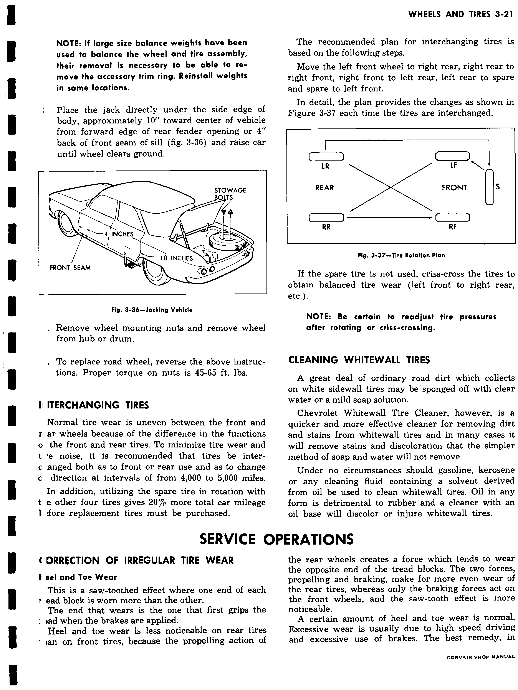

### Rotate tires and clean whitewalls

 **[PDF p.166](../page-images/p0166.png)** <!-- SOURCE id=base-1961 page=3-21 years=1961,1962,1963 scope=passenger -->

The base manual recommends tire interchange every **4,000–5,000 miles**.
Its five-tire pattern is left front → right rear → right front → left rear
→ spare → left front (fig. 3-37). If the spare is not included, cross the
four road tires front-to-rear. **Reset front and rear pressures** after
rotation. Wash whitewalls with water or mild soap, or the factory
whitewall cleaner. The manual forbids gasoline, kerosene, and other
oil-derived solvents on whitewall rubber.

### Diagnose unusual tread wear

 **[PDF p.167](../page-images/p0167.png)** <!-- SOURCE id=base-1961 page=3-22 years=1961,1962,1963 scope=passenger -->

| Pattern | Factory diagnostic direction |
| --- | --- |
| Saw-toothed heel-and-toe blocks | Some is normal, especially at the front. Excess calls for regular tire interchange and checking driving/braking conditions. |
| One-sided tread wear | Check camber; compare with wear on **both** tread shoulders, which suggests underinflation. Also consider crowned roads and fast cornering. |
| Feathered tread edge | Check front or rear toe-in and the rest of the alignment before returning the tires to service. |
| Spotty or uneven wear | Find the mechanical cause: unequal caster/camber, bent suspension parts, imbalance, out-of-round drums, or maladjusted brakes. |
| Rounded outer shoulder and roughened tread | The base manual attributes this pattern to fast cornering; rotate tires and review driving conditions. |

### Dismount and mount a tubeless tire

 **[PDF p.167](../page-images/p0167.png)** <!-- SOURCE id=base-1961 page=3-22 years=1961,1962,1963 scope=passenger -->

Remove the valve cap and core and release all air. Press the inner bead into
the rim well, then lightly lubricate **both beads and the rim** with
vegetable-oil soap. Free the bead with a bead tool or smooth-edged tire
irons, working in small increments so the sealing ribs and wire bundle are
not damaged. The factory expressly forbids sharp-edged tire irons. Lift
the outer bead in small increments, turn the assembly over, and lift the
inner bead off with two irons. The 13-inch bead stretches less than a
larger tire bead, so its sealing surfaces need particular care.

 **[PDF p.168](../page-images/p0168.png)** <!-- SOURCE id=base-1961 page=3-23 years=1961,1962,1963 scope=passenger -->

For installation, use a **light film** of vegetable-oil soap on both beads
and rim. Too much lubricant can let the tire slip on the rim and break its
air seal. Work the inner, then outer bead over the rim in small increments
without striking the bead with a hammer. Ensure the tire passes over the
rim's extra bead and seats properly. The factory describes a mounting band
or heavy cord to help seat a bead when an initial air rush does not do so;
a mounting machine instead lifts the tire against the upper flange.

### Factory tire-puncture repair methods

The base manual describes three historical methods below. Its outside-plug
and self-vulcanizing-patch procedures are **different kit-specific workflows**;
follow the original sequence and limits for the method selected. A cut or
ragged laceration is outside the base manual's simple puncture-repair scope.

 **[PDF p.168](../page-images/p0168.png)** <!-- SOURCE id=base-1961 page=3-23 years=1961,1962,1963 scope=passenger -->

**Fuel-bearing hot patch, tire dismounted:** The factory limits this
method to punctures no larger than **3⁄16″**. Clear the hole with the kit
awl or rasp and fill it from outside with the sealing gun. Clean the inner
surface with the specified nonflammable cleaner and let it dry. Roughen
the repair area with a hand buffer or wire brush. Spread rubber cement
over an area larger than the patch and let it dry **5 minutes**. Prepare
the patch's ignition material, center the patch, and hold it with the
special clamp no tighter than finger-tight. Ignite the material, let the
patch cool **15 minutes** or until touch-safe, remove its cup, and blow
remaining ash out of the tire (figs. 3-38 to 3-40).

 **[PDF p.169](../page-images/p0169.png)** <!-- SOURCE id=base-1961 page=3-24 years=1961,1962,1963 scope=passenger -->

**Self-vulcanizing outside plug, tire mounted:** The factory rules out
punctures over **3⁄16″** and leaks from cuts or ragged lacerations. It
allows this kit on passenger tubeless tires, including tires with soft
puncture-sealing material. Inflate the tire to roughly **10 psi** to support
it, mark the injury and its channel angle, and remove the puncturing object.
Use the kit's reamer to make a circular cut about **¼″ deep**, then clean
the channel with the screw needle, turning clockwise through the injury
and retracting clockwise; repeat twice and remove rubber debris. Keep the
needle in the channel temporarily to limit air loss.

Pull the plug's white stem through its metal tube until its head seats,
then cut the protruding stem. Put the rubber-cement cartridge in the
insertion tool, fit its plunger, pierce the cartridge through the nozzle,
and deposit cement in the hole until the tool's spring stop intervenes.

 **[PDF p.170](../page-images/p0170.png)** <!-- SOURCE id=base-1961 page=3-25 years=1961,1962,1963 scope=passenger -->

Lock the plug tube into the nozzle, lubricate the head with cement, and
guide the tube straight into the channel to the nozzle base. Release the
spring stop, inject the remaining cement, and withdraw the tube while
turning it clockwise. **Trim** the protruding plug; do not pull it.
Remove hardened cement from the tools. If an irregular cut will not seal,
the factory calls for a patch repair instead.

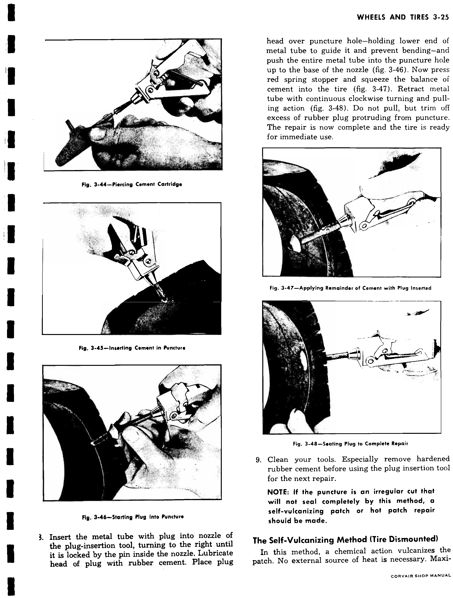

 **[PDF p.171](../page-images/p0171.png)** <!-- SOURCE id=base-1961 page=3-26 years=1961,1962,1963 scope=passenger -->

**Self-vulcanizing patch, tire dismounted:** The base manual limits this
method to a hole no larger than **3⁄16″** and to a tire **without** soft
puncture-sealing material. Clear foreign matter, clean and dry the inside
surface, and fill the channel with the kit's filler rubber. Its illustrated
awl method passes a needle from inside to outside, loads a **⅛″ × 1″**
strip, pulls it back through, and trims the inside flush; the source also
describes a sealant gun. Roughen an area slightly larger than the patch;
do not apply more solvent after buffing. Spread the kit fluid and let it
dry **5 minutes until no longer tacky**. Remove foil backing and roll the
patch firmly from center to edges (figs. 3-49 to 3-51).

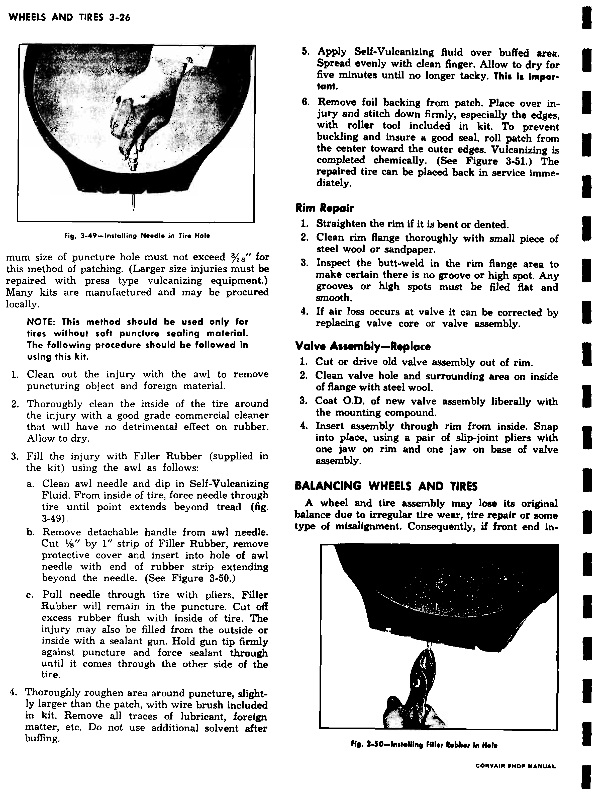

### Rim and valve service

 **[PDF p.171](../page-images/p0171.png)** <!-- SOURCE id=base-1961 page=3-26 years=1961,1962,1963 scope=passenger -->

Straighten a bent rim, clean its flange with steel wool or sandpaper,
and smooth any groove or high spot at the butt weld. If air escapes at the
valve, renew the core or complete valve. To replace the valve, remove the
old assembly, clean the hole and inner flange, coat the new valve's outside
diameter with mounting compound, insert it from inside, and snap it into
place with slip-joint pliers against the rim and valve base.

### Balance and check wheel runout

 **[PDF p.172](../page-images/p0172.png)** <!-- SOURCE id=base-1961 page=3-27 years=1961,1962,1963 scope=passenger -->

Check balance after tire removal, repair, wheel/drum replacement, or when
front-end instability develops. Clear mud and other material from wheel
ventilation slots first. The factory gives maximum original assembly
unbalance of **11 inch-ounces overall**, comprising **6 inch-ounces** for
hub/drum and **5 inch-ounces** for wheel/tire.

For a static check, remove wheel and hub together, clean grease from
bearings and races, and mount on a clean bench spindle (or clean the car's
spindle). Adjust bearings temporarily so the assembly turns almost
frictionlessly, inflate the tire correctly, and spin it. Mark its low,
heavy point. Place two weights on opposite rim edges, initially opposite
the heavy point, then move them equally toward it until balanced. Repack
the bearings and finish with the **1963 front-bearing adjustment** above.
For dynamic balance, use the balancing machine's placement directions;
the base manual explains that equal weights on inner and outer rim edges
retain static balance, while paired weights 180° apart on opposite rim
sides correct dynamic imbalance.

The factory limits side runout at the rim by the tire base to **1⁄16″** and
radial eccentricity at the exposed bead seat to **1⁄16″**. Excess calls for
checking the wheel, mounting, joints, and steering connections.

### Distinguish tire noise from axle noise

 **[PDF p.173](../page-images/p0173.png)** <!-- SOURCE id=base-1961 page=3-28 years=1961,1962,1963 scope=passenger -->

The base manual notes that axle or exhaust noise varies with throttle,
acceleration, or deceleration, while tread noise tends to stay constant
under those changes and may be clearest around **20–30 mph**. Its factory
diagnostic compares sound over the same smooth pavement at normal pressure
and at a temporary **50 psi** test pressure, then restores each tire to its
normal pressure immediately. A drop in noise at the elevated test pressure
points toward tires; axle noise should not change in volume. Check front
alignment, inflation, and uneven wear if the front tires are the source.

## Front hub, drum, and shock absorber service

The following passenger-car operations carry forward from the 1961 manual.
Whenever the hub goes back on the spindle, use the revised **1963 bearing
adjustment** above.

### Remove and inspect the front hub and drum

 **[PDF p.150](../page-images/p0150.png)** <!-- SOURCE id=base-1961 page=3-5 years=1961,1962,1963 scope=passenger -->

1. Break each of the four wheel nuts loose less than one turn. Raise the car,
   support it on stands, and remove the wheel.
2. Remove the hub grease cap, spindle cotter pin, adjusting nut, and washer.
   Withdraw the hub and drum together, keeping the outer roller bearing from
   falling and being damaged. If a scored drum or worn lining binds, back off
   the brake adjustment first.
3. Remove the outer bearing. Pry out and discard the inner bearing seal to
   remove the inner bearing. Wash the parts in cleaning solvent.
4. Check bearing separators and rollers for cracks, wear, or pitting; inspect
   both outer races for cracks, pitting, or looseness in the hub. Check the
   brake drum for scoring and out-of-round condition.

### Replace bearing cups, brake drum, or hub

 **[PDF p.151](../page-images/p0151.png)** <!-- SOURCE id=base-1961 page=3-6 years=1961,1962,1963 scope=passenger -->

**Bearing cups:** Put the press-out tool behind the cup in the provided
notches and use an arbor press to remove it. The factory specifies installer
**J-8351** for the outer cup, **J-8349** for the inner cup, and driver handle
**J-7079-2**. Seat each new cup squarely and fully against the hub shoulder.
The dimensions in factory fig. 3-6 were checked against the
[delivered page image](../page-images/p0151.png) and an
[alternate scan of the same factory page](https://northern-california-corvairs.com/Corvair_1961SM_3.pdf#page=6).
The text calls for steel bar stock from **¾ × ¾ in.** up to **¾ × 1 in.**
in cross section; the two pieces drawn have **¾ × ¾ in.** cross sections.
The drawing labels the **inner-cup piece 1⅞ in. long**, the **outer-cup
piece 1½ in. long**, and the pressing pipe or arbor **1¼ in. diameter**.
Follow the factory illustration for positioning the pieces in the hub's
notches; the lengths alone do not describe the tool geometry.
<!-- RESOLVED IMAGE READING: Base Section 3 p.3-6, fig.3-6 (combined PDF p.151), corroborated against an alternate scan of that factory page, shows 3/4 x 3/4 to 3/4 x 1 in. stock; depicted pieces 3/4 x 3/4 in.; inner 1 7/8 in.; outer 1 1/2 in.; pipe/arbor 1 1/4 in. diameter. -->

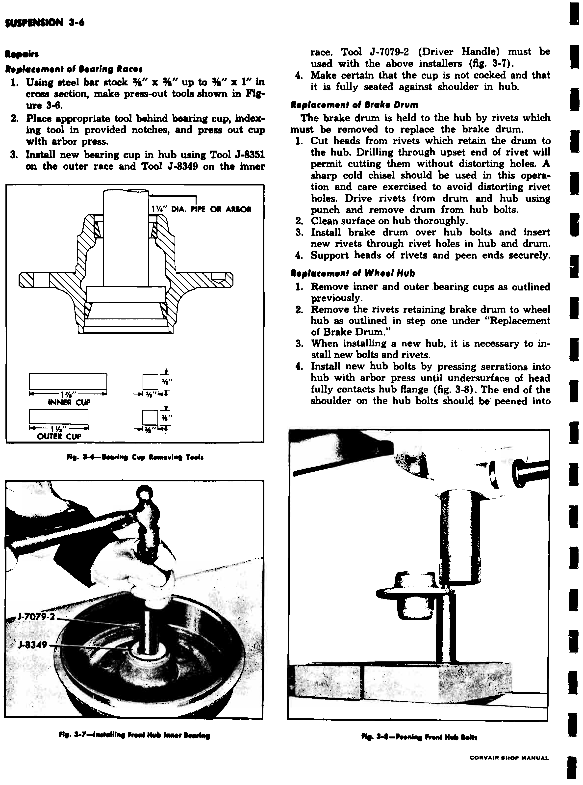

**Brake drum:** Cut off the heads of the drum-to-hub rivets without
distorting the holes; the factory suggests drilling through each upset end
first, then using a sharp cold chisel. Punch out the rivets and remove the
drum. Clean the hub mating surface, position the replacement drum over the
hub bolts, insert new rivets, support their heads, and peen the ends securely.

**Hub:** Remove both bearing cups and the drum rivets as above. Press new
serrated hub bolts into the replacement hub with an arbor press until the
underside of each head contacts the flange. Peen each bolt shoulder into
the countersink around its hole using factory tool **J-0544**.

 **[PDF p.152](../page-images/p0152.png)** <!-- SOURCE id=base-1961 page=3-7 years=1961,1962,1963 scope=passenger -->

Fit the brake drum over the bolts; insert and peen new rivets. Install new
inner and outer bearing cups with the factory installers listed above.

### Install the front hub and drum

 **[PDF p.152](../page-images/p0152.png)** <!-- SOURCE id=base-1961 page=3-7 years=1961,1962,1963 scope=passenger -->

1. Hand-pack both bearings with high-melting-point wheel-bearing lubricant.
2. Put the inner bearing into the hub. Install a **new inner seal** with its
   bent-lug side toward the center of the car.
3. Lightly sand the drum's inside braking surface with fine sandpaper, then
   blow debris out with compressed air. The factory warns against wiping it
   with a cloth that may transfer oil or grease.
4. Slide the hub onto the spindle. Seat the outer bearing by hand; fit the
   spindle washer and adjusting nut.
5. Snug the nut, then perform the [1963 bearing adjustment](#front-wheel-bearing-adjustment).

### Remove and install the front shock absorber

 **[PDF p.152](../page-images/p0152.png)** <!-- SOURCE id=base-1961 page=3-7 years=1961,1962,1963 scope=passenger -->

1. Support the vehicle so the front suspension hangs free and there is room
   below the lower control arm to withdraw the shock.
2. Hold the upper shock stem by its flats. Remove its upper nut, cup washer,
   and grommet, then the two lower bolts and lockwashers.
3. Withdraw the shock and remove the remaining cup washer and grommet from
   the upper end of its stem.
4. For installation, place the cup washer and a new grommet on the stem and
   extend it fully. Pass the shock through the lower arm and coil spring so
   the stem projects through the spring tower.
5. Install the two lower bolts and lockwashers. Hold the upper stem by its
   flats while fitting the upper retaining nut. Lower the car.

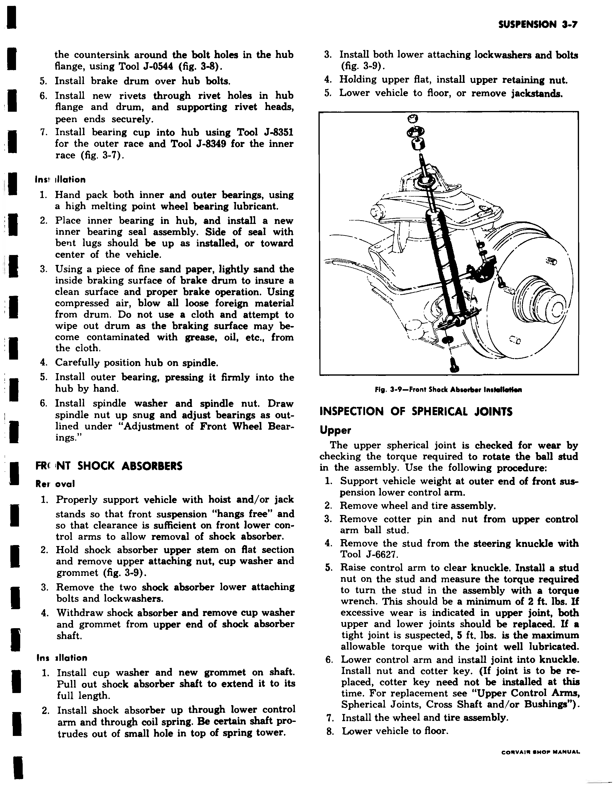

Use the passenger-car shock-mount torque rows in
[Specifications](12-specifications.md#suspension-bolt-torque); the adjacent
commercial column does not apply.

## Troubleshooting carried forward

The base manual's general troubles-and-remedies table follows its separate
commercial section, but its diagnoses are not limited to Corvair 95. The
passenger-car checks below retain those general diagnostic categories; use
the **1963 values** elsewhere in this chapter when a remedy calls for a
specification.

 **[PDF p.181](../page-images/p0181.png)** <!-- SOURCE id=base-1961 page=3-36 years=1961,1962,1963 scope=passenger -->

| Symptom | First factory checks |
| --- | --- |
| Hard steering | Lubrication, tire pressure, alignment, spring sag, wheel/spindle damage, bearings, tight joints, steering-gear adjustment, tie-rod-end position. |

 **[PDF p.182](../page-images/p0182.png)** <!-- SOURCE id=base-1961 page=3-37 years=1961,1962,1963 scope=passenger -->

| Symptom | First factory checks |
| --- | --- |
| Front-wheel shimmy | Inflation, wheel bearings, spherical joints, caster, wheel balance or bend, steering-gear looseness, tie rods, lug nuts, and alignment. |
| Uneven tire wear | Balance, tire pressure and rotation, cornering/braking conditions, brake function, and alignment. |
| Excessively flexible ride or harsh ride | Test shock resistance and inspect for seizure; check tire pressure for harshness. |
| Road wander | Inflation, chassis and gear lubrication, steering-gear adjustment, toe, caster, camber, tie rods, and relay rod. |
| Wheel noise or tramp | Lug nuts, brake return springs and drums, bearings and lubricant, wheel balance, tire defects, and shocks. |

 **[PDF p.183](../page-images/p0183.png)** <!-- SOURCE id=base-1961 page=3-38 years=1961,1962,1963 scope=passenger -->

| Symptom | First factory checks |
| --- | --- |
| Noisy or leaking shock | Faulty shock, grommet position, or loose retaining nuts; replace a leaking faulty unit. |
| Tire loses air | Puncture, valve/core, or rim defect. |

The base table refers passenger-car suspension specifications to Section 12;
use the [1963 passenger-car specifications](12-specifications.md) here.
