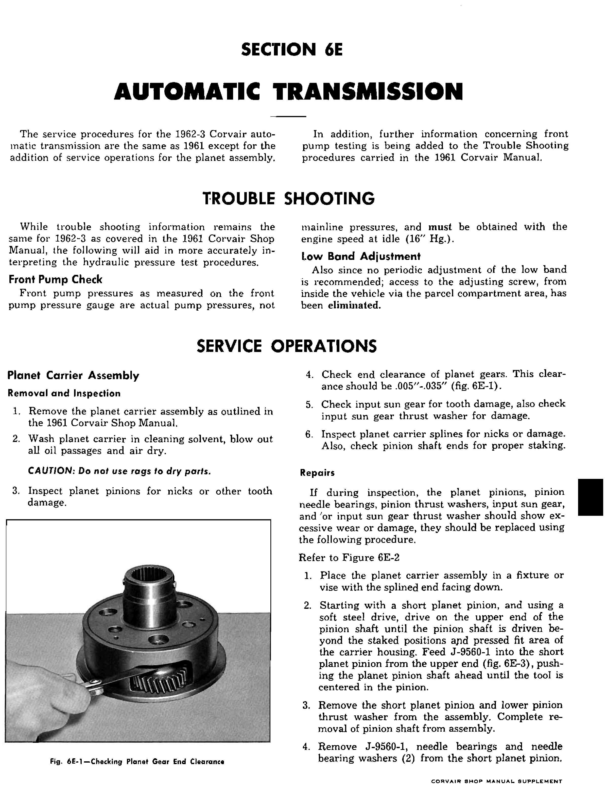
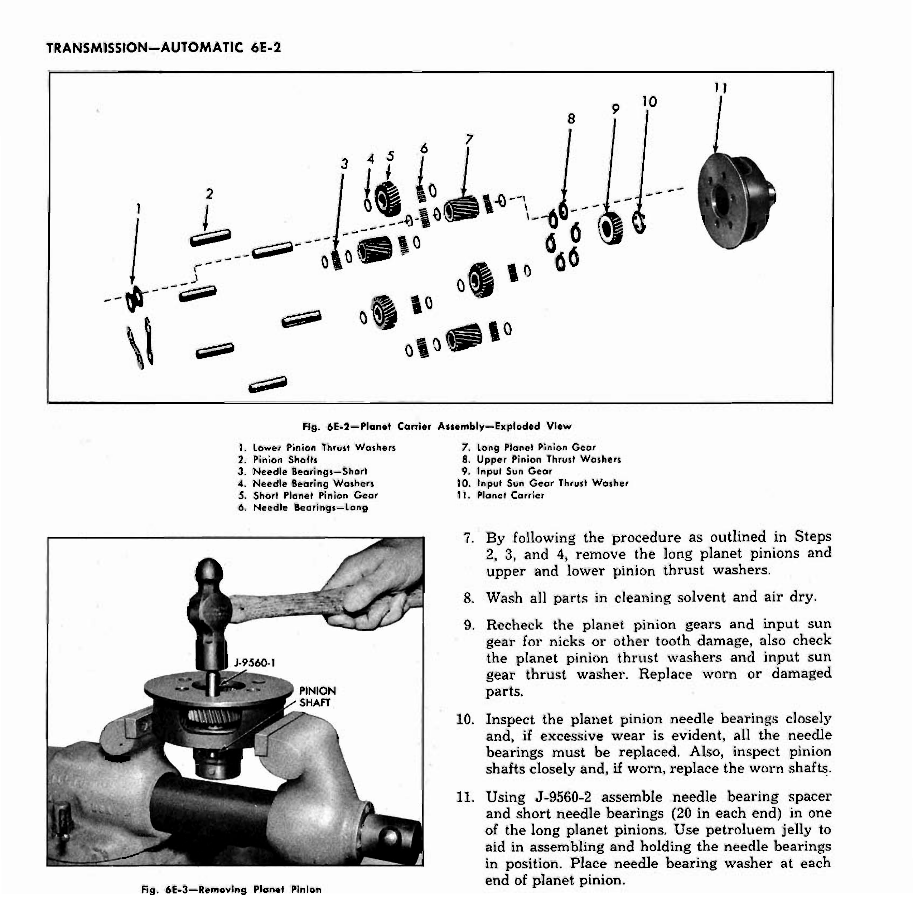
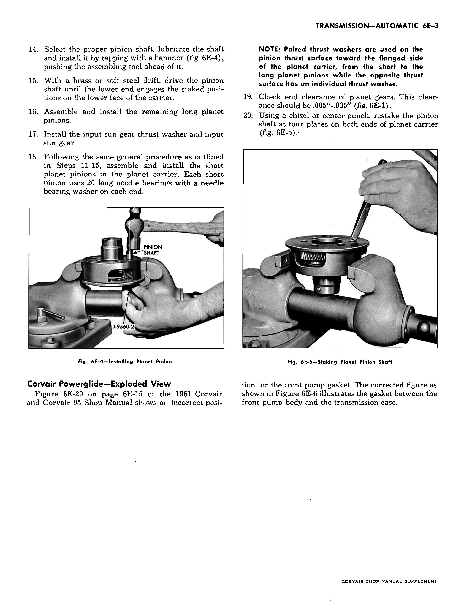

# Automatic Transmission — 1962–63 Supplement

<!-- INCOMPLETE -->

This chapter records the factory changes applicable to the 1963 passenger-car
Powerglide. The 1961 base transmission procedures remain to be cleaned and
cross-linked. The supplement says those procedures remain the same except for
the planet assembly operations and front-pump test clarification below.

 **[PDF p.678](../page-images/p0678.png)** <!-- SOURCE id=supplement-1962-63 page=6E-opening years=1962,1963 scope=passenger -->

## Troubleshooting changes

**Front pump check.** The front-pump gauge reads actual pump pressure, not
mainline pressure. Obtain it with the engine at idle (16″ Hg. as printed in the
supplement). The numerical pressure limits remain in the 1961 troubleshooting
section and are not yet transcribed here.

**Low band adjustment.** The supplement says no periodic adjustment is
recommended. The access to the adjustment screw from the parcel compartment
inside the vehicle was eliminated.

## Planet carrier removal and inspection

1. Remove the planet carrier assembly by the 1961 shop-manual procedure.
2. Wash the carrier in cleaning solvent, blow out every oil passage, and air dry.

   > **CAUTION:** Do not use rags to dry parts.

3. Inspect the planet pinions for nicks or other tooth damage.
4. Check planet-gear end clearance: **.005″–.035″** (factory fig. 6E-1).
5. Inspect the input sun gear teeth and its thrust washer for damage.
6. Inspect the carrier splines for nicks or damage, and the pinion shaft ends
   for proper staking.

## Planet carrier repair

If the planet pinions, needle bearings, pinion thrust washers, input sun gear,
or input sun gear thrust washer show excessive wear or damage, the supplement
directs replacement by this procedure (factory fig. 6E-2).

1. Put the carrier in a fixture or vise, splined end downward.
2. Beginning with a short planet pinion, use a soft-steel drift to drive the
   upper pinion-shaft end past the staked positions and press-fit portion of
   the carrier. Feed tool J-9560-1 into the pinion from above, advancing the
   shaft until the tool is centered in the pinion (fig. 6E-3).
3. Remove the short pinion and lower thrust washer; finish removing the shaft.
4. Remove J-9560-1, the needle bearings, and both needle-bearing washers from
   the short pinion.

 **[PDF p.679](../page-images/p0679.png)** <!-- SOURCE id=supplement-1962-63 page=6E-2 years=1962,1963 scope=passenger -->

> **CAUTION:** Do not lose the needle bearings. The short pinion uses 20 long
> needle bearings; the long pinion uses 40 short bearings, 20 at each end with
> a spacer in the middle.

5. Remove and disassemble the other short pinions.
6. Remove the input sun gear and its thrust washer.
7. Following steps 2–4, remove the long pinions and their upper and lower
   thrust washers.
8. Wash all parts in cleaning solvent and air dry.
9. Recheck the pinion and sun-gear teeth and all thrust washers. Replace worn
   or damaged parts.
10. Inspect needle bearings; replace all of them if wear is excessive.
    Inspect pinion shafts and replace worn shafts.
11. With J-9560-2, assemble the needle-bearing spacer and short needle
    bearings (**20 at each end**) in one long pinion. Petroleum jelly holds
    the bearings during assembly. Put a needle-bearing washer at each end.
12. Reverse the carrier's position in the fixture.
13. Center J-9560-2 in the long pinion and position the pinion and a thrust
    washer at each end in the carrier. Face the washer oil grooves toward the
    gears and align the washers with the carrier holes.

    > **NOTE:** Long pinions go opposite the closed portions of the carrier;
    > short pinions go in the openings.

### Factory figure 6E-2 callouts

| No. | Component | No. | Component |
| --- | --- | --- | --- |
| 1 | Lower pinion thrust washers | 7 | Long planet pinion gear |
| 2 | Pinion shafts | 8 | Upper pinion thrust washers |
| 3 | Needle bearings, short | 9 | Input sun gear |
| 4 | Needle-bearing washers | 10 | Input sun gear thrust washer |
| 5 | Short planet pinion gear | 11 | Planet carrier |
| 6 | Needle bearings, long | | |

 **[PDF p.680](../page-images/p0680.png)** <!-- SOURCE id=supplement-1962-63 page=6E-3 years=1962,1963 scope=passenger -->

14. Lubricate the selected pinion shaft and tap it into place, pushing the
    assembling tool ahead of it (fig. 6E-4).
15. With a brass or soft-steel drift, drive the shaft until its lower end
    engages the staked positions on the carrier's lower face.
16. Assemble and install the other long pinions.
17. Install the input sun gear thrust washer and the input sun gear.
18. Following steps 11–15, assemble and install the short pinions. Each uses
    **20 long needle bearings** and a needle-bearing washer at each end.

    > **NOTE:** Paired thrust washers go on the thrust surface toward the
    > carrier's flanged side, between short and long pinions; the opposite
    > thrust surface has a single washer.

19. Check planet-gear end clearance: **.005″–.035″** (fig. 6E-1).
20. Restake each pinion shaft at four places on **both ends** of the carrier,
    using a chisel or center punch (fig. 6E-5).

## Front pump gasket figure correction

The supplement says that the 1961 manual's fig. 6E-29 on printed p. 6E-15
places the front-pump gasket incorrectly. It states that corrected fig. 6E-6
puts the gasket **between the front-pump body and the transmission case**.
The recovered three-page supplement PDF does not include fig. 6E-6 itself.
<!-- NEEDS REVIEW: Factory supplement refers to corrected fig. 6E-6, but the recovered three-page Section 6E PDF ends without that figure; locate the missing diagram before relying on the exploded view. -->

Source: Chevrolet, *1962–63 Corvair Shop Manual Supplement*, Section 6E;
original PDF `6E-AutoTrns-62-63.pdf`, physical pp. 1–3, combined working
pp. 678–680. The Section 6E opening page has no visible printed page number.
