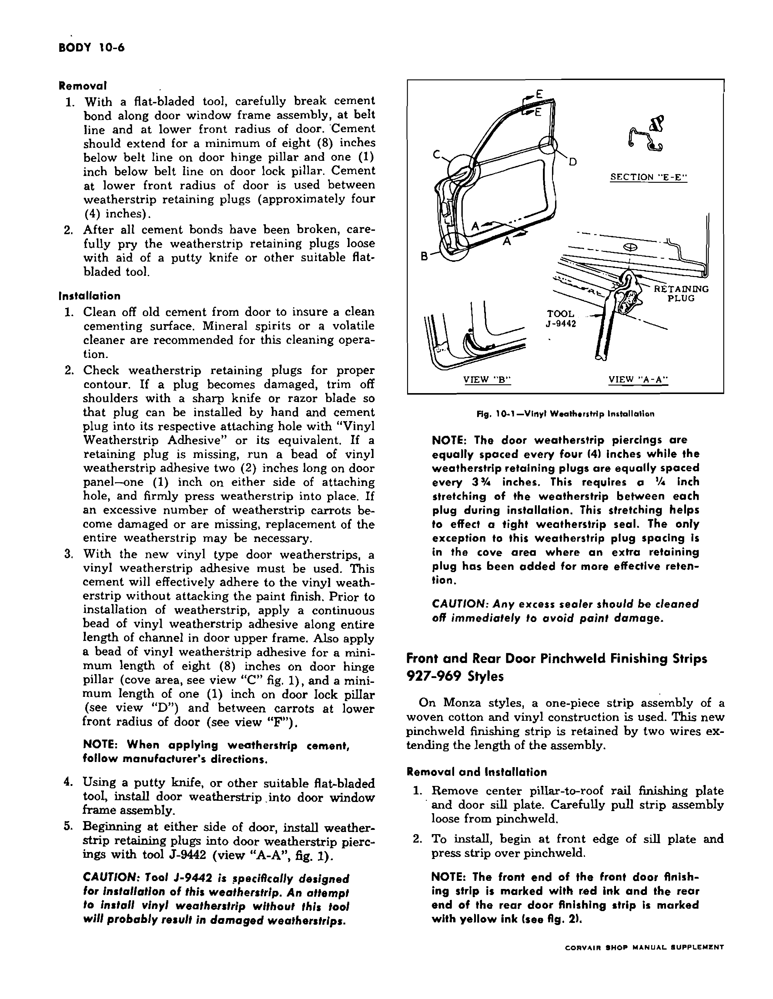
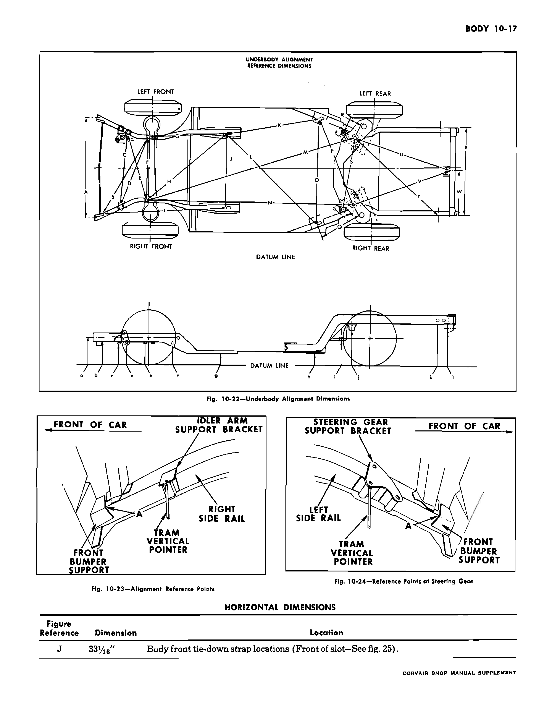
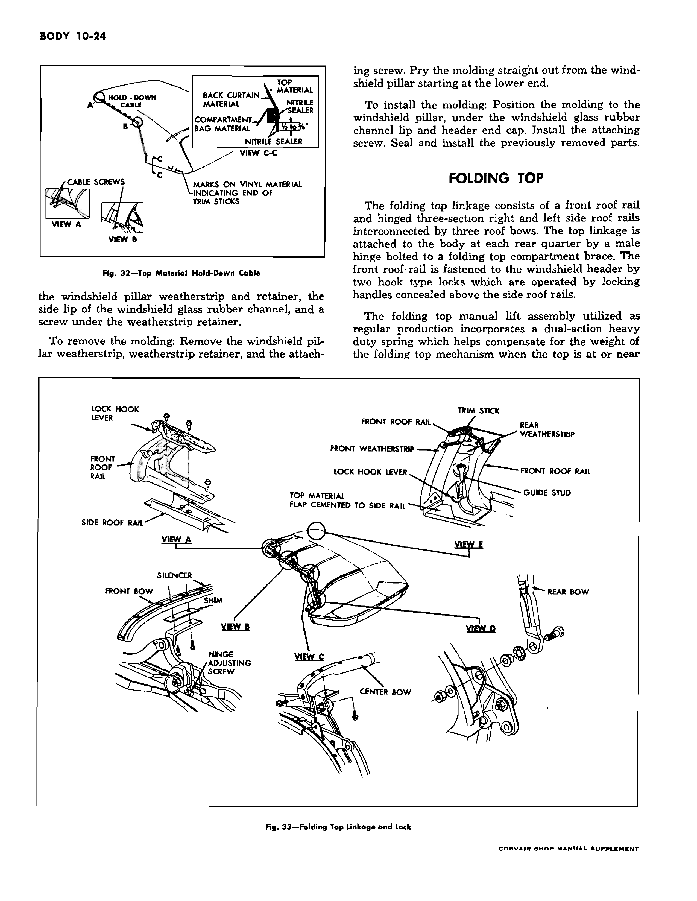
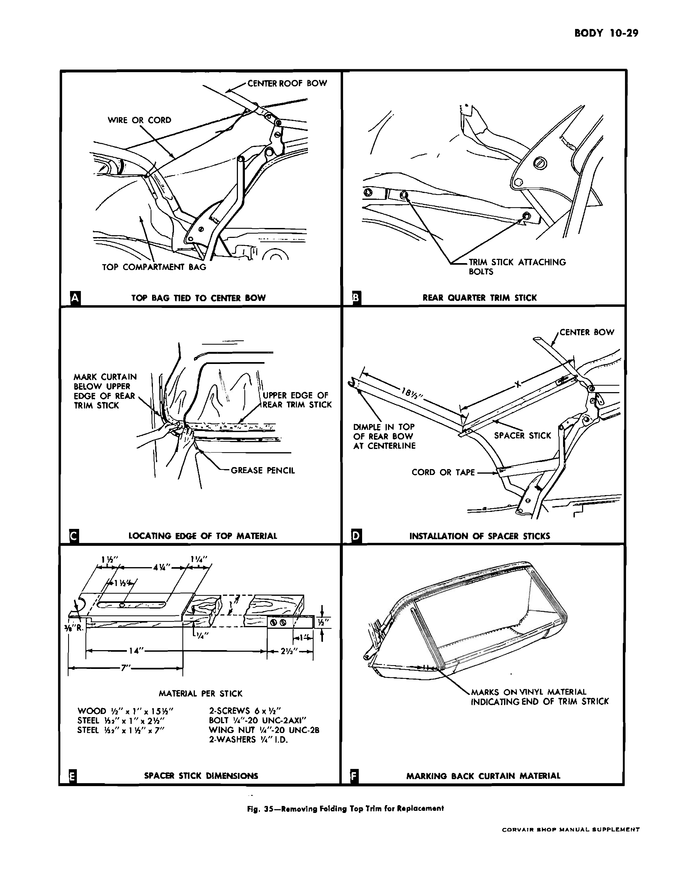
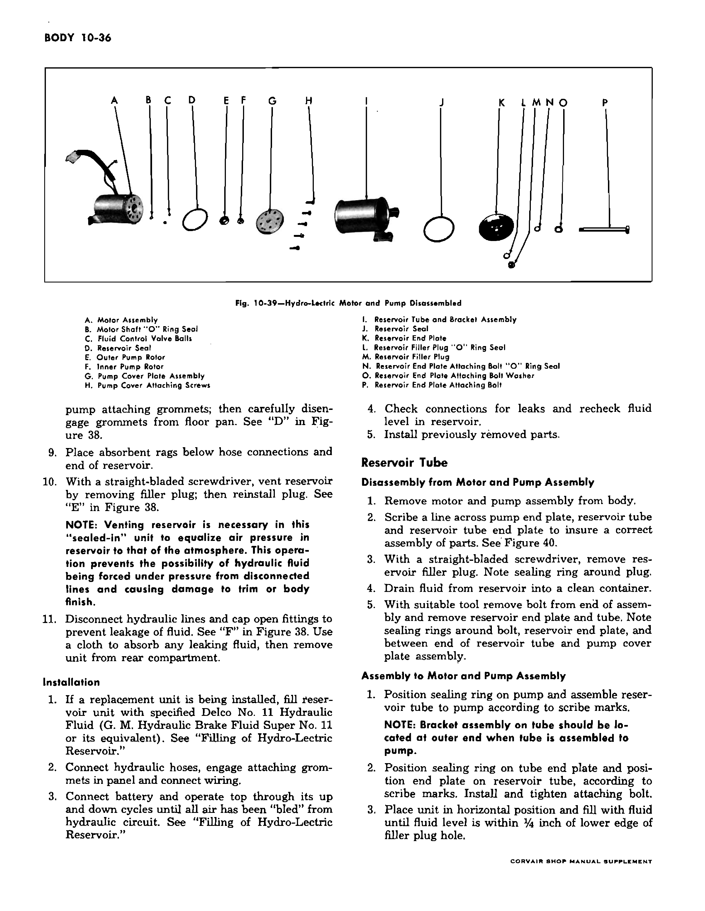

# Body — 1963 Passenger Cars

The 1963 passenger body lineup comprises coupes **527, 727, 927**,
sedans **769, 969**, and convertible **967**. The supplement says body
procedures from the 1961 factory manual continue to apply except where it
updates them. Its separate convertible section applies to model 967.

The 1963 model list cancels station wagons; material restricted to body
style 735 or other wagon models is excluded. Corvair 95 and Greenbrier
commercial material in supplement printed pp.10-42–10-47 is excluded.
Model and body-style applicability will accompany each procedure below.

Original source files: `10-body-4d-61.pdf` (combined pp.32–81),
`10-body-2d-61.pdf` (combined pp.12–31), and `10-body-62-63.pdf`
(combined pp.534–580). Original printed pages and physical PDF pages
are recorded in [the source-page map](../data/source-page-map.jsonl).

## Source condition and applicability

 **[PDF p.534](../page-images/p0534.png)** <!-- SOURCE id=supplement-1962-63 page=10-1 years=1962,1963 scope=contents -->

The supplement contents separate 500/700/900 passenger bodies,
convertible model 967, and Corvair 95/Greenbrier commercial bodies.
The latter material is excluded from this passenger-car chapter.

The base two-door PDF duplicates printed p.10-51 in its first two physical
pages (combined pp.12–13). Both page images are byte-identical. The next
scan is printed p.10-53, so **printed p.10-52 is missing from this source**.
The window-service steps that would have appeared there require another
factory copy before reconstruction.
<!-- NEEDS REVIEW: 10-body-2d-61.pdf duplicates printed p.10-51 at physical pp.1–2; printed p.10-52 is absent. Do not infer the missing front-window procedure. -->

The supplement's body-alignment tables on printed pp.10-16–10-19 revise
the base body dimensions. The values below were checked against page images.
Its wagon-only reference points are inapplicable to the 1963 passenger lineup.

## Unitized body and underbody service

 **[PDF p.36](../page-images/p0036.png)** <!-- SOURCE id=base-1961 page=10-5 years=1961,1962,1963 scope=passenger -->

The coupe and sedan body uses an integral welded steel shell. The underbody
panels carry suspension and powertrain attachment points, so body damage
or poor repair can change suspension alignment. Restore welded joints,
sealing, and rust protection after repairs, especially in enclosed sections.
The factory recommends a corrosion-resistant air-dry primer rather than
a combination primer-surfacer for critical underbody parts.

 **[PDF p.37](../page-images/p0037.png)** <!-- SOURCE id=base-1961 page=10-6 years=1961,1962,1963 scope=passenger applicability=alignment-method -->

For collision checks, use a tram gauge with an **8–108 in.** range and
at least one vertical pointer with a **17 in.** reach. Keep the gauge
parallel to the underbody datum plane. Set the pointers from the vertical
dimensions, then check horizontal reference-point distances. The
[supplement's later alignment chart](../page-images/p0549.png) controls
where its dimensions differ from the base chart.

 **[PDF p.38](../page-images/p0038.png)** <!-- SOURCE id=base-1961 page=10-7 years=1961,1962,1963 scope=passenger applicability=alignment-method -->

Measure unthreaded gauge holes from their centers at the adjacent metal
surface; measure bolt locations at the center of the bolt thread diameter.
For suspension points, centering bolts with a drilled cone can be made from
bolts of the same size and thread, with equal cone depth across the set.
Use the supplement's definition for the revised tie-down **slots**.

 **[PDF p.40](../page-images/p0040.png)** <!-- SOURCE id=base-1961 page=10-9 years=1961,1962,1963 scope=passenger applicability=alignment-method -->

Compare corresponding diagonals to detect misalignment. First establish
which reference points are undamaged; a point in the damaged area gives
misleading measurements. The body tie-down locations may be used when sound,
otherwise begin from an undamaged suspension point. If all key points are
damaged, repair the floor-pan area first and work outward.

## Soft trim and upholstery — 1962–63 update

 **[PDF p.535](../page-images/p0535.png)** <!-- SOURCE id=supplement-1962-63 page=10-2 years=1962,1963 scope=passenger -->

The supplement carries forward 1961 body procedures except for the updates
that follow. Front-seat belt attachment provisions are standard. For routine
upholstery care, remove loose dirt promptly. Use a vacuum or whisk broom on
ordinary fabric, but use a soft bristle brush on polyurethane foam and avoid
a whisk broom on raised tapestry patterns. Test the proposed cleaner on an
inconspicuous area. Factory-approved categories are colorless volatile
upholstery cleaner, synthetic detergent, and neutral nonalkaline soap.

### Fabric with volatile upholstery cleaner

1. Brush off loose dirt. Moisten a clean cloth with volatile cleaner, then
   let some cleaner evaporate so the cloth is only slightly damp.
2. With light pressure and a circular lifting motion, work from the outside
   of the stain toward its center. Turn to a clean part of the cloth often.
3. Wait several minutes before repeating so solvent does not reach and
   damage the padding. Repeat with a clean cloth as needed.
4. If a ring remains, clean the entire trim area in the same manner.

 **[PDF p.536](../page-images/p0536.png)** <!-- SOURCE id=supplement-1962-63 page=10-3 years=1962,1963 scope=passenger -->

Allow cleaned upholstery to dry completely before use. Work with windows
and garage doors open; avoid breathing vapors, skin or eye contact, and
ignition sources where the cleaner is flammable.

### Fabric with synthetic detergent

1. Make thick suds in lukewarm water. Apply **suds only** with a damp clean
   cloth or sponge using light to medium pressure; renew the suds and use
   clean portions of the cloth.
2. Wipe off detergent and loosened soil with a second clean cloth dampened
   in lukewarm water; then remove moisture with a dry cloth or vacuum.
3. Let dry partway and repeat if necessary. Allow complete drying before use.

Water solutions can damage the nap and gloss of broadcloth; use them only
when the stain warrants that tradeoff. Do not use leaded or colored gasoline,
acetone, lacquer thinner, enamel reducer, nail polish remover, bleach,
laundry soap, or strong oxidizing/reducing agents. Excess volatile cleaner
can deteriorate rubber-backed trim.

### Leather, coated fabric, and polyurethane foam

For leather and coated fabric, including vinyl-coated headlining, apply
neutral soap suds with gauze or cheesecloth, wipe with a clean damp cloth,
then dry with a soft cloth. Avoid volatile cleaners, body polishes, oils,
varnishes, furniture polish, and household cleaners or bleach.

For polyurethane foam, mix approximately **2 oz.** of white detergent
powder per **1 gal.** of water. Use only the suds from a well-wrung
cellulose sponge, then rinse lightly without soaking. For cement, sealer,
or grease, first apply detergent suds without rinsing, work with a clean
cloth dipped in volatile upholstery cleaner and wrung out, then apply
detergent suds again and rinse lightly.

### Convertible top fabric

For the **967 convertible**, wash Vicodec top material with neutral soap
suds, lukewarm water, and a soft bristle brush, then rinse thoroughly.
If further cleaning is needed, wet the whole top and clean sections of
approximately **2 sq. ft.** with mild foaming cleanser and a soft brush;
remove loosened soil before it is rubbed into the material. Keep cleanser
from drying on body paint and rinse the whole top generously. Let it dry
completely before lowering it. Do not use volatile cleaner or bleach.

 **[PDF p.537](../page-images/p0537.png)** <!-- SOURCE id=supplement-1962-63 page=10-4 years=1962,1963 scope=passenger -->

### Carpet and specific stains

Brush or vacuum carpets first. For heavily soiled carpet, remove it and
vacuum; work foaming upholstery cleaner over approximately **1 sq. ft.**
at a time, vacuum out cleaner after each area, fluff with compressed air,
dry fully, then fluff again. For lighter soil, use a small amount of foam
in place. Use volatile upholstery cleaner for residual oil or grease.

The factory's stain treatments vary by material and stain. Test for
color and finish damage before applying them:

| Stain | Factory treatment |
|---|---|
| Battery acid | Saturate with household ammonia water for about **1 minute**, then rinse with a cloth wet with cold water. This cannot reverse fiber damage. |
| Blood | Work with cold water only; hot water or soap sets the stain. If needed, apply ammonia water for about **1 minute**, then rinse. A cold-water cornstarch paste may absorb persistent stain after drying. |
| Candy | Use hot water for ordinary candy; for cream or fruit-filled chocolate, use lukewarm neutral-soap suds and a dull knife, then cold-water rinse. For chocolate, use lukewarm water, dry, then volatile cleaner. |
| Chewing gum | Harden with ice and scrape with a dull knife; volatile cleaner may soften residue for removal. |

 **[PDF p.538](../page-images/p0538.png)** <!-- SOURCE id=supplement-1962-63 page=10-5 years=1962,1963 scope=passenger -->

| Stain | Factory treatment, continued |
|---|---|
| Fruit, liquor, or wine | Apply very hot water with a cloth, remove pulp with a dull knife, and rub with a hot wet cloth. Direct pouring may discolor fabric. After drying, use volatile cleaner if needed; avoid soap and heat drying. |
| Grease or oil | Scrape off excess with a dull tool; rub lightly with volatile cleaner toward the center. |
| Ice cream | Start with the fruit-stain method; follow persistent residue with lukewarm neutral-soap suds, cold-water rinse, and volatile cleaner after drying. |
| Nausea | Sponge with cold water, then mild neutral-soap solution and rinse with cold water; use volatile cleaner for residue. |
| Shoe dressing | Let water-soluble dressing dry and brush it out. For wax or paste, work volatile cleaner from outside inward. |
| Tar | Wet slightly with volatile cleaner, scrape with a dull knife, then wipe lightly with cleaner. |
| Urine | Use lukewarm neutral-soap suds, cold-water rinse, then **1 part** household ammonia water to **5 parts** water for **1 minute** and rinse. |
| Lipstick | Try repeated light applications of volatile cleaner; stop if a residual stain remains rather than apply harsher chemicals. |

## Door trim, seals, and hardware — supplement updates

 **[PDF p.538](../page-images/p0538.png)** <!-- SOURCE id=supplement-1962-63 page=10-5 years=1962,1963 scope=passenger -->

The applied front and rear door arm rests each have **two attaching
screws**. Remove those screws to lift the arm rest; reseal their holes
with body caulking compound where needed before refitting.

The **27-style coupes** use a vinyl door weatherstrip with integral
retaining plugs. It replaces the earlier arrangement of separate sealing
plugs and wire clips and needs no lubrication.

 **[PDF p.539](../page-images/p0539.png)** <!-- SOURCE id=supplement-1962-63 page=10-6 years=1962,1963 scope=passenger variant=27-style-coupe -->

### Vinyl door weatherstrip — 27-style coupes

1. For removal, release cement along the door window frame, belt line,
   and lower front door radius with a flat tool. The cement extends at
   least **8 in.** below the belt on the hinge pillar, **1 in.** below
   the belt on the lock pillar, and about **4 in.** around the lower
   front radius between retaining plugs.
2. Pry the integral plugs loose carefully with a putty knife or flat tool.
3. Remove old cement from the door with mineral spirits or volatile
   cleaner. Check plug contours. If a plug is damaged, trim its shoulders
   so it seats by hand and cement it into its hole with vinyl weatherstrip
   adhesive. For a missing plug, apply a **2 in.** bead of adhesive
   centered on the hole and press the strip firmly. Replace the whole
   strip if many plugs are lost or damaged.
4. Apply a continuous bead of vinyl weatherstrip adhesive in the entire
   upper-frame channel, along at least **8 in.** of the hinge-pillar
   cove, at least **1 in.** of the lock pillar, and between plugs at
   the lower front radius. Follow the adhesive maker's instructions.
5. Fit the strip into the upper channel with a putty knife, then seat
   retaining plugs using factory tool **J-9442**. The door holes are
   **4 in.** apart and the strip plugs **3¾ in.** apart; stretch the
   strip **¼ in.** between plugs for its seal. An extra plug is provided
   in the cove area. Remove excess sealer immediately to protect paint.

> **CAUTION:** The factory says installing this vinyl weatherstrip without
> tool J-9442 will probably damage it.

The supplement warns that installing this vinyl strip without J-9442
will likely damage it. Figure 10-1 on the [source page](../page-images/p0539.png)
shows the adhesive locations and plug engagement.

For **927 and 969 Monza** front/rear door openings, remove the
center-pillar-to-roof finishing plate and sill plate, then pull off the
one-piece woven cotton/vinyl pinchweld strip. Install from the front
edge of the sill plate. The **front end of the front-door strip** is
marked red; the **rear end of the rear-door strip** is marked yellow.

 **[PDF p.540](../page-images/p0540.png)** <!-- SOURCE id=supplement-1962-63 page=10-7 years=1962,1963 scope=passenger -->

### Door handles, glass strips, and coupe window cam

To remove a front or rear outside handle, raise the glass, remove door
trim, release the upper rear portion of the inner water deflector, remove
the **two** handle bolts through the access hole, and lift out the handle
and gaskets. Reverse the sequence to install.

For the inner or outer glass run strip on a door with dropping glass,
mask the nearby painted panel, hook the strip at each retaining clip and
lift to disengage it. Install by seating clips in panel slots, then
remove masking tape.

On **27-style coupes**, the double-arm front-window regulator has a balance
arm running in an inner-panel cam. To remove the window or regulator,
remove the trim and loosen the water deflector, remove the cam's **two**
inner-panel bolts, slide the cam forward off the balance-arm roller,
and lift it through the large access opening. Lubricate the full cam
with **630AAW Lubriplate** or equivalent before reverse installation.

 **[PDF p.541](../page-images/p0541.png)** <!-- SOURCE id=supplement-1962-63 page=10-8 years=1962,1963 scope=passenger applicability=rear-window-introduction -->

The back glass on **27-style coupes** and **69-style sedans** is solid
tempered safety plate glass retained in a rubber channel. Except on
500-series cars, it has reveal moldings. The 735-style wagon quarter
window operation on this page is excluded from the 1963 passenger manual.

 **[PDF p.542](../page-images/p0542.png)** <!-- SOURCE id=supplement-1962-63 page=10-9 years=1962,1963 scope=passenger applicability=back-window-only -->

On **769 and 969 sedans**, the reveal moldings seat in a cavity of the
back-window rubber channel, so remove the whole window before taking
off the moldings. On **727 and 927 coupes**, clips hold the moldings to
the body pinchweld; remove the moldings before removing the glass.

For a sedan back window, cover paint, rear seat, and nearby trim. From
inside, break the channel-lip seal all around the pinchweld. Push the
lower window edge and channel rearward until the lip releases, then
release the upper edge. With a helper, lift the unit onto a protected
surface and remove molding and channel on the bench. The remainder of
this source page and pp.543–547 before the exterior-molding heading
concern canceled 735 station wagons.

 **[PDF p.543](../page-images/p0543.png)** <!-- SOURCE id=supplement-1962-63 page=10-10 years=1962 scope=passenger variant=735-wagon; excluded=1963 -->
 **[PDF p.544](../page-images/p0544.png)** <!-- SOURCE id=supplement-1962-63 page=10-11 years=1962 scope=passenger variant=735-wagon; excluded=1963 -->
 **[PDF p.545](../page-images/p0545.png)** <!-- SOURCE id=supplement-1962-63 page=10-12 years=1962 scope=passenger variant=735-wagon; excluded=1963 -->
 **[PDF p.546](../page-images/p0546.png)** <!-- SOURCE id=supplement-1962-63 page=10-13 years=1962 scope=passenger variant=735-wagon; excluded=1963 -->

## Exterior molding and bucket-seat updates

 **[PDF p.547](../page-images/p0547.png)** <!-- SOURCE id=supplement-1962-63 page=10-14 years=1962,1963 scope=passenger applicability=exterior-molding-only -->

The supplement retains base exterior-molding replacement except for the
following. On **700-series passenger cars**, the front-door lower outer
molding uses snap-on bathtub clips and a rear bolt-and-clip assembly.
The illustration above this heading describes the canceled wagon and
does not establish a 1963 wagon application.

 **[PDF p.548](../page-images/p0548.png)** <!-- SOURCE id=supplement-1962-63 page=10-15 years=1962,1963 scope=passenger -->

To remove the 700-series door molding, release it at each clip with a
flat tool, starting at the front. Replace damaged clips and retainers.
For installation, position the front end at the door front edge, align
the rear bolt with its preinstalled clip, engage the upper edge on the
bathtub clips, then snap in the lower edge and rear bolt.

The **center-pillar scalp molding** uses screws. On installation, place
heavy-bodied sealer at its upper and lower inner ends in pieces measuring
**¾ × ¼ × ¼ in.**, then secure the screws. For the rear body lock-pillar
scalp, remove the back glass first, take out screws from front and rear
faces, then install with sealing screws and replace the glass. The rear
compartment front-panel ornament grille is retained by screws; replace
with sealing screws.

### Manual bucket seats

For **bucket-seat-equipped passenger cars**, turn back carpet to expose
front seat mountings. Slide the seat fully rearward and loosen front
adjuster-to-floor nuts or bolts. Slide fully forward and remove rear
mountings; slide rearward again until the front adjusters clear their
mountings. Lift out seat and adjusters with a helper. On installation,
engage the adjusters beneath front mountings before fitting rear bolts.

To replace a manual adjuster, remove the seat and place it upside down
on protection. Remove the assist spring where fitted, move the adjuster
to expose its front and rear attaching bolts, disconnect a power-drive
cable if the fitted adjuster uses one, then unbolt adjuster from seat
bottom frame. Reverse to install.

 **[PDF p.549](../page-images/p0549.png)** <!-- SOURCE id=supplement-1962-63 page=10-16 years=1962,1963 scope=passenger -->

To remove a bucket-seat back, unbolt it from the cushion frame and
carefully remove the outer hinge-pin retainer. On **927 and 969 Monza**
seats, also remove the inner retainer. Shift the seat back inboard to
release its pin; on Monza seats disengage both hinge arms. Reverse for
installation with inner and outer washers on the hinge pins.

## Revised coupe and sedan underbody alignment

The supplement states that the following dimensions reflect changed
underbody construction. They **supersede the base Section 10 chart**.
<!-- SOURCE id=supplement-1962-63 page=10-16 years=1962,1963 scope=passenger variant=sedan-coupe -->
Use a tram gauge parallel to the underbody datum plane. Measure plain
holes at dead center, bolt holes at the center of thread diameter,
and front/rear tie-down slots at their **front centerline edge**.
The tables below retain factory figure letters. They apply to the
supplement's **coupe and sedan** geometry; its station-wagon rows are
omitted. The source does not establish that its rear body geometry
applies unchanged to **967 convertible**.
<!-- NEEDS REVIEW: Supplement body alignment pp.10-16–10-19 identifies coupe/sedan versus station-wagon rear dimensions but gives no explicit 967 convertible chart. Verify convertible applicability before using these body-tram values on model 967. -->

| Horizontal reference, fig. 10-22 | Factory dimension | Measurement endpoints |
|---|---|---|
| A | 42⁵⁄₃₂″ | Lower front-bumper-bracket bolt-hole centers |
| B | 35¹⁹⁄₃₂″ | Front crossmember front bolt to side-rail inner lower corner at rear bumper support |
| C | 30⅝″ | Idler-support lower inner surface to steering-gear plate lower edge |
| D | 30³¹⁄₃₂″ | Idler-support lower inner surface to left front crossmember bolt center |
| E | 29²⁷⁄₃₂″ | Steering-gear plate lower edge to right front crossmember bolt center |
| F | 27¹⁷⁄₃₂″ | Front suspension crossmember front bolt centers |
| G | 29¹⁵⁄₃₂″ | Front tie-down slot front edge to front crossmember front bolt center |
| H | 42⁵⁄₃₂″ | Opposite front tie-down slot front edge to crossmember front bolt center |
| I | 44⅝″ | Front tie-down slot front edge to front side-rail inner lower corner at bumper support |

 **[PDF p.550](../page-images/p0550.png)** <!-- SOURCE id=supplement-1962-63 page=10-17 years=1962,1963 scope=passenger variant=sedan-coupe -->

Factory fig. 10-22 labels the horizontal and vertical reference points,
while figs. 10-23–10-24 locate the front rail points. The front tie-down
slot-to-slot horizontal dimension **J** is **33¹⁄₁₆″**, measured at each
slot's front edge.

 **[PDF p.551](../page-images/p0551.png)** <!-- SOURCE id=supplement-1962-63 page=10-18 years=1962,1963 scope=passenger variant=sedan-coupe -->

| Horizontal reference, fig. 10-22 | Factory dimension | Measurement endpoints |
|---|---|---|
| K | 59⁷⁄₃₂″ | Front tie-down slot to rear tie-down slot, front edges |
| L | 70²⁵⁄₃₂″ | Opposite front/rear tie-down slot diagonal, front edges |
| M | 107¼″ | Front crossmember front bolt to rear crossmember rear mounting bolt |
| N | 103⅜″ | Opposite front/rear crossmember bolt diagonal |
| O | 45½″ | Rear tie-down slot front edges |
| P | 41⁵⁄₁₆″ | Rear tie-down slot front edge to rear crossmember rear bolt |
| Q | 16¾″ | Opposite rear tie-down slot front edge to rear crossmember rear bolt |
| R | 8⁵⁄₃₂″ | Rear suspension front bolt-hole center to rear bolt-hole center on same side, with powertrain/suspension removed |
| S | 33⅝″ | Rear suspension front mounting bolt to rear mounting bolt on opposite side |
| T, coupe/sedan | 49¹⁵⁄₁₆″ | Rear crossmember rear bolt to rear rail outer flange beneath forward rear-bumper-bracket bolt |
| U | 43¹¹⁄₁₆″ | Rear crossmember rear bolt/hole to front lower edge of rear crossrail |
| V, coupe/sedan | 43⁷⁄₁₆″ | Diagonal counterpart from rear crossmember rear bolt/hole to rear crossrail |
| W, coupe/sedan | 19³⁄₁₆″ | Right rear side-rail outer flange to front lower edge of rear crossrail |
| X, coupe/sedan | 39″ | Rear side-rail outer flanges at forward rear-bumper-bracket bolt holes |

 **[PDF p.552](../page-images/p0552.png)** <!-- SOURCE id=supplement-1962-63 page=10-19 years=1962,1963 scope=passenger variant=sedan-coupe -->

| Vertical reference, fig. 10-22 | Factory dimension | Point above datum |
|---|---|---|
| A | 13⁵⁄₃₂″ | Lower front-bumper-bracket bolt-hole center |
| B | 10⁹⁄₃₂″ | Front rail inner lower corner at rear bumper support |
| C | 9¹⁷⁄₃₂″ | Idler-support lower inner surface below attaching bolt |
| D | 9¹³⁄₃₂″ | Steering-gear reinforcement lower edge below rear bolt |
| E | 10⁹⁄₃₂″ | Front rail at front crossmember bolt hole |
| *E, suspension installed | 9²⁵⁄₃₂″ | Lower surface of front crossmember front bolt head |
| F | 9³⁄₁₆″ | Stabilizer support bracket lower bolt center |
| G | 4″ | Front tie-down location, rail bottom surface |
| H | 5⁹⁄₃₂″ | Rear tie-down location, rail bottom surface |
| I, suspension removed | 9²⁹⁄₃₂″ | Rear-seat-pan reinforcement lower surface at front rear-suspension mount |
| J | 15¼″ | Rear crossmember rear support at bolt hole |
| *J, suspension installed | 13⁷⁄₁₆″ | Rear crossmember outer bolt-head lower surface |
| K, coupe/sedan | 16¹¹⁄₃₂″ | Rear rail outer flange beneath forward rear-bumper-bracket bolt |
| L, sedan | 9½″ | Front lower edge of rear crossrail beneath rear engine-mount-bracket lower bolt |

The factory table labels **L only for sedans**. Do not apply that row to a
coupe or convertible without a matching source.

 **[PDF p.553](../page-images/p0553.png)** <!-- SOURCE id=supplement-1962-63 page=10-20 years=1962,1963 scope=passenger applicability=body-drains -->

Keep the drain slots along the bottoms of passenger doors clear. On
**27-style coupes**, rear-quarter drain holes have rubber dust covers;
clear debris and periodically lubricate covers with silicone rubber
lubricant so they do not stick closed. The 35-style wagon drain hoses
and diagram callouts are excluded.

## Model 967 convertible — doors, quarters, and folding top

 **[PDF p.554](../page-images/p0554.png)** <!-- SOURCE id=supplement-1962-63 page=10-21 years=1962,1963 scope=passenger variant=967-convertible -->

This section supplies body procedures specific to the **967 Monza
convertible**. To replace the door ventilator casting, remove the trim
and water deflector, its hinge-pillar bolt and adjusting stud, then
the **three** vent-frame screws. Before installation, apply a ribbon
of medium-bodied sealer at the casting surface shown in the factory
section view; the stud permits small in/out adjustment. To remove the
complete ventilator, remove the division-channel adjusting stud,
casting, and frame-to-inner-panel screw, then tilt the assembly clear
of the window glass. **Support the glass** with the ventilator out.

The tempered door glass, lower sash channel, and riveted front/rear
cams leave the door as one unit:

1. Remove trim and release the inner-panel water deflector. Lower glass
   about **one-third** of its travel.
2. Remove the front and rear inner-panel up-stops and lower-sash guide
   plate. Lower the glass and remove inner/outer glass strips.
3. Raise glass to its high point and shift it rearward to free both sash
   cams from the regulator rollers; lift the unit out.
4. Reverse for installation and lubricate the lower sash channel and
   inner-panel cam.

 **[PDF p.555](../page-images/p0555.png)** <!-- SOURCE id=supplement-1962-63 page=10-22 years=1962,1963 scope=passenger variant=967-convertible -->

For door-window fit, adjust the ventilator division-channel lower stud
to move the channel in/out or fore/aft, the front and rear up-stops
for height or a cocked pane, the inner-panel cam for rotation, the
lower-sash guide plate for fore/aft travel, and the rear run-channel
lower bolt for rear-glass in/out position. To replace the regulator,
remove glass, ventilator adjusting stud and inner-panel cam, then the
regulator; reverse and cycle the window several times. To replace the
rear run channel, remove trim, water deflector and sash guide plate;
with glass fully raised, unbolt the run channel top and bottom and lift
it out through the inner access hole.

To remove the convertible rear-quarter window, lower the top and set
the window half down. Remove upper trim, belt molding and access cover;
remove the hinge pivot bolt, disengage the male/female hinge, lift the
window off the regulator roller and remove it. Lubricate the pivot
hinge and lower sash cam before installation. Set upward travel with
the guide's upper stop; remove compartment side trim, quarter trim,
and belt molding to reach the remaining adjustments.

 **[PDF p.556](../page-images/p0556.png)** <!-- SOURCE id=supplement-1962-63 page=10-23 years=1962,1963 scope=passenger variant=967-convertible -->

For quarter-window height and fore/aft fit, loosen the male-hinge bolt
and both adjusting-stud nuts, position glass, and retighten. For upper
in/out fit, adjust the lower stud after loosening the rear stud. For
rear in/out fit, loosen the pivot-hinge rear and lower studs plus window
guide attachments, adjust the rear stud, align the guide, and retighten.
**Reseal every disturbed attaching screw.** To replace the regulator,
lower the glass fully, remove upper trim/access cover, remove regulator
screws, disengage its lift-arm roller from the sash, and pass it through
the access hole. For the guide, raise glass fully, remove upper trim and
access cover, unfasten upper/center/lower studs, lower glass enough to
clear its stop, and extract the guide.

Whenever quarter inner-panel seals are opened, reseal the hardware
attachments and access openings shown in factory fig. 31 before
refitting trim. The quarter pinchweld finishing molding snaps to clips,
with a front screw and screw-on snap fasteners at outer corners. For
removal, take out those screws, release the top-compartment bag and
back-curtain retainers, then pry molding carefully from clips. Release
only the overlapping short section of the right molding when removing
the left. Clean and seal the pinchweld, cover it with waterproof tape,
renew damaged clips, and install **left molding before right**.

 **[PDF p.557](../page-images/p0557.png)** <!-- SOURCE id=supplement-1962-63 page=10-24 years=1962,1963 scope=passenger variant=967-convertible -->

The convertible windshield-pillar finishing molding is retained by its
weatherstrip/retainer, the windshield rubber lip, and a concealed screw.
Remove those items, then pry the molding straight out from its bottom.
Install under the glass-channel lip and header end cap, refit the screw,
seal and reinstall trim.

The folding top has a die-cast front roof rail, hinged three-section
side rails, three bows, male hinges at both quarters, and two hook locks
at the windshield header. The manual top's dual-action counterbalance
spring is compressed when raised and tensioned when folded. Side cables
hold top material against side-rail stay pads. Manual-top catch clips
restrain the folded linkage; release **both** before raising it.

 **[PDF p.558](../page-images/p0558.png)** <!-- SOURCE id=supplement-1962-63 page=10-25 years=1962,1963 scope=passenger variant=967-convertible -->

> **CAUTION:** Keep hands clear of side-rail hinges and linkage. Do not
> detach a manual counterbalance lift assembly while its spring is
> compressed or tensioned. Do not bend or reform the die-cast front rail.

### Folding-top alignment and locks

- Turn a lock hook **clockwise** to increase header locking force or
  **counterclockwise** to decrease it; finger pressure is sufficient.
- With top half open, loosen a front guide stud and shift it laterally
  to lead its windshield striker. The striker is not adjustable.
- If the front rail is too far forward or not far enough forward,
  unlatch/raise it, loosen the side-rail front attachments behind the
  weatherstrip, shift the rail fore or aft, retighten, and recement
  the weatherstrip. The range is limited; larger changes use the
  folding-top male hinges.
- To correct a high or low joint between front and center side rails,
  mark and loosen the control-link plate at the quarter brace; move
  it vertically over its serrations without altering fore/aft
  position, then retighten. For stack height, move the same plate
  horizontally without changing its vertical position. Readjust
  manual-top catch clips after either change.

 **[PDF p.559](../page-images/p0559.png)** <!-- SOURCE id=supplement-1962-63 page=10-26 years=1962,1963 scope=passenger variant=967-convertible -->

| Folding-top symptom | Factory adjustment sequence |
|---|---|
| Header lock difficult | Reduce hook force counterclockwise; align and retack front weatherstrip; align front rail. |
| Header lock loose | Increase hook force clockwise; align and retack front weatherstrip; align front rail. |
| Top too far forward / not far enough | Shift front rail rearward / forward, then male hinge if needed. For insufficient forward travel, an additional rear trim-stick spacer may be required at each bolt. |
| Rear side-rail seal too tight against quarter glass / gap at its rear | Shift male hinge rearward / forward; shim seal forward if needed. |
| Rear side-rail seal too tight on top of quarter glass / gap above it | Shift male hinge upward / downward; shim seal downward if needed. |
| Front-center side-rail joint sags / bows upward | Move control-link plate down / up; turn hinge adjusting screw counterclockwise / clockwise. |

 **[PDF p.560](../page-images/p0560.png)** <!-- SOURCE id=supplement-1962-63 page=10-27 years=1962,1963 scope=passenger variant=967-convertible -->

| Further folding-top symptom | Factory adjustment sequence |
|---|---|
| Dust boot difficult to fit | Adjust control-link plate fore/aft, align fasteners, repair thick stay pads, or move manual-top catches down. Set rear-seat-back edge to pinchweld molding edge at **12⅝″ ± ¹⁄₁₆″**, measured near body centerline. |
| Dust boot too loose | Move control-link plate forward, move rear seat back toward the same **12⅝″ ± ¹⁄₁₆″** position, or raise manual-top catches. |
| Top material too low at side windows | Add **one or two ⅛″ shims** between front bow and slat iron; trim and hand-sew oversize side binding if required. |
| Top material too high | Remove **one or two ⅛″ shims**; trim front-bow felt silencer to **⅛″** below its top. |
| Wrinkled top | Adjust rear-quarter trim stick or retack material at the trim-stick center. |
| Header wind whistle or water leak | Tighten hook clockwise and retack front weatherstrip. |

The source names front-bow attaching screws by shim count: no shims,
**#4865935**; one shim, **#4824789**; two shims, **#4837811**.

 **[PDF p.561](../page-images/p0561.png)** <!-- SOURCE id=supplement-1962-63 page=10-28 years=1962,1963 scope=passenger variant=967-convertible -->

To set male-hinge position, first loosen the two rear-quarter trim-stick
bolts to avoid tearing top material. Mark male-hinge washers and control
link. Loosen their bolts, move the hinge fore/aft to align side-rail
rear weatherstrip with quarter glass, then lock the front rail at the
header and check trim-stick fit and stack height. For a rail that sits
high or low, keep fore/aft position fixed while moving the hinge up
or down. Tighten bolts, check top material and stack height, and reset
manual-top catches after any change. Fig. 34 locates the hinge and plate.

 **[PDF p.562](../page-images/p0562.png)** <!-- SOURCE id=supplement-1962-63 page=10-29 years=1962,1963 scope=passenger variant=967-convertible -->

Factory fig. 35 shows the spacer sticks between center and rear roof
bows, marks to transfer from old top and back curtain, and the rear
trim-stick positions. Keep those relationships when replacing fabric.

Figure 35 gives this material list **per spacer stick**:

| Piece | Printed size |
| --- | --- |
| Wood | ½ × 1 × 15½ in. |
| Steel | ¹⁄₃₂ × 1 × 2½ in. |
| Steel | ¹⁄₃₂ × 1¼ × 7 in. |
| Fasteners | Two No. 6 × ½ in. screws; one ¼-20 UNC-2A × 1 in. bolt; one ¼-20 UNC-2B wing nut; two ¼ in. inside-diameter washers |

### Folding-top lock, lift, and trim replacement

 **[PDF p.563](../page-images/p0563.png)** <!-- SOURCE id=supplement-1962-63 page=10-30 years=1962,1963 scope=passenger variant=967-convertible -->

To replace a front roof-rail lock, unlock the top, leave it half open,
remove lock screws and assembly, then reverse. To replace a manual
counterbalance lift, remove rear seat and compartment side trim, move
the top to **midway** so the spring is relieved, and support the front
rail if both lifts are being serviced. Unbolt the lift top and bottom;
reverse installation and cycle the top fully several times.

The top covering is **one continuous piece**, with a separate back
curtain. Factory materials are neoprene-type weatherstrip adhesive for
vinyl surfaces and nitrile convertible-top sealer for the cloth inner
lining. Protect painted panels and trim before removal. Remove rear
seat, side trim, rear side-rail weatherstrips, quarter flaps, front
weatherstrip, front-rail covering, cemented front flaps, and hold-down
cables. Release the top-compartment bag to reach rear-quarter and rear
trim-stick bolts. Remove trim sticks with curtain and top attached,
mark old curtain-to-top and trim-stick positions **below** the visible
trim-stick edge, and transfer those marks to replacement material.
Do not cut the curtain selvage while trimming old top material.

 **[PDF p.564](../page-images/p0564.png)** <!-- SOURCE id=supplement-1962-63 page=10-31 years=1962,1963 scope=passenger variant=967-convertible -->

Factory fig. 36 illustrates the stay-pad tacking, rear-bow spacing,
curtain-to-trim-stick sealing, top centerline, and rear-bow center mark.
These location marks govern installation of replacement fabric.

 **[PDF p.565](../page-images/p0565.png)** <!-- SOURCE id=supplement-1962-63 page=10-32 years=1962,1963 scope=passenger variant=967-convertible -->

After removing the old curtain and stay pads, install bow spacer sticks
and align both sides equally. Factory dimension **X is 15″ ± ¼″**,
measured along each spacer between center and rear bows; both sides must
match within the **14¾–15¼″** range. Fit stay pads in bow/rail recesses, secure
with tacks or screws at factory locations, and cement their wadding.
Lay the plastic-window curtain on a clean protected bench. Apply nitrile
sealer to its lower trim-stick area and lower selvage, then transfer
old curtain reference and bolt-hole marks **below the trim sticks**.
Center curtain on rear trim stick with lower edge **½″ below** its
edge; tack to rear and quarter sticks, including beside bolt holes,
and punch holes for bolts. Recement rubber gutter fillers if needed.
Install the sticks fully, tack curtain valance from center outward to
rear bow, remove fullness, and fold excess valance back without cutting
it (cut edges could unravel).

 **[PDF p.566](../page-images/p0566.png)** <!-- SOURCE id=supplement-1962-63 page=10-33 years=1962,1963 scope=passenger variant=967-convertible -->

Check curtain contour and adjust before final sealing. Seal tack heads
on curtain cloth at trim sticks with nitrile sealer. Mark centerline
of new top lining and rear bow, trial-fit the top so deck-seam marks
meet rear-bow center with quarter flaps correctly wrapped. Transfer
trim-stick edge marks from old top to new material. Apply nitrile sealer
inside the front roof-rail attachment line. Pull the hold-down cables
through their top-material pockets and fasten them loosely at the front
and rear side rails; set final tension after the cover is installed.

 **[PDF p.567](../page-images/p0567.png)** <!-- SOURCE id=supplement-1962-63 page=10-34 years=1962,1963 scope=passenger variant=967-convertible -->

Recheck seam and centerline marks. Cement quarter flaps to rear side
rails and temporarily refit rear weatherstrips. Tack top material to
rear/quarter trim sticks at transferred marks, punch bolt holes, and
install sticks fully to judge fit. Retack or move quarter sticks to
remove wrinkles. Before final attachment, leave back curtain **½″**
and top cover **½–¾″** below the trim-stick edge to limit water wicking.
Seal trimmed edges, tack heads and bolt holes with nitrile sealer, then
reinstall sticks. Tack material on rear bow in a straight center line;
outboard of each deck seam, tacks extend no more than **6 in.** along
the wire-on binding zone. Pull fabric forward to set tension, mark
front-rail edge, cement/tack it to front rail, and cement its front
side flaps. Check top appearance and header locking before final tacking.

 **[PDF p.568](../page-images/p0568.png)** <!-- SOURCE id=supplement-1962-63 page=10-35 years=1962,1963 scope=passenger variant=967-convertible -->

With front rail propped approximately **12 in.** above header, pull
side hold-down cables taut and retighten their front screws. They must
hold fabric to stay pads without making the front rail hard to lock.
Check for wrinkles, restore trim and hardware, and clean top material.
The source also gives separate sequences for replacing only the back
curtain or only the outer top, reusing the applicable sealing and
mark-transfer steps above.

### Optional hydraulic folding top

The hydraulic option has a **12 V reversible motor**, rotor pump,
two lift cylinders and upper/lower hoses. The pump and motor are behind
the rear seat. When servicing their end plate, fit the small motor-shaft
O-ring in the plate before pump rotors and drive ball.

 **[PDF p.569](../page-images/p0569.png)** <!-- SOURCE id=supplement-1962-63 page=10-36 years=1962,1963 scope=passenger variant=967-convertible applicability=power-top -->

For pump/motor removal, raise the top fully and disconnect battery
positive. Protect rear-seat trim, release the top bag and pump shield,
unclip wiring/hoses, and disconnect motor leads and ground. Free pump
grommets from floor. Place rags under reservoir and hoses; **vent the
sealed reservoir at its filler plug before disconnecting hoses**, so
fluid pressure cannot spray trim or paint. Cap open fittings and remove
unit. For installation, prime a replacement with specified **Delco
No. 11 hydraulic fluid / GM Hydraulic Brake Fluid Super No. 11** or
equivalent, connect hoses/wiring, cycle the top to bleed air, check
leaks, and recheck fluid. For reservoir-tube disassembly, scribe pump,
tube and end-plate alignment; drain fluid, unbolt end plate, preserve
seal positions, and reassemble at the marks. With the unit horizontal,
fill to **¼″ below** the filler-hole lower edge.

 **[PDF p.570](../page-images/p0570.png)** <!-- SOURCE id=supplement-1962-63 page=10-37 years=1962,1963 scope=passenger variant=967-convertible applicability=power-top -->

The pump is designed for **340–380 psi** maximum delivery. The **red**
motor lead powers top raising, routing fluid to cylinder bottoms; the
**green** lead powers lowering, routing it to cylinder tops. Before
electrical or hydraulic diagnosis, disconnect cylinder rods and move
the top by hand to find binding; also check door/quarter-glass contact
against side-rail weatherstrips.

 **[PDF p.571](../page-images/p0571.png)** <!-- SOURCE id=supplement-1962-63 page=10-38 years=1962,1963 scope=passenger variant=967-convertible applicability=power-top -->

| Diagnostic step | Check | Indication |
|---|---|---|
| Feed | Test center switch terminal against body ground | Dark lamp means open/short in feed circuit. |
| Switch | Bridge feed to either motor terminal with **No. 12 jumper** | Motor runs by jumper but not switch: defective switch. |

 **[PDF p.572](../page-images/p0572.png)** <!-- SOURCE id=supplement-1962-63 page=10-39 years=1962,1963 scope=passenger variant=967-convertible applicability=power-top -->

| Diagnostic step | Check | Indication |
|---|---|---|
| Down lead | Test disconnected **green** lead with switch Down | Dark lamp means open/short in lead. |
| Up lead | Test disconnected **red** lead with switch Up | Dark lamp means open/short in lead. |
| Motor | Check ground, then jumper battery positive to green (Down) and red (Up) motor terminals | No motion calls for repair/replacement; motion only by jumper points to wiring/connection loss. |
| Cylinders | Watch both rods through Up/Down cycles | Sluggish pair: check kinked hoses, then pump; one slow rod: replace that cylinder. |

Clean the exposed cylinder rods and apply a light brake-fluid film **at
least twice yearly**, keeping fluid off paint and trim. With top raised,
check reservoir level at **¼″ below** lower filler-hole edge. For a pump
pressure test, remove the unit, plug one port and gauge the other; run
at **9.5–11.0 V**. Each port must read **340–380 psi**; differences
between ports within that range are acceptable.

 **[PDF p.573](../page-images/p0573.png)** <!-- SOURCE id=supplement-1962-63 page=10-40 years=1962,1963 scope=passenger variant=967-convertible applicability=power-top -->

To replace a lift cylinder, remove rear seat and compartment side trim.
With top raised, unfasten upper rod hardware and lower clevis hardware.
Move cylinder to access lower hose, disconnect and cap both lines, then
remove cylinder. Protect trim with rags and disconnect battery before
opening hydraulics. Reverse installation; use power to extend piston
rod before attaching it to top linkage, cycle top repeatedly, and
refill/bleed reservoir.

For reservoir filling, the source constructs an airtight adapter from
a spare filler plug and metal tube, then attaches a length of hose to
a container of approved hydraulic fluid placed **below reservoir level**.
Prime a replacement or rebuilt pump on the bench before operation.

 **[PDF p.574](../page-images/p0574.png)** <!-- SOURCE id=supplement-1962-63 page=10-41 years=1962,1963 scope=passenger variant=967-convertible applicability=power-top -->

With the reservoir adapter and hose submerged in sufficient fluid,
run the top fully down, then continue pump operation for approximately
**15–20 seconds** until pump noise drops. Cycle top until Up and Down
travel is consistently smooth. Remove hose and adapter, check fluid
at **¼″ below** the lower edge of filler hole, then fit original plug.

 **[PDF p.575](../page-images/p0575.png)** <!-- SOURCE id=supplement-1962-63 page=10-42 scope=commercial; excluded=passenger -->
 **[PDF p.576](../page-images/p0576.png)** <!-- SOURCE id=supplement-1962-63 page=10-43 scope=commercial; excluded=passenger -->
 **[PDF p.577](../page-images/p0577.png)** <!-- SOURCE id=supplement-1962-63 page=10-44 scope=commercial; excluded=passenger -->
 **[PDF p.578](../page-images/p0578.png)** <!-- SOURCE id=supplement-1962-63 page=10-45 scope=commercial; excluded=passenger -->
 **[PDF p.579](../page-images/p0579.png)** <!-- SOURCE id=supplement-1962-63 page=10-46 scope=commercial; excluded=passenger -->
 **[PDF p.580](../page-images/p0580.png)** <!-- SOURCE id=supplement-1962-63 page=10-47 scope=commercial; excluded=passenger -->

## Inherited coupe and sedan body-shell procedures

 **[PDF p.32](../page-images/p0032.png)** <!-- SOURCE id=base-1961 page=10-1 years=1961,1962,1963 scope=passenger applicability=contents -->
 **[PDF p.33](../page-images/p0033.png)** <!-- SOURCE id=base-1961 page=10-2 years=1961,1962,1963 scope=passenger -->

The base four-door service sequence also supplies common body-shell,
front compartment, windshield, instrument-panel, door, and trim methods
for 1963 sedans and coupes where the supplement does not revise them.
Body lubrication belongs to [Section 2](02-lubrication.md); body wiring
belongs to [Section 8](08-electrical-systems.md).

 **[PDF p.34](../page-images/p0034.png)** <!-- SOURCE id=base-1961 page=10-3 years=1961,1962,1963 scope=passenger applicability=body-shell-figures -->
 **[PDF p.35](../page-images/p0035.png)** <!-- SOURCE id=base-1961 page=10-4 years=1961,1962,1963 scope=passenger applicability=body-shell-figure -->

Factory figs. 10-1–10-3 identify the welded body shell, front-end and
underbody parts. They are a guide to location and names, not a promise
that each illustrated stamping is separately supplied for service.

 **[PDF p.39](../page-images/p0039.png)** <!-- SOURCE id=base-1961 page=10-8 years=1961; excluded=1963 alignment-values-superseded -->

The base horizontal/vertical dimension chart on pp.38–39 is superseded
by the supplement's [revised alignment tables](#revised-coupe-and-sedan-underbody-alignment).
Only its measuring method is carried forward.

 **[PDF p.41](../page-images/p0041.png)** <!-- SOURCE id=base-1961 page=10-10 years=1961,1962,1963 scope=passenger -->

### Underbody mounting repair

For a rear suspension crossmember mounting nut or support cup, remove
the crossmember per [Section 3](03-suspension.md), open or drill the
damaged mounting area as the factory drawing directs, align a replacement
from the body tram references, then weld it securely. Restore rust
protection and seal any access opening. For a front crossmember cage nut,
remove its bolt, bend up the retainer's inboard lip, slide out the nut,
fit replacement, rebend lip, and reinstall the bolt. Use the
**supplement's** body dimensions when positioning repaired mounts.

 **[PDF p.42](../page-images/p0042.png)** <!-- SOURCE id=base-1961 page=10-11 years=1961,1962,1963 scope=passenger -->
 **[PDF p.43](../page-images/p0043.png)** <!-- SOURCE id=base-1961 page=10-12 years=1961,1962,1963 scope=passenger -->

### Front fender and front-end welded panels

For outer-fender replacement, remove affected bumper parts, lamps,
front door, cowl grille, and on the left side the tank. Protect front
compartment weatherstrip. If the windshield opening is damaged, remove
glass and separate fender at its pinchweld; otherwise section ahead of
that opening. Cut spot welds at hinge pillar, rocker, front panel,
headlamp pocket, wheelhouse upper gutter and cowl. Transfer or renew
the left filler-neck housing. Clean sealer from weld zones, straighten
adjacent panels, clamp replacement in place, align to lid and door,
tack and weld while rechecking fit. Re-prime bare metal with corrosion
resistant zinc-chromate type primer, reseal all water/dust joints,
especially the vertical fender-to-cowl rubber strip, then refinish.

For front-end panel removal, take off bumper, lamps and front-lid lock,
then release spot welds at fenders, front crossrail, bumper supports,
headlamp pockets, lock support and wheelhouse front panel. Align the
replacement at front-lid and headlamp openings before welding; restore
primer and sealing afterward.

 **[PDF p.44](../page-images/p0044.png)** <!-- SOURCE id=base-1961 page=10-13 years=1961,1962,1963 scope=passenger -->

The front luggage-compartment lid has individual counterbalance torque
rods and a two-stage side-action latch. For lid removal, protect painted
edges, mark hinge straps, support the lid, remove hinge fasteners and
lift away. Refit at marks and check gaps/latch. The compartment
weatherstrip is cemented around the opening.

 **[PDF p.45](../page-images/p0045.png)** <!-- SOURCE id=base-1961 page=10-14 years=1961,1962,1963 scope=passenger -->
 **[PDF p.46](../page-images/p0046.png)** <!-- SOURCE id=base-1961 page=10-15 years=1961,1962,1963 scope=passenger -->

For front-lid fit, adjust hinges within the marked locations, then
adjust lock/striker for secure engagement without binding. Move the
torque-rod end among its retainer holes to change counterbalance force;
control its spring load with the factory tool or suitable support.
To renew weatherstrip, pull the old cemented strip, clean the gutter,
brush weatherstrip cement along gutter base/outboard side with enough
at the lower inner corner to fill it after seating, and center the
new strip at the rear between hinges using its color mark.

 **[PDF p.47](../page-images/p0047.png)** <!-- SOURCE id=base-1961 page=10-16 years=1961,1962,1963 scope=passenger -->

Seat the front-compartment strip across rear, down sides, and across
front, using a rounded putty knife; press for continuous seal. Trim
ends to a cemented butt joint at front center and let adhesive set
before shutting the lid. For the gas-filler door, mark hinge location,
unbolt, and refit at marks; shift hinge to adjust up/down or in/out.
For the cowl ventilator grille, remove wiper arms, open lid, unscrew
the grille front edge, then lift/slide it forward to release rear tabs.
Seal screw holes and tab slots before refitting.

 **[PDF p.48](../page-images/p0048.png)** <!-- SOURCE id=base-1961 page=10-17 years=1961,1962,1963 scope=passenger -->

Remove the cowl trim pad to service the fresh-air outlet. Unfasten the
outlet at the cowl panel and disconnect its control cable from the door;
seal panel joints with medium-bodied sealer on installation. The outlet
door comes off after removing cable and hinge pin; restore both and
confirm movement.

 **[PDF p.49](../page-images/p0049.png)** <!-- SOURCE id=base-1961 page=10-18 years=1961; excluded=1963 wiper-system-superseded -->

The 1961 single-speed wiper linkage and park position on this page are
**superseded** by the 1962–63 electrical-system wiper section. See
[1963 wiper service](08-electrical-systems.md) for current equipment.

## Inherited windshield and instrument-panel service

 **[PDF p.50](../page-images/p0050.png)** <!-- SOURCE id=base-1961 page=10-19 years=1961,1962,1963 scope=passenger -->

Remove mirror support, upper windshield garnish moldings, lower side
moldings, then lower center moldings in that order. The center escutcheon
belongs to the lower right center molding. The sunshade support is
screw-mounted. For windshield-pillar drip molding, remove screws;
on 700 models slide it downward from beneath the roof-drip scalp.
Seal screw holes and molding joint on refitting.

For windshield removal, protect paint, dash and seats; remove mirror
and wiper arms. From inside, push rubber-channel lip over pinchweld
at top and sides with a blunt tool and palm pressure on glass. With
a helper, lift glass/channel onto a protected bench.

 **[PDF p.51](../page-images/p0051.png)** <!-- SOURCE id=base-1961 page=10-20 years=1961,1962,1963 scope=passenger -->

Before installing replacement glass, clean and inspect channel and
pinchweld. Install **five J-8372 checking blocks** at the lower and
upper flange positions shown in fig. 10-33; trial-fit glass with a
helper. Check uniform clearance all around, reshape opening where
needed, then mark glass and body centerlines. Figure 10-34 specifies
**¼–5⁄16 in.** between glass and pinchweld on the inside and
**5⁄16–⅜ in.** between glass and metal on the outside. Both ranges
were checked against the printed page image.

 **[PDF p.52](../page-images/p0052.png)** <!-- SOURCE id=base-1961 page=10-21 years=1961,1962,1963 scope=passenger -->

For windshield installation, remove old sealer; fit rubber channel to
glass, with reveal moldings inside it where fitted. Thread cord around
the channel's pinchweld cavity with ends at lower center. Apply
medium-bodied sealer around channel base and windshield rabbet as
fig. 10-36 shows. With helper, center glass, then pull cord from lower
center across bottom, up both sides and across top to roll channel lip
over flange. Seal channel lips to glass completely with approved
weatherstrip adhesive, clean excess, reinstall parts, and water-test.
Do not hammer glass into position. To remove reveal moldings, take out
windshield first, then remove side pieces followed by upper/lower;
install upper/lower centered and then sides, using mild soap solution
in channel cavity if needed.

 **[PDF p.53](../page-images/p0053.png)** <!-- SOURCE id=base-1961 page=10-22 years=1961,1962,1963 scope=passenger -->

For instrument-panel compartment door removal, mark hinge, remove
stop and hinge screws, and lift door; reinstall at marks. Shift hinge
at door for height and at panel for side-to-side alignment; move lock
striker fore/aft for closure. The knob and hinge stop are separately
screw-retained. Inside door handles use a spring clip: depress trim,
insert **J-7797** to release clip, and refit handle at same angle as
its opposite-side mate. The instrument-panel cover procedure is under
the base two-door section below.

## Inherited sedan door and glass procedures

 **[PDF p.54](../page-images/p0054.png)** <!-- SOURCE id=base-1961 page=10-23 years=1961,1962,1963 scope=passenger -->

Mask inner door paint, tap around trim-panel edge with a rubber mallet,
then lift each retaining nail from its plastic retainer with a flat
tool. Replace broken nails with proper short repair tabs so they do
not puncture retainers and cause leaks. Where a retainer is loose,
cover its panel hole with cloth-backed waterproof tape slit in an X.
For a lock striker, mark its pillar location, remove **three** screws
and adjusting plates, seal screw holes and back of plate, then refit
at marks. After door removal or alignment, **check lock extension
engagement before closing door fully**; use factory emergency spacers
where required.

 **[PDF p.55](../page-images/p0055.png)** <!-- SOURCE id=base-1961 page=10-24 years=1961,1962,1963 scope=passenger -->

Adjust striker up/down and in/out at its screws only after door itself
is aligned. Check lock extension with modeling clay in the striker
notch. When dimension A is less than **11⁄32 in.**, use the factory
emergency-spacer chart; dimension B must never be less than **⅛ in.**
The spacer and screw values below were checked against the printed chart.

| Dimension A | Emergency spacer | Screw |
| --- | --- | --- |
| 11⁄32–9⁄32 in. | One 1⁄16 in. | Original |
| 9⁄32–7⁄32 in. | One ⅛ in. | ⅛ in. longer |
| 7⁄32–5⁄32 in. | One ⅛ in. plus one 1⁄16 in. | ⅛ in. longer |
| 5⁄32–3⁄32 in. or interference | Two ⅛ in. | ¼ in. longer |

For access behind a door water deflector, remove trim and lower
waterproof tape, cut deflector **inside its cemented edge** from top
to bottom without tearing it, then lift its lower edge from slot and
roll it back.

 **[PDF p.56](../page-images/p0056.png)** <!-- SOURCE id=base-1961 page=10-25 years=1961,1962,1963 scope=passenger -->

For full water-deflector removal, release corner tape and cement,
hold the string within sealer against deflector, lift its edges and
bottom slot. Repair tears on **both sides** with waterproof body tape;
cover separated paper/polyethylene to prevent wicking. Use old
deflector as template for replacement. Clean panel, reseal edges and
arm-rest screw holes, place shiny polyethylene side **against door
inner panel**, insert lower edge into slot, and press cemented areas
for continuous seal.

 **[PDF p.57](../page-images/p0057.png)** <!-- SOURCE id=base-1961 page=10-26 years=1961,1962,1963 scope=passenger variant=69-style-sedan applicability=door-weatherstrip -->

Tape the deflector's lower corners, clean excess sealer, and reinstall
trim. For the earlier clip-retained weatherstrip still used on
**69-style sedans**, release cement at window frame and front-door cove,
then disengage clips from sealing plugs with **J-5757**. Clean old
cement; repair loose plugs with X-slit waterproof tape and re-form
clips with **J-5984**. Apply approved weatherstrip cement continuously
along frame channel and cove as fig. 10-45 shows, then seat strip.
The 27-style coupe weatherstrip uses the [later vinyl procedure](#vinyl-door-weatherstrip-27-style-coupes).

 **[PDF p.58](../page-images/p0058.png)** <!-- SOURCE id=base-1961 page=10-27 years=1961,1962,1963 scope=passenger applicability=door-hinge-only -->

The supplement updates glass run strips and Monza pinchweld finishing
strips; use those procedures above. A front door can be removed with
hinges or from hinges. Protect adjacent fender, mark hinge location,
support door with a helper, then unbolt selected attachments.

 **[PDF p.59](../page-images/p0059.png)** <!-- SOURCE id=base-1961 page=10-28 years=1961,1962,1963 scope=passenger applicability=door-hinge-only -->
 **[PDF p.60](../page-images/p0060.png)** <!-- SOURCE id=base-1961 page=10-29 years=1961,1962,1963 scope=passenger applicability=door-hinge-and-ventilator -->

Coat hinge mating faces with heavy-bodied sealer for squeak control,
refit the supported door at marks, then adjust with striker temporarily
removed so it hangs freely. Move front-pillar hinge bolts for up/down
and fore/aft position; move hinge-to-door screws for in/out. The
door-opening-stop stud at upper hinge increases door-to-fender clearance
when turned clockwise and decreases it counterclockwise. Recheck
lock-to-striker engagement after every door adjustment.

 **[PDF p.61](../page-images/p0061.png)** <!-- SOURCE id=base-1961 page=10-30 years=1961,1962,1963 scope=passenger applicability=sedan-front-glass -->

For sedan front-door ventilator assembly removal, raise and support
door glass, remove trim/deflector, disconnect lower division-channel
stud and frame attachments, and lift ventilator clear. Adjust division
channel lower stud for in/out and fore/aft fit to glass. Its pivot-nut
setting controls opening effort; bend washer tab back down to lock
after adjustment. The tempered front window, lower sash and welded cam
leave as one unit after ventilator removal. Lubricate sash cam on
installation and check travel.

 **[PDF p.62](../page-images/p0062.png)** <!-- SOURCE id=base-1961 page=10-31 years=1961,1962,1963 scope=passenger applicability=sedan-front-glass -->

For front glass run-channel renewal, remove window, pull old channel
from upper/rear frame and seat replacement. For regulator renewal,
raise glass and secure it to frame with protective body tape on both
sides before releasing regulator; remove trim/deflector and lower
division stud, remove regulator screws, shift regulator forward to
disengage cam roller, then extract through access hole. Reverse and
cycle window before refitting trim.

 **[PDF p.63](../page-images/p0063.png)** <!-- SOURCE id=base-1961 page=10-32 years=1961,1962,1963 scope=passenger applicability=sedan-locks -->

The lock-to-remote link uses a sliding spring clip; disengage its slot
with a screwdriver. To remove lock cylinder, raise glass and remove
trim/deflector, pry its retaining clip through the access hole, and
withdraw cylinder/gasket. Test with key after fitting. If dismantling
cylinder, note cap and spring positions under tension; the production
housing scalp often needs replacement after removal. The rotary-bolt
lock requires correct extension-to-striker engagement and spacers
where the factory spacer chart indicates.

 **[PDF p.64](../page-images/p0064.png)** <!-- SOURCE id=base-1961 page=10-33 years=1961,1962,1963 scope=passenger applicability=sedan-lock-and-rear-hinge -->

Check lock, remote control, and links through all positions before
sealing water deflector. The old outside-handle attachment on this page
is superseded by the [supplement's handle bolts](#door-handles-glass-strips-and-coupe-window-cam).
For rear-door removal, mark upper/lower hinge positions, support the
door, and unbolt either door-to-hinge or hinge-to-center-pillar mounts.

 **[PDF p.65](../page-images/p0065.png)** <!-- SOURCE id=base-1961 page=10-34 years=1961,1962,1963 scope=passenger variant=69-style-sedan -->

For rear-door installation, clean old hinge sealer, coat mating faces
with heavy-bodied sealer, refit at marks with helper, and check alignment.
Move hinge-to-door screws for in/out fit, hinge-to-center-pillar bolts
for up/down and fore/aft; alter **one hinge at a time** for fore/aft to
preserve height. Check striker engagement afterward. Rear tempered glass
and lower sash/cam leave the door as a unit after trim and water-deflector
removal.

 **[PDF p.66](../page-images/p0066.png)** <!-- SOURCE id=base-1961 page=10-35 years=1961,1962,1963 scope=passenger variant=69-style-sedan -->

For sedan rear glass removal, support glass, lower until sash cam leaves
regulator lift roller, rotate front edge up, and lift glass/cam clear.
For installation, engage balance-arm roller in cam first, then lift-arm
roller; fit inner cam, lubricate sash and inner cams with **630AAW
Lubriplate** or equivalent, and cycle window. Adjust rear run-channel
lower retainer for in/out fit and inner-panel cam for cocked glass.
The glass run channel pulls from front, upper and rear frame after glass
is removed.

 **[PDF p.67](../page-images/p0067.png)** <!-- SOURCE id=base-1961 page=10-36 years=1961,1962,1963 scope=passenger variant=69-style-sedan -->

To replace rear run-channel lower retainer, raise glass, open trim and
water deflector, unfasten retainer at door lock pillar and withdraw its
upper tab. To replace rear regulator, secure glass fully up to window
frame with protective body tape, release remote control and inner cam,
unbolt regulator, disengage rollers, and remove through access hole.
After refitting, cycle glass before closing deflector. The inner cam
is removed after freeing its screws and regulator roller; only one end
admits roller removal. Lubricate cam before refit. For remote-control
service, release its panel screws, anti-rattle clip, and lock-link spring
clip; verify lock operation before sealing the door.

 **[PDF p.68](../page-images/p0068.png)** <!-- SOURCE id=base-1961 page=10-37 years=1961,1962,1963 scope=passenger variant=69-style-sedan applicability=locks-only -->

For rear rotary-bolt lock removal, open trim and deflector, disconnect
remote and inside-locking rods, unfasten lock and lift through access
hole. To remove inside-locking rod, unscrew knob, release rod's lock
spring clip and inner-panel retainer, then unfasten rod support. Test
all lock functions before closing deflector. Outside-handle mounting
on this base page is superseded by the supplement's [two-bolt handle
procedure](#door-handles-glass-strips-and-coupe-window-cam).

 **[PDF p.69](../page-images/p0069.png)** <!-- SOURCE id=base-1961 page=10-38 years=1961,1962,1963 scope=passenger applicability=headlining-only -->

### Sedan and coupe headlining

The headlining is shaped by listing wires fitted to side-rail clips,
cemented along roof-rail edges and tacked/stapled at windshield and rear
window. Use clean hands and protection for upholstery. Remove mirror,
sunshades, upper garnish moldings, center-pillar roof trim, dome lamp,
and enough pinchweld strip to expose material. Release cement and edge
fasteners, then unhook listing wires **front to rear**; record each
wire-end hole and the center rear tab. The old outside-handle pushbutton
diagram on this page belongs to the superseded handle design.

 **[PDF p.70](../page-images/p0070.png)** <!-- SOURCE id=base-1961 page=10-39 years=1961,1962,1963 scope=passenger applicability=headlining-and-bench-seat -->

For headlining installation, fit listing wires to pockets, hook rear
wire and center tab, then work forward using the recorded rail holes.
Center at windshield, sunshades and rear window, cement/stay-tack front
and rear edges, then cement side rails. Remove draws before final tacking
and refit trim. On **bench-seat-equipped cars**, manual adjusters lock
when their control lever is released; the supplement's bucket-seat
procedures govern cars so equipped.

 **[PDF p.71](../page-images/p0071.png)** <!-- SOURCE id=base-1961 page=10-40 years=1961,1962,1963 scope=passenger variant=bench-seat -->

For bench front-seat back removal, remove seat and place upside down,
release lower back trim hog rings and cardboard breakover foundation,
free spring tabs from seat-back frame, then remove back-to-bottom bolts
while a helper supports back. Reverse, checking spring and foundation
position before reattaching trim. The side protector cover is screw
mounted to floor pan. A bench-seat adjuster locking wire must unlock
both tracks together; change its retainer among the adjacent seat-bottom
holes until both lock and release correctly.

 **[PDF p.72](../page-images/p0072.png)** <!-- SOURCE id=base-1961 page=10-41 years=1961,1962,1963 scope=passenger variant=bench-seat applicability=front-seat-adjustment-only -->

The base manual gives bench-seat rework to move the assembly **1 in.**
rearward and separate spacer positions for height/tilt. Use the page's
drilling and hardware drawing if performing that modification; do not
apply it to the supplement's bucket seats. The remainder of this page
starts canceled station-wagon folding-seat service and is excluded.

 **[PDF p.73](../page-images/p0073.png)** <!-- SOURCE id=base-1961 page=10-42 years=1961; excluded=1963 station-wagon-folding-seat -->

### Rear-seat compartment trim

 **[PDF p.74](../page-images/p0074.png)** <!-- SOURCE id=base-1961 page=10-43 years=1961,1962,1963 scope=passenger applicability=stationary-seat-trim-only -->

For a **stationary rear seat** on a sedan, remove cushion and back;
release side trim from door-opening pinchweld and its upper screws,
then detach cemented portions. Rear trim/insulation is held by screws
and a retainer; remove seat back before it. Division-panel trim lifts
from beneath the rear trim and upper flange. For wheelhouse trim, remove
seat back/support and rear trim, loosen side trim, lift division trim,
and free wheelhouse cement; use approved trim cement on refitting.
Instructions for a wagon folding rear seat on this page are excluded.

## Rear glass, engine lid, moldings, and bumpers

 **[PDF p.75](../page-images/p0075.png)** <!-- SOURCE id=base-1961 page=10-44 years=1961,1962,1963 scope=passenger applicability=back-window-general-method -->

For rear glass removal, protect nearby paint and trim, release rubber
channel lip from body flange from inside, push lower edge out first and
then upper edge, and lift with helper to a protected bench. Before
replacement, clean the opening, inspect pinchweld and channel, trial-fit
glass using **five J-8372 blocks** at fig. 10-79 positions, and correct
any uneven clearance. **Tempered back glass can shatter if its edge hits
body metal; never grind it.** For 1963 molding retention, follow the
supplement's sedan/coupe instructions at [printed p.10-9](#p542).

 **[PDF p.76](../page-images/p0076.png)** <!-- SOURCE id=base-1961 page=10-45 years=1961,1962,1963 scope=passenger applicability=back-window-sealing -->

Clean channel and body, thread cord through channel pinchweld cavity,
place continuous medium-bodied sealer in rabbet and at channel base,
then seat glass/channel with helper while drawing cord around flange.
Seal between glass and rubber **inside and outside** all around with
black weatherstrip adhesive, clean excess and water-test. Local leaks
can often be resealed without removing glass by injecting adhesive
between glass/channel or sealer between channel/body while a helper
pushes glass outward slightly. The later sedan/coupe molding retention
rules still control removal order.

 **[PDF p.77](../page-images/p0077.png)** <!-- SOURCE id=base-1961 page=10-46 years=1961,1962,1963 scope=passenger -->

For engine-compartment lid removal, prop open, mark hinge straps,
unbolt and lift with helper; refit at marks. Shift straps on lid for
fore/aft or side fit; hinge-to-body bolts adjust lid front height and
side fit. Bend bumper supports cautiously for flushness. Remove lid
support or hinge at its bolts after propping lid; lubricate according
to [Section 2](02-lubrication.md). For latch removal, mark its place,
unbolt latch/retainer and refit at marks. To adjust, first align lid
without latch, then observe striker through license-lamp opening and
center it in latch; set height so lid contacts both bumpers snugly.

 **[PDF p.78](../page-images/p0078.png)** <!-- SOURCE id=base-1961 page=10-47 years=1961,1962,1963 scope=passenger -->

The engine-lid lower gutter sealing strip clips into sealing plugs;
release and refit with **J-5757**, renew cracked plugs, and repair loose
plug holes with X-slit waterproof tape. Protect painted surfaces before
any exterior molding work. Seal each disturbed molding fastener and
outer-panel hole against water. The 700-series lid moldings use screws
and T-nut clips; seal holes on reinstallation. See the supplement's
updated [700-series front-door molding](#exterior-molding-and-bucket-seat-updates).

 **[PDF p.79](../page-images/p0079.png)** <!-- SOURCE id=base-1961 page=10-48 years=1961,1962,1963 scope=passenger applicability=molding-attachment-diagram -->

Factory fig. 10-84 distinguishes nut, snap, clip, pinchweld, drip,
and screw attachment types; release each by its own retention method
to avoid bending reusable molding.

 **[PDF p.80](../page-images/p0080.png)** <!-- SOURCE id=base-1961 page=10-49 years=1961,1962,1963 scope=passenger applicability=moldings-not-updated -->

The 700-series roof-drip scalp moldings snap over the drip edge:
remove front pieces to release rears and install rears before fronts.
Rear-door lower outer molding uses a rear screw and bathtub clips;
remove screw, then unclip carefully. The older front-door molding
attachment is replaced by the [supplement's 1962–63 method](#exterior-molding-and-bucket-seat-updates).

 **[PDF p.81](../page-images/p0081.png)** <!-- SOURCE id=base-1961 page=10-50 years=1961,1962,1963 scope=passenger -->

Rear fender lower molding has a rear bolt/clip and snap-on clips;
release the bolt nut and each clip, renew/seal damaged retainers,
and press replacement into place. For front bumper removal, release
inner brackets from luggage compartment, center/license bracket,
and outer brackets from wheelhouses; preserve shims. On reinstallation,
seal bracket bolts and align before tightening. For rear bumper,
remove center bolt then inner/outer face-bar bracket bolts; seal center
bolt on refit. Factory torque for bumper bracket bolts is **20–30
ft-lb**. Front bumper-to-body clearance is at least **9⁄16 in.**
at the bracket location, checked against the printed page image.

## Two-door coupe-specific carryover procedures

 **[PDF p.12](../page-images/p0012.png)** <!-- SOURCE id=base-1961 page=10-51 years=1961,1962,1963 scope=passenger variant=27-style-coupe -->

The base factory text says four-door procedures generally apply to
two-door bodies, subject to the differences in the following pages.
For a coupe front window, remove the inner-panel cam before extracting
glass or regulator. A cocked pane can be corrected by loosening cam
fasteners, setting cam position, and tightening. The full continuation
of that front-window operation is on the **missing printed p.10-52**;
do not improvise those steps. The supplement's [double-arm cam removal](#door-handles-glass-strips-and-coupe-window-cam) supplies a later procedure.

 **[PDF p.13](../page-images/p0013.png)** <!-- SOURCE id=base-1961 page=10-51 years=1961; excluded=1963 duplicate-scan -->

Combined p.13 is byte-identical to p.12, so it contributes no separate
procedure. Printed p.10-52 is absent.

 **[PDF p.14](../page-images/p0014.png)** <!-- SOURCE id=base-1961 page=10-53 years=1961,1962,1963 scope=passenger variant=27-style-coupe -->

For coupe front-door regulator removal, raise and tape glass securely
to protected window frame, remove trim/water deflector, lower vent
division stud, then unfasten inner cam. Remove regulator screws, free
its rollers from lower sash cam and lift through access hole; reverse
and cycle glass after installing. Coupe rear-quarter trim and inner
water deflector follow common door-trim sealing methods. To renew the
quarter glass run channel, lower window, remove front/upper garnish,
and carefully release its rosebud clips from roof rail and lock pillar,
including the hidden lower front clip.

 **[PDF p.15](../page-images/p0015.png)** <!-- SOURCE id=base-1961 page=10-54 years=1961,1962,1963 scope=passenger variant=27-style-coupe -->

To remove a coupe dropping quarter window, lower it, remove trim and
open the deflector enough to release sash-cam screws. Tilt glass out
between quarter panels. The cam leaves the guides and regulator rollers
after rear guide fasteners are removed; lubricate and reengage all
rollers on installation. Adjust front/rear guides fore/aft with glass
fully up in run channel, then tighten with glass lowered; reseal
deflector access slits with **2 in.** waterproof tape. The quarter
regulator and front guide leave through the loading opening after
glass/cam removal.

 **[PDF p.16](../page-images/p0016.png)** <!-- SOURCE id=base-1961 page=10-55 years=1961,1962,1963 scope=passenger variant=27-style-coupe -->

For coupe stationary quarter glass, remove garnish and **three** channel
retainers, then carefully push glass/channel inboard and lift out.
Remove old sealer, apply a continuous medium-bodied ribbon to roof-rail
and lock-pillar flanges, refit channel/glass and retainers, inject black
weatherstrip adhesive between outer channel lip and glass all around,
then clean and refit garnish. On 727, back-window reveal moldings clip
to pinchweld and must be removed **before** back glass; the supplement
extends this clip-retention rule to 927.

 **[PDF p.17](../page-images/p0017.png)** <!-- SOURCE id=base-1961 page=10-56 years=1961,1962,1963 scope=passenger variant=27-style-coupe -->

For 727/927 back-glass reveal moldings, use **J-7898-01** between rubber
channel and molding to release each clip without bending molding.
Side moldings also have a lower clip bolt; seal it on installation.
The upper right molding overlaps upper left; the lower right overlaps
lower left, with side ends over the lower pieces. On 527 no reveal
moldings are fitted. For coupe back glass, remove garnish and any reveal
moldings, then release the inner channel lip and push glass out with
a helper. Inspect opening and clips before sealing and installing.

 **[PDF p.18](../page-images/p0018.png)** <!-- SOURCE id=base-1961 page=10-57 years=1961,1962,1963 scope=passenger variant=27-style-coupe -->

To install coupe back glass, cord its rubber channel, apply continuous
medium-bodied sealer to opening and channel as factory fig. 10-95
shows, center with helper, and draw cord **bottom, sides, top** to seat
lip. Refit moldings where fitted, inject black adhesive between glass
and both inner/outer channel lips, and clean excess.

Coupe headlining has a center roof-bow listing wire and rear-quarter
filler foundation in addition to the common listing wires. Remove
mirror, sunshade, garnish, lamp and upper pinchweld trim; release rear
quarter foundation and cemented fabric, then listing wires front to
rear. Record their clip holes and center-bow/rear-window tabs.

 **[PDF p.19](../page-images/p0019.png)** <!-- SOURCE id=base-1961 page=10-58 years=1961,1962,1963 scope=passenger variant=27-style-coupe -->

For coupe headlining installation, restore listing wires to original
holes, center and attach rear wire and center-bow tab, cement/stay-tack
fabric at windshield, rear quarter and rear window, then side rails.
Remove draws before final tacking. Recement the quarter filler foundation
only **after** headlining tacks beneath it are installed, then refit trim.

 **[PDF p.20](../page-images/p0020.png)** <!-- SOURCE id=base-1961 page=10-59 years=1961,1962,1963 scope=passenger variant=27-style-coupe -->

On a tilting front seat, tilt back forward, remove side clip, lift and
tilt to disengage center support; reverse to refit. Remove rear seat
cushion by lifting front edge from support slots. The base 527/727
rear seat may be tilting or full-folding: remove bolts at each seat-back
hinge to lift the back. Hinge assemblies unbolt from floor after cushion
and back are out; catches and finishing moldings are screw-retained.
The source gives no 1963 confirmation of every optional folding-seat
configuration, so identify the installed hardware before using this
variant-specific procedure.

 **[PDF p.21](../page-images/p0021.png)** <!-- SOURCE id=base-1961 page=10-60 years=1961,1962,1963 scope=passenger variant=27-style-coupe -->

For coupe rear-compartment front trim, remove cushion, lower screw,
tilt back and remove upper screws. Rear trim releases after rear screws
and a forward retainer; wheelhouse trim is cemented plus two upper
screws. Remove adjoining trim before lifting cemented panels; restore
with approved trim cement. Coupe rear-quarter reveal moldings differ
by body style: 527 has painted pieces, 927 bright pieces, and 727
uses its own clip and scalp arrangement.

 **[PDF p.22](../page-images/p0022.png)** <!-- SOURCE id=base-1961 page=10-61 years=1961,1962,1963 scope=passenger variant=27-style-coupe -->

For 527 quarter upper reveal molding, remove stationary quarter glass
first, then release clips. For 727, pry front of upper reveal piece
down and slide it forward, then unfasten vertical scalp at lock pillar.
For 927 door-window frame scalp, loosen ventilator frame, lower glass
and unclip upper piece from rear; the vertical piece comes off after
loosening upper piece. Reseal inner face at factory locations on refit.
The rocker outer molding uses end screws and snap-in clips; renew
damaged clips and seal fastener holes.

 **[PDF p.23](../page-images/p0023.png)** <!-- SOURCE id=base-1961 page=10-62 years=1961; excluded=1963 station-wagon -->
 **[PDF p.24](../page-images/p0024.png)** <!-- SOURCE id=base-1961 page=10-63 years=1961; excluded=1963 station-wagon -->
 **[PDF p.25](../page-images/p0025.png)** <!-- SOURCE id=base-1961 page=10-64 years=1961; excluded=1963 station-wagon -->
 **[PDF p.26](../page-images/p0026.png)** <!-- SOURCE id=base-1961 page=10-65 years=1961; excluded=1963 station-wagon -->
 **[PDF p.27](../page-images/p0027.png)** <!-- SOURCE id=base-1961 page=10-66 years=1961; excluded=1963 station-wagon -->
 **[PDF p.28](../page-images/p0028.png)** <!-- SOURCE id=base-1961 page=10-67 years=1961; excluded=1963 station-wagon -->
 **[PDF p.29](../page-images/p0029.png)** <!-- SOURCE id=base-1961 page=10-68 years=1961; excluded=1963 station-wagon -->
 **[PDF p.30](../page-images/p0030.png)** <!-- SOURCE id=base-1961 page=10-69 years=1961; excluded=1963 station-wagon -->
 **[PDF p.31](../page-images/p0031.png)** <!-- SOURCE id=base-1961 page=10-70 years=1961,1962,1963 scope=passenger applicability=special-tools-only -->

The base special-tools page identifies **J-5757** weatherstrip tool,
**J-5984** weatherstrip-clip reformer, **J-8372** glass checking blocks,
**J-7797** inside-handle spring remover and **J-7898-01** reveal-molding
remover. Its old wiper-link retainer tool belongs to the superseded
1961 wiper system.
