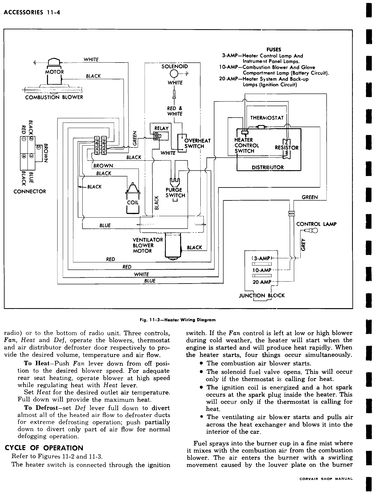
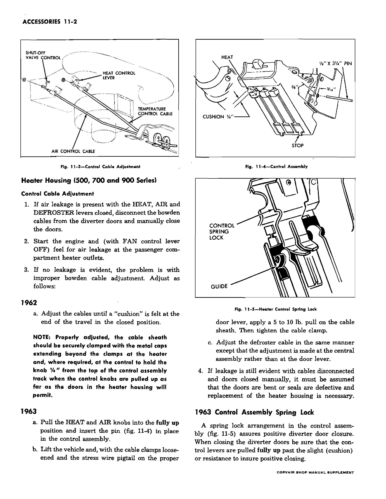
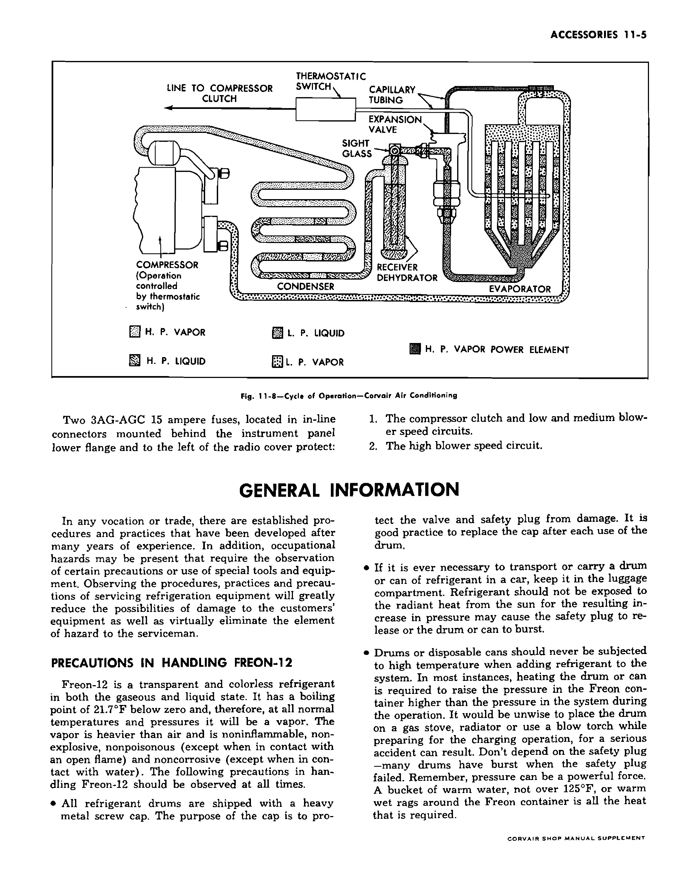
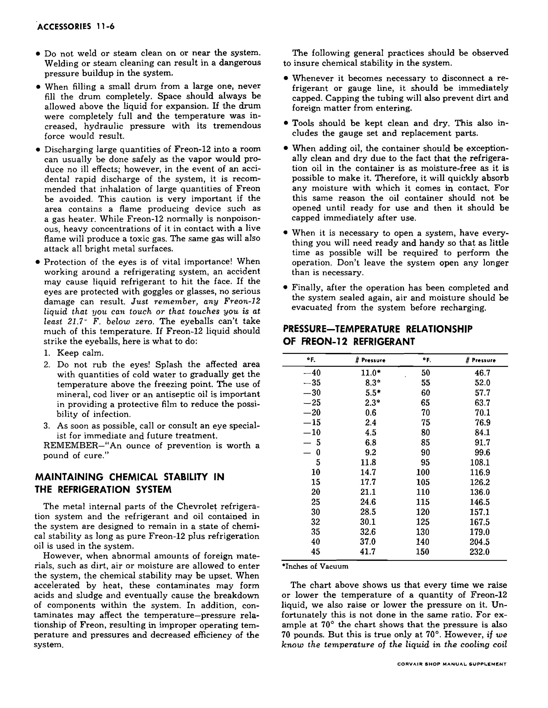
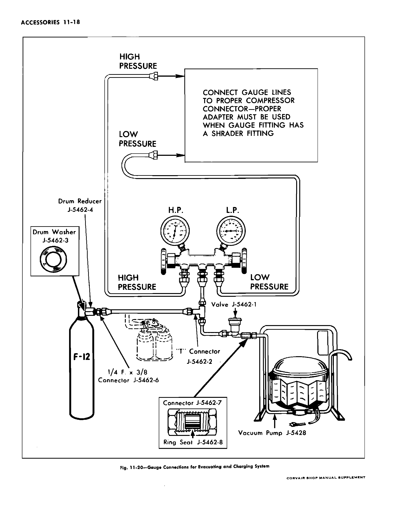
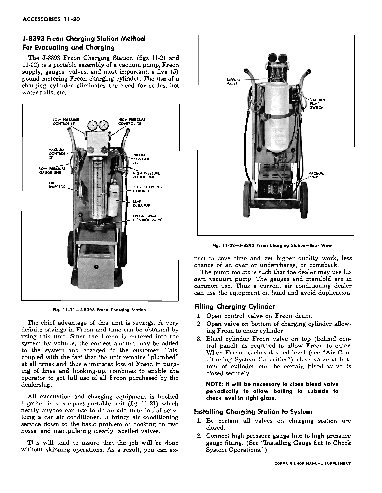
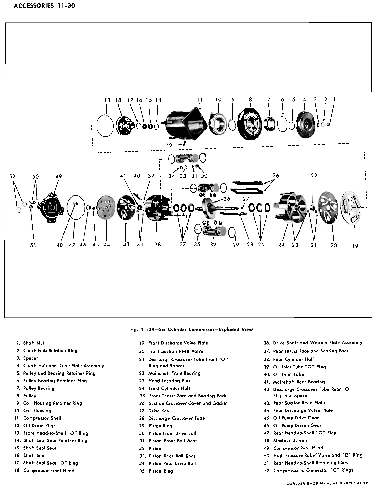
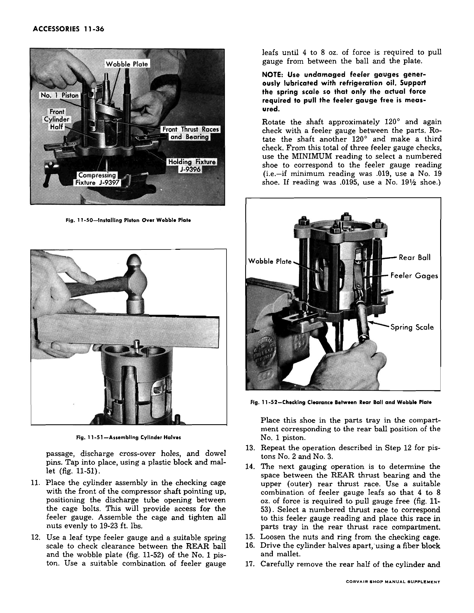
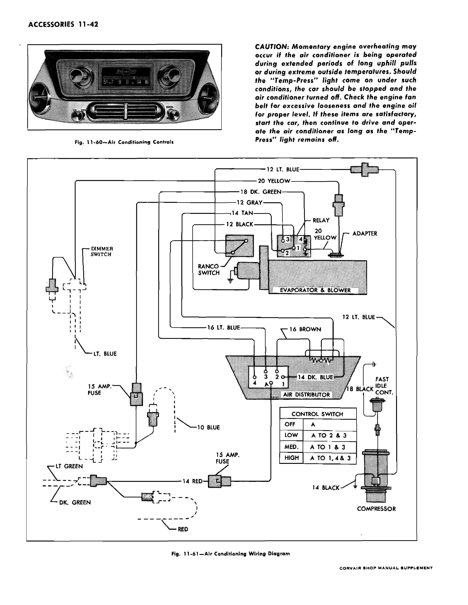

# Heaters and Accessories — 1963 Passenger Cars

This chapter covers passenger-car gasoline and direct-air heaters, the padded
instrument-panel cover, and factory air conditioning. The 1961 heater procedures
carry over under the 1962–63 supplement except where that supplement changes
them. The supplement's **1963** direct-air control-cable method replaces its
separately labeled 1962 adjustment. The base 1200-series/Corvair 95 heater
pages are commercial-only and do not apply to this passenger reference.

The original source and printed page are retained at each page marker; the
[source-page map](../data/source-page-map.jsonl) also records the physical PDF.

## Gasoline heater — 500, 700 and 900 series

 **[PDF p.82](../page-images/p0082.png)** <!-- SOURCE id=base-1961 page=11-1 years=1961,1962,1963 scope=passenger applicability=contents -->

The base section separates passenger gasoline-heater service from the
1200-series commercial instructions. Only the former is inherited here.

 **[PDF p.581](../page-images/p0581.png)** <!-- SOURCE id=supplement-1962-63 page=11-1 years=1962,1963 scope=passenger -->

The supplement explicitly carries the 1961 passenger gasoline-heater
procedures into 1962–63. Its correction to base fig. 11-21 is essential:
**item 12, spark-plug washer, and item 15, spark-plug sleeve, were not used
in any 1961–63 gasoline heater.** Ignore instructions below that would
install those two parts. The separate correction to Corvair 95 connector
wiring belongs to the commercial heater and is excluded.

 **[PDF p.83](../page-images/p0083.png)** <!-- SOURCE id=base-1961 page=11-2 years=1961,1962,1963 scope=passenger -->

### Operation and components

The gasoline heater sits at the right front dash. Cowl air passes around
the stainless heat exchanger into the distributor and passenger compartment.
The burner has a fuel nozzle, mixer cup, fuel solenoid, spark plug and
combustion-air blower. A bimetal thermostat in the air distributor cycles
fuel and ignition. The overheat switch interrupts the solenoid circuit and
automatically resets after cooling. The purge switch keeps the combustion
blower running after shutdown to clear the chamber.

 **[PDF p.84](../page-images/p0084.png)** <!-- SOURCE id=base-1961 page=11-3 years=1961,1962,1963 scope=passenger -->

The ventilator blower moves outside air through the exchanger; a separate
combustion blower supplies the burner and operates the breaker-point cam.
The fan control switch and air door are linked, so verify both switch and
door travel when diagnosing low or absent airflow.

 **[PDF p.85](../page-images/p0085.png)** <!-- SOURCE id=base-1961 page=11-4 years=1961,1962,1963 scope=passenger -->

The factory wiring drawing assigns a **3 amp** fuse to the heater-control
lamp/instrument lamps, a **10 amp** battery-circuit fuse to the combustion
blower and glove-compartment lamp, and a **20 amp** ignition-circuit fuse
to the heater system and back-up lamps. Use the wiring diagram to trace
the relay, thermostat, overheat and purge switches and solenoid.

 **[PDF p.86](../page-images/p0086.png)** <!-- SOURCE id=base-1961 page=11-5 years=1961,1962,1963 scope=passenger -->

On a call for heat, the combustion blower runs, breaker points make spark,
and the solenoid admits fuel. The flame heats the exchanger while the
ventilator blower carries warmed outside air through the distributor.
After switch-off, purge airflow continues until the purge switch opens.

### Diagnose the gasoline heater

 **[PDF p.87](../page-images/p0087.png)** <!-- SOURCE id=base-1961 page=11-6 years=1961,1962,1963 scope=passenger -->

Begin with the symptom and follow the base diagnosis guide. Check wiring,
fuses and ground before removing the burner. A heater that fails to start
requires separate checks of ventilator and combustion blowers, relay and
control switch; a running combustion blower with no flame requires fuel,
spark, solenoid, thermostat and overheat checks.

 **[PDF p.88](../page-images/p0088.png)** <!-- SOURCE id=base-1961 page=11-7 years=1961,1962,1963 scope=passenger -->

| Symptom | Factory check sequence |
| --- | --- |
| Combustion blower runs; heater does not ignite | Thermostat cable and switch, combustion-air hose, fuel flow, blower fan, exhaust restriction, points, coil, solenoid, plug and overheat switch. |
| Blower starts then stops prematurely | Fuel valve/nozzle, relay and purge-switch circuit. |
| Blower continues beyond its purge interval or stops at once | Purge switch and wiring. |
| Burner operates but passenger air remains cold | Heater-switch wiring, ventilator blower and thermostat cable. |
| Burner pops or runs unevenly | Spark gap and electrode location, points, coil, plug lead and combustion airflow. |

 **[PDF p.89](../page-images/p0089.png)** <!-- SOURCE id=base-1961 page=11-8 years=1961,1962,1963 scope=passenger -->

For too little or too much heat, check thermostat cable, thermostat,
fuel pressure and nozzle before readjusting. Fuel or combustion odor calls
for inspection of the fuel valve, burner clamp, exhaust ferrule/tube and
heat exchanger. Never treat an exhaust or burner leak as a control setting.

 **[PDF p.90](../page-images/p0090.png)** <!-- SOURCE id=base-1961 page=11-9 years=1961,1962,1963 scope=passenger -->

Check the ventilator blower with ignition and fan switch on. Check the
combustion blower through its relay, ground, hose and feed. For thermostat
continuity, connect a test light to its cold side with ignition and heater
on; move the heat cable through its travel. Replace a thermostat that will
not switch after its cable and wiring have been verified. The thermostat
is factory preset; do not bend its bimetal element to compensate for a
wrong cable setting.

 **[PDF p.91](../page-images/p0091.png)** <!-- SOURCE id=base-1961 page=11-10 years=1961,1962,1963 scope=passenger -->

Check both lobes of the combustion-blower breaker cam. The average of the
two point gaps, rather than either lobe alone, controls setting. Inspect
coil lead routing and ground before judging weak spark. A plug with carbon
bridge, damaged porcelain or mislocated electrode can prevent ignition.

 **[PDF p.92](../page-images/p0092.png)** <!-- SOURCE id=base-1961 page=11-11 years=1961,1962,1963 scope=passenger applicability=except-superseded-plug-parts -->

Remove and clean the burner spark plug, inspect its porcelain, then set
the electrode gap and location with factory gauge **J-8368**. The printed
base instruction to install the plug with item 12 washer and item 15 sleeve
is canceled by [supplement p.11-1](#p581). Verify the overheat switch and
purge switch electrically before replacing either.

 **[PDF p.93](../page-images/p0093.png)** <!-- SOURCE id=base-1961 page=11-12 years=1961,1962,1963 scope=passenger -->

Fuel comes from the engine fuel system through the heater pressure regulator.
Check pressure with a gauge at the heater connection, and inspect lines,
regulator overflow and fuel-filter screen if it is low. The regulator
procedure counts turns of its staked screw before removing the spring and
nylon disc; clean a sticking disc, restore the screw setting, then adjust
with the engine running and check for leaks. The printed **normal heater
pressure is 4½–5½ psi**; the regulator-cleaning procedure separately
instructs adjusting its screw to **4–5 psi**. Both numbers are retained
as printed in their distinct contexts.

 **[PDF p.94](../page-images/p0094.png)** <!-- SOURCE id=base-1961 page=11-13 years=1961,1962,1963 scope=passenger -->

Disconnect the solenoid lead and momentarily energize it from the battery;
listen for the valve click. The coil is approximately **50 ohms**, or
about **0.24 amp at 12 volts**. If the coil works but fuel does not flow,
inspect the valve seat, filter, nozzle and regulator. For nozzle-pattern
testing, remove the mixer cup and plug, mount the burner on gauge **J-8367**,
connect vehicle fuel and momentarily energize the solenoid. Keep the test
brief to avoid accumulating fuel.

 **[PDF p.95](../page-images/p0095.png)** <!-- SOURCE id=base-1961 page=11-14 years=1961,1962,1963 scope=passenger -->

The spray must strike the gauge's prescribed area without continuous
dribble after power is removed. Check nozzle seat leakage before replacing
the burner casting. Inspect combustion-air hose, exhaust tube and exhaust
gasket for restrictions or leaks; a loose burner clamp can cause combustion
noise and odors in the car. The source places two **¼ in.** exhaust-pipe
noise-control holes **3⅞ in.** and **12¾ in.** from the front of its
mounting bracket, respectively.

### Gasoline-heater component service

 **[PDF p.96](../page-images/p0096.png)** <!-- SOURCE id=base-1961 page=11-15 years=1961,1962,1963 scope=passenger -->

To replace the ventilator blower, disconnect its lead, remove its mounting
screws, lower the motor/fan through the opening, transfer the fan, then
reinstall and test. To remove the combustion blower, release its air hose,
wires, ground and three mounting screws, then remove its point-base cap.

 **[PDF p.97](../page-images/p0097.png)** <!-- SOURCE id=base-1961 page=11-16 years=1961,1962,1963 scope=passenger -->

For combustion-blower motor replacement, take off the cam, separate the
two case halves, remove fan and motor, then transfer gasket, case, fan,
cam and breaker base to the new motor. The base instruction discards the
new motor's unused white lead and retains its black motor lead. Set
breaker gaps before closing the point-base cap.

 **[PDF p.98](../page-images/p0098.png)** <!-- SOURCE id=base-1961 page=11-17 years=1961,1962,1963 scope=passenger -->

Refit the blower ground under its upper rear screw, secure wires to its
hose and reconnect the gang connectors. For thermostat replacement,
remove the distributor cover, disconnect its two leads and screws,
then install the new unit with the **white lead at the rear** and adjust
the heat cable. The fan switch must engage the air-door track and its
bracket tab must enter the locating hole. For breaker-base replacement,
solder the white lead with rosin-core solder, set one cam lobe to
**.018 in.**, and check the other at **.012–.024 in.** so the two-lobe
average is **.015–.021 in.**; solder the fixed point after setting.

 **[PDF p.99](../page-images/p0099.png)** <!-- SOURCE id=base-1961 page=11-18 years=1961,1962,1963 scope=passenger -->

The heater ignition coil resembles a standard automotive coil but requires
the correct heater replacement part. To change it, remove exhaust shield,
mount nuts and leads, then install the high-tension lead, black lead at
the positive terminal and brown lead at the negative terminal. The
overheat switch uses four screws and white/red-white/black leads.
Viewed from the burner end, connect the purge switch's **blue lead to
the lower terminal, red to the left and black to the right**. The relay
uses a three-way connector and two mounting screws.

 **[PDF p.100](../page-images/p0100.png)** <!-- SOURCE id=base-1961 page=11-19 years=1961,1962,1963 scope=passenger -->

For burner removal, disconnect the five-way plug, fuel-solenoid lead,
relay green lead, heater straps and upper-case screws. Move the upper
case aside to expose burner and heat exchanger before opening fuel lines.

 **[PDF p.101](../page-images/p0101.png)** <!-- SOURCE id=base-1961 page=11-20 years=1961,1962,1963 scope=passenger applicability=except-superseded-plug-parts -->

Disconnect combustion hose, ground, plug lead and fuel line; loosen the
burner clamp and withdraw the burner/mixer cup. In the burner, service
solenoid cup, seal, gasket, spring and valve, nozzle/spacer, valve seat,
fuel filter and vent tube. Blow out casting passages. Rebuild with the
factory burner service kit, keeping the designated reusable metal parts.
**Omit the item 12 washer and item 15 sleeve shown in fig. 11-21** under
the supplement correction; do not use the base instruction to add them.

 **[PDF p.102](../page-images/p0102.png)** <!-- SOURCE id=base-1961 page=11-21 years=1961,1962,1963 scope=passenger applicability=except-superseded-plug-parts -->

Seat the burner in the exchanger and tighten its circular clamp fully;
an improperly fitted clamp can admit combustion odor and noise. Reconnect
fuel, plug lead, combustion hose, ground and connectors; ensure the vent
tube protrudes through the upper case. For spark-plug removal, remove
burner and retainer cap. On installation, use the [later parts correction](#p581)
instead of base instructions calling for the obsolete washer/sleeve.
Replace the nozzle after removing mixer cup; printed nozzle torque is
**100 in. lb.** The solenoid coil and washer are replaced under its cover.

 **[PDF p.103](../page-images/p0103.png)** <!-- SOURCE id=base-1961 page=11-22 years=1961,1962,1963 scope=passenger -->

For heat-exchanger replacement, remove the burner, shield, fuel and
exhaust connections, the two blower-case nuts accessible from inside,
and drain hose. Tilt the lower case forward to lift the exchanger.
Renew exhaust gasket, restore tight exhaust/fuel joints and reattach
drain hose before fitting burner. For complete heater-unit removal,
disconnect the same exhaust/fuel/drain/combustion lines plus electrical
connectors, upper flange and the two inside blower-case nuts; lift the
unit out and reverse for installation.

 **[PDF p.104](../page-images/p0104.png)** <!-- SOURCE id=base-1961 page=11-23 years=1961,1962,1963 scope=passenger -->

For air-distributor replacement, disconnect Bowden cables and defroster
hoses, unbolt the case, transfer thermostat and fan switch, then refit
and adjust controls. To replace a knob/cable, release it at the
distributor and control assembly, insert the new knob at the bottom
of its slot, run it to the top and secure both sheath clamps. For
control-assembly replacement, remove cables, lamp and mounting screws;
reinstall with each cable at its proper knob and adjust full travel.

 **[PDF p.105](../page-images/p0105.png)** <!-- SOURCE id=base-1961 page=11-24 years=1961,1962,1963 scope=passenger -->

Set HEAT cable with the thermostat lever fully clockwise and the knob
able to reach top of track. Set DEFROST and FAN cables with their
respective doors fully closed when their knobs reach top of track.
Use the [Section 12 source pages](../page-images/p0117.png) for heater specifications.
Factory special tools are spark-plug gauge **J-8368** and nozzle spray
pattern gauge **J-8367**.

 **[PDF p.106](../page-images/p0106.png)** <!-- SOURCE id=base-1961 page=11-25 scope=commercial; excluded=passenger -->
 **[PDF p.107](../page-images/p0107.png)** <!-- SOURCE id=base-1961 page=11-26 scope=commercial; excluded=passenger -->
 **[PDF p.108](../page-images/p0108.png)** <!-- SOURCE id=base-1961 page=11-27 scope=commercial; excluded=passenger -->

Base pp.11-25–11-27 cover the 1200-series/Corvair 95 gasoline heater only.

## Direct-air heater — 1963 passenger cars

 **[PDF p.109](../page-images/p0109.png)** <!-- SOURCE id=base-1961 page=11-28 years=1961,1962,1963 scope=passenger -->

Engine cooling air enters the heater through flexible tubes, mixes with
cooler upper-shroud air at the heater housing, and passes through the
cross-air duct to rear-seat outlets and rocker-panel ducts. Diverter
doors select heat, fresh air and defrost.

 **[PDF p.110](../page-images/p0110.png)** <!-- SOURCE id=base-1961 page=11-29 years=1961,1962,1963 scope=passenger -->

The four controls are FAN (three-speed blower), HEAT and AIR (mixing
doors), and DEFROST (front outlet or windshield ducts). Shut the system
off with FAN off and HEAT/AIR fully up. Oil or fumes in the engine
compartment can enter passenger ducts; clean spilled oil and correct
gasket/seal leaks. For blower replacement from below, disconnect lead,
unbolt mounting plate, lower motor/fan past suspension and exhaust,
transfer drum and reinstall.

 **[PDF p.111](../page-images/p0111.png)** <!-- SOURCE id=base-1961 page=11-30 years=1961,1962,1963 scope=passenger -->

Remove the heater housing only for damaged doors/seals or collision
repair: remove engine as directed in the base procedure, release cold-air
inlet, rubber adapter, blower lead and control cables, cross-duct angle
brackets and package-shelf stud nuts; lower the rear housing and draw
the cross duct over rear-suspension pads. Renew damaged passenger air-port
seals and replace a housing whose doors cannot be repaired. During refit,
seat the cross duct on both passenger openings and restore brackets,
stud nuts, inlet fasteners and cable travel.

 **[PDF p.112](../page-images/p0112.png)** <!-- SOURCE id=base-1961 page=11-31 years=1961,1962,1963 scope=passenger applicability=except-superseded-cable-setting -->

With housing removed, the inlet assembly separates from cross duct at
two stud nuts and one screw; transfer hot-air hoses and blower to the
replacement. The heater's control cables are specific to this system.
Use the [1963 cable setting below](#p582), which supersedes the base
general cable-adjustment advice.

 **[PDF p.113](../page-images/p0113.png)** <!-- SOURCE id=base-1961 page=11-32 scope=commercial; excluded=passenger -->
 **[PDF p.114](../page-images/p0114.png)** <!-- SOURCE id=base-1961 page=11-33 scope=commercial; excluded=passenger -->
 **[PDF p.115](../page-images/p0115.png)** <!-- SOURCE id=base-1961 page=11-34 scope=commercial; excluded=passenger -->

Base pp.11-32–11-34 cover the 1200-series/Corvair 95 direct-air heater only.

 **[PDF p.582](../page-images/p0582.png)** <!-- SOURCE id=supplement-1962-63 page=11-2 years=1963 scope=passenger -->

### 1963 heater door and cable adjustment

The supplement introduced manually operated rear-seat heat-outlet
shut-off doors for 1962; no later deletion is given, so they carry into
1963. If air leaks with HEAT, AIR and DEFROST levers closed:

1. Disconnect Bowden cables and close the diverter doors by hand.
2. Run engine with FAN off and feel the passenger outlets. If leakage
   stops, adjust the cables. If it persists with the doors manually
   closed, inspect for bent doors or failed seals; replace the housing
   where necessary.
3. For the **1963 control assembly**, pull HEAT and AIR knobs fully up
   and insert the **⅛ × 3¼ in.** control-assembly pin shown in fig. 11-4.
4. With cable clamps loose and each stress-wire pigtail on its correct
   door lever, pull the cable sheath **5–10 lb** and tighten the clamp.
   Set the DEFROST cable similarly at the central assembly.
5. The 1963 spring lock must pass the slight cushion/resistance at the
   top of lever travel to close the diverter doors positively.

The supplement's separately headed **1962** cable-setting paragraph is
not a 1963 adjustment specification.

| 1963 direct-air setting | Factory value |
| --- | --- |
| Cable-sheath pull before tightening clamp | 5–10 lb |
| Control-assembly temporary pin | ⅛ × 3¼ in. |

## Padded instrument-panel cover

 **[PDF p.116](../page-images/p0116.png)** <!-- SOURCE id=base-1961 page=11-35 years=1961,1962,1963 scope=passenger -->

Protect front seats. Remove lower windshield garnish moldings, speaker
opening molding, ashtray, cluster center panel, finishing molding and
cover retainer molding. Detach cemented cover areas carefully; bending
the one-piece cover can permanently distort it. Clean the dash, apply
a thin coat of neoprene weatherstrip adhesive to corresponding cover
areas and a heavy coat to the dash, then immediately position and press
the cover from rear edge around the ashtray and forward edge. Along the
forward edge, the adhesive area grows from **2 in.** at the speaker grille
centerline to **6 in.** at the outboard ends; use a **1 in.** adhesive
band at speaker and ashtray cutouts. Trim at moldings as needed, remove
any old center-panel rubber seal, and reinstall the hardware. The
retainer molding is screw-mounted; the radio-speaker finish molding
has underside nuts.

## Factory air conditioning — 1962–63 design

 **[PDF p.583](../page-images/p0583.png)** <!-- SOURCE id=supplement-1962-63 page=11-3 years=1962,1963 scope=passenger applicability=contents -->

The supplement introduces passenger air conditioning on printed pp.11-4–11-43.

 **[PDF p.584](../page-images/p0584.png)** <!-- SOURCE id=supplement-1962-63 page=11-4 years=1962,1963 scope=passenger applicability=factory-air-conditioning -->

The factory system recirculates cabin air. Evaporator, blower and thermostatic
switch sit under the dash; condenser above the engine; receiver-dehydrator
with sight glass at right rear quarter. The green six-cylinder compressor
rotates opposite those in other 1962–63 Chevrolets and is **not interchangeable**.
The thermostat cycles its clutch. A selenium rectifier limits blower speed
to MEDIUM when headlights are on.

 **[PDF p.585](../page-images/p0585.png)** <!-- SOURCE id=supplement-1962-63 page=11-5 years=1962,1963 scope=passenger applicability=factory-air-conditioning -->

Two in-line **15 amp 3AG-AGC fuses** behind the lower dash flange protect
clutch/low-medium blower and high blower circuits separately. The factory
refrigerant is Freon-12. The source limits warming water for charging
containers to **125°F** and warns against sun or flame heating.

 **[PDF p.586](../page-images/p0586.png)** <!-- SOURCE id=supplement-1962-63 page=11-6 years=1962,1963 scope=passenger applicability=factory-air-conditioning -->

Keep tubing, tools, replacement parts and oil dry and clean. Cap an opened
connection at once, minimize exposure to air, then evacuate before charging.
The source warns that liquid refrigerant can freeze eyes/skin and contact
with a flame produces toxic gas. The printed Freon-12 chart, checked
against the page image, distinguishes starred **inches of vacuum** from
unstarred **pressure in pounds**:

| Temperature (°F) | Pressure / vacuum | Temperature (°F) | Pressure (lb) |
| --- | --- | --- | --- |
| −40 | 11.0 in. vacuum | 50 | 46.7 |
| −35 | 8.3 in. vacuum | 55 | 52.0 |
| −30 | 5.5 in. vacuum | 60 | 57.7 |
| −25 | 2.3 in. vacuum | 65 | 63.7 |
| −20 | 0.6 lb | 70 | 70.1 |
| −15 | 2.4 lb | 75 | 76.9 |
| −10 | 4.5 lb | 80 | 84.1 |
| −5 | 6.8 lb | 85 | 91.7 |
| 0 | 9.2 lb | 90 | 99.6 |
| 5 | 11.8 lb | 95 | 108.1 |
| 10 | 14.7 lb | 100 | 116.9 |
| 15 | 17.7 lb | 105 | 126.2 |
| 20 | 21.1 lb | 110 | 136.0 |
| 25 | 24.6 lb | 115 | 146.5 |
| 30 | 28.5 lb | 120 | 157.1 |
| 32 | 30.1 lb | 125 | 167.5 |
| 35 | 32.6 lb | 130 | 179.0 |
| 40 | 37.0 lb | 140 | 204.5 |
| 45 | 41.7 lb | 150 | 232.0 |

 **[PDF p.587](../page-images/p0587.png)** <!-- SOURCE id=supplement-1962-63 page=11-7 years=1962,1963 scope=passenger applicability=factory-air-conditioning -->

The low-side compound gauge reads pressure and **0–30 in. Hg** vacuum;
the high-side gauge reads pressure. The manifold center port serves both
valves. Cap and leak-test manifold connections before opening them to the
system. Check component joints with the factory leak detector.

 **[PDF p.588](../page-images/p0588.png)** <!-- SOURCE id=supplement-1962-63 page=11-8 years=1962,1963 scope=passenger applicability=factory-air-conditioning -->

The factory describes a flame-type detector, cautions against use near
flammables and against breathing its fumes, and warns that dust can mimic
a large leak. Clean its intake without pushing wire through the orifice.
Vacuum pump **J-5428** is specified for evacuation.

 **[PDF p.589](../page-images/p0589.png)** <!-- SOURCE id=supplement-1962-63 page=11-9 years=1962,1963 scope=passenger applicability=factory-air-conditioning -->

For J-5428, fit **J-5462-1** to prevent pressure entering the pump,
remove its outlet dust cap and maintain pump oil to its side-level screw
with **Frigidaire 150-viscosity oil**. The source lists refrigerant in
**25 lb drums** or **15 oz cans**. Tool J-6272 holds three cans, **45 oz**
total; J-6271 pierces one can. That 45 oz is a tool quantity, **not**
system capacity. Keep compressor oil sealed against moisture.

 **[PDF p.590](../page-images/p0590.png)** <!-- SOURCE id=supplement-1962-63 page=11-10 years=1962,1963 scope=passenger applicability=factory-air-conditioning -->

### Inspection and performance

At predelivery, check belt, clutch slip after **10 minutes at about
1500 rpm**, sight glass, leaks, oil-loss evidence and controls. At
**1,000 miles**, inspect leaks, clamps, brace and belt. Check condenser
and drains periodically, sight glass every **6,000 miles**, hoses and
charge annually, and run the system **10–15 minutes weekly** during
long idle seasons for seal lubrication.

The performance test requires closed doors/windows, raised engine lid,
shop-fan air across condenser left-to-right, transmission in NEUTRAL
at **1500 rpm**, maximum cooling/high blower, heater off, gauges fitted,
about **10 minutes** run-in and a thermometer at right diffuser. The
printed chart assumes about **35–40% relative humidity** over the
evaporator. Starred pressures are at clutch disengagement.

| Grille air (°F) | Head pressure (psi) | Suction pressure (psi) | Right outlet air (°F) |
| --- | --- | --- | --- |
| 70 | 140–150 | 13.5 | 37–42 |
| 80 | 160–170 | 13.5 | 38–43 |
| 90 | 180–190 | 15.5 | 38–43 |
| 100 | 225–235 | 17 | 38–43 |
| 110 | 260–270 | 17 | 40 |
| 120 | 300–310 | 17 | 47 |

 **[PDF p.591](../page-images/p0591.png)** <!-- SOURCE id=supplement-1962-63 page=11-11 years=1962,1963 scope=passenger applicability=factory-air-conditioning -->

### System diagnosis

Use the factory performance-test setup before judging gauge readings.
Check clutch/belt, controls, condenser airflow, sight glass and leaks
before opening the system. Record both gauge readings.

| Symptom | Factory checks |
| --- | --- |
| Drafts | Adjust outlets; check thermostatic switch and linkage. |
| Little air at outlets | Check blower speeds/voltage/rotation, evaporator air passage and bearings. |
| Air noise | Clear obstructions, kinks, loose material and dampers in ducts/outlets. |
| Scrape or rattle | Check fan clearance, motor bearings and duct/compressor fasteners. |
| Water in passenger area | Clear/reconnect drains; replace displaced evaporator felt baffle. |
| Hiss at expansion valve | Check charge/leak, receiver restriction, kink or inlet screen. |
| Partial frost or poor cooling | Verify controls, charge/leaks, line restriction, switch/relay, valve and clutch release. |

 **[PDF p.592](../page-images/p0592.png)** <!-- SOURCE id=supplement-1962-63 page=11-12 years=1962,1963 scope=passenger applicability=factory-air-conditioning -->

| Symptom | Factory checks |
| --- | --- |
| No cooling | Test switch/relay, clutch coil and slip, charge/leak, blower, duct/coil airflow, receiver/liquid line and expansion valve. |
| Intermittent cooling | Check evaporator freeze-up, then expansion-valve bulb charge. |
| Too cold | Check thermostatic-switch linkage/adjustment. |
| High high-side gauge | Check air/overcharge, blocked condenser airflow and engine temperature. |
| Low high-side gauge | Check low charge/leak, then compressor pumping. |
| High low-side gauge | Check clutch slip, excessive head pressure, valve overfeed and compressor. |

 **[PDF p.593](../page-images/p0593.png)** <!-- SOURCE id=supplement-1962-63 page=11-13 years=1962,1963 scope=passenger applicability=factory-air-conditioning -->

| Symptom | Factory checks |
| --- | --- |
| Low low-side gauge | Leak/low charge; kinked or blocked line, receiver or valve screen; dirty or iced evaporator. |
| High head | Air/overcharge, blocked condenser airflow or hot condensing air. |
| Low head | Restricted expansion valve, weak compressor, low charge or cool condensing air. |
| Short charge clues | Valve hiss, bubbles/foam in sight glass, warm coil, low head, little sweating. |
| Expansion needle stuck open | Poor cooling and high head. |
| Expansion needle stuck shut | No cooling and very low back pressure. |

The source lists further possible no-cooling causes including switch
misadjustment, expansion bulb location/charge, receiver restriction and
clutch failure. Diagnose the actual cause before replacing components.

 **[PDF p.594](../page-images/p0594.png)** <!-- SOURCE id=supplement-1962-63 page=11-14 years=1962,1963 scope=passenger applicability=factory-air-conditioning -->

For thermostatic-switch adjustment, verify its lever is fully forward
when COOL knob is fully out; reset Bowden cable if not. Fit gauges and
use the performance-test setup. Remove the fiber cover. If compressor
runs regardless of screw position, replace the switch for fused points;
if it never runs, check circuit/bellows action and replace as needed.
At the end of a cooling cycle compare suction to the temperature chart:
if below target, turn screw **clockwise in one-turn increments**; if
above, turn it counterclockwise. Keep lever forward, observe several
cycles, replace cover and reconfirm cable travel.

 **[PDF p.595](../page-images/p0595.png)** <!-- SOURCE id=supplement-1962-63 page=11-15 years=1962,1963 scope=passenger applicability=factory-air-conditioning -->

### Capacity, expansion valve and line connections

The 1962–63 factory system specifies a **5 lb Freon-12 charge by mass**.
Section 12 repeats that mass, while the can-count shorthand in this
section conflicts with the printed can size. The oil quantity printed
here also differs from Section 12; it is withheld below.

| Factory capacity item | Printed value | Applicability |
| --- | --- | --- |
| Freon-12 charge | **5 lb by mass** | 1962–63 factory A/C; printed can count is inexact |
| Compressor oil charge | Conflicting printed quantities; withheld | Verify the installed system before filling <!-- NEEDS REVIEW: Supplement Section 11 p.11-15 prints 10 oz 525-viscosity oil; Section 12 p.12-13 prints 11 oz for the same 1962–63 Cool Pack system. Find a controlling 1963 factory correction before selecting an oil quantity. --> |

<!-- RESOLVED CAPACITY INTERPRETATION: Supplement Section 11 p.11-15 and Section 12 p.12-13 independently specify 5 lb Freon-12. Section 11 p.11-9 says each disposable can contains 15 oz, so its five-can shorthand is 75 oz, not the specified 80 oz. Retain the printed can statement as a source inconsistency; use the repeated mass specification. -->

| Expansion-valve condition | Factory indications |
| --- | --- |
| Stuck open or failed power element | High suction/head pressure, noisy compressor, poor cooling/freezing. |
| Stuck closed or plugged screen | Very low suction pressure, no cooling. |
| Bulb installed poorly | Normal pressures, poor cooling. |

Do not kink metal lines, bend a hose tighter than **10 times its diameter**
or route it within **2½ in.** of exhaust manifold. Renew and oil every
opened O-ring, use a backing wrench and no fitting sealer. At a steel-to-
aluminum joint, use the aluminum torque.

| Tube O.D. (in.) | Fitting (in.) | Steel torque (ft-lb) | Aluminum torque (ft-lb) |
| --- | --- | --- | --- |
| ¼ | 7⁄16 | 10–15 | 5–7 |
| ⅜ | ⅝ | 30–35 | 11–13 |
| ½ | ¾ | 30–35 | 11–13 |
| ⅝ | ⅞ | 30–35 | 18–21 |
| ¾ | 1¹⁄₁₆ | 30–35 | 23–28 |

 **[PDF p.596](../page-images/p0596.png)** <!-- SOURCE id=supplement-1962-63 page=11-16 years=1962,1963 scope=passenger applicability=factory-air-conditioning -->

Draw down the factory hose clamp until its rubber collar reaches the
figure's slot relationship, then tighten to **40 in. lb.** Use approved
refrigeration hose/O-rings. Wear goggles when opening lines. With
engine off, identify compressor high/low cored ports and attach the
manifold with correct adapters while keeping dirt out.

 **[PDF p.597](../page-images/p0597.png)** <!-- SOURCE id=supplement-1962-63 page=11-17 years=1962,1963 scope=passenger applicability=factory-air-conditioning -->

### Evacuating and charging

The source's sea-level evacuation target is **26–28 in. Hg**; lower
it **1 in. Hg per 1,000 ft** elevation (**21–23 in. Hg** at
**5,000 ft**). Evacuate after any opening. Charge vapor after leak
testing, warming upright containers only in water ≤**125°F**.
**While adding refrigerant, compressor head pressure should not exceed 275 psi.**
The page also says pressure within the Freon containers should stay between
**12 and 90–100 psi**. This is a charging-process limit,
not a universal operating ceiling: the separate performance test lists
**300–310 psi** at 120°F grille air, and the fast-idle instruction uses
**300 psi** under its own conditions. Apply each number only to its
stated procedure.
<!-- RESOLVED SCOPE: Supplement Section 11 p.11-17 puts the 275-psi limit under "Adding Refrigerant" with the compressor running; p.11-10's 300–310-psi row belongs to a 120°F performance test, and p.11-41's 300-psi statement to fast-idle setup. These values describe different procedures, not one universal operating limit. -->

For the printed purging sequence, connect both gauges with engine off
and bleed high side slowly through center port. Below **100 psi** high
side, open low side and continue until remaining pressure ≤**5 psi**;
opening too quickly can expel compressor oil.

 **[PDF p.598](../page-images/p0598.png)** <!-- SOURCE id=supplement-1962-63 page=11-18 years=1962,1963 scope=passenger applicability=factory-air-conditioning -->

The tool-connection diagram identifies manifold, compressor high/low
adapters, vacuum-pump shutoff and refrigerant-container connections.
Match hoses to marked compressor ports before opening a valve.

 **[PDF p.599](../page-images/p0599.png)** <!-- SOURCE id=supplement-1962-63 page=11-19 years=1962,1963 scope=passenger applicability=factory-air-conditioning -->

Close pump shutoff before admitting refrigerant. The factory sequence
evacuates, checks vacuum hold for **3 minutes**, admits a small test
charge for leak detection, evacuates again and charges vapor. Investigate
vacuum failure at car and gauge connections. With engine/compressor
running for final charge, use at least **1,000 rpm**; check pressure,
sight glass and performance at **1500 rpm** afterward.

 **[PDF p.600](../page-images/p0600.png)** <!-- SOURCE id=supplement-1962-63 page=11-20 years=1962,1963 scope=passenger applicability=factory-air-conditioning -->

The alternative **J-8393 charging station** measures refrigerant in a
**5 lb** graduated cylinder. To fill it, open drum supply and bottom
cylinder valve, bleed at top as required, and close both when desired
level is visible. Close the bleed intermittently so boiling subsides
before sight-glass reading. To attach station, close all its valves,
connect high-side gauge, open high control **(2) one turn**, crack low
control **(1)** to purge its loose hose for **3 seconds**, then attach
the low-side gauge.

 **[PDF p.601](../page-images/p0601.png)** <!-- SOURCE id=supplement-1962-63 page=11-21 years=1962,1963 scope=passenger applicability=factory-air-conditioning -->

The J-8393 method calls for **28–29 in. Hg** and **15 minutes** pumping
after reaching that vacuum. The printed operating sequence is:

1. With station attached, remove low-side hose/adapter, crack high **(2)**
   and low **(1)** controls to purge slowly without carrying oil, then
   reconnect low-side hose as flow dwindles.
2. Start pump and open vacuum control **(3)**. Reach **28–29 in. Hg**,
   then continue **15 minutes**. If unobtainable, close (3), stop pump,
   admit **½ lb** through Freon control **(4)**, repair leaks and retry.
3. After initial evacuation, admit another **½ lb**, purge it and
   evacuate **5 minutes** more. Fill station cylinder to the required
   mark only after the [printed charge conflict](#p595) is resolved.
4. Close low control **(1)**; fully open Freon control **(4)** to admit
   liquid into the stopped system. When required charge enters, close
   (4) and both hand shutoffs.
5. If charge will not all enter, close high control and (4), idle the
   engine with compressor running, and crack (4) plus low control (1).
   Regulate (4) so low-side gauge remains **below 50 psi**, preventing
   liquid from reaching the running compressor. Close both valves and
   performance-test before removing gauges.

The source's step 11 refers back to “step 3” for the full-charge attempt,
apparently a printed cross-reference error; that operation is step 10.
The compressor originally holds **10 oz** of Frigidaire 525-viscosity oil.
Check only after evidence of major loss. After **10 minutes at
1,000–1,500 rpm**, drain and measure compressor oil:

| Drained quantity | Replacement-compressor fresh oil |
| --- | --- |
| At least 4 fluid oz | Same measured amount |
| Less than 4 fluid oz | 6 fluid oz |

For a field-repaired compressor, add **1 fluid oz** more. Drain a new
service compressor's shipping oil before filling to the required amount.

 **[PDF p.602](../page-images/p0602.png)** <!-- SOURCE id=supplement-1962-63 page=11-22 years=1962,1963 scope=passenger applicability=factory-air-conditioning -->

If the compressor could not be run first, the source uses a **1½ fluid
oz** threshold: above it without a major leak, replace the measured
amount; below it after major loss, add **6 fluid oz** to a replacement
or **7 fluid oz** to a repaired unit. For chips or foreign matter,
renew receiver-dehydrator, clean affected parts and add the full
**10 fluid oz** of new oil.

| Replaced part | Additional fresh oil |
| --- | --- |
| Evaporator | 3 fluid oz |
| Condenser | 1 fluid oz |
| Receiver-dehydrator | 1 fluid oz |

### Evaporator, controls and compressor removal

 **[PDF p.603](../page-images/p0603.png)** <!-- SOURCE id=supplement-1962-63 page=11-23 years=1962,1963 scope=passenger applicability=factory-air-conditioning -->

To remove the evaporator, purge the system, disconnect switch/blower
wiring and control cable, support the case, then remove **three** bracket
stud nuts from the luggage compartment, **two** dash bracket screws and
the control-to-blower screw. Lower the case, unplug relay and rectifier,
release both drain tubes, disconnect and immediately cap both refrigerant
lines, then lift out. To renew its core, remove the **13** cover screws,
lift the core/cover/brackets out, release **six** core bracket screws,
transfer expansion valve and rebuild. Route switch capillary tube
before closing the blower-to-evaporator joint.

 **[PDF p.604](../page-images/p0604.png)** <!-- SOURCE id=supplement-1962-63 page=11-24 years=1962,1963 scope=passenger applicability=factory-air-conditioning -->

Reinstall evaporator with drain tubes, relay/rectifier leads, blower
flange engaged in control assembly, all dash/trunk mounts and switch
cable properly adjusted. The expansion valve is factory preset and
cannot be adjusted: first check inlet screen and sensing bulb contact,
clamp and insulation. If faulty, remove case/core, transfer valve and
capillary, position felt baffle, and seal insulation with no air leaks.
For blower motor, remove its rear bracket nut and **five** plate screws;
transfer vaned wheel. For thermostatic switch, remove leads/cable and
mount screws, separate the lower blower/evaporator joint enough to
withdraw capillary, then route replacement tube in a circle through
the air passage between case and rubber gasket.

 **[PDF p.605](../page-images/p0605.png)** <!-- SOURCE id=supplement-1962-63 page=11-25 years=1962,1963 scope=passenger applicability=factory-air-conditioning -->

The control panel hangs from **four** long screws beneath the radio;
lower it, unplug panel/relay and release thermostat cable. During refit,
engage blower flange correctly and readjust cable. For blower switch,
remove **seven** cover screws without tearing its rear rubber gasket,
pull knob, use **J-7673** on spanner nut, record connector positions,
then replace switch and spacer. The supplement replaces the 1961
air-conditioning compressor with a serviceable six-cylinder type.

 **[PDF p.606](../page-images/p0606.png)** <!-- SOURCE id=supplement-1962-63 page=11-26 years=1962,1963 scope=passenger applicability=factory-air-conditioning -->

For complete compressor removal, purge, unbolt/cap the front fittings
block, release pivot/adjuster and belt, disconnect feed/ground, remove
front triangular bracket bolts and slide long pivot bolt forward to
lift unit. For engine access or clutch/pulley work, the source permits
repositioning compressor **with lines connected**. Drain and measure
oil when removed. A service compressor arrives without reusable clutch
coil/pulley. Refit fittings block with new O-rings and torque its bolt
**17–23 ft-lb**; restore bracket, belt, wiring and belt tension.

### Compressor clutch and external service

 **[PDF p.607](../page-images/p0607.png)** <!-- SOURCE id=supplement-1962-63 page=11-27 years=1962,1963 scope=passenger applicability=factory-air-conditioning -->

Hub/drive plate, pulley/bearing and coil housing can be serviced without
opening refrigerant lines. Shaft seal can be serviced on car but the
system must first be purged. Use holding bracket **J-9396**, shaft-nut
tool **J-9399** and the specified puller for hub removal; replace a
heat-warped friction plate.

 **[PDF p.608](../page-images/p0608.png)** <!-- SOURCE id=supplement-1962-63 page=11-28 years=1962,1963 scope=passenger applicability=factory-air-conditioning -->

Install the drive plate with the proper installer, never by hammering.
Fit retainer with convex side toward washer; tighten shaft nut
**14–16 ft-lb** and verify clutch air gap **.022 in.** Cycle clutch
at least **20 times** at about **one-second** intervals to seat faces.
For pulley/bearing removal use puller **J-8433** with legs **J-9405-1**;
inspect bearing and friction surface before reuse.

 **[PDF p.609](../page-images/p0609.png)** <!-- SOURCE id=supplement-1962-63 page=11-29 years=1962,1963 scope=passenger applicability=factory-air-conditioning -->

Remove pulley bearing wire retainer, press bearing out with **J-9398**
and **J-8092**, then press replacement in and refit retainer. Mark coil
housing orientation and terminal position before removing its ring;
inspect cracks/loose connectors. Coil draw must not exceed **3.2 amp
at 12 V DC** at room temperature. Refit housing at its marks with the
retainer's flat face toward the coil.

 **[PDF p.610](../page-images/p0610.png)** <!-- SOURCE id=supplement-1962-63 page=11-30 years=1962,1963 scope=passenger applicability=factory-air-conditioning -->

The compressor sectional drawing identifies external clutch, shaft,
bearings, seal, cylinder and rear-head components. Preserve the
factory figure with the page citation when identifying disassembly order.

### Compressor seal and internal mechanism

 **[PDF p.611](../page-images/p0611.png)** <!-- SOURCE id=supplement-1962-63 page=11-31 years=1962,1963 scope=passenger applicability=factory-air-conditioning -->

Major internal service requires purging, clean paper-covered bench,
correct fixtures and packaged service seals. Keep matched piston,
shoe, ball-seat and cylinder locations together. Use the factory
numbered ball seats and thrust races, not an unmeasured substitute.
The source specifies a fresh gasket/O-ring kit at each rebuild and
provides **10 ball-seat sizes** and **14 thrust-race sizes**, each range
including a ZERO size.

 **[PDF p.612](../page-images/p0612.png)** <!-- SOURCE id=supplement-1962-63 page=11-32 years=1962,1963 scope=passenger applicability=factory-air-conditioning -->

For shaft seal, remove seat O-ring with **J-5139**, withdraw seal with
**J-9392**, inspect seat/shaft, oil new parts with clean refrigeration
oil and refit retainer with its **flat side away from seal seat**.
Leak-test compressor before evacuation and charging. Replace a faulty
rear-head pressure-relief valve and gasket after purge; then evacuate
and recharge.

For seal removal, first take off clutch hub/drive plate and shaft key,
release seat retainer with **J-5403**, lift seat with **J-9393**, remove
its O-ring with J-5139, then turn J-9392 into seal tabs and lift seal.
To install, engage new seal on J-9392, turn it onto shaft flat, oil
new O-ring/cavity/shaft, seat seal face with J-9393 and restore ring
with its flat face away from the seat. Do not scratch either seal face.

 **[PDF p.613](../page-images/p0613.png)** <!-- SOURCE id=supplement-1962-63 page=11-33 years=1962,1963 scope=passenger applicability=factory-air-conditioning -->

Inspect rear reeds and valve plate; renew damaged pieces. The oil-pump
outer gear must be positioned at about **9 o'clock**, viewed from sump
side, before rear-head assembly. Oil gears, reeds and gasket contact,
keep rear-head suction/discharge ports upward and tighten head nuts
**19–23 ft-lb**.

For rear-head service, mount the cleaned, drained compressor rear-up
on **J-9396**, discard its four old head nuts and head O-ring, inspect
Teflon sealing webs and suction screen, and renew both pump gears if
either is worn. Preserve gear-end orientation. Pry out the rear
discharge plate carefully and inspect its reeds/seats; lift rear suction
reed. During assembly align reeds/plate on dowels, trial-position head
with lower pads at oil sump, place inner gear on shaft D-flat, set
outer gear at 9 o'clock, oil ring and sealing areas, seat screen/head
without binding pump gears, use new nuts, then leak-test.

 **[PDF p.614](../page-images/p0614.png)** <!-- SOURCE id=supplement-1962-63 page=11-34 years=1962,1963 scope=passenger applicability=factory-air-conditioning -->

With checking cage **J-9397**, tighten cage nuts **15 ft-lb** and
check rear piston shoe and thrust-race clearances before disassembly.
Number the three pistons/cylinders and keep their original ball/seat
sets together. Separate cylinder halves only with the crossover tube
discarded for replacement. Internal gauging continues on pp.11-35–11-37.

For interior-mechanism removal, remove rear head/reeds, oil-inlet tube
and O-ring with J-5139, lay shell sideways and slide mechanism/front
head out without hammering. Inspect front head Teflon, front reeds and
plates, then discard crossover-cover gasket. In test cage, the rear
piston shoe clearance must be **.0005–.0010 in.**, rear thrust-race
clearance at most **.0015 in.** To split the cylinder, number pistons
and bores **1–3**, drive discharge tube **toward rear** with **J-9492**,
position low side of swash plate under crossover tube, separate halves
with fiber block/mallet, and discard the old crossover tube. Transfer
each piston, ball and seat to matching compartment in tray **J-9402**.

 **[PDF p.615](../page-images/p0615.png)** <!-- SOURCE id=supplement-1962-63 page=11-35 years=1962,1963 scope=passenger applicability=factory-air-conditioning -->

Inspect piston rings, shoes, balls, shaft/wobble plate and cylinder
bores. Do not disturb the factory-set wobble plate on its shaft.
The source's two gauging procedures select numbered rear shoes and
thrust races from measured clearances. Preserve each measurement and
selected numbered part with its piston position during reassembly.

Renew damaged rings/pistons/balls and deeply scored cylinder halves;
discard both old thrust-race/bearing packs. Clean reusable parts and
replace main bearings with **J-9432** as necessary. The required
running clearance at each ball seat is **.0005–.0010 in.** at the
tightest point over **360°** of wobble-plate rotation. Target shaft
thrust running clearance is **.0005–.0015 in.** The numbered ball
seats and thrust races come in **.0005 in.** increments.

Begin gauging with **four ZERO thrust races, three ZERO ball seats and
two new thrust bearings**. Fit ZERO race/bearing/ZERO race to each end
of shaft and oil wobble-plate faces. Set shaft into front cylinder on
J-9397. Put balls in piston pockets with a little petroleum jelly and
ZERO seats on **front** balls only; leave rear balls bare. **Do not
install piston rings yet.** Turn high point of plate to bore No. 1,
insert notched front end of piston No. 1 with front ball/seat and rear
bare ball around plate, holding front thrust pack together. Repeat
for pistons 2 and 3; align rear cylinder with suction and discharge
passages and dowels, and tap halves together with plastic block/mallet.

 **[PDF p.616](../page-images/p0616.png)** <!-- SOURCE id=supplement-1962-63 page=11-36 years=1962,1963 scope=passenger applicability=factory-air-conditioning -->

The gauging procedure turns the shaft approximately **120°** between
three measurements at each piston. Use oiled undamaged feeler leaves
and spring scale so the leaf takes **4–8 oz** to withdraw; select the
numbered shoe using the **minimum** reading. For example, the source pairs a minimum
**.019 in.** reading with a **No. 19** shoe and **.0195 in.** with a
**No. 19½** shoe. Record rear thrust measurement separately.

Tighten gauging-cage nuts evenly to **19–23 ft-lb** with front shaft
pointing up and discharge opening between cage bolts. Repeat rear-ball
measurement at all three pistons, selecting each numbered shoe from
its own minimum. Measure between rear thrust bearing and outer rear
ZERO race with the same **4–8 oz** feeler drag; select matching
numbered rear thrust race. Loosen cage, split halves and return each
matched piston/ball/seat/shoe to its tray pocket.

 **[PDF p.617](../page-images/p0617.png)** <!-- SOURCE id=supplement-1962-63 page=11-37 years=1962,1963 scope=passenger applicability=factory-air-conditioning -->

Transfer each matched piston, ball, seat and numbered rear shoe to
the corresponding pocket of parts tray **J-9402**. Replace the zero
gauging race with the numbered thrust race chosen by the source's
measurement. Reassemble with new seals/O-rings and fixture **J-9397**.

Install front ZERO/race/bearing pack and rear ZERO/bearing/**numbered**
race pack on shaft. Install a piston ring on each piston end with
scraper groove **toward piston center**. Refit balls, front ZERO seats
and matched rear numbered seats. With plate high point at bore No. 1,
fit piston 1 over it, compress front ring into front cylinder, then
repeat pistons 2 and 3. Fit a **new** crossover tube into front half,
stagger pistons, lower rear cylinder onto them and compress their rear
rings. Align crossover tube with rear bore with its **flattened side
facing compressor interior** for plate clearance. Seat halves on dowels
using fiber block/mallet or cage. Oil moving parts and confirm free
rotation; regauge if binding/noisy. Oil new rectangular crossover-cover
gasket and fit cover into dovetail slot using **J-9433** or a
**.015–.020 in.** spring-steel shoehorn, centered at cylinder ends.

 **[PDF p.618](../page-images/p0618.png)** <!-- SOURCE id=supplement-1962-63 page=11-38 years=1962,1963 scope=passenger applicability=factory-air-conditioning -->

Install cylinder mechanism into shell without disturbing the matched
parts. Position front suction reed, discharge plate and head over
dowels, preserve their oil-return and crossover passages, and protect
Teflon sealing faces. The front plate has the **larger center hole**.

Support cylinder on **J-9521** shaft-up. Fit front dowels, crossover
front O-ring/spacer, front suction reed aligned to oil return, then
front discharge plate. Oil and fit front head over dowels and new
head O-ring. Oil shell bore and lower shell over mechanism with sump
aligned to oil-intake hole. Invert onto J-9396, oil/fix oil-pickup
tube and O-ring through baffle, fit rear dowels and crossover rear
O-ring/spacer, then rear reeds/plate, pump gears and rear head in the
order above. Leak-test before return to vehicle.

 **[PDF p.619](../page-images/p0619.png)** <!-- SOURCE id=supplement-1962-63 page=11-39 years=1962,1963 scope=passenger applicability=factory-air-conditioning -->

Leak-test a serviced compressor with O-rings and **J-9527** cover
plate over both ports. Admit refrigerant to can pressure through the
suction-port adapter **J-5420**, inspect for leaks, then repeat from
discharge port. Correct leaks before installation. Set compressor belt
to **½–¾ in. deflection under 15 lb** midway between compressor and
crankshaft pulleys. For condenser replacement, purge, cap both lines,
remove six bracket screws and separate core from shroud.

 **[PDF p.620](../page-images/p0620.png)** <!-- SOURCE id=supplement-1962-63 page=11-40 years=1962,1963 scope=passenger applicability=factory-air-conditioning -->

For engine access only, leave condenser lines connected, remove six
bracket screws and carefully swing shroud/condenser toward right rear
within hose reach. For belt replacement also slacken compressor and
remove belt; for carburetor access use only the condenser-move steps.
Replace a damaged, leaking, clogged or moisture-contaminated
receiver-dehydrator rather than repairing it. Keep new unit capped
until attachment; purge, cap old lines, replace three mounting screws,
reconnect, evacuate and charge. After collision, inspect condenser,
receiver, compressor, evaporator, lines, controls and clutch; the source
calls for replacing damaged parts and assessing moisture exposure.

 **[PDF p.621](../page-images/p0621.png)** <!-- SOURCE id=supplement-1962-63 page=11-41 years=1962,1963 scope=passenger applicability=factory-air-conditioning -->

If collision-service oil contains dirt, water or metal, renew compressor
and receiver and flush affected components separately; refill the full
oil charge when parts were flushed/replaced. With clean oil and no
component replacement, do not add more than was drained. The source
allows dry nitrogen flushing with drum pressure ≤**125 psi**.

The supplement's fast-idle instruction, headed 1962 but not replaced
for 1963, sets **550 rpm** with A/C on, automatic transmission in DRIVE
or manual gearbox in NEUTRAL, and expects **300 psi** head pressure
under that test. This is a separate idle-load check from the
[1500-rpm performance table](#p590); its different pressure is not
a substitute for the charging limit on p.11-17.

 **[PDF p.622](../page-images/p0622.png)** <!-- SOURCE id=supplement-1962-63 page=11-42 years=1962,1963 scope=passenger applicability=factory-air-conditioning -->

The factory operating controls are FAN (low, medium, high; headlights
cap speed at MEDIUM) and COOL (fully out for maximum). Close windows
and vents while cooling. Leave engine warming-hole covers installed in
cooling season and stow them for winter. The page provides the system
wiring drawing and a warning to stop and switch A/C off if the
TEMP-PRESS lamp lights during prolonged uphill/hot-weather operation;
check engine blower belt and oil before restarting.

| Blower switch position | Connected terminals, fig. 11-61 |
| --- | --- |
| OFF | A; no outgoing terminal shown |
| LOW | A to 2 and 3 |
| MEDIUM | A to 1 and 3 |
| HIGH | A to 1, 4 and 3 |

 **[PDF p.623](../page-images/p0623.png)** <!-- SOURCE id=supplement-1962-63 page=11-43 years=1962,1963 scope=passenger applicability=factory-air-conditioning -->

The factory special-tool plate lists gauge manifold, vacuum pump,
clutch puller/installer, seal and bearing tools, compressor fixture,
parts tray and pressure-test connectors used above.
