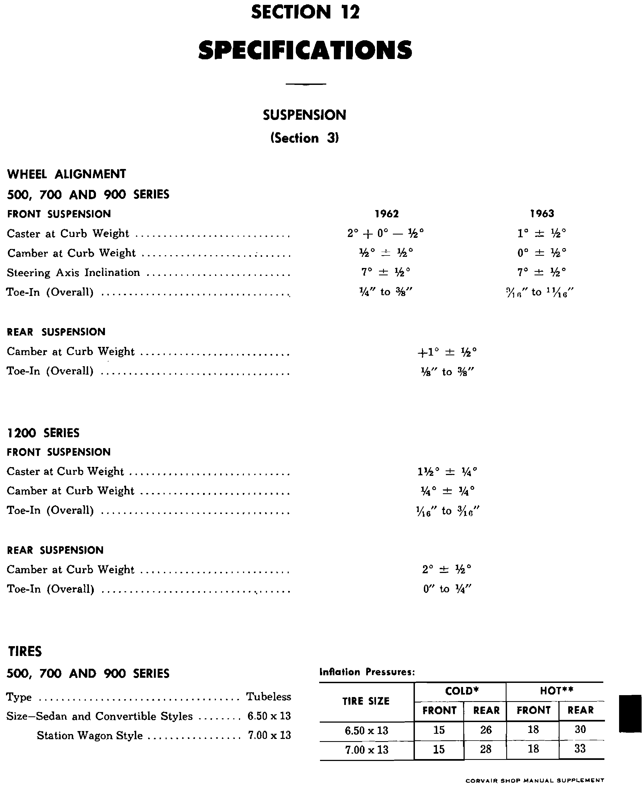
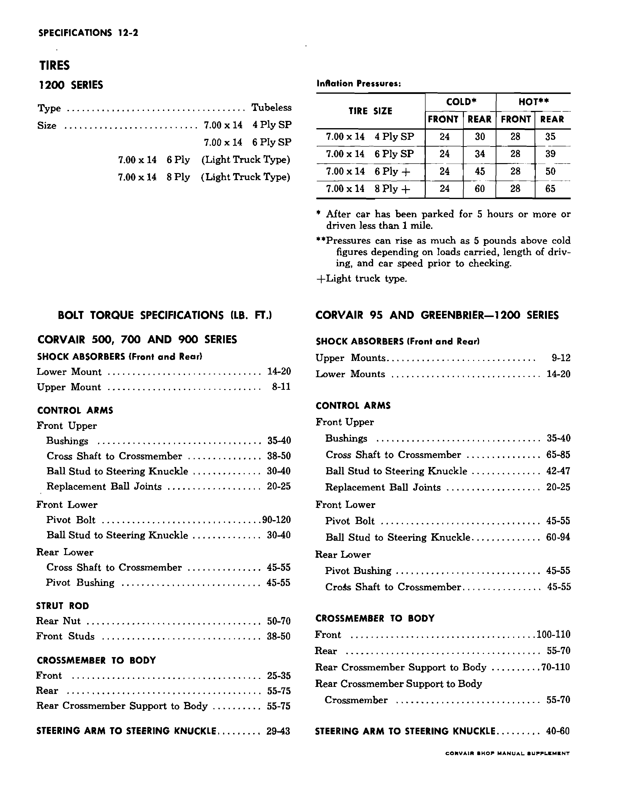

# Specifications — 1963 Passenger Cars

<!-- INCOMPLETE -->

Only the visually verified passenger-car alignment and tire rows from the first
page of the factory supplement are transcribed here. The rest of Section 12 and
base-manual carryovers still need reconciliation.

 **[PDF p.624](../page-images/p0624.png)** <!-- SOURCE id=supplement-1962-63 page=12-opening years=1963 scope=passenger -->

## Front wheel alignment at curb weight

| Item | 1963 passenger-car specification |
| --- | --- |
| Caster | 1° ± ½° |
| Camber | 0° ± ½° |
| Steering axis inclination | 7° ± ½° |

The 1962 caster and camber columns on the source page have different values and
are deliberately excluded. The source's 1963 front toe-in fraction is not
entered until the printed fraction is independently corroborated. A 600 DPI
render still leaves the first numerator uncertain.
<!-- NEEDS REVIEW: 1963 front toe-in fraction on Section 12 opening page remains ambiguous even at 600 DPI; do not substitute the 1962 column or infer a plausible value. -->

## Rear wheel alignment at curb weight

| Item | 1963 passenger-car specification |
| --- | --- |
| Camber | +1° ± ½° |
| Toe-in, overall | ⅛″ to ⅜″ |

## Tire size and inflation pressure

| Tire size | Cold front | Cold rear | Hot front | Hot rear | Applicability |
| --- | --- | --- | --- | --- | --- |
| 6.50 × 13 | 15 psi | 26 psi | 18 psi | 30 psi | Sedan and convertible styles |

The 7.00 × 13 station-wagon row is omitted because the factory Section 1
identifies no 1963 passenger-car station wagon.

 **[PDF p.625](../page-images/p0625.png)** <!-- SOURCE id=supplement-1962-63 page=12-2 years=1962,1963 scope=passenger -->

For the cold pressures above, the factory defines cold as after the car has
been parked for 5 hours or more or driven less than 1 mile. It states that hot
pressures can rise as much as 5 pounds above cold figures depending on load,
driving duration, and speed before checking.

## Suspension bolt torque

All values below are **lb. ft.** as printed for Corvair 500, 700, and 900
series; the adjacent Corvair 95/1200-series column has different values and is
excluded.

| Assembly | Fastener | Torque (lb. ft.) |
| --- | --- | --- |
| Shock absorbers, front and rear | Lower mount | 14–20 lb. ft. |
| Shock absorbers, front and rear | Upper mount | 8–11 lb. ft. |
| Front upper control arm | Bushings | 35–40 lb. ft. |
| Front upper control arm | Cross shaft to crossmember | 38–50 lb. ft. |
| Front upper control arm | Ball stud to steering knuckle | 30–40 lb. ft. |
| Front upper control arm | Replacement ball joints | 20–25 lb. ft. |
| Front lower control arm | Pivot bolt | 90–120 lb. ft. |
| Front lower control arm | Ball stud to steering knuckle | 30–40 lb. ft. |
| Rear lower control arm | Cross shaft to crossmember | 45–55 lb. ft. |
| Rear lower control arm | Pivot bushing | 45–55 lb. ft. |
| Strut rod | Rear nut | 50–70 lb. ft. |
| Strut rod | Front studs | 38–50 lb. ft. |
| Crossmember to body | Front | 25–35 lb. ft. |
| Crossmember to body | Rear | 55–75 lb. ft. |
| Crossmember to body | Rear crossmember support to body | 55–75 lb. ft. |
| Steering arm to steering knuckle | — | 29–43 lb. ft. |

Source: Chevrolet, *1962–63 Corvair Shop Manual Supplement*, Section 12. The
opening page has no visible printed number (original file
`12-specs-62-63.pdf`, physical PDF p. 1, combined p. 624); tire footnotes and
suspension torque are on printed p. 12-2 (physical PDF p. 2, combined p. 625).

