# General Information

## Chapter Contents

Source: [PDF p.3](../page-images/p0003.png).

| Section | Printed page |
| :--- | :--- |
| Chassis and Paint Codes — '00 through '08 models | 1-2 through 1-10 |
| Identification Number Locations | 1-11 |
| Danger/Warning/Caution Label Locations | 1-12 |
| Under-hood Emission Control Label | 1-14 |
| Lift and Support Points | 1-18 |
| Towing | 1-19 |
| Parts Marking | 1-21 |
| Service Precaution | 1-22 |
| Revised Component Terms | 1-23 |

## Chassis and Paint Codes — '00 Model

### Vehicle Identification Number

The illustrated pattern is `JHM AP1 1 4 * Y T 000001`; `*` marks the check-digit position in the diagram.

| Position | Field | Code and meaning |
| --- | --- | --- |
| a | Manufacturer, make, and type of vehicle | `JHM`: Honda Motor Co., Ltd.; Honda passenger vehicle |
| b | Line, body, and engine type | `AP1`: S2000/F20C1 |
| c | Body type and transmission type | `1`: 2-door convertible/6-speed manual |
| d | Vehicle grade (series) | `4`: S2000 |
| e | Check digit | Shown as `*` in the example |
| f | Model year | `Y`: '00 |
| g | Factory code | `T`: Tochigi Factory in Japan |
| h | Serial number | `000001—`: USA models; `800001—`: Canada models |

The diagram locates the vehicle identification number and Federal Motor Vehicle Safety Standard Certification Label for USA models, and the vehicle identification number and Canadian Motor Vehicle Safety Standard Certification Label for Canada models. See the [source illustration](../page-images/p0004.png).

### Engine Number

The illustrated engine number is `F20C1 - 1000001`.

| Field | Code and meaning |
| --- | --- |
| Engine type | `F20C1`: 2.0 L DOHC VTEC Sequential Multiport Fuel-injected engine |
| Serial number | `1000001—`: USA models; `1100001—`: Canada models |

### Transmission Number

The illustrated transmission number is `SCYM - 1000001`. `SCYM` identifies the 6-speed manual transmission. The page labels the second part as the serial number but does not give separate USA and Canada starting ranges.

### Paint Code

| Code | Color |
| --- | --- |
| NH-547 | Berlina Black |
| NH-565 | Grand Prix White |
| NH-630M | Silverstone Metallic |
| R-510 | New Formula Red |

The source illustration shows color-label locations at the door jamb. [View the label-location diagram on PDF p.4](../page-images/p0004.png).

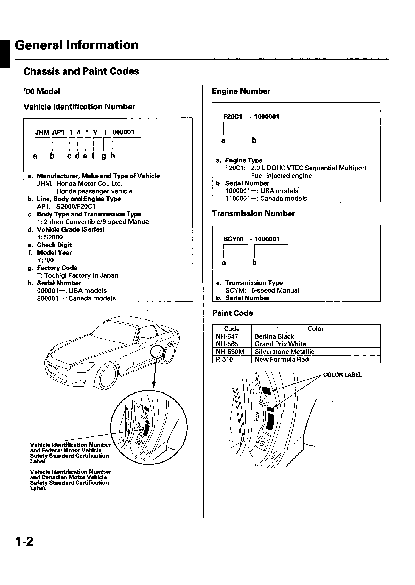

## Chassis and Paint Codes — '01 Model

Source: [PDF p.5, printed p.1-3](../page-images/p0005.png).

### Vehicle Identification Number — '01 Model

The illustrated pattern is `JHM AP1 1 4 * 1 T 000001`; `*` marks the check-digit position in the diagram.

| Position | Field | Code and meaning |
| --- | --- | --- |
| a | Manufacturer, make, and type of vehicle | `JHM`: Honda Motor Co., Ltd.; Honda passenger vehicle |
| b | Line, body, and engine type | `AP1`: S2000/F20C1 |
| c | Body type and transmission type | `1`: 2-door convertible/6-speed manual |
| d | Vehicle grade (series) | `4`: S2000 |
| e | Check digit | Shown as `*` in the example |
| f | Model year | `1`: '01 |
| g | Factory code | `T`: Tochigi Factory in Japan |
| h | Serial number | `000001—`: USA models; `800001—`: Canada models |

### Engine Number — '01 Model

The illustrated engine number is `F20C1 - 1010001`. `F20C1` identifies the 2.0 L DOHC VTEC Sequential Multiport Fuel-injected engine. The serial numbers start at `1010001—` for USA models and `1110001—` for Canada models.

### Transmission Number — '01 Model

The illustrated transmission number is `SCYM - 1000001`. `SCYM` identifies the 6-speed manual transmission. The page labels the second part as the serial number but does not give separate USA and Canada starting ranges.

### Paint Code — '01 Model

The circles in the source table mark the models for which each color is listed.

| Code | Color | USA models | Canada models |
| --- | --- | :---: | :---: |
| B-66P | Montecarlo Blue Pearl | | ○ |
| NH-547 | Berlina Black | ○ | ○ |
| NH-565 | Grand Prix White | ○ | |
| NH-630M | Silverstone Metallic | ○ | ○ |
| R-510 | New Formula Red | ○ | ○ |
| Y-52P | Spa Yellow Pearl | ○ | ○ |

The source illustration shows the VIN and certification-label location and the color-label locations at the door jamb.

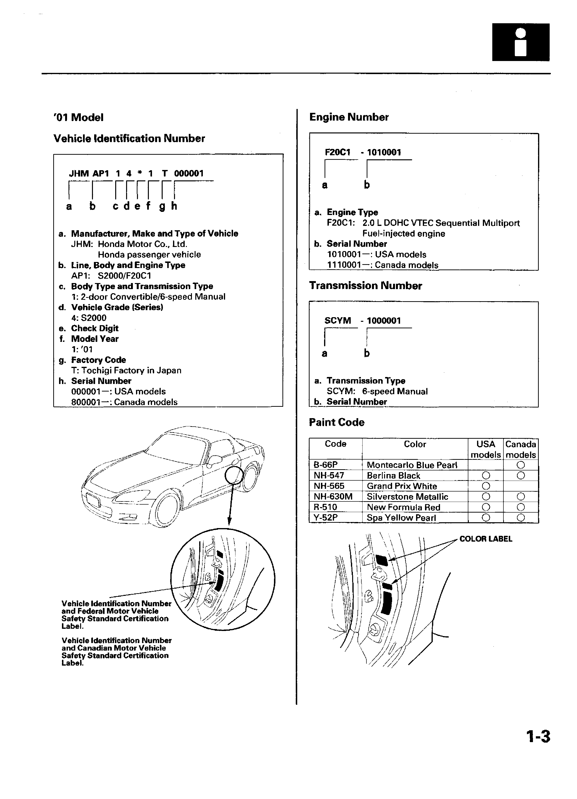

## Chassis and Paint Codes — '02 Model

Source: [PDF p.6, printed p.1-4](../page-images/p0006.png).

### Vehicle Identification Number (VIN)

**Pattern:** `JHM AP1 1 4 * 2 T 000001`

| Position | Code/Value | Description |
| :--- | :--- | :--- |
| a | JHM | Manufacturer: Honda Motor Co., Ltd. |
| b | AP1 | Line/Body/Engine: S2000/F20C1 |
| c | 1 | Body/Transmission: 2-door Convertible / 6-speed Manual |
| d | 4 | Vehicle Grade: S2000 |
| e | * | Check Digit |
| f | 2 | Model Year: '02 |
| g | T | Factory Code: Tochigi Factory in Japan |
| h | `000001—` | Serial number, USA models |
| h | `800001—` | Serial number, Canada models |

### Engine Number

**Pattern:** `F20C1 - 1020001`

*   **Engine Type:** F20C1 (2.0 L DOHC VTEC Sequential Multiport Fuel-injected engine)
*   **Serial Number:**
    *   `1020001—`: USA models
    *   `1120001—`: Canada models

### Transmission Number

**Pattern:** `SCYM - 2000001`

*   **Transmission Type:** SCYM (6-speed Manual)
*   **Serial number:** The illustrated number is `2000001`; the page gives no separate USA and Canada starting ranges.

### Paint Code Availability

| Code | Color | USA Models | Canada Models |
| :--- | :--- | :--- | :--- |
| B-513M | Suzuka Blue Metallic | ○ | ○ |
| NH-547 | Berlina Black | ○ | ○ |
| NH-552M | Sebring Silver Metallic | ○ | ○ |
| NH-565 | Grand Prix White | ○ | ○ |
| R-510 | New Formula Red | ○ | ○ |
| Y-52P | Spa Yellow Pearl | ○ | |

Circles mark availability in the source table; a blank cell has no availability mark.

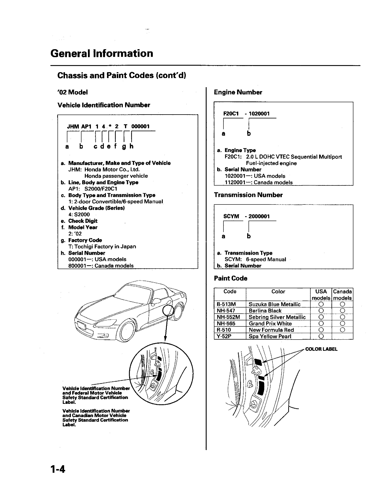

## Chassis and Paint Codes — '03 Model

Source: [PDF p.7, printed p.1-5](../page-images/p0007.png).

### Vehicle Identification Number (VIN)
**Pattern:** `JHM AP1 1 4 * 3 T 000001`

*   **Manufacturer/Make/Type:** JHM (Honda Motor Co., Ltd.; Honda passenger vehicle)
*   **Line/Body/Engine:** AP1 (S2000/F20C1)
*   **Body/Transmission:** 1 (2-door Convertible / 6-speed Manual)
*   **Vehicle Grade:** 4 (S2000)
*   **Check Digit:** `*` marks this position in the example.
*   **Model Year:** 3 ('03)
*   **Factory Code:** T (Tochigi Factory in Japan)
*   **Serial Number:**
    *   `000001—`: USA models
    *   `800001—`: Canada models

### Engine Number
**Pattern:** `F20C1 - 1040001`

*   **Engine Type:** F20C1 (2.0 L DOHC VTEC Sequential Multiport Fuel-injected engine)
*   **Serial Number:**
    *   `1040001—`: USA models
    *   `1130001—`: Canada models

### Transmission Number
**Pattern:** `SCYM - 2000001`

*   **Transmission Type:** SCYM (6-speed Manual)
*   **Serial number:** The illustrated number is `2000001`; the page gives no separate USA and Canada starting ranges.

### Paint Code Availability

| Code | Color | USA | Canada |
| :--- | :--- | :--- | :--- |
| B-513M | Suzuka Blue Metallic | ○ | |
| NH-547 | Berlina Black | ○ | ○ |
| NH-552M | Sebring Silver Metallic | ○ | ○ |
| NH-565 | Grand Prix White | ○ | ○ |
| R-510 | New Formula Red | ○ | ○ |
| Y-52P | Spa Yellow Pearl | ○ | |
| NH-630M | Silverstone Metallic | ○ | |

Circles mark availability in the source table; a blank cell has no availability mark.

## Chassis and Paint Codes — '04 Model

Source: [PDF p.8, printed p.1-6](../page-images/p0008.png).

### Vehicle Identification Number (VIN)

**Pattern:** `JHM AP2 1 4 * 4 T 000001`. The letters `a` through `h` in the source diagram label the fields; they are not VIN characters.

| Position | Code/Value | Description |
| :--- | :--- | :--- |
| a | `JHM` | Honda Motor Co., Ltd.; Honda passenger vehicle |
| b | `AP2` | S2000/F22C1 |
| c | `1` | 2-door convertible/6-speed manual |
| d | `4` | S2000 vehicle grade |
| e | `*` | Check-digit position in the example |
| f | `4` | '04 model year |
| g | `S` or `T` | Suzuka or Tochigi factory in Japan, respectively; the example shows `T` |
| h | `000001—` or `800001—` | USA or Canada model serial-number start, respectively |

### Engine Number

The illustrated engine number is `F22C1 - 1000001`. `F22C1` identifies the 2.2 L DOHC VTEC sequential multiport fuel-injected engine.

| Starting serial number | Market | Factory |
| :--- | :--- | :--- |
| `1000001—` | USA | Tochigi |
| `1100001—` | Canada | Tochigi |
| `1007001—` | USA | Suzuka |
| `1101001—` | Canada | Suzuka |

### Transmission Number

The illustrated transmission number is `SCYM - 3000001`. `SCYM` identifies the 6-speed manual transmission. The page labels `3000001` as the serial number but gives no separate USA and Canada starting ranges.

### Paint Code Availability

| Code | Color | USA | Canada |
| :--- | :--- | :---: | :---: |
| B-513MY | Suzuka Blue Metallic | ○ | |
| NH-547 | Berlina Black | ○ | ○ |
| NH-552M | Sebring Silver Metallic | ○ | ○ |
| NH-565 | Grand Prix White | ○ | ○ |
| R-510 | New Formula Red | ○ | |
| Y-65P | Rio Yellow Pearl | ○ | ○ |
| NH-630MX | Silverstone Metallic | ○ | |

Circles mark availability in the source table; a blank cell has no availability mark. The source illustration shows the VIN and certification-label location, and separate color-label locations for Tochigi and Suzuka models.

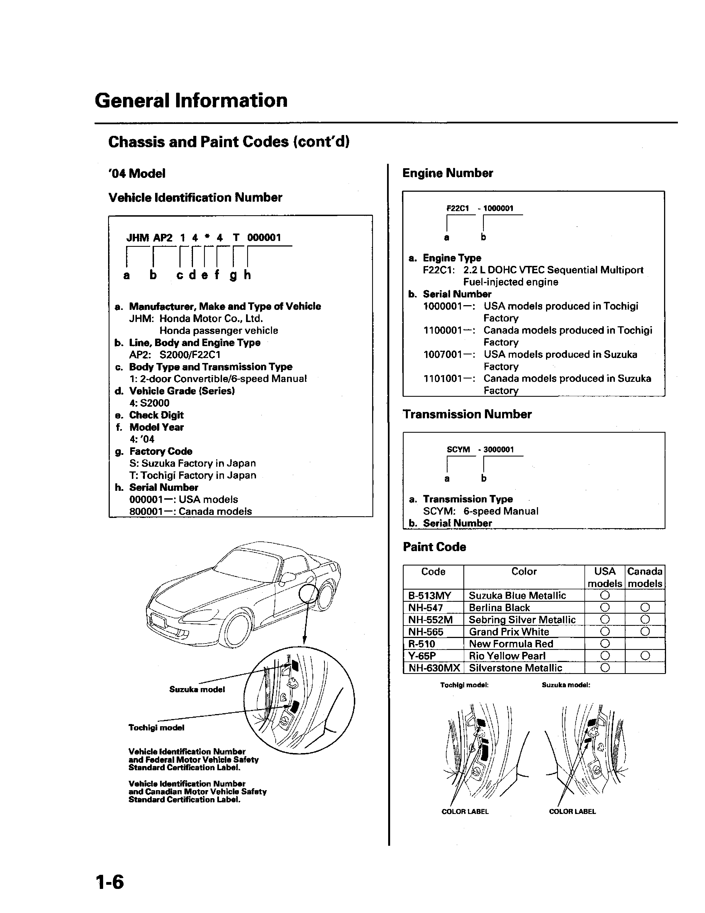

## Chassis and Paint Codes — '05 Model

Source: [PDF p.9, printed p.1-7](../page-images/p0009.png).

### Vehicle Identification Number (VIN)

**Pattern:** `JHM AP2 1 4 * 5 S 000001`. The letters `a` through `h` in the source diagram label the fields; they are not VIN characters.

| Position | Code/Value | Description |
| :--- | :--- | :--- |
| a | `JHM` | Honda Motor Co., Ltd.; Honda passenger vehicle |
| b | `AP2` | S2000/F22C1 |
| c | `1` | 2-door convertible/6-speed manual |
| d | `4` | S2000 vehicle grade |
| e | `*` | Check-digit position in the example |
| f | `5` | '05 model year |
| g | `S` | Suzuka Factory in Japan |
| h | `000001—` or `800001—` | USA or Canada model serial-number start, respectively |

### Engine Number

The illustrated engine number is `F22C1 - 1007001`. `F22C1` identifies the 2.2 L DOHC VTEC sequential multiport fuel-injected engine. The page lists `1002001—` for USA models and `1110001—` for Canada models as the engine serial-number starts. The illustrated number differs from the listed USA start; both values are retained as printed.

### Transmission Number

The illustrated transmission number is `SCYM - 3000001`. `SCYM` identifies the 6-speed manual transmission. The page labels `3000001` as the serial number but gives no separate USA and Canada starting ranges.

### Paint Code Availability

| Code | Color | USA | Canada |
| :--- | :--- | :---: | :---: |
| B-513MY | Suzuka Blue Metallic | ○ | |
| NH-547 | Berlina Black | ○ | ○ |
| NH-552M | Sebring Silver Metallic | ○ | ○ |
| NH-565 | Grand Prix White | ○ | ○ |
| R-510 | New Formula Red | ○ | |
| Y-65P | Rio Yellow Pearl | ○ | ○ |
| NH-630M | Silverstone Metallic | ○ | ○ |

Circles mark availability in the source table; a blank cell has no availability mark. The source illustration shows the VIN and certification-label location and the color-label location at the door jamb.

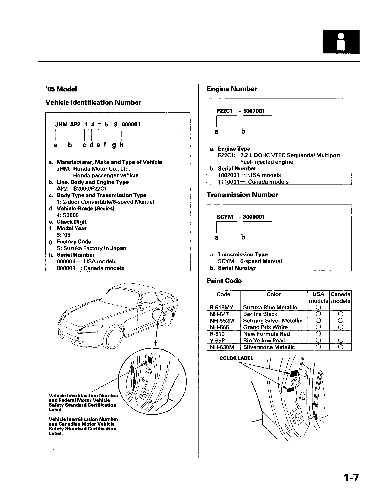

## Chassis and Paint Codes — '06 Model

Source: [PDF p.10, printed p.1-8](../page-images/p0010.png).

### Vehicle Identification Number (VIN)

**Pattern:** `JHM AP2 1 4 * 6 S 000001`. The letters `a` through `h` in the source diagram label the fields; they are not VIN characters.

| Position | Code/Value | Description |
| :--- | :--- | :--- |
| a | `JHM` | Honda Motor Co., Ltd.; Honda passenger vehicle |
| b | `AP2` | S2000/F22C1 |
| c | `1` | 2-door convertible/6-speed manual |
| d | `4` | S2000 vehicle grade |
| e | `*` | Check-digit position in the example |
| f | `6` | '06 model year |
| g | `S` | Suzuka Factory in Japan |
| h | `000001—` or `800001—` | USA or Canada model serial-number start, respectively |

### Engine Number

The illustrated engine number is `F22C1 - 1040001`. `F22C1` identifies the 2.2 L DOHC VTEC sequential multiport fuel-injected engine. Engine serial numbers start at `1040001—` for USA models and `1120001—` for Canada models.

### Transmission Number

The illustrated transmission number is `SCYM - 4000001`. `SCYM` identifies the 6-speed manual transmission. The page labels `4000001` as the serial number but gives no separate USA and Canada starting ranges.

### Paint Code Availability

| Code | Color | USA | Canada |
| :--- | :--- | :---: | :---: |
| B-513MY | Suzuka Blue Metallic | ○ | |
| B-545P | Bermuda Blue Pearl | ○ | |
| NH-547 | Berlina Black | ○ | ○ |
| NH-552M | Sebring Silver Metallic | ○ | ○ |
| NH-565 | Grand Prix White | ○ | ○ |
| NH-676M | Moon Rock Metallic | | ○ |
| R-510 | New Formula Red | ○ | |
| Y-65P | Rio Yellow Pearl | ○ | ○ |
| NH-630M | Silverstone Metallic | ○ | ○ |

Circles mark availability in the source table; a blank cell has no availability mark. The source illustration shows the VIN and certification-label location and the color-label location at the door jamb.

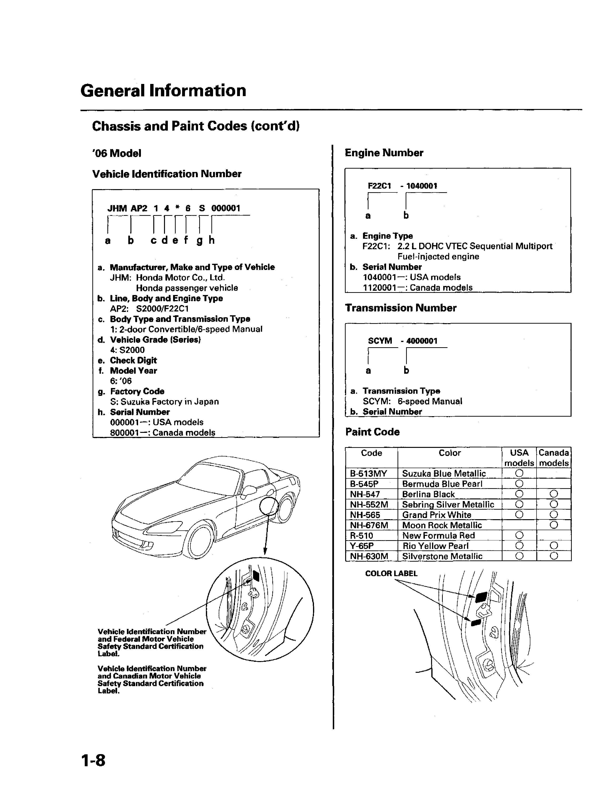

## Chassis and Paint Codes — '07 Model

Source: [PDF p.11, printed p.1-9](../page-images/p0011.png).

### Vehicle Identification Number (VIN)

**Pattern:** `JHM AP2 1 4 * 7 S 000001`. The letters `a` through `h` in the diagram label fields, not VIN characters.

| Position | Code/Value | Description |
| :--- | :--- | :--- |
| a | `JHM` | Honda Motor Co., Ltd.; Honda passenger vehicle |
| b | `AP2` | S2000/F22C1 |
| c | `1` | 2-door convertible/6-speed manual |
| d | `4` | S2000 vehicle grade |
| e | `*` | Check-digit position in the example |
| f | `7` | '07 model year |
| g | `S` | Suzuka Factory in Japan |
| h | `000001—` or `800001—` | USA or Canada model serial-number start, respectively |

### Engine and Transmission Numbers

The illustrated engine number is `F22C1 - 1050001`. `F22C1` identifies the 2.2 L DOHC VTEC sequential multiport fuel-injected engine. Engine serial numbers start at `1050001—` for USA models and `1130001—` for Canada models.

The illustrated transmission number is `SCYM - 4000001`. `SCYM` identifies the 6-speed manual transmission. The page labels `4000001` as the serial number but gives no separate USA and Canada starting ranges.

### Paint Code Availability

| Code | Color | USA | Canada |
| :--- | :--- | :---: | :---: |
| B-545P | Bermuda Blue Pearl | ○ | |
| NH-547 | Berlina Black | ○ | ○ |
| NH-552M | Sebring Silver Metallic | | ○ |
| NH-565 | Grand Prix White | ○ | ○ |
| R-510 | New Formula Red | ○ | |
| Y-65P | Rio Yellow Pearl | ○ | |
| NH-630M | Silverstone Metallic | ○ | ○ |
| YR-536P | New Imola Orange Pearl | | ○ |

Circles mark availability in the source table; a blank cell has no availability mark. The source illustration shows the VIN and certification-label location and the color-label location at the door jamb.

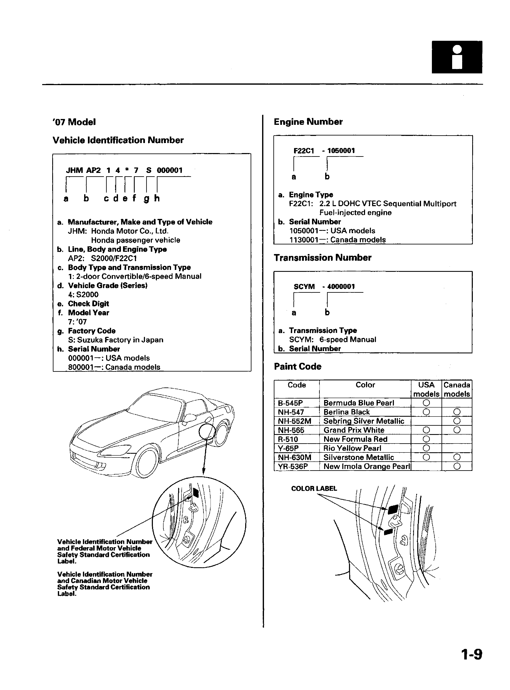

## Chassis and Paint Codes — '08 Model

Source: [PDF p.12, printed p.1-10](../page-images/p0012.png).

### Vehicle Identification Number (VIN)

**Illustrated pattern:** `JHM AP2 1 2 * 8 S 000001` for the CR model shown. The vehicle-grade code is `2` for CR and `4` for S2000. The letters `a` through `h` in the diagram label fields, not VIN characters.

| Position | Code/Value | Description |
| :--- | :--- | :--- |
| a | `JHM` | Honda Motor Co., Ltd.; Honda passenger vehicle |
| b | `AP2` | S2000/F22C1 |
| c | `1` | 2-door convertible/6-speed manual |
| d | `2` or `4` | CR or S2000 vehicle grade, respectively |
| e | `*` | Check-digit position in the example |
| f | `8` | '08 model year |
| g | `S` | Suzuka Factory in Japan |
| h | `000001—` or `800001—` | USA or Canada model serial-number start, respectively |

### Engine and Transmission Numbers

The illustrated engine number is `F22C1 - 1060001`. `F22C1` identifies the 2.2 L DOHC VTEC sequential multiport fuel-injected engine. Engine serial numbers start at `1060001—` for USA models and `1140001—` for Canada models.

The illustrated transmission number is `SCYM - 5000001`. `SCYM` identifies the 6-speed manual transmission. The page labels `5000001` as the serial number but gives no separate USA and Canada starting ranges.

### Paint Code Availability

| Code | Color | USA S2000 | USA CR | Canada |
| :--- | :--- | :---: | :---: | :---: |
| NH-547 | Berlina Black | ○ | ○ | ○ |
| NH-565 | Grand Prix White | ○ | ○ | ○ |
| NH-745M | Chicane Silver Metallic | ○ | | ○ |
| B-554P | Apex Blue Pearl | | ○ | ○ |
| R-510 | New Formula Red | ○ | | ○ |
| Y-65P | Rio Yellow Pearl | ○ | ○ | ○ |
| B-545P | Laguna Blue Pearl | ○ | | |

Circles mark availability in the source table; a blank cell has no availability mark. The source illustration shows the CR model and the VIN, certification-label, and color-label locations.

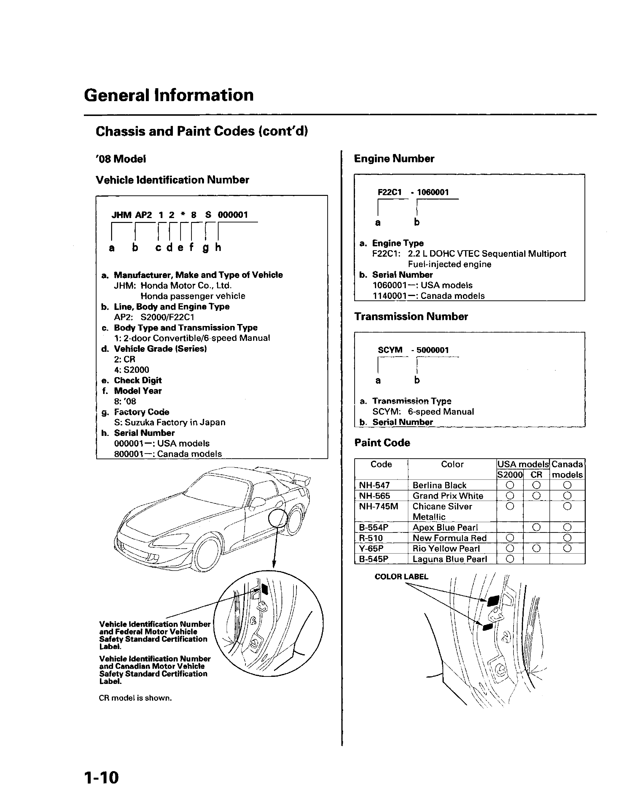

## Identification Number Locations

Source: [PDF p.13, printed p.1-11](../page-images/p0013.png).

The diagram marks two VIN locations in the engine compartment, the engine-number location on the engine, and the transmission number under the transmission. Use the diagram to identify the exact stamped locations.

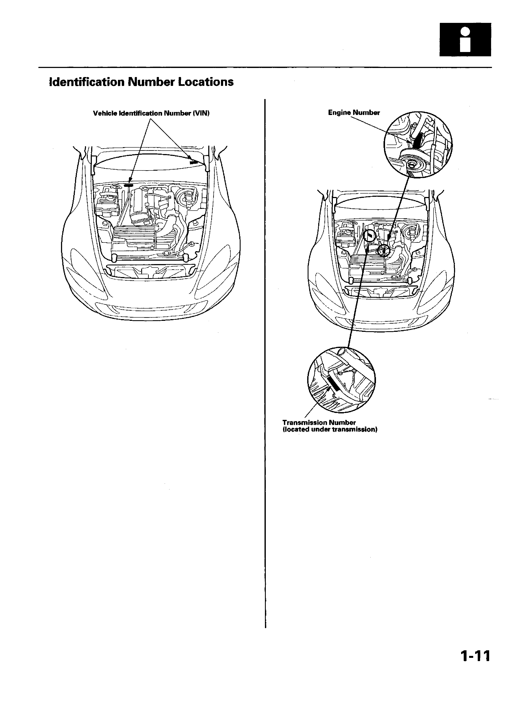

## Danger, Warning, and Caution Label Locations

Sources: [PDF p.14, printed p.1-12](../page-images/p0014.png) and [PDF p.15, printed p.1-13](../page-images/p0015.png).

The passenger-compartment diagram marks front-passenger airbag module danger, SRS information and warning information, a front-passenger airbag child-seat warning tag for USA models, seat-belt tensioner cautions (including a '00–'01 model label), and a monitor notice. The steering-wheel diagram marks cable-reel caution and driver-airbag module danger labels.

The continuation diagram marks service information for under-hood emission control, steering-column notice, SRS warning, engine-coolant information, battery danger, radiator-cap danger, and air-conditioning information. Tire-information label locations differ between '00–'03 and '04–'08 models; both are shown on the door jamb.

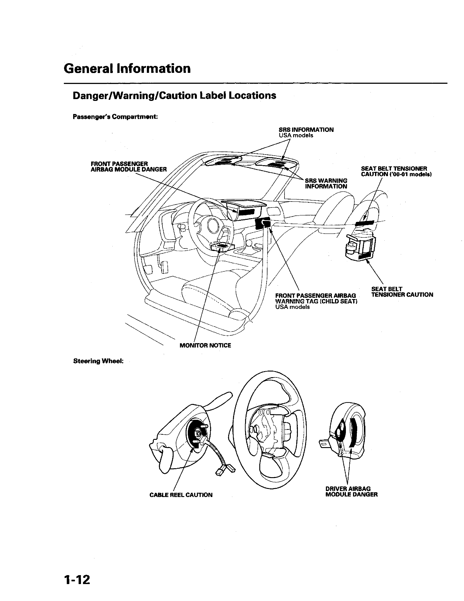

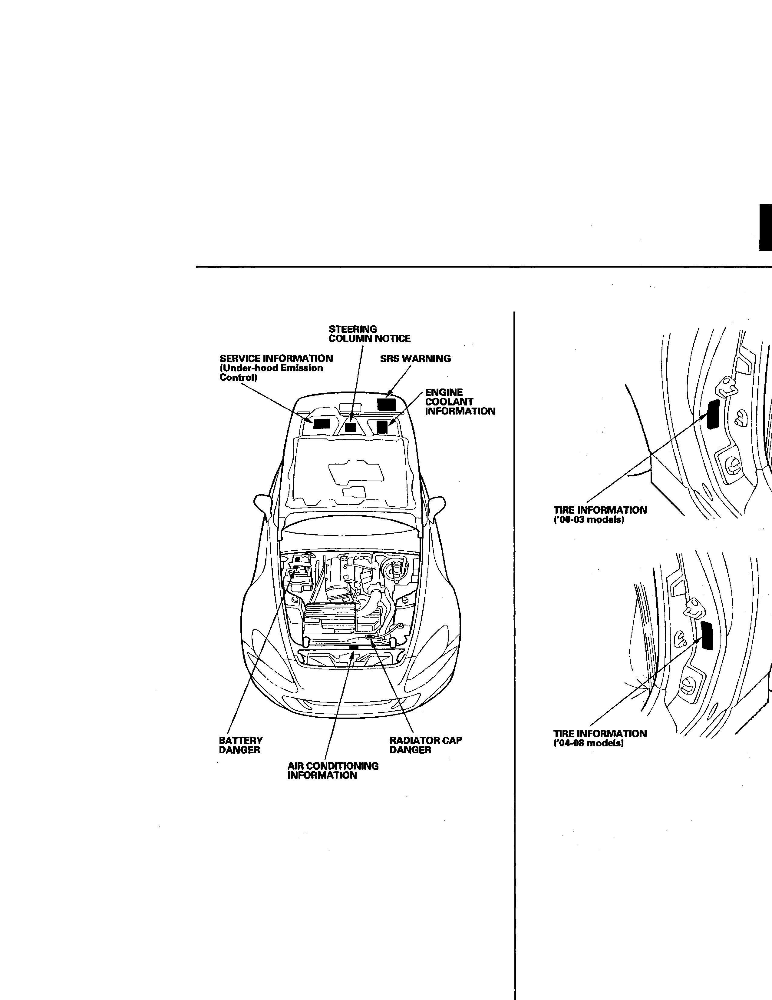

## Under-hood Emission Control Label — '00–'02 Models

Source: [PDF p.16, printed p.1-14](../page-images/p0016.png).

The page reproduces an example vehicle emission control label and explains the test-group and evaporative-family identifiers. Its regulatory statements read:

| Model | Statement |
| :--- | :--- |
| '00 | This vehicle conforms to U.S. EPA NLEV regulations applicable to 2000 model year new LEV passenger cars and California regulations applicable to 2000 model year new LEV passenger cars. |
| '01 | This vehicle conforms to U.S. EPA NLEV regulations applicable to 2001 model year new LEV passenger cars and California regulations applicable to 2001 model year new LEV passenger cars. |
| '01, Canadian Tier 1 | This vehicle conforms to Canadian Tier 1 standards for 2001 model year new passenger cars. |
| '02 | This vehicle conforms to U.S. EPA NLEV regulations applicable to 2002 model year new LEV passenger cars and California regulations applicable to 2002 model year new LEV passenger cars. |

The **test-group** example is `2 HNX V 02.0 DYC`:

| Field | Example | Meaning |
| :--- | :--- | :--- |
| a | `2` | Model year; `Y` = '00, `1` = '01, `2` = '02 |
| b | `HNX` | Manufacturer subcode: Honda |
| c | `V` | Family type: LDV |
| d | `02.0` | Displacement group |
| e | `DYC` | Sequence characters |

The **evaporative-family** example is `2 HNX R 0130 AAF`:

| Field | Example | Meaning |
| :--- | :--- | :--- |
| a | `2` | Model year; `Y` = '00, `1` = '01, `2` = '02 |
| b | `HNX` | Manufacturer subcode: Honda |
| c | `R` | Family type: EVAP/ORVR |
| d | `0130` | Canister working capacity group |
| e | `AAF` | Sequence characters |

The example label lists cold valve lash of `0.23 ± 0.02 mm` intake and `0.27 ± 0.02 mm` exhaust, spark-plug gap of `1.0–1.1 mm`, and “no other adjustments needed.” The small catalyst-system line reads `TWC/HO2S(2)/AIR/SFI/OBD II CERTIFIED`. <!-- IMAGE CHECKED: abbreviation transcribed from enlarged PDF p.16 page image; OCR was garbled. -->

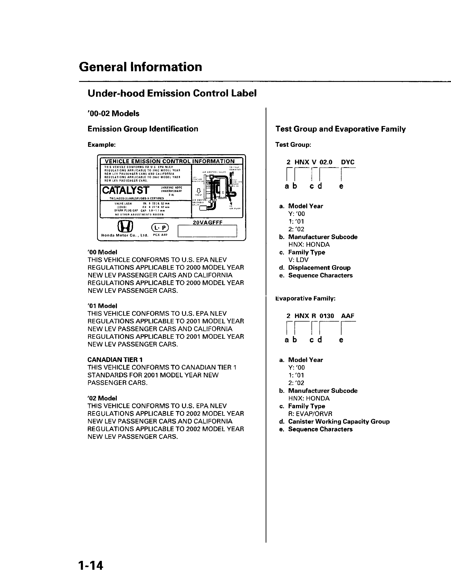

## Under-hood Emission Control Label — '03 Model

Source: [PDF p.17, printed p.1-15](../page-images/p0017.png).

The label states: “This vehicle conforms to U.S. EPA NLEV regulations applicable to 2003 model year new LEV passenger cars and California regulations applicable to 2003 model year new LEV passenger cars.”

The **test-group** example is `3 HNX V 02.0 RJC`: `3` denotes model year '03; `HNX` is the Honda manufacturer subcode; `V` is family type LDV; `02.0` is the displacement group; and `RJC` is the sequence-character group.

The **evaporative-family** example is `3 HNX R 0130 AAA`: `3` denotes model year '03; `HNX` is the Honda manufacturer subcode; `R` is family type EVAP/ORVR; `0130` is the canister working capacity group; and `AAA` is the sequence-character group.

The example label lists cold valve lash of `0.23 ± 0.02 mm` intake and `0.27 ± 0.02 mm` exhaust, followed by “no other adjustments needed.” The small catalyst-system line reads `TWC/HO2S(2)/AIR/SFI/OBD CERTIFIED`. <!-- IMAGE CHECKED: abbreviation transcribed from enlarged PDF p.17 page image; the label does not show "II" after OBD. -->

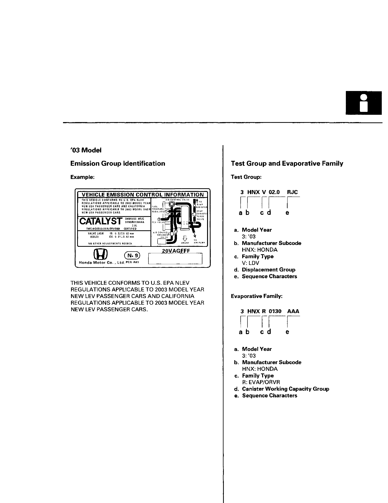

## Under-hood Emission Control Label — '04–'05 Models

Source: [PDF p.18, printed p.1-16](../page-images/p0018.png).

| Model | Regulatory statement |
| :--- | :--- |
| '04 | This vehicle conforms to U.S. EPA interim non-Tier 2 Bin 9 regulations applicable to 2004 model year new passenger cars and California regulations applicable to 2004 model year new LEV I LEV passenger cars. |
| '05 | This vehicle conforms to U.S. EPA interim non-Tier 2 Bin 9 regulations applicable to 2005 model year new passenger cars and California regulations applicable to 2005 model year new LEV I LEV passenger cars. |

The **test-group** example is `5 HNX V 02.2 DJE`. The example label also prints `4 HNX V 02.2 PJE` for '04. The fields are model year (`4` = '04, `5` = '05), manufacturer subcode (`HNX` = Honda), family type (`V` = LDV), displacement group (`02.2`), and sequence characters (`PJE` for '04; `DJE` for '05).

The **evaporative-family** example is `5 HNX R 0130 AAA`. The fields are model year (`4` = '04, `5` = '05), manufacturer subcode (`HNX` = Honda), family type (`R` = EVAP/ORVR), canister working capacity group (`0130`), and sequence characters (`AAA`). The example label also prints `4 HNX R 0130 AAA` for '04.

The example label says “no other adjustments needed.” Its small system line reads `TWC, HO2S(2), AIR, SFI OBD II CERTIFIED`. <!-- IMAGE CHECKED: abbreviation transcribed from enlarged PDF p.18 page image; OCR was garbled. -->

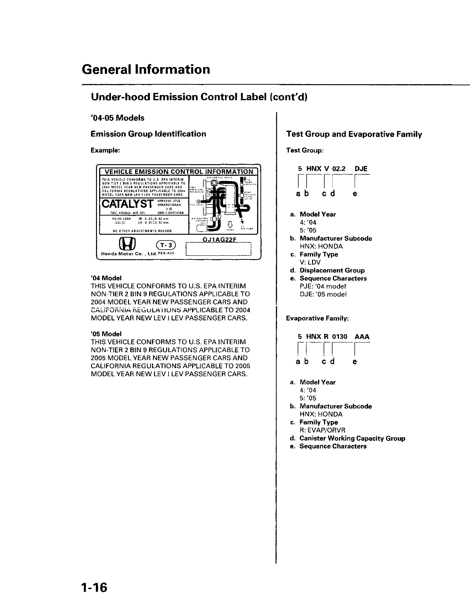

## Under-hood Emission Control Label — '06–'08 Models

Source: [PDF p.19, printed p.1-17](../page-images/p0019.png).

| Model | Regulatory statement |
| :--- | :--- |
| '06 | This vehicle conforms to U.S. EPA Tier 2 Bin 5 regulations applicable to 2006 model year new passenger cars and California regulations applicable to 2006 model year new LEV II LEV passenger cars. |
| '07 | This vehicle conforms to U.S. EPA Tier 2 Bin 5 regulations applicable to 2007 model year new passenger cars and California regulations applicable to 2007 model year new LEV II LEV passenger cars. |

The '08 example label uses a compact “conforms to regulations: 2008MY” format. It lists U.S. EPA `T2B5 LDV`, ARB `LEV II LEV PC`, OBD `CA OBD II`, and fuel `GASOLINE`.

The **test-group** example is `8 HNX V 02.2 AKC`. Its fields are model year (`6` = '06, `7` = '07, `8` = '08), manufacturer subcode (`HNX` = Honda), family type (`V` = LDV), displacement group (`02.2`), and sequence characters (`AKC`).

The **evaporative-family** example is `8 HNX R 0102 BBA`. Its fields are model year (`6` = '06, `7` = '07, `8` = '08), manufacturer subcode (`HNX` = Honda), family type (`R` = EVAP/ORVR), canister working capacity group (`0102`), and sequence characters (`BBB` for '06, `BBY` for '07, `BBA` for '08). The OCR reads the example's leading `8` as `3`; the page image shows `8`. <!-- IMAGE CHECKED: OCR read 3 in the evaporative-family example; page image shows 8, corrected from image. -->

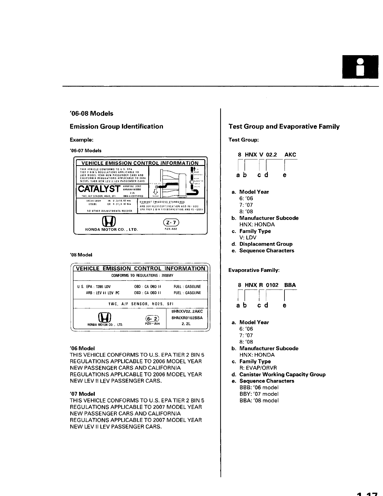

## Lift and Support Points

Source: [PDF p.20, printed p.1-18](../page-images/p0020.png). The diagrams identify front and rear lift support points and show the floor-jack contact locations for '00–'05 and '06–'08 models.

> **NOTE:** Before removing heavy rear components such as suspension parts or the fuel tank, support the front of the vehicle with tall safety stands. Removing substantial weight from the rear can shift the center of gravity and cause the vehicle to tip forward on the lift.

### Vehicle Lift

1. Position lift blocks (A) under the front support points (B) and rear support points (C).
2. Raise the lift a few inches and rock the vehicle gently to confirm firm support.
3. Raise the lift to full height and inspect support points B and C for solid contact with the lift blocks.

### Safety Stands

Use the same front and rear support points (B and C) as for a vehicle lift. Always use safety stands when working on or under a vehicle supported only by a jack.

### Floor Jack

1. To lift the front, set the parking brake. To lift the rear, put the shift lever in reverse.
2. Block the wheels that will not be lifted.
3. Put the floor jack under the front jacking bracket (A) or rear differential carrier (B). Center the bracket on the jack lift platform (C) and raise the vehicle enough to fit safety stands underneath. The diagrams distinguish '00–'05 and '06–'08 models and show a rubber pad or shop towel at the contact point.
4. Put safety stands under the support points and adjust them until the vehicle is level.
5. Lower the vehicle onto the stands.

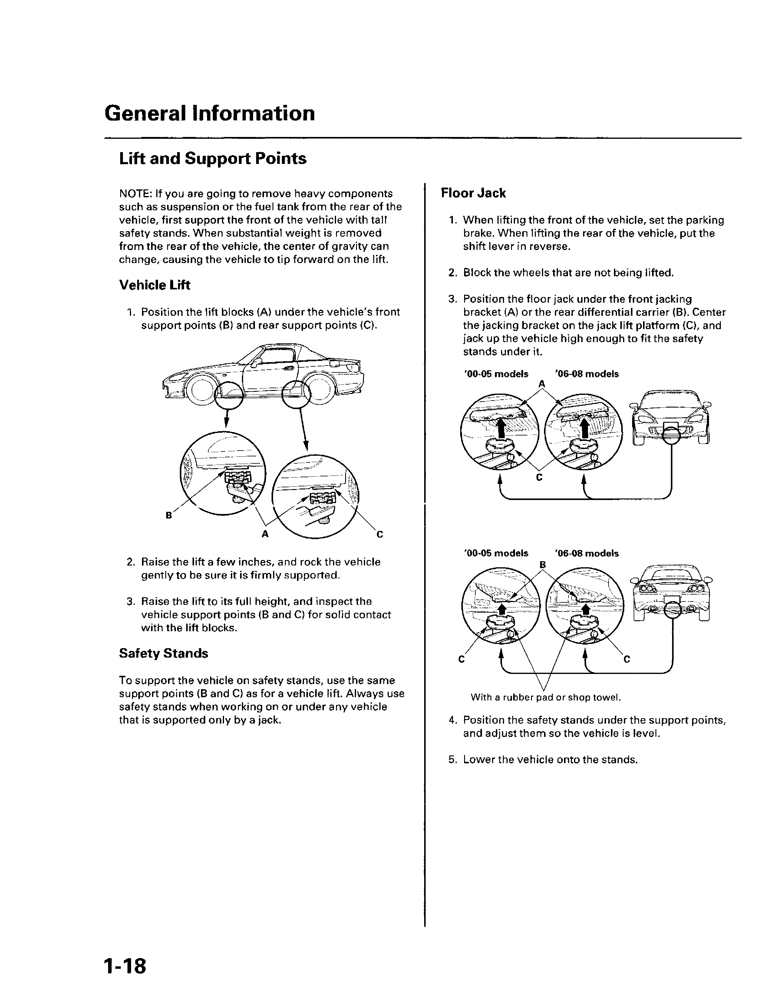

## Towing

Sources: [PDF p.21, printed p.1-19](../page-images/p0021.png) and [PDF p.22, printed p.1-20](../page-images/p0022.png).

If the vehicle needs towing, call a professional towing service. The manual warns against towing it behind another vehicle with a rope or chain.

> **NOTICE:** The vehicle can only be transported on a flat-bed. Lifting or towing by the bumpers can cause serious damage; the bumpers are not designed to support the vehicle's weight.

The flat-bed operator loads the vehicle onto a truck. The vehicle has a towing hook (A), front tie-down slots (B), and rear tie-down hook slots (C), shown separately for '00–'03 and '04–'08 models. Rubber plugs (D) cover the tie-down slot openings. Page 21 says the towing hook can be used with a winch to pull the vehicle onto the truck and the tie-down slots can secure it. **Practical loading note:** When winching onto a flat-bed, keep the pull straight and the loading angle shallow; a steep angle risks damage. Do not use the hook as a tie-down. Page 22 cautions against angled towing and says not to use the hook to tow the vehicle onto a flat-bed. These statements conflict in the printed manual; the loading note clarifies the p.21 winching use while preserving p.22's caution. <!-- EDITORIAL NOTE: PDF p.21 permits winching with the hook onto a flat-bed; PDF p.22 forbids using the hook to tow onto a flat-bed. Preserve both statements and the maintainer's angle clarification. -->

### Detachable Towing Hook Installation

The detachable hook is described for towing a very short distance, such as freeing the car, and mounts to anchors in the front and rear bumpers.

> **NOTICE:** Page 22 limits use of the detachable hook to straight, flat-ground towing and says not to use it as a tie-down or to tow the vehicle onto a flat-bed. See the p.21 winching statement and loading-angle clarification above.

1. Remove the cover (A) from the bumper.
2. Take the towing hook, hook extension, and wheel wrench from the tool case in the trunk.
3. Use the wheel wrench to fasten extension (B) into the bumper bolt hole.
4. Screw hook (A) into the extension and tighten it securely by hand.

The manual says never to tow the vehicle with wheel-lift equipment. It also rejects sling-type equipment because its cables and hooks can seriously damage the suspension and body. It repeats that flat-bed transport is the only recommended method.

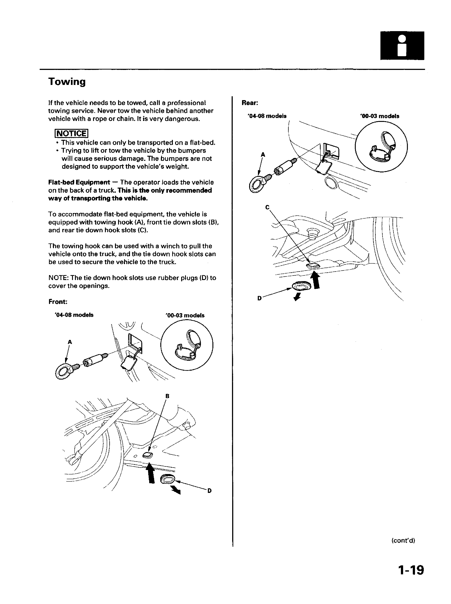

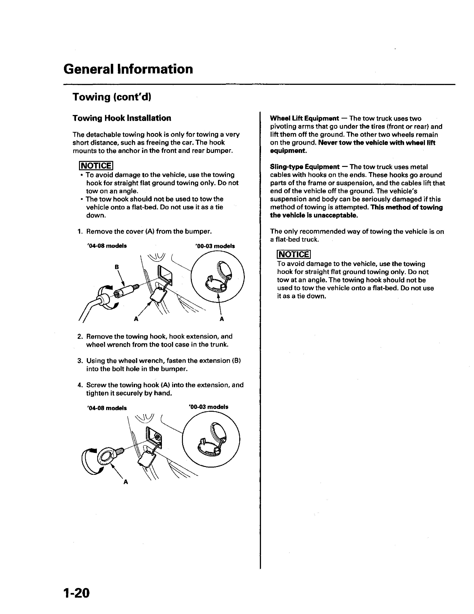

## Parts Marking

Source: [PDF p.23, printed p.1-21](../page-images/p0023.png).

To deter theft, certain major components are marked with the VIN. Original parts have self-adhesive labels; replacement body parts have generic self-adhesive labels. Do not remove these labels. Original engine or transmission VIN plates cannot be transferred to a replacement engine or transmission.

> **NOTE:** Protect parts-marking labels during body repair. Mask the labels before repairing the part.

## Service Precaution — Adhesive Wheel Balance Weight

Source: [PDF p.24, printed p.1-22](../page-images/p0024.png).

These wheels are not designed for balance weights on the outer side. Fit self-adhesive weights on the inner side and observe the following service instructions:

- Use only self-adhesive wheel balance weights on the car.
- Keep the wheel and weight at `41 °F (5 °C)` or above during installation. The OCR garbles the temperature unit; the page image shows `°F` and `°C`. <!-- IMAGE CHECKED: OCR read “41 T (5 'C)”; page image shows “41 °F (5 °C)” — corrected from image. -->
- Avoid wheel damage when removing a weight. After removal, clean adhesive residue with a degreasing cleaning agent.
- Remove dust and foreign material from the inner wheel surface. Clean it with IPA (isopropyl alcohol) or brake cleaner and let it dry completely.
- Peel off the backing without touching the adhesive. Place the weight lengthwise on the wheel.
- Press the full weight surface with `11.0 to 15.4 lbf (5 to 7 kg)` of force so the tape adheres securely, then rock the weight lightly to check adhesion.
- Do not stack one balance weight on another.
- If the balance machine cannot measure the weight needed at the adhesion position, multiply the measured outer-rim imbalance by `2.9` for a front wheel or `2.5` for a rear wheel, and select the closest available weight. The manual's front-wheel example is `15 g × 2.9 = 43.5 g`.

The diagram specifies a `5 mm (0.2 in.)` adhesion-position dimension from the flat surface and says there must be clearance at the illustrated wheel profile. This dimension appears in the diagram rather than the OCR text.

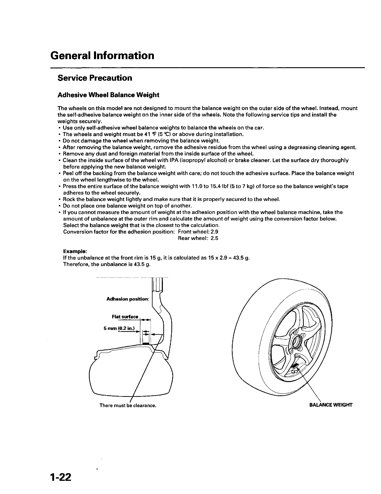

## Revised Component Terms

Source: [PDF p.25, printed p.1-23](../page-images/p0025.png). Beginning with the '01 model, Honda changed these component terms to conform to SAE J1930. A term absent from this list did not change. Blank cells below are blank in the source table.

| '00 and earlier description | Honda abbreviation | '01 or later description | New abbreviation / SAE recommendation |
| :--- | :--- | :--- | :--- |
| Brake Switch | | Brake Pedal Position Switch | BPP Switch |
| Clutch Switch | | Clutch Pedal Position Switch | |
| Distributor Ignition Rotor | DI Rotor | Distributor Rotor | |
| Function Sensor | | Engine Speed Fluctuation Sensor | CKP Sensor |
| Evaporative Emission Control Canister | EVAP Control Canister | Evaporative Emission Canister | EVAP Canister |
| Evaporative Emission Control Canister Vent Shut Valve | EVAP Control Canister Vent Shut Valve | Evaporative Emission Canister Vent Shut Valve | EVAP Canister Vent Shut Valve |
| Evaporative Emission Purge Control Solenoid Valve | EVAP Purge Control Solenoid Valve | Evaporative Emission Canister Purge Valve | EVAP Canister Purge Valve |
| Exhaust Gas Recirculation Valve Lift Sensor | EGR Valve Lift Sensor | Exhaust Gas Recirculation Valve Position Sensor | EGR Valve Position Sensor |
| Exhaust Gas Recirculation Control Solenoid Valve | EGR Control Solenoid Valve | Exhaust Gas Recirculation Valve Vacuum Control Solenoid Valve | EGR Valve Vacuum Control Solenoid Valve |
| Exhaust Gas Recirculation Vacuum Control Valve | EGR Vacuum Control Valve | Exhaust Gas Recirculation Valve Vacuum Control Solenoid Valve | EGR Valve Vacuum Control Solenoid Valve |
| Radiator Fan Control Module | | Fan Control Module | |
| Fuel Tank Evaporative Emission Valve | | Fuel Tank Vapor/Liquid Separation Valve | |
| ORVR Vent Shut Valve | | Fuel Tank Vapor Control Valve | |
| ORVR Vapor Recirculation Tube | | Fuel Tank Vapor Recirculation Tube | |
| First Idle Thermo Valve | | Idle Air Control Thermal Valve | IAC Thermal Valve |
| Fuel Injector | | Injector | |
| Fuel Injection Air Control Valve | FIA Control Valve | Intake Air Bypass Control Valve | |
| Fuel Injection Air Control Solenoid Valve | FIA Control Solenoid Valve | Intake Air Bypass Control Thermal Valve | |
| Intake Air Bypass Check Valve | IAB Check Valve | Intake Manifold Runner Control Vacuum Check Valve | IMRC Vacuum Check Valve |
| | | Intake Manifold Runner Control Actuator | IMRC Actuator |
| | | Intake Manifold Runner Control Actuator Wire | IMRC Actuator Wire |
| Intake Air Bypass Control Diaphragm | IAB Control Diaphragm | Intake Manifold Runner Control Actuator Diaphragm | IMRC Diaphragm |
| | | Intake Manifold Runner Control Module | IMRC Module |

Continuation source: [PDF p.26, printed p.1-24](../page-images/p0026.png).

| '00 and earlier description | Honda abbreviation | '01 or later description | New abbreviation / SAE recommendation |
| :--- | :--- | :--- | :--- |
| Intake Air Bypass Control Solenoid Valve | IAB Control Solenoid Valve | Intake Manifold Runner Control Solenoid Valve | IMRC Solenoid Valve |
| Intake Air Bypass Vacuum Tank | IAB Vacuum Tank | Intake Manifold Runner Control Vacuum | IMRC Vacuum Reservoir |
| Intake Air Bypass Valve Body Assembly | IAB Valve Body Assembly | Intake Manifold Runner Control Valve | IMRC Valve |
| Breather Chamber | | Oil/Air Separator | |
| Fuel Pressure Regulator Control Solenoid Valve | | Pressure Regulator Vacuum Control Solenoid Valve | |
| Air Control Valve Check Valve | | Secondary Air Injection Control Vacuum Check Valve | Air Control Vacuum Check Valve |
| Air Control Valve Vacuum Tank | | Secondary Air Injection Control Vacuum Reservoir | Air Control Vacuum Reservoir |
| Air Control Solenoid Valve | | Secondary Air Injection Control Vacuum Control Solenoid Valve | Air Control Valve Vacuum Control Solenoid Valve |
| Air Pump | | Secondary Air Injection Pump | Air Pump |
| Air Control Valve | | Secondary Air Injection Pump Control Valve | Air Control Valve |
| Air Pump Electrical Current Sensor | | Secondary Air Injection Pump Electrical Current Sensor | Air Pump Electrical Current Sensor |
| Shift/Clutch Pressure Control Solenoid Valve Set | | Shift Solenoid and Automatic Transaxle Clutch Pressure Control Solenoid Valve Set | SS and A/T Clutch Pressure Control Solenoid Valve Set |
| Shift Control Solenoid Valve Set | | Shift Solenoid and Torque Converter Clutch Solenoid Valve Set | SS and TCC Solenoid Valve Set |
| Shift/Lock-up Clutch Control Solenoid Valve Assy | | Shift Solenoid and Torque Converter Clutch Solenoid Valve | SS and TCC Solenoid Valve |
| Shift Control Solenoid Valve A | | Shift Solenoid Valve A | SS Valve A |
| Shift Control Solenoid Valve B | | Shift Solenoid Valve B | SS Valve B |
| Throttle Valve Control Module | | Throttle Actuator | |
| Lock-up Clutch Control Solenoid Valve Set | | Torque Converter Clutch Solenoid and Automatic Transaxle Clutch Pressure Control Solenoid Valve Set | TCC Solenoid and A/T Clutch Pressure Control Solenoid Valve Set |
| Lock-up Clutch Control Solenoid Valve | | Torque Converter Clutch Solenoid Valve | TCC Solenoid Valve |
| Automatic Transaxle Position Switch | A/T Gear Position Switch | Transmission Range Switch | TR Switch |
| Variable Valve Timing and Valve Lift Electronic Control Pressure Switch | VTEC Pressure Switch | Variable Valve Timing and Valve Lift Electronic Control Pressure Switch | VTEC Oil Pressure Switch |
