# Engine Electrical

## Chapter Contents

Source: [PDF p.71](../page-images/p0071.png).

- Engine Electrical: Special Tools (4-2)
- Starting System:
  - Component Location Index (4-3)
  - Symptom Troubleshooting Index (4-4)
  - Circuit Diagram (4-5)
  - Starter System Circuit Troubleshooting (4-7)
  - Clutch Interlock Switch Test and Starter Solenoid Test (4-9)
  - Starter Performance Test (4-10)
  - Starter Removal and Installation (4-11)
  - Starter Overhaul (4-15)
- Ignition System:
  - Component Location Index (4-21)
  - Circuit Diagram (4-22)
  - Ignition Timing Inspection (4-24)
  - Ignition Coil Removal/Installation (4-25)
  - Ignition Coil Relay Circuit Troubleshooting (4-26)
  - Spark Plug Inspection (4-28)
- Charging System:
  - Component Location Index (4-29)
  - Symptom Troubleshooting Index (4-30)
  - Circuit Diagram (4-31)
  - Charging System Indicator Circuit Troubleshooting (4-34)
  - Alternator and Regulator Circuit Troubleshooting (4-38)
  - Alternator Control Circuit Troubleshooting (4-39)
  - Drive Belt Inspection and Replacement (4-42)
  - Drive Belt Auto-tensioner Inspection (4-43)
  - Drive Belt Auto-tensioner Replacement and Tensioner Pulley Replacement (4-44)
  - Alternator Removal and Installation (4-45)
  - Alternator Overhaul (4-47)
- Cruise Control:
  - Component Location Index (4-53)
  - Symptom Troubleshooting Index (4-54)
  - Circuit Diagram (4-58)
  - Cruise Control Unit Input Test (4-61)
  - Cruise Control Input Test (4-63)
  - Cruise Control Main Switch Test (4-65)
  - Cruise Control Main Switch/Indicator/Illumination Test and Indicator Bulb Replacement (4-66)
  - Cruise Control Set/decel and Resume/accel Switch Test/Replacement (4-67)
  - Cruise Control Set/decel, Resume/accel, Cancel Switch Test/Replacement (4-67)
  - Cruise Control Actuator Test (4-68)
  - Cruise Control Actuator Replacement (4-69)
  - Cruise Control Actuator Cable Replacement (4-70)
  - Cruise Control Actuator Cable Adjustment (4-71)
  - Clutch Pedal Position Switch Test (4-72)

## Special Tools

Source: [PDF p.72, printed p.4-2](../page-images/p0072.png).

| Ref. | Tool number | Description | Qty |
| :--- | :--- | :--- | ---: |
| 1 | 07746-0010300 | Attachment, 42 × 47 mm | 1 |
| 2 | 07749-0010000 | Handle Driver | 1 |

The source illustrates both tools below the table.

## Starting System

### Component Location Index

Source: [PDF p.73, printed p.4-3](../page-images/p0073.png).

The illustration locates the engine control module (ECM), clutch interlock switch, ignition switch, engine start switch, battery, starter, and main under-hood fuse/relay box. It points to the clutch interlock switch test (4-9), battery test (22-47), and starter tests and service (4-7 through 4-15).

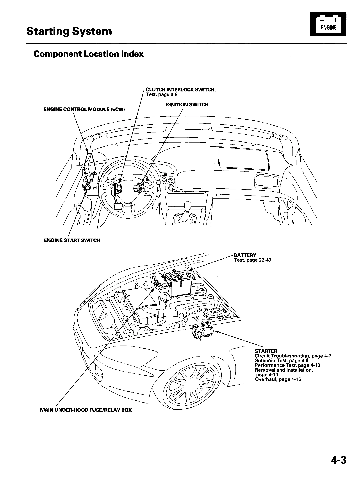

### Symptom Troubleshooting Index

Source: [PDF p.74, printed p.4-4](../page-images/p0074.png).

#### Symptom: Engine does not start (does not crank)
**Diagnostic procedure:**
1. Check for loose battery terminals or connections.
2. Test the battery for a low charge (see page 22-47).
3. Check the starter (see page 4-7).
4. Check the starter cut relay (see page 22-48).
5. Check the clutch interlock switch (see page 4-9).
6. Check the ignition switch or wire (see page 22-51).
7. Check the engine start switch.

**Also check for:** Poor ground at G401.

#### Symptom: Engine cranks, but does not start
**Diagnostic procedure:**
1. Check for PGM-FI DTCs.
2. Check the fuel pressure:
   - '00-05 models (see page 11-145)
   - '06-08 models (see page 11-477)
3. Check for a plugged or damaged fuel line:
   - '00-05 models (see page 11-148)
   - '06-08 models (see page 11-478)
4. Check for a plugged fuel filter:
   - '00-05 models (see page 11-154)
   - '06-08 models (see page 11-486)
5. Check the throttle body:
   - '00-05 models (see page 11-163)
   - '06-08 models (see page 11-498)
6. Check for low engine compression (see page 6-7).
7. Check for a damaged or broken cam chain.

#### Symptom: Engine is hard to start
**Diagnostic procedure:**
1. Check for PGM-FI DTCs.
2. Check the fuel pressure:
   - '00-05 models (see page 11-145)
   - '06-08 models (see page 11-477)
3. Check for a plugged or damaged fuel line:
   - '00-05 models (see page 11-148)
   - '06-08 models (see page 11-478)
4. Check for a plugged fuel filter:
   - '00-05 models (see page 11-154)
   - '06-08 models (see page 11-486)

#### Symptom: Engine cranks slowly
**Diagnostic procedure:**
1. Check for loose battery terminals or connections.
2. Test the battery for a low charge (see page 22-47).
3. Check the starter for binding (see page 4-7).
4. Check for excessive drag in the engine.

### Starting System Circuit Diagram — 2000–2005 Models

Source: [PDF p.75, printed p.4-5](../page-images/p0075.png).

The diagram shows the battery, No. 41 (100 A) and No. 42 (40 A) fuses, ignition switch, No. 3 (7.5 A) and No. 21 (7.5 A) fuses, engine start switch, starter cut relay, clutch interlock switch, starter solenoid, ECM, and grounds G401 and G501. Follow the drawing for exact wire routing and connector associations; the OCR does not preserve them.

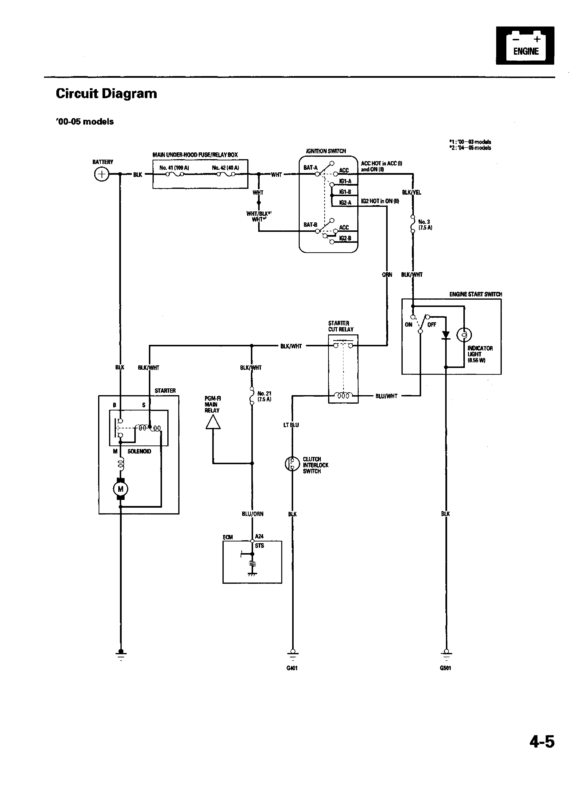

### Starting System Circuit Diagram — 2006–2008 Models

Source: [PDF p.76, printed p.4-6](../page-images/p0076.png).

This diagram shows the battery, main and auxiliary under-hood fuse boxes, ignition switch, under-dash fuse/relay box, starter cut relay, engine start switch, clutch interlock switch, starter, and grounds G401 and G501. The clutch interlock switch is closed when the clutch pedal is pressed. Use the drawing for exact wiring and pin associations.

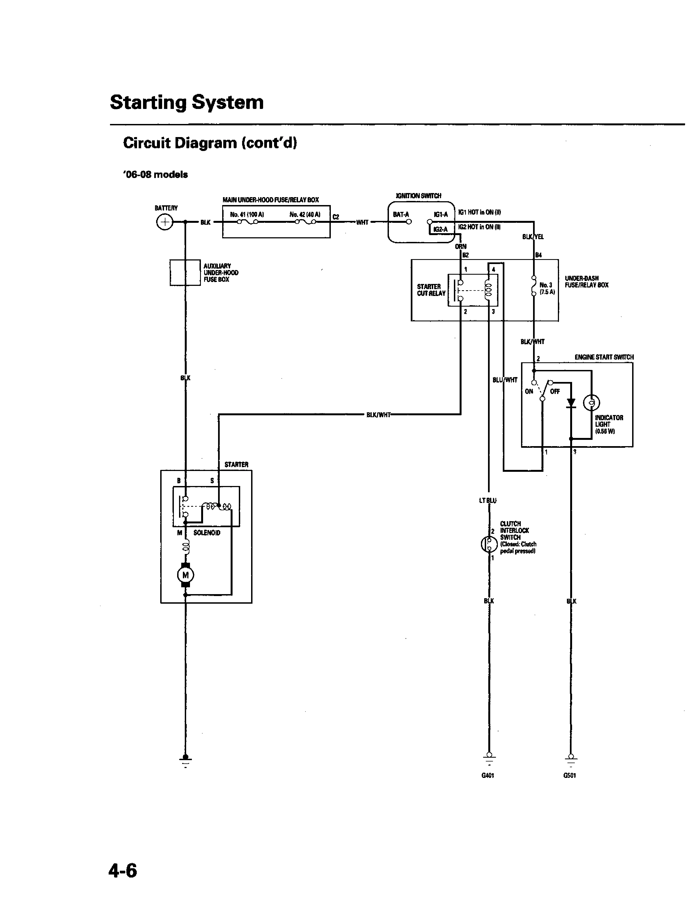

### Starter System Circuit Troubleshooting

Source: [PDF p.77, printed p.4-7](../page-images/p0077.png).

> **NOTE:** Air temperature must be 59–100 °F (15–38 °C). The battery must be in good condition and fully charged. After the inspection, reset the ECM with the HDS to clear DTCs (2000–2005 models, printed p.11-4) or to cancel ALL INJECTORS OFF (2006–2008 models, printed p.11-214). Otherwise, on 2006–2008 models the ECM continues to stop the fuel injectors.

**Recommended procedure:** Use a starter system tester, connected and operated according to its manufacturer's instructions.

1. Connect an ammeter (0–400 A) and a voltmeter (0–20 V, accurate within 0.1 V) as illustrated on the source page.
2. On 2000–2005 models, remove the No. 2 (15 A) fuse from the under-dash fuse/relay box.
3. On 2006–2008 models, connect the HDS to the data link connector (DLC), as described in step 2 on printed p.11-213.
4. Turn the ignition switch to ON (II).
5. On 2006–2008 models, make sure the HDS communicates with the vehicle and ECM. If it does not, troubleshoot the DLC circuit (printed p.11-367).
6. On 2006–2008 models, select PGM-FI, INSPECTION, then ALL INJECTORS OFF on the HDS.
7. With the clutch pedal pressed, press the engine start switch. If the starter cranks normally, the starting system is OK. Otherwise, continue to step 8.
8. Check battery condition and the electrical connections at the battery, the negative battery cable to the body, the engine ground cables, and the starter for looseness or corrosion. Try cranking again.
   - If it now cranks, repairing the loose connection corrected the problem; go to step 11.
   - If it does not crank at all, go to step 9.
   - If it cranks erratically or too slowly, go to step 10.
   - If it does not disengage from the flywheel ring gear when the engine start switch is released, check the solenoid plunger and switch, and the drive gear or overrunning clutch.

Steps 9–15 continue on [PDF p.78](../page-images/p0078.png).

Source: [PDF p.78, printed p.4-8](../page-images/p0078.png).

9. Make sure the transmission is in neutral. Disconnect the BLK/WHT wire (A) from the starter solenoid S terminal, then connect a jumper wire from battery positive to the solenoid S terminal, as shown on the source page. Does the starter crank normally?
   - **YES:** Check, in order, the BLK/WHT wire and connectors from starter cut relay to starter; ORN wire and connectors from ignition switch to starter cut relay; LT BLU wire and connectors from starter cut relay to clutch interlock switch; BLK/WHT wire from under-dash fuse/relay box to engine start switch; No. 3 fuse in the under-dash fuse/relay box; ignition switch (printed p.22-51); engine start switch; clutch interlock switch (printed p.4-9); and starter cut relay (printed p.22-48).
   - **NO:** Replace the starter (printed p.4-11) or repair it (printed p.4-15).
10. While cranking, check voltage and current draw. Is the cranking voltage at least 8.7 V and the current draw no more than 380 A (2000–2005) or 230 A (2006–2008)?
    - **YES:** Go to step 11.
    - **NO:** Replace the starter (printed p.4-11), or remove and disassemble it. Check for open armature commutator segments, armature drag, shorted armature winding, excessive engine drag, excessively worn or open starter brushes, dirty or damaged helical spline or drive gear, and a faulty drive gear clutch.
11. Remove the starter. Inspect its drive gear and the flywheel ring gear for damage; replace damaged parts.
12. On 2000–2005 models, reinstall the No. 2 (15 A) fuse in the under-dash fuse/relay box.
13. On 2000–2005 models, select ECM reset on the HDS (printed p.11-4).
14. On 2006–2008 models, select ECM reset (printed p.11-214) to cancel ALL INJECTORS OFF on the HDS.
15. Do the ECM idle learn procedure: 2000–2005 models, printed p.11-140; 2006–2008 models, printed p.11-462.

### Clutch Interlock Switch Test

Source: [PDF p.79, printed p.4-9](../page-images/p0079.png).

1. Disconnect the connector from the clutch interlock switch, then remove the switch.
2. Check continuity between the two connector terminals, viewed from the terminal side of the male terminals. There should be no continuity with button A released and continuity with it pressed.
3. Replace the switch if faulty.
4. Install and adjust the switch (printed p.12-7).

### Starter Solenoid Test

Source: [PDF p.79, printed p.4-9](../page-images/p0079.png).

1. Make sure you have the audio system anti-theft code; write down the presets.
2. Disconnect the battery negative cable.
3. Disconnect the starter cable (A), BLK/WHT wire (B), and motor cable (C). The source diagram identifies the S, B, and M terminals. It labels 9 N·m (0.9 kgf·m, 6.5 lbf·ft) and 9.8 N·m (1.0 kgf·m, 7.2 lbf·ft) fasteners; follow the diagram for their exact locations.
4. Check continuity between the S terminal and armature housing (ground). If none, replace the solenoid; otherwise continue.
5. Check continuity between the S and M terminals. If there is continuity, the solenoid is OK; otherwise replace it.
6. Reconnect the starter cable, BLK/WHT wire, and motor cable.
7. Reconnect the battery negative cable.
8. On 2000–2005 models, do the ECM idle learn procedure (printed p.11-140).
9. Enter the audio anti-theft code and presets, and set the clock.

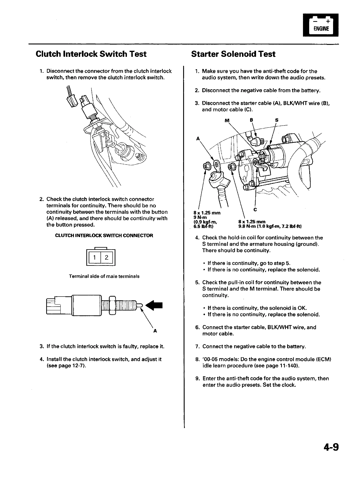

### Starter Performance Test

Source: [PDF p.80, printed p.4-10](../page-images/p0080.png).

1. Disconnect the wires from the S and M terminals.
2. Use the thickest practical gauge wire for the test, preferably the gauge used on the vehicle.

> **NOTE:** To avoid damaging the starter, never leave the battery connected for more than 10 seconds.

3. Connect the battery as shown in the diagram, with the starter motor wire disconnected from the solenoid. The pinion should move out.
4. Disconnect the battery from the M terminal. The pinion should remain extended; this checks the solenoid hold-in coil.
5. Disconnect the battery from the starter body. The pinion should retract immediately.
6. Clamp the starter firmly in a vise.
7. Connect the starter to the battery as shown and confirm that the motor rotates.
8. At a battery voltage of 11.5 V, electric current should be 90 A or less. The source lists a 1.0 kW starter for 2000–2003 models and a 1.1 kW starter for 2004–2008 models.

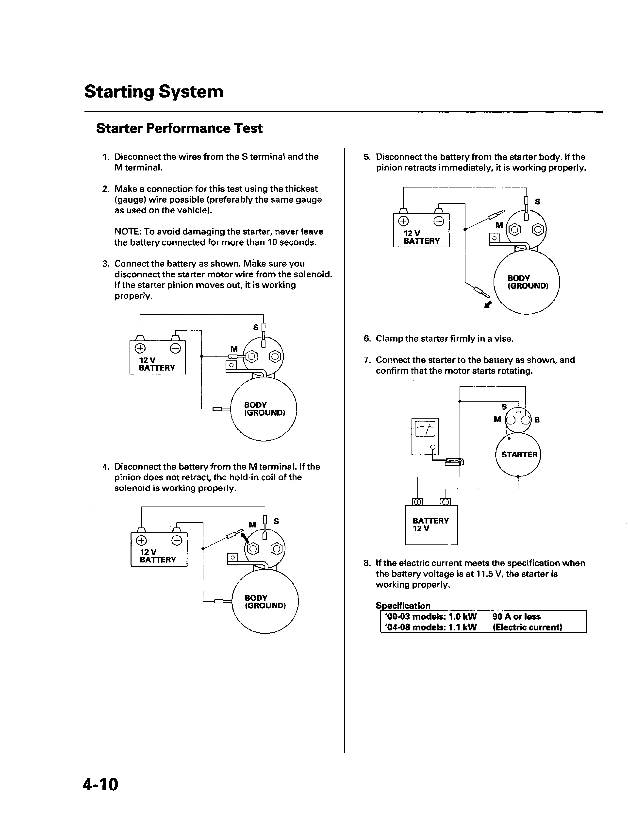

### Starter Removal and Installation

Source: [PDF p.81, printed p.4-11](../page-images/p0081.png).

#### Removal

1. Make sure you have the anti-theft code for the audio system, then write down the audio presets.
2. Disconnect the negative cable from the battery.
3. '00-05 models: Disconnect the air hose (A) and breather pipe (B), then remove the air cleaner housing cover (C) and air cleaner assembly (D).
4. '06-08 models: Disconnect the intake air temperature (IAT) sensor connector (A) and breather pipe (B), remove the manifold absolute pressure (MAP) sensor harness (C) from the holder, then remove the air cleaner housing cover (D) and air cleaner assembly (E).
5. '00-05 models: Disconnect the air control solenoid valve connector (A) and vacuum hoses (B), remove the harness clamps (C), then remove the intake air cleaner housing (D).
6. '06-08 models: Remove the IAT sensor harness clamps (A), then remove the intake air cleaner housing (B).
7. Remove the drive belt (see page 4-42).

Source: [PDF p.82, printed p.4-12](../page-images/p0082.png).

8. Disconnect the 4P connector (A) from the alternator (B), and disconnect the BLK wire from the alternator B terminal (C).

9. Remove the mounting bolts, then remove the alternator.

10. Disconnect the starter cable from the B terminal on the starter solenoid (A), then disconnect the BLK/WHT wire from the S terminal (C).

11. Remove the two bolts securing the starter, then remove the starter.

#### Installation

Source: [PDF p.83, printed p.4-13](../page-images/p0083.png).

1. Install the starter. Connect the starter cable to solenoid B terminal (A) and the BLK/WHT wire to S terminal (C). The crimped side of the starter cable ring terminal must face away from the starter. The source diagram labels the two 10 × 1.25 mm mounting bolts at 44 N·m (4.5 kgf·m, 33 lbf·ft) and the 8 × 1.25 mm cable fastener at 9 N·m (0.9 kgf·m, 7 lbf·ft).
2. Install the alternator. The two 10 × 1.25 mm mounting bolts are labeled 44 N·m (4.5 kgf·m, 33 lbf·ft).
3. Connect the 4P connector (A) to the alternator and the BLK wire to the alternator B terminal (B). The source diagram labels the 8 × 1.25 mm B-terminal fastener 12 N·m (1.2 kgf·m, 9 lbf·ft).
4. Install the drive belt (printed p.4-42).
5. On 2000–2005 models, install intake air cleaner housing (A), then harness clamps (B); connect air control solenoid valve connector (C) and vacuum hoses (D).

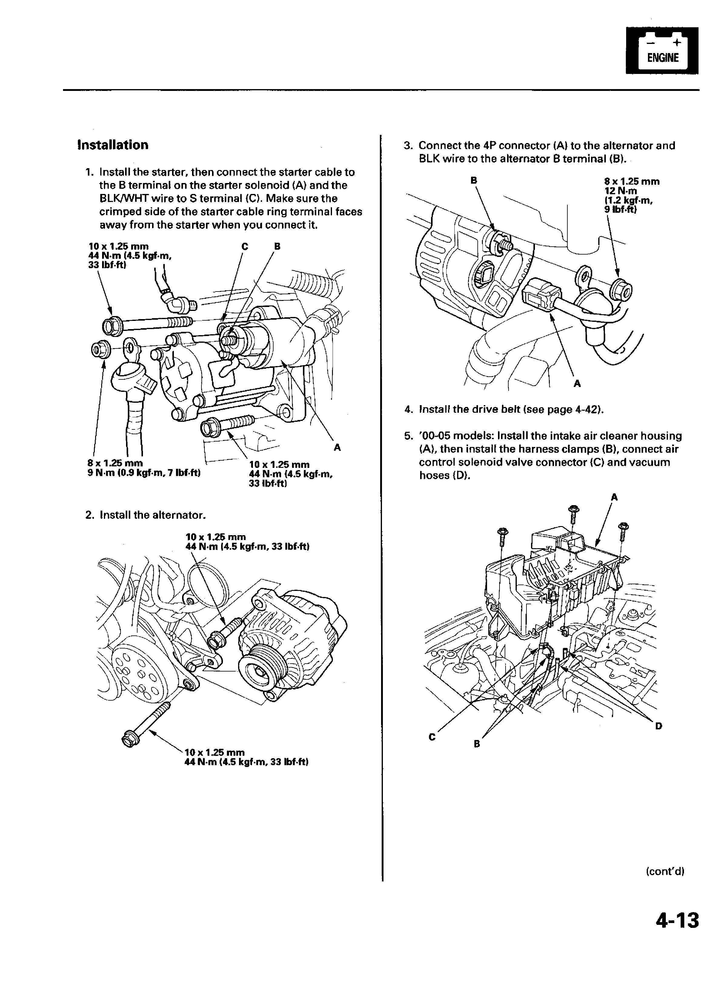

Source: [PDF p.84, printed p.4-14](../page-images/p0084.png).

6. On 2006–2008 models, install intake air cleaner housing (A), then IAT sensor harness clamps (B).
7. On 2000–2005 models, install air cleaner assembly (A) and housing cover (B), then connect air hose (C) and breather pipe (D).
8. On 2006–2008 models, install air cleaner assembly (A) and housing cover (B), then install MAP sensor harness (C) to the holder; connect IAT sensor connector (D) and breather pipe (E).
9. Connect the battery negative cable.
10. Start the engine to make sure the starter works properly.
11. On 2000–2005 models, do the ECM idle learn procedure (printed p.11-140).
12. Enter the audio anti-theft code and presets; set the clock.

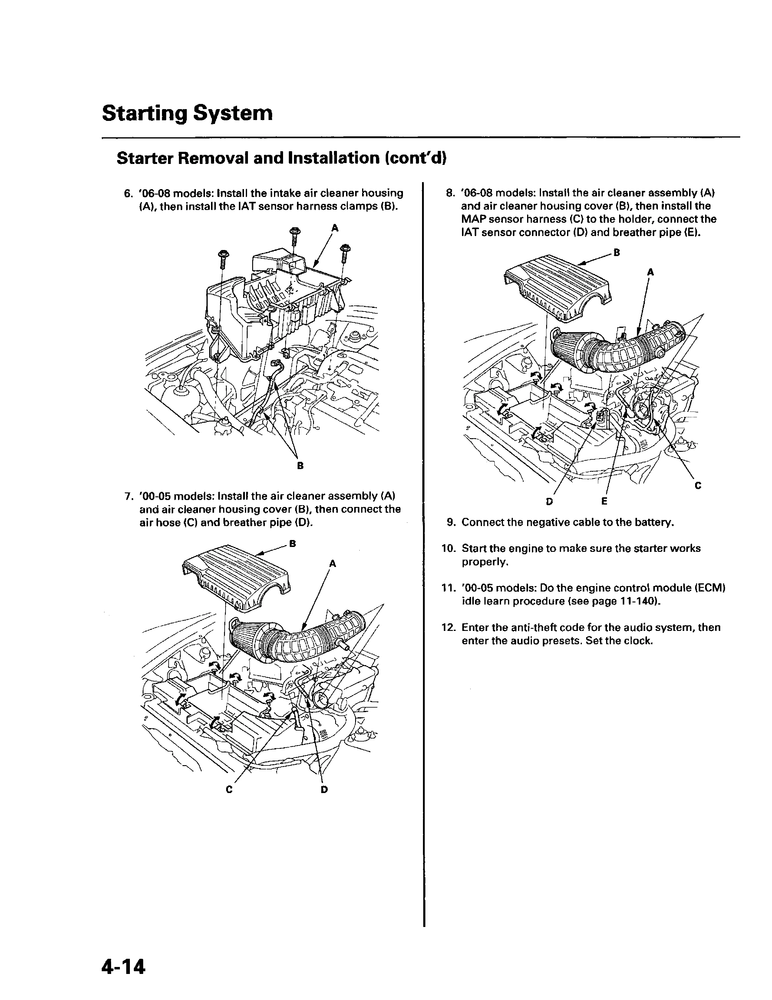

### Starter Overhaul — Disassembly/Reassembly

Source: [PDF p.85, printed p.4-15](../page-images/p0085.png).

The exploded drawing identifies the starter solenoid, damper assembly, washer, snap rings, overrunning clutch assembly, pinion drive lever, drive side housing, armature assembly, sealing plate, planetary gears, drive shaft, internal gear, end cover, brush holder plate, and armature housing. Follow the drawing for part order and fastener locations.

| Fastener shown | Torque |
| :--- | :--- |
| 8 × 1.25 mm | 9.8 N·m (1.0 kgf·m, 7.2 lbf·ft) |
| 8 × 1.25 mm | 9 N·m (0.9 kgf·m, 6.5 lbf·ft) |
| 6 × 1.0 mm | 8.3 N·m (0.88 kgf·m, 6.2 lbf·ft) |
| 5 × 1.0 mm bolts | 5.9 N·m (0.6 kgf·m, 4.3 lbf·ft) |
| 4 × 0.7 mm screws | 1.5 N·m (0.15 kgf·m, 1.1 lbf·ft) |

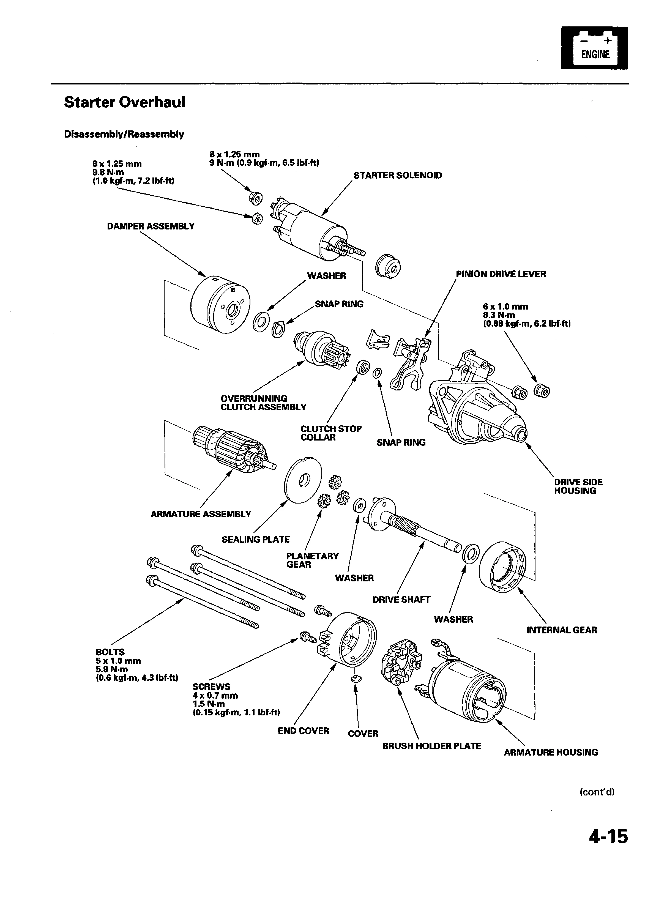

Source: [PDF p.86, printed p.4-16](../page-images/p0086.png).

1. Remove the starter (printed p.4-11).
2. Disassemble it.

#### Armature Inspection and Test

3. Inspect the armature for wear or damage from contact with the permanent magnet. Replace it if worn or damaged.
4. Inspect commutator surface (A). If dirty or burnt, resurface with emery cloth or a lathe to the step 5 specification, or recondition with #500 or #600 sandpaper (B).
5. Check commutator diameter. Replace the armature if below the service limit.
6. Measure commutator runout. If within the service limit, check between segments for carbon dust or brass chips. If outside the service limit, replace the armature.

| Measurement | Standard (new) | Service limit |
| :--- | :--- | :--- |
| Commutator diameter | 28.0–28.1 mm (1.102–1.106 in.) | 27.5 mm (1.083 in.) |
| Commutator runout | 0.02 mm (0.001 in.) max. | 0.05 mm (0.002 in.) |

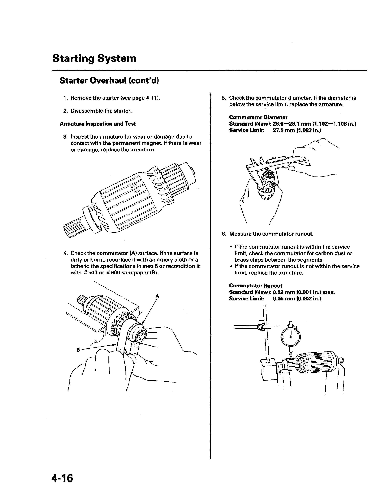

Source: [PDF p.87, printed p.4-17](../page-images/p0087.png).

7. Check mica depth (A). If the mica is too high (B), cut all mica (C) between the commutator segments to the proper depth with a hacksaw blade. The undercut must not be too shallow, too narrow, or V-shaped (D). New standard: 0.4–0.5 mm (0.016–0.020 in.); service limit: 0.15 mm (0.006 in.).
8. Check continuity between commutator segments. Replace the armature if any segment pair is open.
9. Place the armature (A) on an armature tester (B). Hold a hacksaw blade (C) on the armature core. If the blade is attracted to the core or vibrates as the core turns, the armature is shorted; replace it.
10. Check continuity from the commutator (A) to the armature coil core (B), and from the commutator to the shaft (C). Replace the armature if there is continuity.

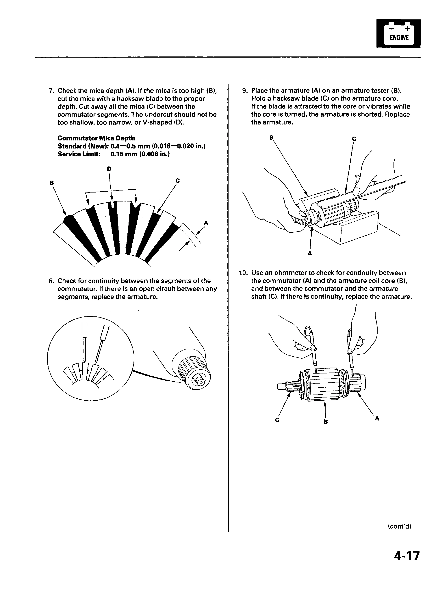

Source: [PDF p.88, printed p.4-18](../page-images/p0088.png).

#### Starter Brush Inspection

11. Measure brush length. Replace the brush holder assembly if below the service limit. New standard: 15.8–16.2 mm (0.62–0.64 in.); service limit: 11.0 mm (0.43 in.).

#### Starter Field Winding Test

12. Check continuity between brushes (A). If there is none, replace armature housing (B).
13. Check continuity from each brush (A) to armature housing (B). If there is continuity, replace the housing.

#### Starter Brush Holder Test

14. Check continuity between the positive brush holder (A) and negative brush holder (B). If there is continuity, replace the brush holder assembly.
15. Place brush (A) against the commutator in its holder. Attach spring scale (B) to spring (C) and measure tension just as the spring lifts off the brush. Replace the spring if outside 15.7–17.7 N (1.6–1.8 kgf, 3.53–3.97 lbf).

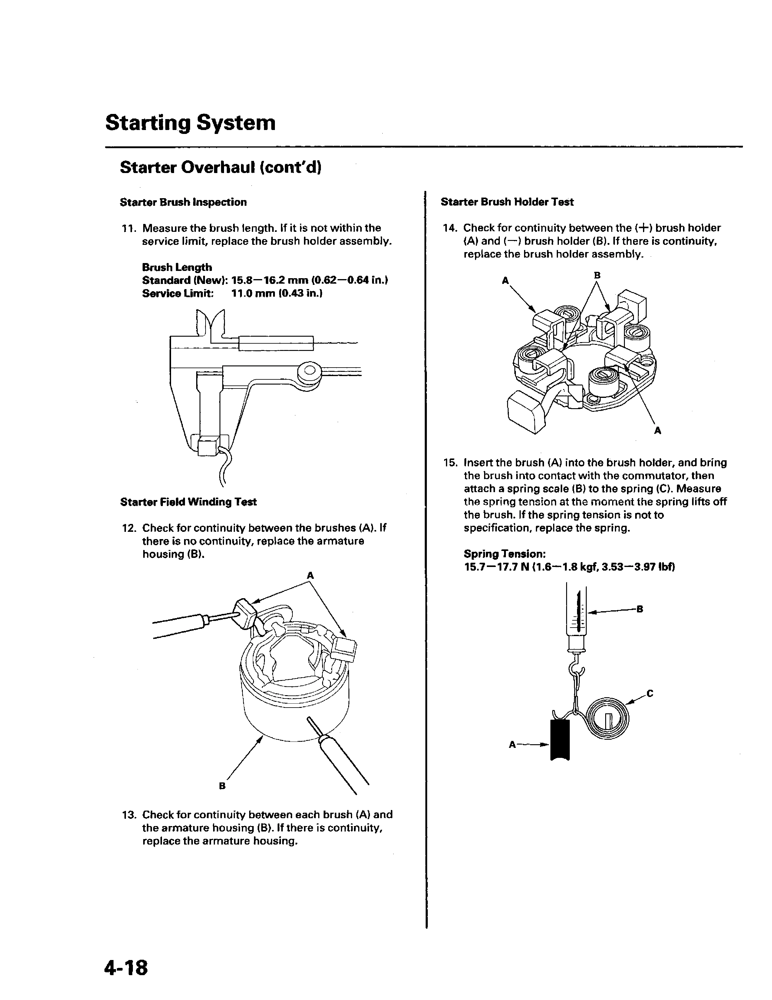

Source: [PDF p.89, printed p.4-19](../page-images/p0089.png).

16. Pry each brush spring back with a screwdriver. Position each brush halfway out of its holder and release its spring to hold it.
17. Install armature and brush holder. Pry back each spring again, push its brush against the commutator, and release the spring onto the end of the brush.

> **NOTE:** To seat new brushes, put a strip of #500 or #600 sandpaper grit-side up between each brush and the commutator and rotate the armature smoothly. The brushes will be sanded to the commutator contour.

18. Install starter end cover (A) to retain brush holder (B). The illustrated 5 × 1.0 mm bolts are 5.9 N·m (0.6 kgf·m, 4.3 lbf·ft); 4 × 0.7 mm screws are 1.5 N·m (0.15 kgf·m, 1.1 lbf·ft).

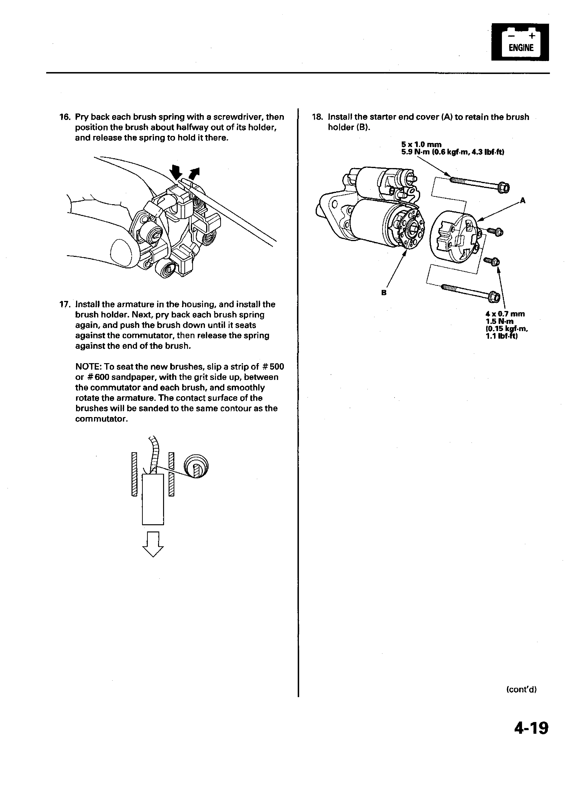

Source: [PDF p.90, printed p.4-20](../page-images/p0090.png).

#### Overrunning Clutch Inspection

19. Slide the overrunning clutch along the shaft. Replace it if movement is not smooth.
20. Hold planetary gear shaft (A) and turn overrunning clutch assembly (B) both ways. Replace it if it locks in both directions or neither direction.
21. If starter drive gear (C) is worn or damaged, replace the overrunning clutch assembly; the gear is not available separately. If its teeth are damaged, check the flywheel ring gear.
22. Reassemble the starter in reverse order of disassembly.

## Ignition System

### Component Location Index

Source: [PDF p.91, printed p.4-21](../page-images/p0091.png).

The diagram locates the ECM, ignition coil relay (2006–2008 models), ignition coil/ignition control module assemblies (removal and installation on printed p.4-25), and spark plugs (inspection on printed p.4-28).

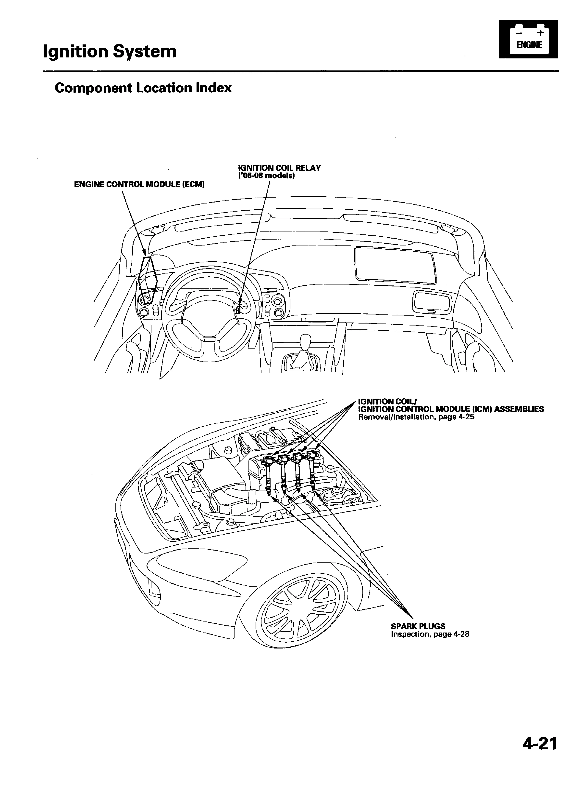

### Ignition System Circuit Diagram — 2000–2005 Models

Source: [PDF p.92, printed p.4-22](../page-images/p0092.png).

The drawing traces the battery through main under-hood fuses No. 41 (100 A) and No. 42 (40 A), the ignition switch and under-dash No. 4 (15 A) fuse to the ignition coils. It also shows ECM ignition pulse outputs IGPLS1–4, each coil's ignition control module (ICM), spark plugs, and G101 ground. Use the diagram for exact wire colors, connector terminals and routing.

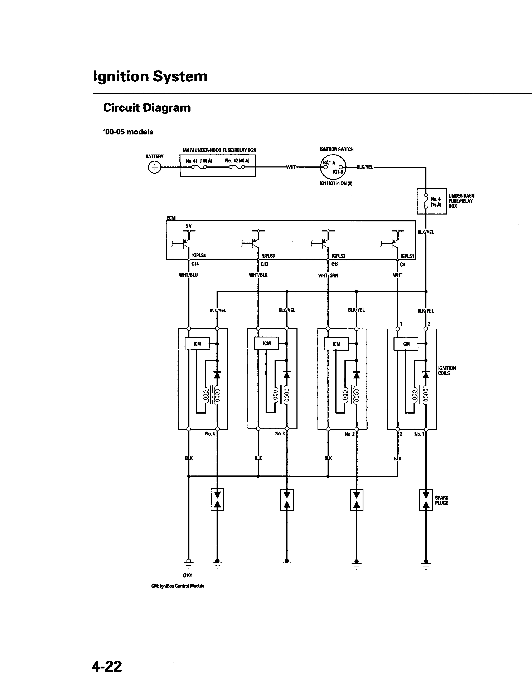

### Ignition System Circuit Diagram — 2006–2008 Models

Source: [PDF p.93, printed p.4-23](../page-images/p0093.png).

The later-model drawing adds the ignition coil relay. It shows main under-hood fuses No. 41 (100 A) and No. 59 (20 A), under-dash No. 16 (15 A), the relay, ECM ignition pulse outputs IGPLS1–4, ignition coils and their ICMs, spark plugs, and G101 ground. Use the diagram for exact wire colors, connector terminals and routing.

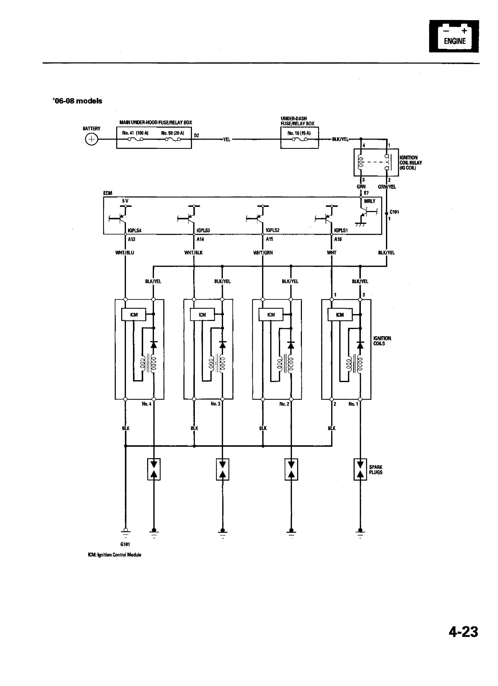

### Ignition Timing Inspection

Source: [PDF p.94, printed p.4-24](../page-images/p0094.png).

1. Connect the Honda Diagnostic System (HDS) to the data link connector (DLC), '00-05 models (see step 2 on page 11-3), '06-08 models (see step 2 on page 11-213), and check for DTCs. If a DTC is present, diagnose and repair the cause before inspecting the ignition timing.

2. Turn the ignition switch to ON (II).

3. '06-08 models: Make sure the HDS communicates with the vehicle and the engine control module (ECM). If it doesn't communicate, troubleshoot the DLC circuit (see page 11-367).

4. Start the engine. Hold the engine speed at 3,000 rpm with no load (in neutral) until the radiator fan comes on, then let it idle.

5. Check the idle speed:
   - '00-05 models (see page 11-140)
   - '06-08 models (see page 11-461)

6. Jump the SCS line with the HDS.

7. Free the service loop (A) from the engine wire harness, then connect the timing light to the service loop.

8. Aim the light toward the pointer (A). Check the ignition timing under a no load condition (headlights, blower fan, and air conditioner are turned off).

**Ignition Timing:**
5 ± 2 °BTDC (RED mark (B)) at idle in neutral

9. If the ignition timing differs from the specification, check the cam timing. If the cam timing is OK, update the ECM if it does not have the latest software '06-08 models (see page 11-216), or substitute a known-good ECM , '00-05 models (see page 11-5), '06-08 models (see page 11-217), then recheck. If the system works properly, and the ECM was substituted, replace the original ECM , '00-05 models (see page 11-115), '06-08 models (see page 11-389).

10. Turn the ignition switch to LOCK (0).

11. Disconnect the HDS and the timing light.

12. Secure the service loop to the engine wire harness with wire ties.

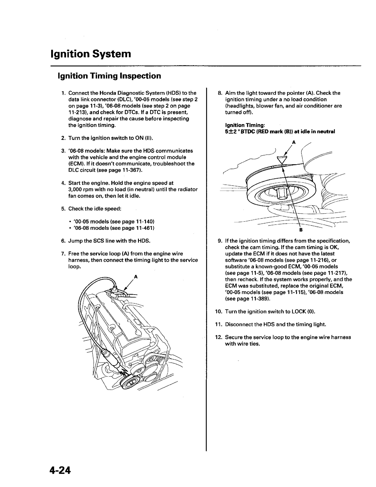

### Ignition Coil Removal/Installation

Source: [PDF p.95, printed p.4-25](../page-images/p0095.png).

1. Remove the ignition coil cover (**A**).
2. Disconnect the ignition coil connectors, then remove the ignition coils (**B**).
3. Install the ignition coils in the reverse order of removal.

> **NOTE:** The ignition coils for '06-08 models are different from former models. Do not install the ignition coils from other model years, because they may be damaged. To differentiate between the two types of ignition coils, the ignition coils for '06-08 models have the ribs (**A**) on the coil head and supplier's parts number (**B**).

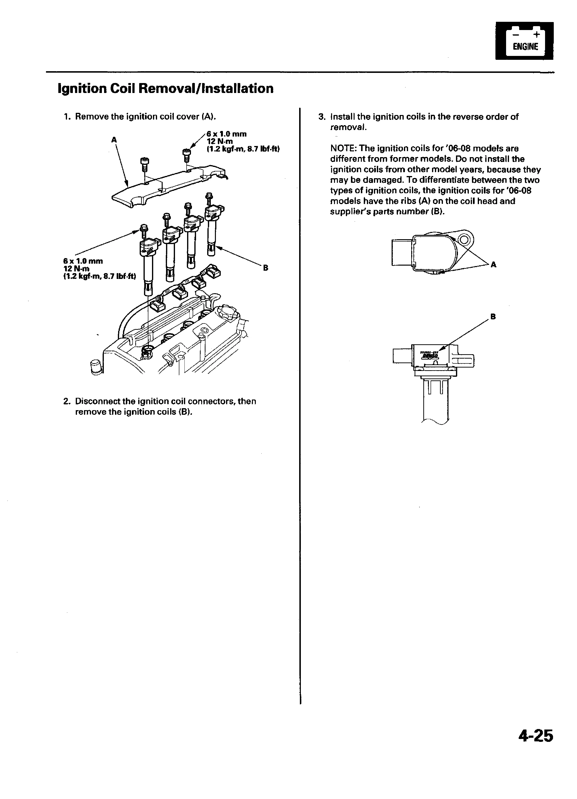

### Ignition Coil Relay Circuit Troubleshooting — 2006–2008 Models

Source: [PDF p.96, printed p.4-26](../page-images/p0096.png).

1. Check under-dash No. 16 (15 A) fuse. **YES, good:** Reinstall it and go to step 2. **NO:** Replace it. If it blows again, find and repair the short between the under-dash fuse/relay box and ignition coils.
2. Remove and test the ignition coil relay (printed p.22-48). **YES, good:** Go to step 3. **NO:** Replace the relay.
3. Measure voltage from ignition coil relay 4P socket terminal No. 1 to body ground, then from terminal No. 4 to body ground. **YES, battery voltage:** Go to step 4. **NO:** Repair the open between the under-dash fuse/relay box and relay 4P socket.
4. Check continuity from each ignition coil relay 4P socket terminal No. 2 to ignition coil 3P connector terminal No. 3. **YES:** Go to step 5. **NO:** Repair the open between those terminals.
5. Check continuity from each ignition coil 3P connector terminal No. 2 to body ground. **YES:** Go to step 6 on the next page. **NO:** Repair the open between that terminal and body ground.

The source diagram shows the connector faces and test probe locations for steps 3–5.

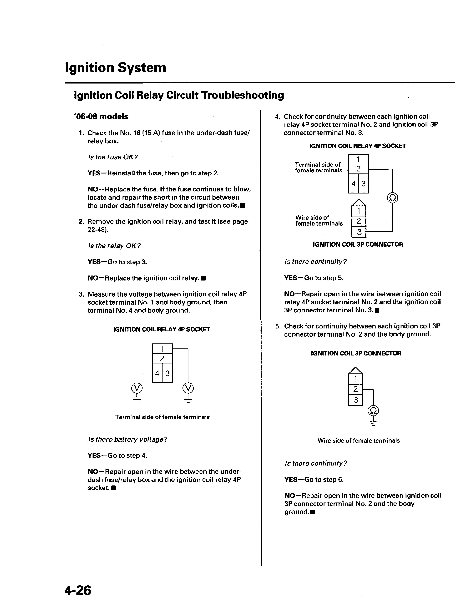

Source: [PDF p.97, printed p.4-27](../page-images/p0097.png).

6. Connect the HDS to the DLC (step 2 on printed p.11-213).
7. Turn the ignition switch to ON (II).
8. Confirm HDS communication with the vehicle and ECM. If it does not communicate, troubleshoot the DLC circuit (printed p.11-367).
9. Jump the SCS line with the HDS. **This protects the ECM from damage.**
10. Turn the ignition switch to LOCK (0).
11. Disconnect ECM connector E (31P).
12. Check continuity from ignition coil relay 4P socket terminal No. 3 to body ground. **YES:** Repair a short to ground in the wire between the relay 4P socket terminal No. 3 and ECM (E7). **NO:** Go to step 13.
13. Check continuity from ignition coil relay 4P socket terminal No. 3 to ECM connector terminal E7. **YES:** The system is OK at this time; check for loose or poor connections at the ignition coil relay and ECM (E7). **NO:** Repair an open in the wire between relay 4P socket terminal No. 3 and ECM (E7).

The source page shows the terminal views and test points for steps 12–13.

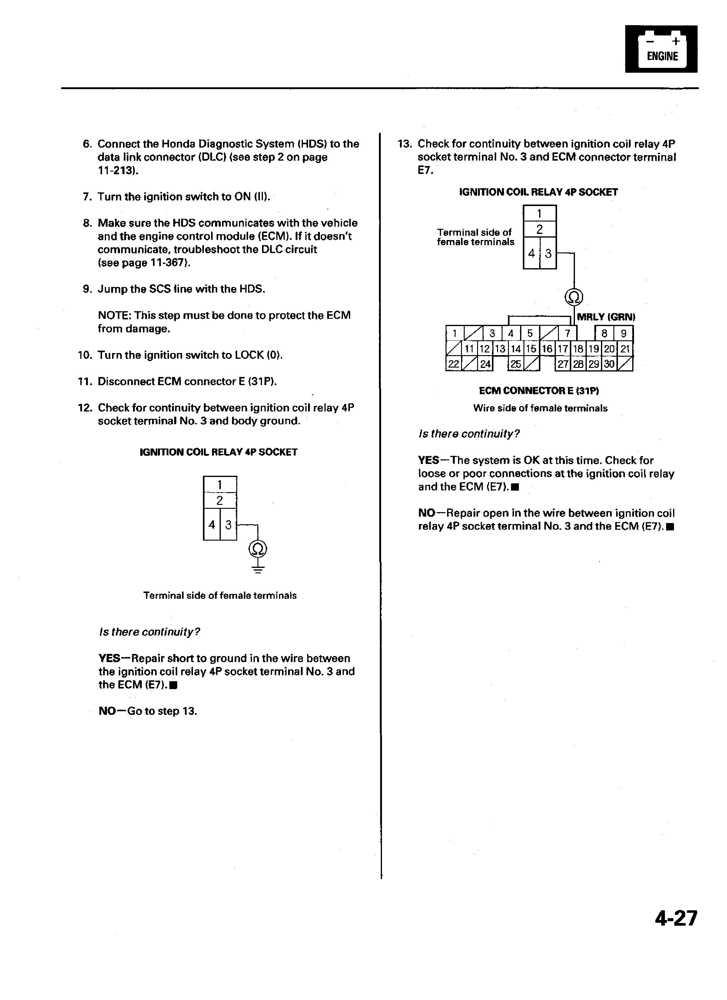

### Spark Plug Inspection

Source: [PDF p.98, printed p.4-28](../page-images/p0098.png).

1. Remove the plugs and inspect electrodes and ceramic insulators. Burned or worn electrodes may result from advanced ignition timing, a loose plug, a heat range that is too hot, or insufficient cooling. Fouling may result from retarded ignition timing, oil in the combustion chamber, incorrect gap, a heat range that is too cold, excessive idling or low-speed running, a clogged air cleaner element, or deteriorated ignition coils. Inspect for worn or deformed electrodes, damaged gasket, cracked insulator, improper gap, oil fouling, carbon deposits, and a cracked center electrode insulator.
2. If an electrode is dirty or contaminated, clean it with a plug cleaner. **Do not wire-brush or scrape the iridium electrode.** With a sand blaster plug cleaner, clean for no longer than 20 seconds.
3. Do not adjust the gap of platinum-tip plugs; replace a plug whose gap is outside the new standard of 1.0–1.1 mm (0.039–0.043 in.).
4. Replace plugs at the specified interval or if the center electrode is rounded. Use NGK PFR7G-11S or DENSO PK22PR-L11S.
5. Apply a small amount of anti-seize compound to the plug threads. Screw plugs into the cylinder head finger-tight, then torque to 25 N·m (2.5 kgf·m, 18 lbf·ft).

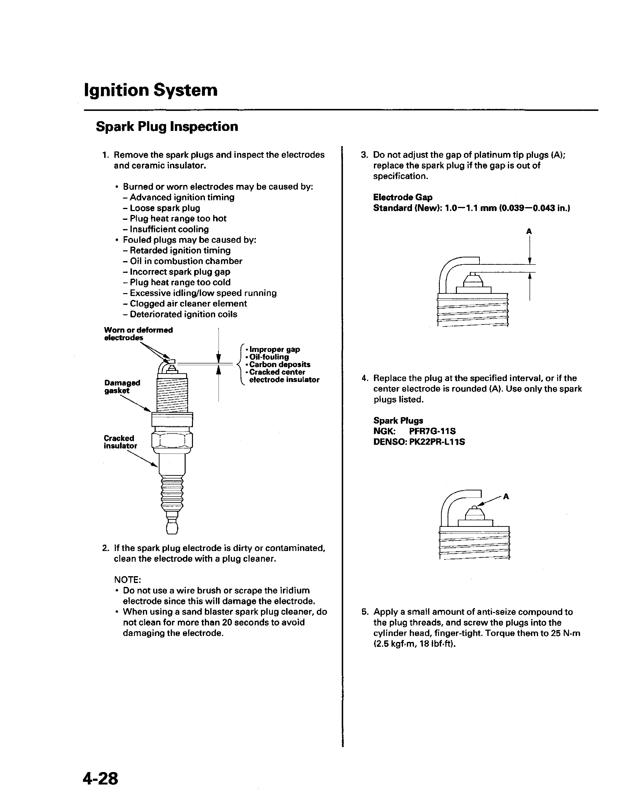

## Charging System

### Component Location Index

Source: [PDF p.99, printed p.4-29](../page-images/p0099.png).

The source diagram locates the alternator, battery, ECM, under-hood fuse/relay box, and charging system indicator in the gauge assembly.

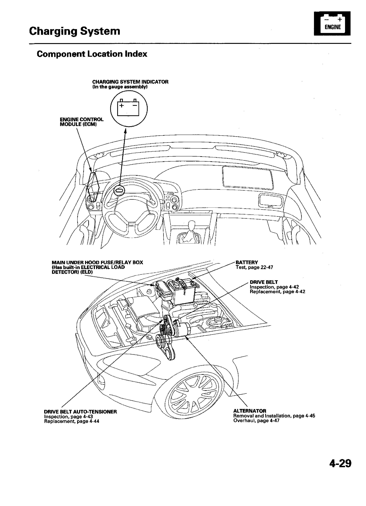

### Symptom Troubleshooting Index

Source: [PDF p.100, printed p.4-30](../page-images/p0100.png).

#### 2000–2005 Models

| Symptom | Diagnostic procedure | Also check for |
| :--- | :--- | :--- |
| **Charging system indicator does not come on with the ignition switch to ON (II)** | Troubleshoot the charging system indicator circuit (see page 4-34). | - |
| **Charging system indicator stays on** | 1. Troubleshoot the charging system indicator circuit (see page 4-34). 2. Check for a broken drive belt (see page 4-42). 3. Check the drive belt auto-tensioner (see page 4-43). | - |
| **Battery discharged** | 1. Check for a poor connection and for open or shorted wire(s) in charging system. 2. Check for any electrical equipment (including OEM options) that use parasitic electrical current draw when the ignition switch is in LOCK (0). 3. Check for a broken drive belt (see page 4-42). 4. Check the drive belt auto-tensioner (see page 4-43). 5. Troubleshoot the alternator and regulator circuit (see page 4-38). 6. Check for a poor connection at the battery terminal. 7. Test the battery (see page 22-47). | - |
| **Battery overcharged** | 1. Troubleshoot the alternator and regulator circuit (see page 4-38). 2. Test the battery (see page 22-47). | - |

#### 2006–2008 Models

| Symptom | Diagnostic procedure | Also check for |
| :--- | :--- | :--- |
| **Charging system indicator does not come on with the ignition switch to ON (II)** | Troubleshoot the charging system indicator circuit (see page 4-36). | - |
| **Charging system indicator stays on** | 1. Check for PGM-FI DTCs (see page 11-213). 2. Troubleshoot the charging system indicator circuit (see page 4-36). 3. Check for a broken drive belt (see page 4-42). 4. Check the drive belt auto-tensioner (see page 4-43). | - |
| **Battery discharged** | 1. Check for any electrical equipment (including OEM options) that use parasitic electrical current draw when the ignition switch is in LOCK (0). 2. Check for a broken drive belt (see page 4-42). 3. Check the drive belt auto-tensioner (see page 4-43). 4. Troubleshoot the alternator and regulator circuit (see page 4-38). 5. Check for a poor connection at the battery terminal. 6. Test the battery (see page 22-47). | - |
| **Battery overcharged** | 1. Troubleshoot the alternator and regulator circuit (see page 4-38). 2. Test the battery (see page 22-47). | - |

### Charging System Circuit Diagram — 2000–2003 Models

Source: [PDF p.101, printed p.4-31](../page-images/p0101.png).

The diagram shows the battery, main under-hood and under-dash fuse/relay boxes, ELD unit, ignition switch, gauge assembly indicator, ECM, and alternator regulator and rectifier. Follow the drawing for exact wire colors, terminals, and routing.

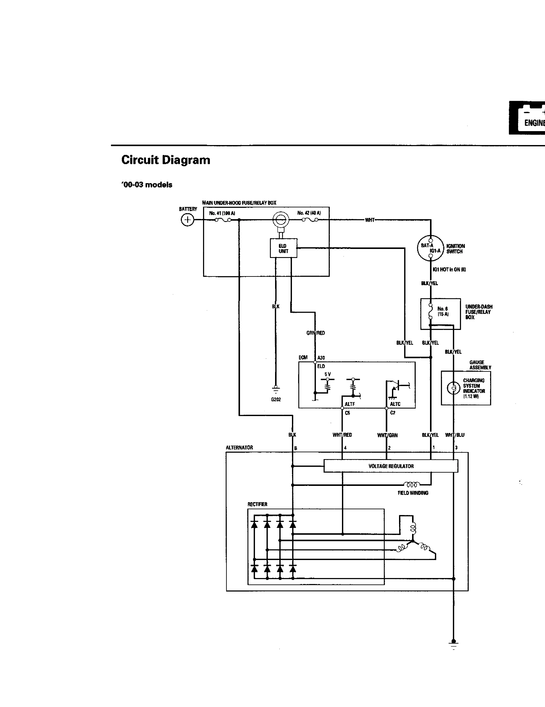

### Charging System Circuit Diagram — 2004–2005 Models

Source: [PDF p.102, printed p.4-32](../page-images/p0102.png).

The diagram shows the battery, main under-hood and under-dash fuse/relay boxes, ELD unit, ignition switch, gauge assembly indicator, ECM, and alternator regulator and rectifier. Follow the drawing for exact wire colors, terminals, and routing.

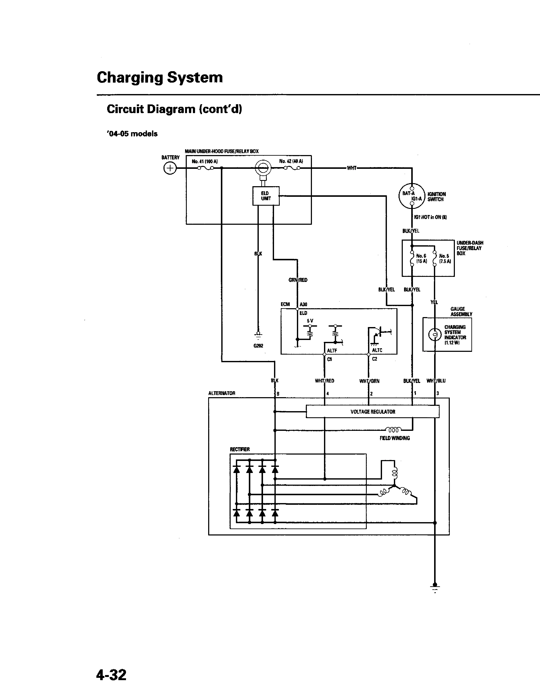

### Charging System Circuit Diagram — 2006–2008 Models

Source: [PDF p.103, printed p.4-33](../page-images/p0103.png).

The later-model diagram shows the battery, main under-hood and under-dash fuse/relay boxes, ELD unit, ignition switch, gauge assembly indicator, ECM, and alternator regulator and rectifier. Follow the drawing for exact wire colors, terminals, and routing.

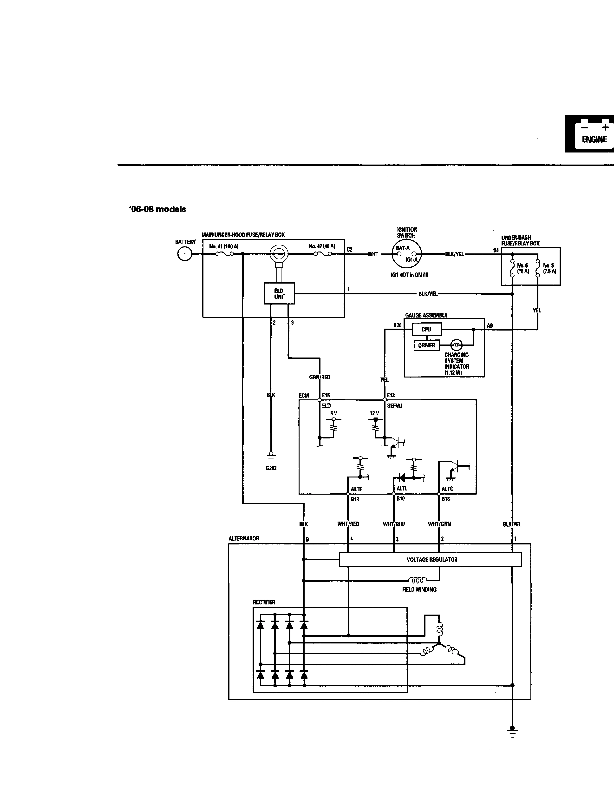

### Charging System Indicator Circuit Troubleshooting — 2000–2005 Models

Source: [PDF p.104, printed p.4-34](../page-images/p0104.png).

1. Turn the ignition switch to ON (II).
   Does the charging system indicator come on?
   - **YES** — Go to step 2.
   - **NO** — Go to step 6.

2. Start the engine.
   Does the charging system indicator go off?
   - **YES** — Charging system indicator circuit is OK. Go to the alternator and regulator circuit troubleshooting (see page 4-38).
   - **NO** — Go to step 3.

3. Turn the ignition switch to LOCK (0).

4. Disconnect the alternator 4P connector from the alternator.

5. Turn the ignition switch to ON (II).
   Does the charging system indicator come on?
   - **YES** — Repair short to ground in the wire between the gauge assembly and alternator.
   - **NO** — Go to step 11.

6. Turn the ignition switch to LOCK (0).

7. Check the No. 6 (15 A) fuse ('00-03 models) or No. 5 (7.5 A) fuse ('04-05 models) in the under-dash fuse/relay box.
   Is the fuse OK?
   - **YES** — Reinstall the fuse, then go to step 8.
   - **NO** — Replace the fuse, then recheck.

8. Disconnect the alternator 4P connector from the alternator.

9. Connect the alternator 4P connector terminal No. 3 to body ground with a jumper wire. Turn the ignition switch to ON (II).

   Does the charging system indicator come on?
   - **YES** — Go to step 11.
   - **NO** — Go to step 10.

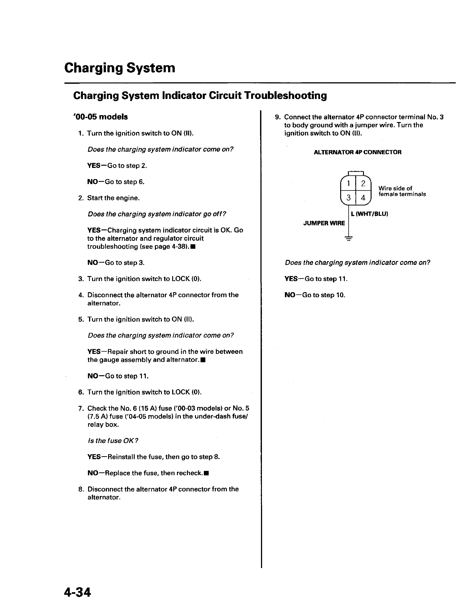

Source: [PDF p.105, printed p.4-35](../page-images/p0105.png).

10. Check continuity from alternator 4P connector terminal No. 3 to gauge assembly connector D11 (2000–2003) or B26 (2004–2005). **YES:** Check for a blown charging system indicator bulb. If the bulb is good, check the gauge assembly indicator power supply circuit. **NO:** Repair the open between alternator and gauge assembly.
11. With the ignition switch ON (II), measure voltage from alternator 4P connector terminal No. 1 to body ground. **YES, battery voltage:** The indicator circuit is OK; continue to alternator and regulator circuit troubleshooting. **NO:** Repair the open between under-dash fuse/relay box and alternator.

The source image shows the connector views and test points for both model ranges.

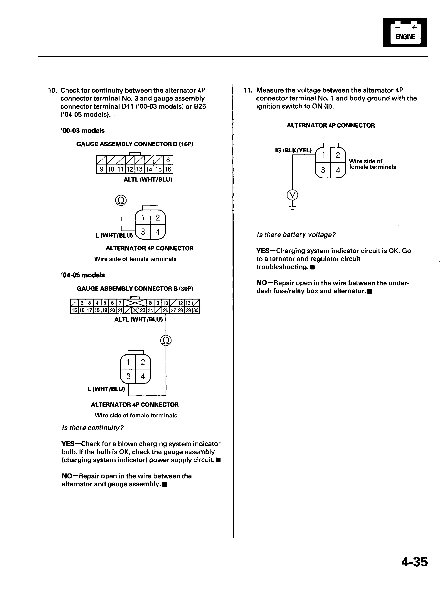

### Charging System Indicator Circuit Troubleshooting — 2006–2008 Models

Source: [PDF p.106, printed p.4-36](../page-images/p0106.png).

1. Turn the ignition switch to ON (II).
   Does the charging system indicator come on?
   - **YES** — Go to step 2.
   - **NO** — Go to step 15.

2. Shift to neutral, and start the engine. Hold the engine speed at 2,000 rpm for 1 minute.
   Does the charging system indicator go off?
   - **YES** — Charging system indicator circuit is OK. Go to the alternator and regulator circuit troubleshooting (see page 4-38).
   - **NO** — Go to step 3.

3. Do the gauge assembly self-diagnostic function procedure (see page 22-60).
   Does the charging system indicator flash?
   - **YES** — Go to step 4.
   - **NO** — Replace the gauge assembly (see page 22-89).

4. Turn the ignition switch to LOCK (0).
5. Disconnect the alternator 4P connector.
6. Turn the ignition switch to ON (II).
   Does the charging system indicator go off?
   - **YES** — Replace the alternator (see page 4-45) or repair the alternator (see page 4-47).
   - **NO** — Go to step 7.

7. Turn the ignition switch to LOCK (0).
8. Connect the Honda Diagnostic System (HDS) to the data link connector (DLC) (see step 2 on page 11-213).
9. Turn the ignition switch to ON (II).
10. Make sure the HDS communicates with the vehicle and the engine control module (ECM). If it doesn't communicate, troubleshoot the DLC circuit (see page 11-367).
11. Jump the SCS line with the HDS.
    > **NOTE:** This step must be done to protect the ECM from damage.
12. Turn the ignition switch to LOCK (0).
13. Disconnect ECM connector B (24P).

14. Check for continuity between ECM connector terminal B10 and body ground.

**Is there continuity?**
- **YES** — Repair short to ground in the wire between the alternator and the ECM (B10).
- **NO** — Update the ECM if it does not have the latest software (see page 11-216), or substitute a known-good ECM (see page 11-217), then recheck. If the symptom/indication goes away with a known-good ECM, replace the original ECM (see page 11-389).

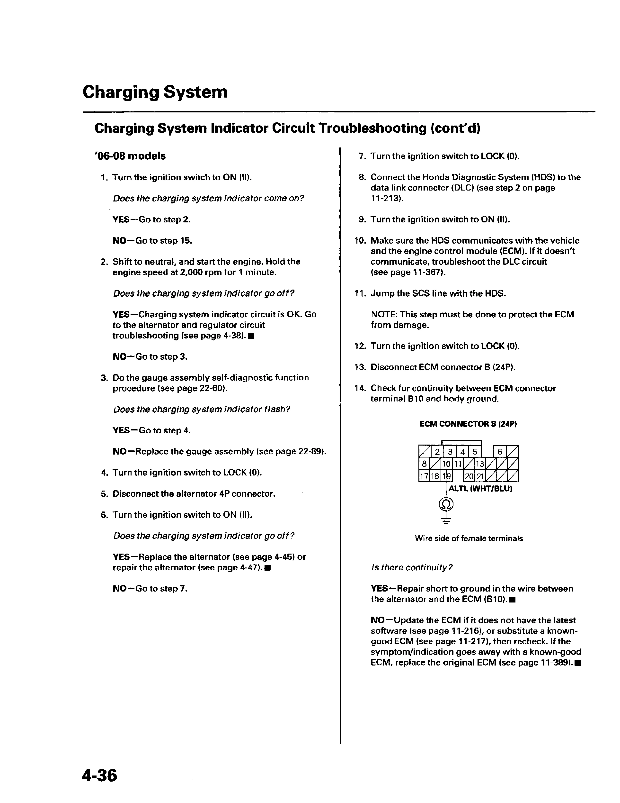

Source: [PDF p.107, printed p.4-37](../page-images/p0107.png).

15. Run the gauge assembly self-diagnostic function (printed p.22-60). **Indicator flashes:** Go to step 16. **Does not flash:** Replace the gauge assembly (printed p.22-89).
16. Turn the ignition switch to LOCK (0).
17. Disconnect the alternator 4P connector.
18. Connect alternator 4P connector terminal No. 3 to body ground with a jumper wire, as shown.
19. Turn the ignition switch to ON (II). **Indicator comes on:** Replace the alternator (printed p.4-45) or repair it (printed p.4-47). **Does not come on:** Remove the jumper and go to step 20.
20. Turn the ignition switch to LOCK (0).
21. Connect the HDS to the DLC (step 2 on printed p.11-213).
22. Turn the ignition switch to ON (II).
23. Confirm HDS communication with vehicle and ECM. If it does not communicate, troubleshoot the DLC circuit (printed p.11-367).
24. Jump the SCS line with the HDS. **This protects the ECM from damage.**
25. Turn the ignition switch to LOCK (0).
26. Disconnect ECM connector B (24P).
27. Check continuity between ECM connector terminal B10 and alternator 4P connector terminal No. 3. **YES:** Update ECM software if needed (printed p.11-216) or substitute a known-good ECM (printed p.11-217), then recheck. If that resolves the symptom, replace the original ECM (printed p.11-389). **NO:** Repair the open between alternator and ECM (B10).

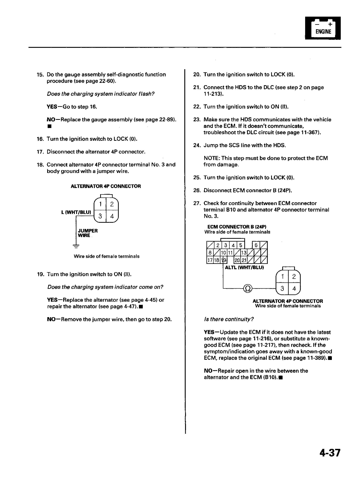

### Alternator and Regulator Circuit Troubleshooting

Source: [PDF p.108, printed p.4-38](../page-images/p0108.png).

1. Make sure the battery connections are good, and that the battery is sufficiently charged (see page 22-47).
2. Connect a VAT-40 (or equivalent tester), and turn the selector switch to position 1 (starting).

3. Shift to neutral, and start the engine. Hold the engine speed at 3,000 rpm, with no load until the radiator fan comes on, then let it idle.
4. Raise the engine speed to 2,000 rpm, and hold it there.

Is the voltage over 15.1 V?
YES—Replace the alternator or the rear housing assembly.
NO—Go to step 5.

5. Release the accelerator pedal, and let the engine idle.
6. Turn off all the accessories. Select the charging test on the tester.
7. Remove the inductive pickup, and zero the ammeter.
8. Place the inductive pickup over the B terminal wire of the alternator so the arrow points away from the alternator.
9. Raise the engine speed to 2,000 rpm, and hold it there.

Is the voltage less than 13.5 V?
YES—Go to alternator control circuit troubleshooting.
NO—Go to step 10.

10. Apply a load with the VAT-40 until the battery voltage drops within 12—13.5 V.

Is the amperage 87.5 A or more?
YES—The charging system is OK.
NOTE: If the charging system indicator is still on, replace the alternator (see page 4-45).
NO—Replace the alternator (see page 4-45) or repair the alternator (see page 4-47).

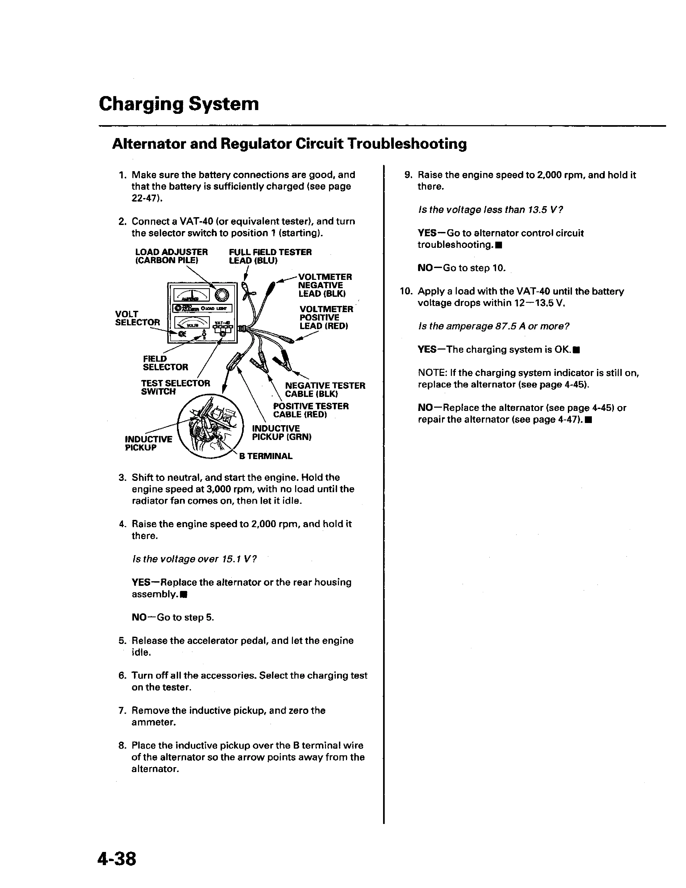

### Alternator Control Circuit Troubleshooting — 2000–2005 Models

Source: [PDF p.109, printed p.4-39](../page-images/p0109.png).

1. Check the electrical load detector (ELD) for a DTC. If present, diagnose and repair its cause before this test. The ELD DTC does not turn on the MIL.
2. Disconnect the alternator 4P connector.
3. Start the engine and turn the headlights to high beam.
4. Measure voltage from alternator 4P connector terminal No. 2 to battery positive. **Less than 1 V:** Go to step 8. **Not less than 1 V:** Go to step 5.
5. Turn off the headlights and turn the ignition switch to LOCK (0).
6. Disconnect ECM connector C (31P).
7. Check continuity from ECM connector terminal C2 to body ground. **YES:** Repair the short to ground between alternator and ECM (C2). **NO:** Check ECM connector C for loose or poor connections. If good, substitute a known-good ECM (printed p.11-5) and recheck; replace the original ECM if that resolves the symptom (printed p.11-115).
8. Turn off the headlights and turn the ignition switch to LOCK (0).
9. Disconnect ECM connector C (31P).

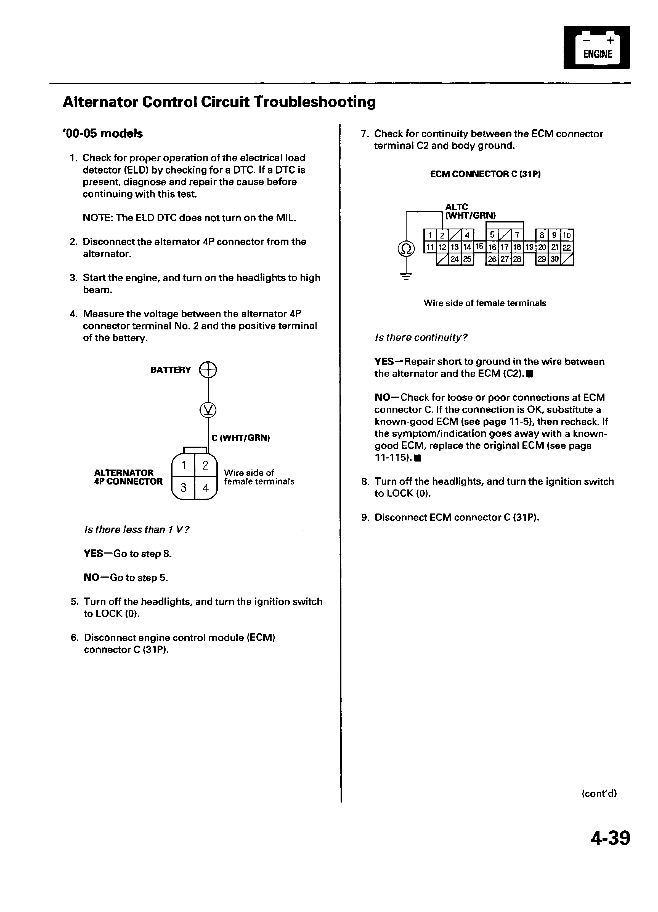

Source: [PDF p.110, printed p.4-40](../page-images/p0110.png).

**2000–2005 model procedure, continued:**

10. Check continuity from ECM connector terminal C2 to alternator 4P connector terminal No. 2. **YES:** Replace the alternator (printed p.4-45) or repair it (printed p.4-47). **NO:** Repair the open between alternator and ECM (C2).

#### Alternator Control Circuit Troubleshooting — 2006–2008 Models

1. Check ELD operation by checking for a DTC. Diagnose and repair any DTC before continuing. The ELD DTC does not turn on the MIL.
2. Disconnect the alternator 4P connector.
3. Start the engine and turn the headlights to high beam.
4. Measure voltage from alternator 4P connector terminal No. 2 to battery positive. **Less than 1 V:** Go to step 13. **Not less than 1 V:** Go to step 5.
5. Turn off the headlights and turn the ignition switch to LOCK (0).
6. Connect the HDS to the DLC (step 2 on printed p.11-213).

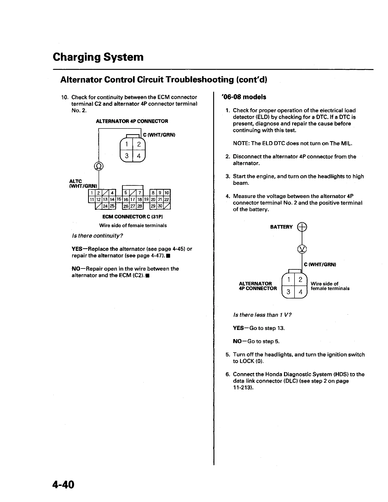

Source: [PDF p.111, printed p.4-41](../page-images/p0111.png).

**2006–2008 model procedure, continued:**

7. Turn the ignition switch to ON (II).
8. Confirm the HDS communicates with the vehicle and ECM. If it does not, troubleshoot the DLC circuit (printed p.11-367).
9. Jump the SCS line with the HDS. **This protects the ECM from damage.**
10. Turn the ignition switch to LOCK (0).
11. Disconnect ECM connector B (24P).
12. Check continuity from ECM connector terminal B18 to body ground. **YES:** Repair the short to ground between alternator and ECM (B18). **NO:** Update ECM software if needed (printed p.11-216) or substitute a known-good ECM (printed p.11-217). If that resolves the symptom, replace the original ECM (printed p.11-389).
13. Turn off the headlights and turn the ignition switch to LOCK (0).
14. Connect the HDS to the DLC (step 2 on printed p.11-213).
15. Turn the ignition switch to ON (II).
16. Confirm HDS communication with vehicle and ECM; if absent, troubleshoot the DLC circuit (printed p.11-367).
17. Jump the SCS line with the HDS. **This protects the ECM from damage.**
18. Turn the ignition switch to LOCK (0).
19. Disconnect ECM connector B (24P).
20. Check continuity from ECM connector terminal B18 to alternator 4P connector terminal No. 2. **YES:** Replace the alternator (printed p.4-45) or repair it (printed p.4-47). **NO:** Repair the open between alternator and ECM (B18).

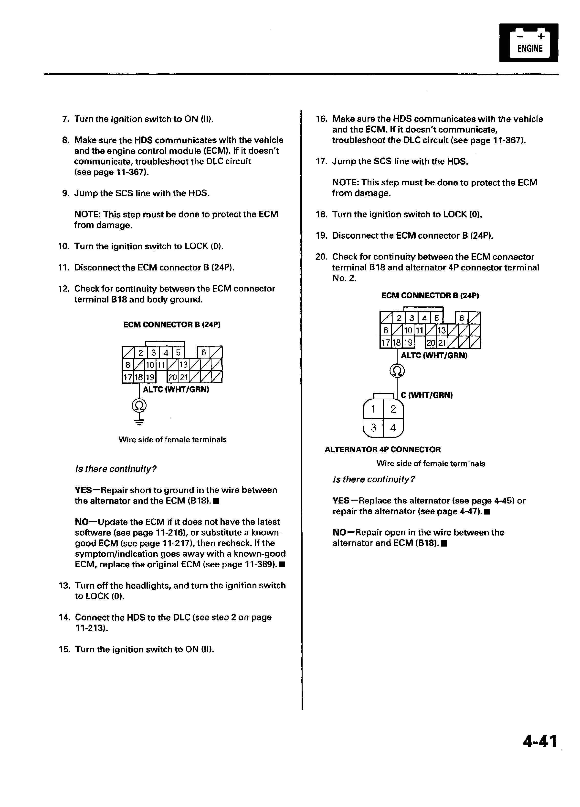

Source: [PDF p.112, printed p.4-42](../page-images/p0112.png).

### Drive Belt Inspection

1. Inspect the belt for cracks or damage. If the belt is cracked or damaged, replace it.

2. Check that the indicator (A) on the auto-tensioner housing is not beyond the edge of the indicator rib (B) on the tensioner base. If it is beyond the edge of the indicator rib, replace the drive belt (see page 4-42).

### Drive Belt Replacement
##### Special Tools Required

*   Belt tension release tool: Snap-on YA9317 or equivalent, commercially available

1. Move the auto-tensioner (A) to relieve tension from the drive belt (B), and remove the drive belt.

2. Install the new belt in the reverse order of removal.

> **NOTE:** For belt routing, see the charging system component location index (see page 4-29).

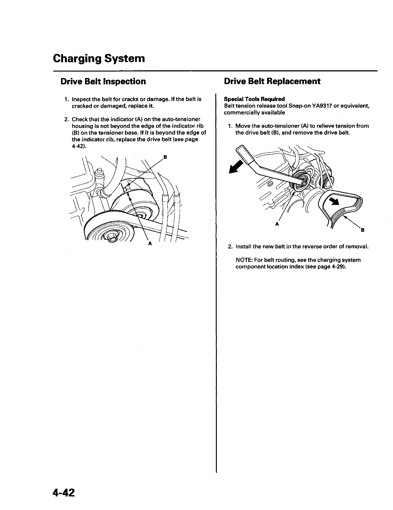

Source: [PDF p.113, printed p.4-43](../page-images/p0113.png).

### Drive Belt Auto-tensioner Inspection

#### Special Tools Required
*   Belt tension release tool: Snap-on YA9317 or equivalent, commercially available

1.  Turn the ignition switch to ON (II), and make sure the A/C switch is OFF. Turn the ignition switch to LOCK (0).
2.  Check the position of the auto-tensioner indicator's pointer (A). Start the engine, then check the position again with the engine idling. If the position of the indicator moves or fluctuates very much, replace the auto-tensioner (see page 4-44).
3.  Check for abnormal noise from the tensioner pulley. If you hear abnormal noise, remove the auto-tensioner, and replace the tensioner pulley.
4.  Turn off the engine. Move the auto-tensioner (A) in the direction shown with the belt tension release tool (B) to relieve tension from the drive belt (C), then remove the belt.
5.  Move the auto-tensioner within its limit using the belt tension release tool in the direction shown, check that the tensioner moves smoothly and without any abnormal noise. If the tensioner does not move smoothly, or you hear abnormal noise, replace the auto-tensioner.
6.  Attach a torque wrench (A) to the pulley bolt. Align the indicator on the auto-tensioner housing with the edge of the indicator rib on the tensioner base by using the torque wrench, and measure the torque. If the torque value is out of specification, replace the auto-tensioner.

### Auto-tensioner Spring Torque
*   26.2 N-m (2.67 kgf-m, 19.3 Ibf ft)

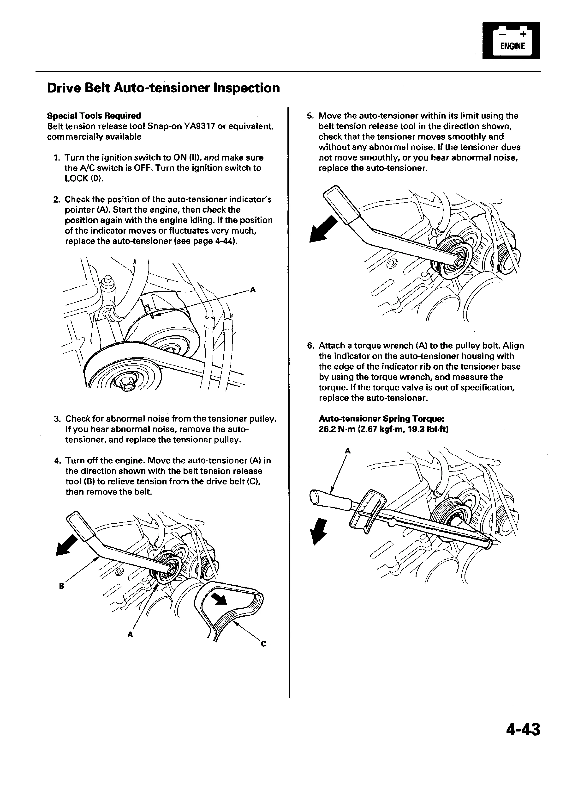

Source: [PDF p.114, printed p.4-44](../page-images/p0114.png).

### Drive Belt Auto-tensioner Replacement

1. Remove the drive belt (see page 4-42).
2. Remove the auto-tensioner.
   - Torque specification: **8 x 1.25 mm** bolts at **22 N-m** (2.2 kgf-m, 16 lb-ft).
3. Install the parts in the reverse order of removal.

### Tensioner Pulley Replacement

1. Remove the auto-tensioner (see page 4-44).
2. Secure the auto-tensioner in a bench vise with soft jaws. To prevent damage to the tensioner, always use soft jaws or equivalent materials between the tensioner and the vise.
3. Remove the pulley bolt (**left-hand threads**), and remove the tensioner pulley.
   - Torque specification: **42 N-m** (4.3 kgf-m, 31 lb-ft).
4. Install the parts in the reverse order of removal.

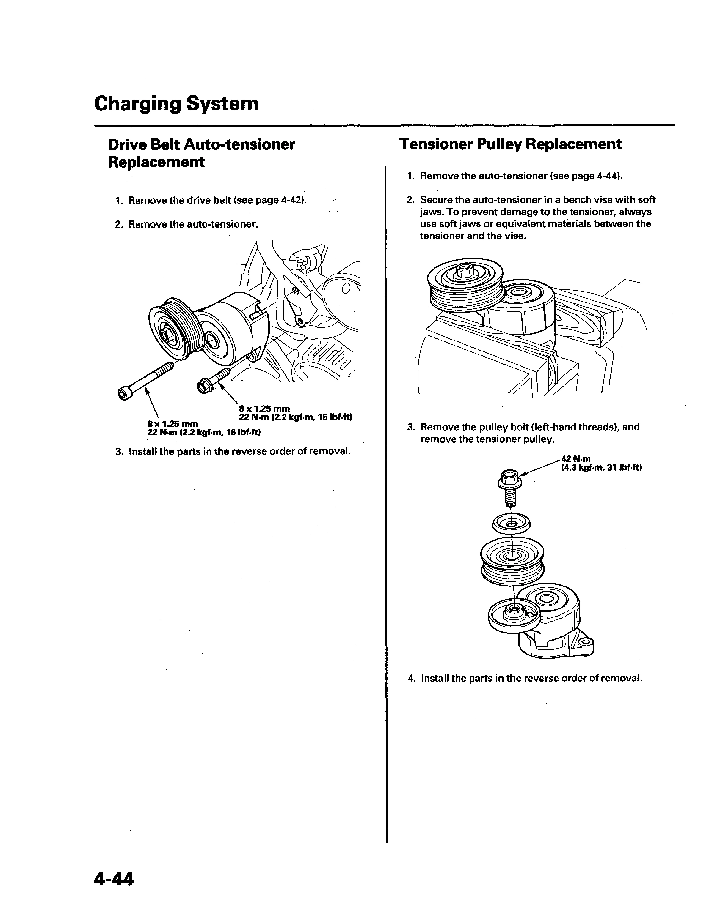

Source: [PDF p.115, printed p.4-45](../page-images/p0115.png).

### Alternator Removal and Installation

#### Removal

1. Make sure you have the anti-theft code for the audio system, then write down the audio presets.
2. Disconnect the negative cable from the battery.
3. Remove the drive belt (see page 4-42).
4. Disconnect the 4P connector (A) from the alternator (B) and the BLK wire from the alternator B terminal (C).

5. Remove the mounting bolts, then remove the alternator.

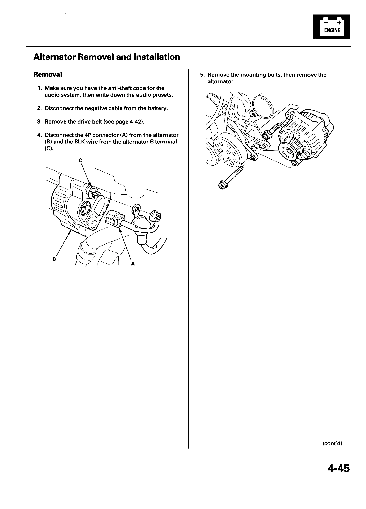

Source: [PDF p.116, printed p.4-46](../page-images/p0116.png).

### Alternator Removal and Installation (continued)
#### Installation

1. Install the alternator.
   - Torque specification: **10 x 1.25 mm** bolts to **44 N-m (4.5 kgf-m, 33 Ibf ft)**.

2. Connect the **4P connector (A)** to the alternator (**B**) and the **BLK wire** to the alternator **B terminal (C)**. Tighten the illustrated 8 × 1.25 mm B-terminal fastener to 12 N·m (1.2 kgf·m, 9 lbf·ft).

3. Install the drive belt (see page **4-42**).

4. Connect the negative cable to the battery.

5. **'00-05 models**: Do the engine control module (**ECM**) idle learn procedure (see page **11-140**).

6. Enter the anti-theft code for the audio system, then enter the audio presets. Set the clock.

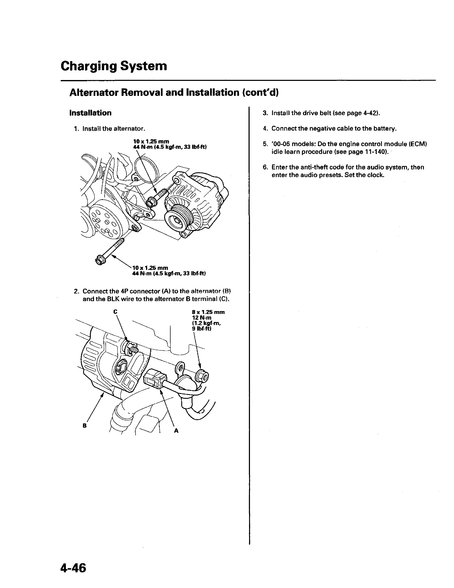

### Alternator Overhaul — Exploded View

Source: [PDF p.117, printed p.4-47](../page-images/p0117.png).

The exploded view identifies the rotor, bearing retainer, front and rear bearings, stator drive-end cover, pulley, brush holder, voltage regulator, rectifier assembly, insulator bush, rear housing, spacer ring, terminal plate and insulator, end cover, and brush holder insulator. The pulley locknut is specified at 111 N·m (11.3 kgf·m, 81.7 lbf·ft).

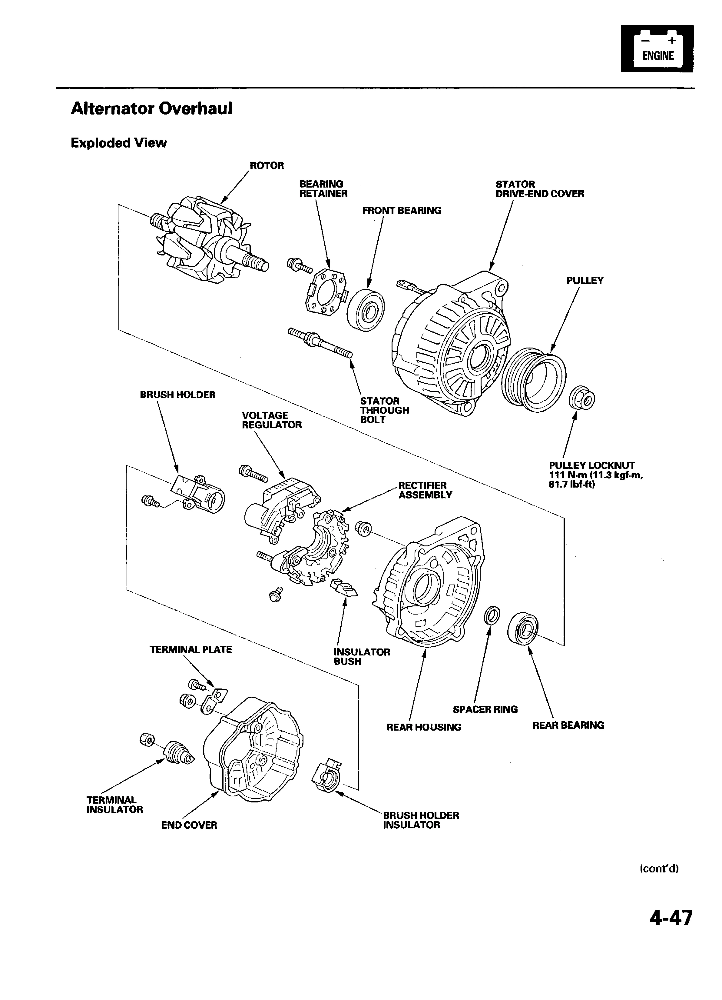

### Alternator Overhaul — Disassembly

Source: [PDF p.118, printed p.4-48](../page-images/p0118.png).

Special tools: handle driver 07749-0010000 and 42 × 47 mm attachment 07746-0010300. Refer to the [exploded view](../diagrams/p0117-alternator-exploded.webp) as needed.

1. Test the alternator and regulator before removing them (see printed p.4-38).
2. Remove the alternator (see printed p.4-45).
3. If replacing the front bearing, remove the pulley locknut with a 10 mm wrench and a 22 mm wrench. Use an impact wrench if necessary.
4. Remove the three flange nuts and screw, then remove the terminal plate.
5. Remove the washer nut and terminal insulator from the B terminal, then remove the end cover and brush holder insulator.
6. Remove the brush holder.

### Alternator Disassembly — Continued

Source: [PDF p.119, printed p.4-49](../page-images/p0119.png). The OCR missed the procedure text on this diagram page.

7. Remove the voltage regulator.
8. Remove the four screws, then remove the rectifier and rubber seal.
9. Remove the four flange nuts.
10. Remove the four insulators, rear housing, and washer.

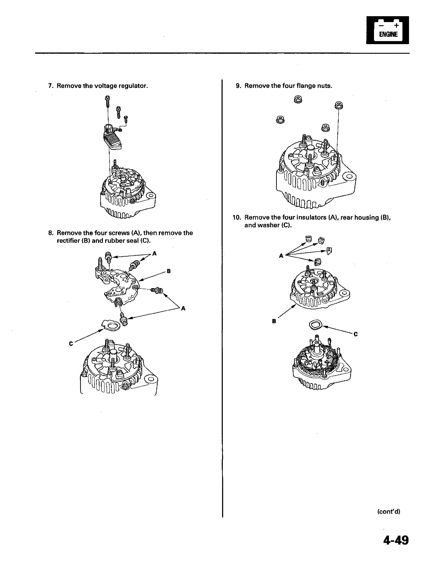

### Alternator Overhaul — Bearings

Source: [PDF p.120, printed p.4-50](../page-images/p0120.png).

11. If neither the front nor rear bearing needs replacing, go to step 18. Otherwise, remove the rotor from the stator drive-end housing.
12. Inspect the rotor shaft for scoring and the bearing journal surface in the stator housing for seizure marks. Replace the alternator if either is damaged; otherwise continue to step 13.
13. Remove the rear bearing with a puller as shown.
14. Install a new rear bearing on the rotor shaft with a hammer and commercially available tools as shown.
15. Remove the front bearing retainer plate.

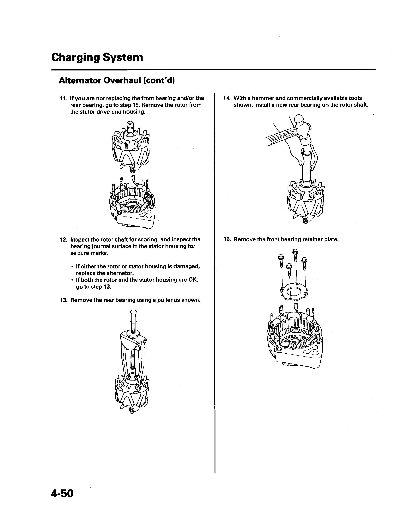

### Front Bearing and Rectifier Test

Source: [PDF p.121, printed p.4-51](../page-images/p0121.png).

16. Support the stator housing in a vise; drive out the front bearing with a brass drift and hammer.
17. Install a new front bearing in the stator housing with a hammer, handle driver 07749-0010000, and attachment 07746-0010300.
18. With an ohmmeter that can check diodes, check continuity in both directions between the B and P terminals, and between the E and P terminals, of each diode pair. The rectifier has eight diodes (four pairs), requiring 16 checks. Each diode should conduct in only one direction. Replace the rectifier assembly if any diode is faulty; the diodes are not available separately. If all pass, continue to step 19.

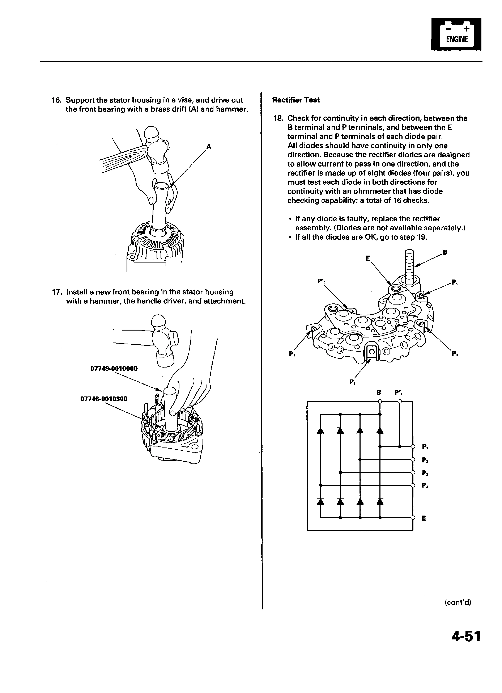

### Alternator Brush, Rotor, and Stator Tests

Source: [PDF p.122, printed p.4-52](../page-images/p0122.png).

19. Measure both brushes with a vernier caliper. Replace the brush assembly if either is shorter than the 1.5 mm (0.06 in.) service limit; otherwise continue to step 20. New length is 10.5 mm (0.41 in.).
20. Check continuity between the rotor slip rings. Continue to step 21 if there is continuity; otherwise replace the alternator.
21. Check continuity between each slip ring and both the rotor and rotor shaft. Continue to step 22 if there is no continuity; otherwise replace the alternator.
22. Check continuity between each pair of stator leads. **If continuity is present, continue to step 23; if absent, replace the alternator.** The source page repeats “If there is no continuity” for both branches. The continuation condition here is resolved from the mutually exclusive branches and the stator winding test; confirm against another official source before using it as a diagnostic decision.
23. Check continuity between each stator lead and the coil core. Continue to step 24 if there is no continuity; otherwise replace the alternator.
24. Reassemble in reverse order. Keep grease and oil off the slip rings. If removed, tighten the pulley locknut to 111 N·m (11.3 kgf·m, 81.7 lbf·ft).

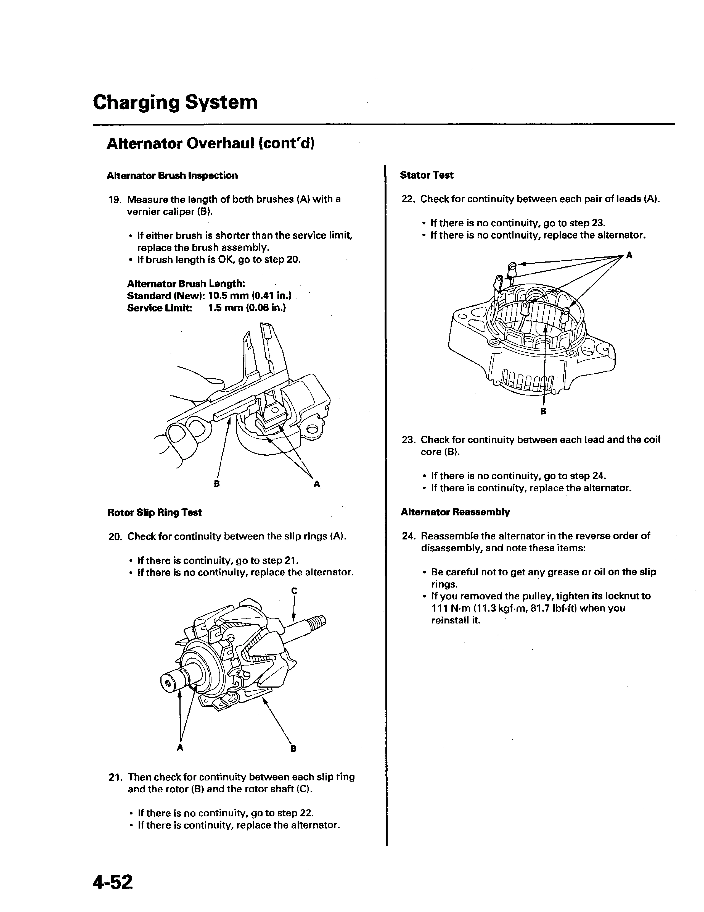

## Cruise Control

### Component Location Index

Source: [PDF p.123, printed p.4-53](../page-images/p0123.png).

| Component | Models | Service reference (printed page) |
| --- | --- | --- |
| Cruise control indicator | — | Location shown in instrument cluster |
| Engine control module (ECM) | — | Location shown behind dashboard |
| Brake pedal position switch | — | Test 22-144; adjustment 19-6 |
| Cruise control set/decel, resume/accel switch | 2000–2003 | Test and replacement 4-67 |
| Cruise control set/decel, resume/accel, cancel switch | 2004–2008 | Test and replacement 4-67 |
| Cruise control main switch | — | Test 4-65; replacement 4-66 |
| Cruise control unit | 2000–2005 | Input test 4-61 |
| Clutch pedal position switch | — | Test 4-72; adjustment 12-7 |
| Cruise control actuator | 2000–2005 | Test 4-68; replacement 4-69 |
| Actuator cable | 2000–2005 | Adjustment 4-71; replacement 4-70 |

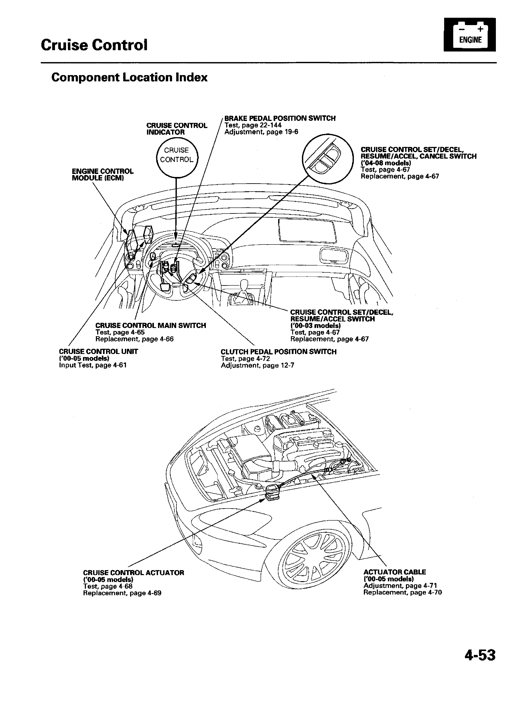

Source: [PDF p.124, printed p.4-54](../page-images/p0124.png).

### Symptom Troubleshooting Index
#### 2000–2005 models

##### Cruise control cannot be set
**Diagnostic procedure:**
1. Check horn operation.
2. **'00-03 models**: Check cruise control set/decel, resume/accel switch (see page 4-67).
3. **'04-05 models**: Check cruise control set/decel, resume/accel, cancel switch (see page 4-67).
4. Test the brake pedal position switch (see page 22-144) and check its adjustment (see page 19-6).
5. Test clutch pedal position switch (see page 4-72) and check its adjustment (see page 12-7).
6. Do the cruise control unit input test (see page 4-61).

**Also check for:**
* Blown No. 6 (15 A) fuse in the under-dash fuse/relay box.
* Blown No. 47 ('00-01 models: 10 A, '02-05 models: 15 A) fuse in the main under-hood fuse/relay box.
* Poor ground: G301, G401, G402.
* Open circuit, loose or disconnected terminals: BLK/YEL, LT GRN, LT GRN/RED, GRY, ORN, WHT/BLK.

##### Cruise control can be set, but the cruise control indicator does not come on
**Diagnostic procedure:**
1. **'00-03 models**: Check dimming circuit in gauge assembly (see page 22-63).
2. **'04-05 models**: Check dimming circuit in gauge assembly (see page 22-68).
3. Do the cruise control unit input test (see page 4-61).

**Also check for:**
* Poor ground: G501.
* Open circuit, loose or disconnected terminals: BLU/YEL.

##### Cruise speed is noticeably higher or lower than what was set
**Diagnostic procedure:**
1. Check vehicle speed sensor (VSS) (see page 22-94).
2. Check cruise control actuator (see page 4-68), and cable adjustment (see page 4-71).
3. Do the cruise control unit input test (see page 4-61).

##### Excessive overshooting or undershooting when trying to set speed
**Diagnostic procedure:**
1. Check vehicle speed sensor (VSS) (see page 22-94).
2. Check cruise control actuator (see page 4-68), and cable adjustment (see page 4-71).
3. Do the cruise control unit input test (see page 4-61).

##### Speed fluctuates on a flat road with the cruise control set
**Diagnostic procedure:**
1. Check vehicle speed sensor (VSS) (see page 22-94).
2. Check cruise control actuator and cable adjustment (see page 4-68).
3. Do the cruise control unit input test (see page 4-61).

##### Vehicle does not decelerate or accelerate accordingly when the set/decel or resume/accel switch is pressed
**Diagnostic procedure:**
1. **'00-03 models**: Check cruise control set/decel, resume/accel switch (see page 4-67).
2. **'04-05 models**: Check cruise control set/decel, resume/accel, cancel switch (see page 4-67).
3. Do the cruise control unit input test (see page 4-61).

**Also check for:**
* Open circuit, loose or disconnected terminals: LT GRN/RED, LT GRN/BLK.

### Symptom Troubleshooting Index — 2000–2005 Models (continued)

Source: [PDF p.125, printed p.4-55](../page-images/p0125.png).

#### Set speed does not cancel when the brake pedal is pressed

1. Test the brake pedal position switch (printed p.22-144) and its adjustment (p.19-6).
2. Do the cruise control unit input test (p.4-61).

Also check for a short to power in the GRY wire.

#### Set speed does not cancel when the clutch pedal is pressed (engine rpm stays high)

1. Test the clutch pedal position switch (p.4-72) and its adjustment (p.12-7).
2. Do the cruise control unit input test (p.4-61).

Also check for a short to ground in the PNK wire.

#### Set speed does not cancel when the cruise control main switch is turned off

1. Check the cruise control main switch (p.4-65).
2. Do the cruise control unit input test (p.4-61).

Also check for a short to power in the LT GRN wire.

#### Set speed does not cancel when the cancel switch is pressed (2004–2005)

1. Check the cruise control set/decel, resume/accel, cancel switch (p.4-67).
2. Do the cruise control unit input test (p.4-61).

Also check for an open circuit, loose or disconnected terminals in LT GRN/RED or LT GRN/BLK.

#### Set speed will not resume after brake pedal cancellation

With the main switch on and a set speed temporarily canceled by pressing the brake pedal:

1. Test the brake pedal position switch (p.22-144) and its adjustment.
2. Check the set/decel and resume/accel switch (2000–2003), or the set/decel, resume/accel, cancel switch (2004–2005), at p.4-67.
3. Do the cruise control unit input test (p.4-61).

Also check for a faulty brake pedal position switch or an open circuit, loose or disconnected LT GRN/BLK terminal.

#### Set speed will not resume after clutch pedal cancellation

With the main switch on and a set speed temporarily canceled by pressing the clutch pedal:

1. Test the clutch pedal position switch (p.4-72) and its adjustment (p.12-7).
2. Check the set/decel and resume/accel switch (2000–2003), or the set/decel, resume/accel, cancel switch (2004–2005), at p.4-67.
3. Do the cruise control unit input test (p.4-61).

Also check for a faulty clutch pedal position switch or an open circuit, loose or disconnected LT GRN/BLK terminal.

### Symptom Troubleshooting Index — 2006–2008 Models

Source: [PDF p.126, printed p.4-56](../page-images/p0126.png).

#### Cruise control cannot be set

1. Check for PGM-FI DTCs.
2. Do the cruise control input test (printed p.4-63).
3. Do the set/decel, resume/accel, cancel switch test (p.4-67).

Also check for poor ground G501.

#### Cruise control can be set, but the indicator does not come on

1. Check for PGM-FI DTCs.
2. Do the gauge assembly self-diagnostic procedure (p.22-60).
3. Do the cruise control input test (p.4-63), including the indicator signal input.

Also check for a faulty gauge assembly.

#### Vehicle does not respond to set/decel or resume/accel

1. Check for PGM-FI DTCs.
2. Do the cruise control input test (p.4-63), including both switch signal inputs.
3. Do the set/decel, resume/accel, cancel switch test (p.4-67).

Also check for an open circuit, loose or disconnected LT GRN/RED or LT GRN/BLK wire.

#### Set speed does not cancel when the brake pedal is pressed

1. Check for PGM-FI DTCs.
2. Do the cruise control input test (p.4-63), including the brake pedal position switch signal input.
3. Do the brake pedal position switch test (p.22-144).

Also check for a short to power in the GRY wire or a faulty brake pedal position switch.

#### Set speed does not cancel when the clutch pedal is pressed (engine rpm stays high)

1. Check for PGM-FI DTCs.
2. Do the cruise control input test (p.4-63), including the clutch pedal position switch signal input.
3. Do the clutch pedal position switch test (p.4-72).

Also check for a short to ground in the PNK wire or a faulty clutch pedal position switch.

#### Set speed does not cancel when the cruise control main switch is turned off

1. Check for PGM-FI DTCs.
2. Do the cruise control input test (p.4-63), including the main switch signal input.
3. Do the set/decel, resume/accel, cancel switch test (p.4-67).

Also check for a short to power in the LT GRN wire.

#### Set speed does not cancel when the cancel switch is pressed

1. Check for PGM-FI DTCs.
2. Do the cruise control input test (p.4-63), including the cancel switch signal input.
3. Do the set/decel, resume/accel, cancel switch test (p.4-67).

Also check for an open circuit, loose or disconnected LT GRN/RED or LT GRN/BLK wire.

### Symptom Troubleshooting Index — 2006–2008 Models (continued)

Source: [PDF p.127, printed p.4-57](../page-images/p0127.png).

#### Set speed will not resume when the resume/accel switch is pressed (with the cruise control main switch turned on, and set speed temporarily canceled by pressing the brake pedal)

1. Check for PGM-FI DTCs.
2. Check the brake pedal position switch adjustment (see page 19-6).
3. Do the cruise control input test (see page 4-63).
   - Test the cruise control resume/accel switch signal input.
   - Test the brake pedal position switch signal input.
4. Do the cruise control set/decel, resume/accel, cancel switch test (see page 4-67).

**Also check for:**
- Open circuit, loose or disconnected terminals: LT GRN/BLK wire
- Faulty brake pedal position switch

#### Set speed will not resume when the resume/accel switch is pressed (with the cruise control main switch turned on, and set speed temporarily canceled by pressing the clutch pedal)

1. Check for PGM-FI DTCs.
2. Check the clutch pedal position switch adjustment (see page 12-7).
3. Do the cruise control input test (see page 4-63).
   - Test the cruise control resume/accel switch signal input.
   - Test the clutch pedal position switch signal input.
4. Do the cruise control set/decel, resume/accel, cancel switch test (see page 4-67).

**Also check for:**
- Open circuit, loose or disconnected terminals: LT GRN/BLK wire
- Faulty clutch pedal position switch

### Cruise Control Circuit Diagram — 2000–2003

Source: [PDF p.128, printed p.4-58](../page-images/p0128.png).

The source circuit diagram shows fuse and relay feeds, the brake and clutch pedal switches, the cruise control unit, main and steering-wheel switches, gauge indicator and speedometer signal, actuator motor and magnetic clutch, wire colors, connector positions, and grounds. Use the diagram for exact circuit tracing; OCR does not preserve its wiring paths.

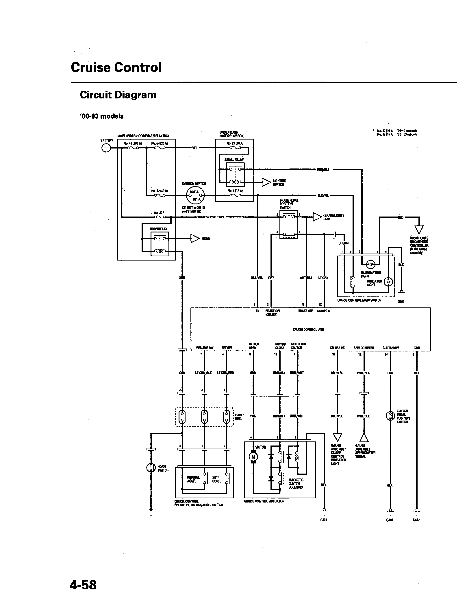

### Cruise Control Circuit Diagram — 2004–2005

Source: [PDF p.129, printed p.4-59](../page-images/p0129.png).

The source circuit diagram shows fuse and relay feeds, the brake and clutch pedal switches, the cruise control unit, main and steering-wheel switches, gauge indicator and speedometer signal, actuator motor and magnetic clutch, wire colors, connector positions, and grounds. Use the diagram for exact circuit tracing; OCR does not preserve its wiring paths.

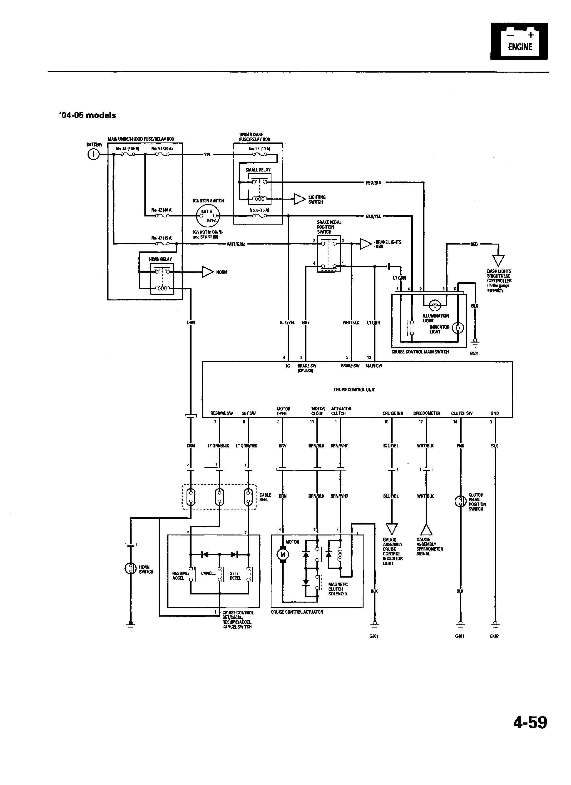

### Cruise Control Circuit Diagram — 2006–2008

Source: [PDF p.130, printed p.4-60](../page-images/p0130.png).

The diagram shows the switch and gauge circuits, brake pedal position switch, fuses, throttle actuator control module, and wire colors. Use the image to trace exact paths and terminal locations; OCR does not preserve the wiring layout.

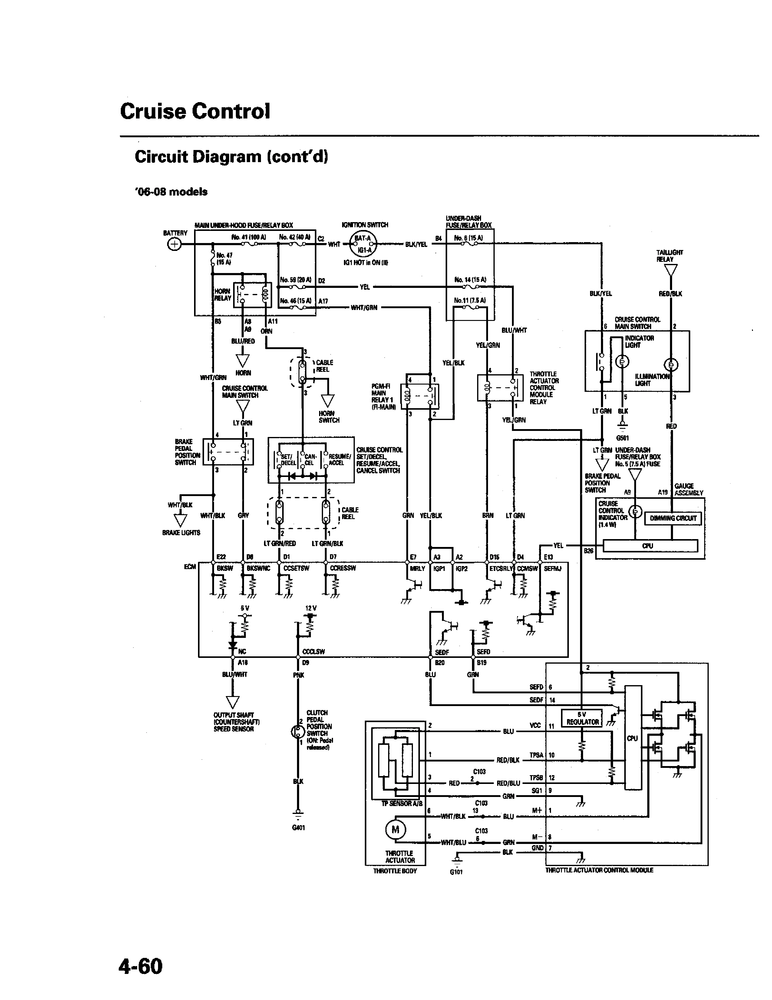

### Cruise Control Unit Input Test — 2000–2005

Source: [PDF p.131, printed p.4-61](../page-images/p0131.png).

**2000–2005 models**

SRS components are located in this area, review the SRS component locations, '00-05 models (see page 23-11), '06-08 models (see page 23-12), precautions, and procedures (see page 23-13), before performing repairs or service.

1. Remove the knee bolster under the steering column.
2. Disconnect the 14P connector from the cruise control unit.
3. Inspect the connector and connector terminals to be sure they are making good contact.
4. If the terminals are bent, loose, or corroded, repair them as necessary, and recheck the system.
5. Do the following input test, at the 14P connector.
   * If a test indicates a problem, find and correct the cause, then recheck the system.
   * If all the tests prove OK, check the cruise control actuator operation, and adjust the actuator cable.

#### Cruise Control Unit Connector (14P)

The connector diagram is viewed from the wire side of the female terminals.

| Cavity | Wire color | Test condition | Test: Desired result | Possible cause if result is not obtained |
|---|---|---|---|---|
| 1 | BRN/WHT | Connect to terminal 4 (BLK/YEL) with a jumper wire, and turn ignition switch to ON (II) | The magnetic clutch should click and the output link should be locked. | • Faulty actuator • Poor ground (G301) • An open in the wire |
| 2 | GRY | Ignition switch to ON (II), cruise control main switch ON, and brake pedal pressed, then released | Check for voltage to ground: There should be 0 V with the brake pedal pressed, and there should be battery voltage with the brake pedal released. | • Faulty brake switch • Faulty cruise control main switch • An open in the wire • Blown No. 6 (15 A) fuse in the under-dash fuse/relay box |
| 3 | BLK | Under all conditions | Check for continuity to ground: There should be continuity. | • Poor ground (G402) • An open in the wire |
| 4 | BLK/YEL | Ignition switch to ON (II) | Check for voltage to ground: There should be battery voltage. | • Blown No. 6 (15 A) fuse in the under-dash fuse/relay box • An open in the wire |
| 5 | WHT/BLK | With brake pedal pressed and released | Check for voltage to ground: There should be battery voltage with the brake pedal pressed, and there should be 0 V with the brake pedal released. | • Blown No. 47 (10 A) [No. 47 (15 A)] fuse in the main under-hood fuse/relay box • Faulty brake switch • An open in the wire |

Bracketed fuse rating applies to 2002–2005 models.

### Cruise Control Unit Input Test — 2000–2005 (continued)

Source: [PDF p.132, printed p.4-62](../page-images/p0132.png).

| Cavity | Wire | Test condition | Desired result | Check if failed |
| --- | --- | --- | --- | --- |
| 6 | LT GRN/RED | Ignition ON (II), cruise main switch on, set/decel pressed | Battery voltage to ground at 6; no voltage at 7 | No. 47 fuse (10 A in 2000–2001; 15 A in 2002–2005), horn relay, steering switch, cable reel, open wire |
| 7 | LT GRN/BLK | Ignition ON (II), cruise main switch on, resume/accel pressed | Battery voltage to ground at 7; no voltage at 6 | Same checks as cavity 6 |
| 9 and 11 | BRN and BRN/BLK | Jumper BRN to cavity 4 (BLK/YEL); ground BRN/BLK; ignition ON (II) | Actuator motor should be audible | Actuator, ground G402, open wire |
| 10 | BLU/YEL | Ignition ON (II); attach to ground | Cruise indicator lights | No. 5 (7.5 A) under-dash fuse, indicator bulb or gauge circuit, open wire |
| 12 | WHT/BLK | Rear raised, Neutral, ignition ON (II), cruise main switch on; rotate one rear wheel while holding the other | Between cavity 12 (+) and 3 (−): alternates between 0 V and about 5 V or battery voltage | Vehicle speed sensor, gauge speedometer circuit, open wire |
| 13 | LT GRN | Ignition ON (II), cruise main switch on | Battery voltage to ground | No. 6 (15 A) under-dash fuse, main switch, open wire |
| 14 | PNK | Press and release clutch | No continuity to ground pressed; continuity released | Clutch switch, adjustment, ground G401, open wire |

If any test fails, correct the cause and recheck. If all input tests pass, substitute a known-good cruise control unit and retest; replace the unit if the system then works properly. The full source table is reproduced below for exact test details.

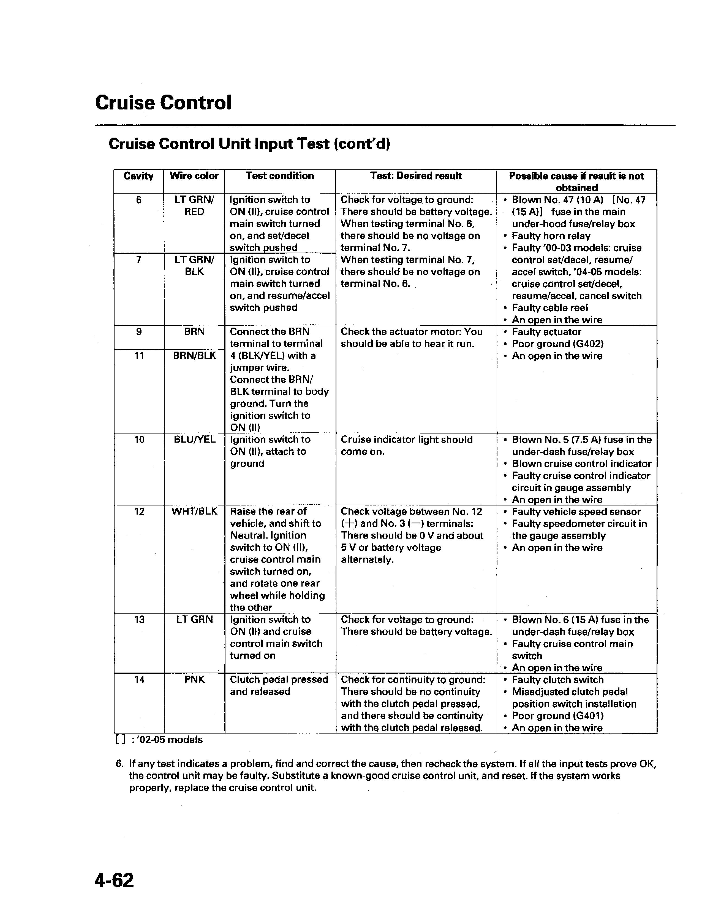

### Cruise Control Input Test — 2006–2008

Source: [PDF p.133, printed p.4-63](../page-images/p0133.png).

**'06-08 models**

1. Connect the Honda Diagnostic System (HDS) to the data link connector (DLC).
2. Turn the ignition switch to ON (II).
3. Make sure the HDS communicates with the vehicle and the engine control module (ECM). If it doesn't, troubleshoot the DLC circuit (see page 11-367).
4. Go to PGM-FI, and check for DTCs.
5. Do the following tests while monitoring parameters in the PGM-FI DATA LIST with the HDS.

> **NOTE:** Intermittent failures are often caused by loose circuit connections. While monitoring cruise control inputs, flex their circuits, and note if any of the test results change.

| Signal to be tested | Test condition | Parameter: Desired result | Possible cause if result is not obtained |
| :--- | :--- | :--- | :--- |
| Brake switch signal | Brake pedal pressed, then released with cruise control main switch turned on | CRUISE BRAKE SW should indicate OFF when the brake pedal is pressed and ON when the brake pedal is released. | • Faulty brake pedal position switch • Blown No. 6 (15 A) fuse in the under-dash fuse/relay box • An open in the wire between the ECM and the brake pedal position switch • A wire shorted to ground between the ECM and the brake pedal position switch |
| Clutch pedal position switch signal | Clutch pedal pressed, then released | SHIFT/CLUTCH SW should indicate OFF when the clutch pedal is pressed and ON when the clutch pedal is released. | • Faulty clutch pedal position switch • An open in the wire between the ECM and the clutch pedal position switch • A wire shorted to ground between the ECM and the clutch pedal position switch • Poor ground G401 |
| Cruise control main switch signal | Cruise control main switch on and off | CRUISE MASTER (MAIN)SW should indicate ON when the cruise control main switch is turned on and OFF when the cruise control main switch is turned off. | • Faulty cruise control main switch • Blown No. 6 (15A) fuse in the under-dash fuse/relay box • An open in the wire between the ECM and the cruise control main switch • A wire shorted to ground between the ECM and the cruise control main switch |
| Set switch signal | Set/decel switch pressed and released | CRUISE SET SW should indicate ON when the set/decel switch is pressed and OFF when the set/decel switch is released. | • Faulty cruise control set/decel, resume/accel, cancel switch • An open in the wire between the ECM and the cruise control set/decel, resume/accel, cancel switch • A wire shorted to ground between the ECM and the cruise control set/decel, resume/accel, cancel switch |

### Cruise Control Input Test — 2006–2008 (continued)

Source: [PDF p.134, printed p.4-64](../page-images/p0134.png).

| Signal to be tested | Test condition | Parameter: Desired result | Possible cause if result is not obtained |
| :--- | :--- | :--- | :--- |
| Resume switch signal | Resume/accel switch pressed and released | CRUISE R E S U M E S W should indicate ON when the resume/accel switch is pressed and OFF when the resume/accel switch is released. | • Faulty cruise control set/decel, resume/accel, cancel switch • An open in the wire between the ECM and the cruise control set/decel, resume/accel, cancel switch • A wire shorted to ground between the ECM and the cruise control set/decel, resume/accel, cancel switch |
| Cancel switch signal | Cancel switch pressed and released | CRUISE C A N C E L S W should indicate ON when the cancel switch is pressed and OFF when the cancel switch is released. | • Faulty cruise control set/decel, resume/accel, cancel switch |

### Cruise Control Main Switch Test

Source: [PDF p.135, printed p.4-65](../page-images/p0135.png).

1. Carefully pry the cruise control main switch out of the instrument panel, then disconnect the connector from the switch.
2. Check for continuity between terminals No. 6 and No. 1, and between terminals No. 6 and No. 5 on the switch. There should be continuity when the switch is pressed, and no continuity when the switch is pressed again.
3. Check for continuity between the No. 2 and No. 3 terminals. There should be continuity.
4. If a failure occurs between terminals No. 6 and No. 1, replace the cruise control main switch.
5. If a failure occurs between terminals No. 6 and No. 5, and between the No. 2 and No. 3, check the cruise control main switch indicator and illumination (see page 4-66).

**Cruise control main switch connector:** terminal side of male terminals, numbered 1, 2, 3, 5, 6. See source image for orientation.

### Cruise Control Main Switch Indicator and Illumination

Source: [PDF p.136, printed p.4-66](../page-images/p0136.png).

## Cruise Control Main Switch/Indicator/Illumination Test
1. Turn the ignition switch to ON (II). Turn the lighting switch and the cruise control main switch (A) ON.
2. Check that the illumination indicator (B) and the indicator light (C) in the cruise control main switch come on.
3. If the indicator does not come on, remove the switch, and replace the bulb.
4. If the indicator does not come on after the bulb has been replaced, replace the cruise control main switch.

## Cruise Control Main Switch/Indicator Bulb Replacement
1. Carefully pry the cruise control main switch (A) out of the instrument panel, then disconnect the connector from the switch.
2. Replace the indicator bulb (B) or the switch, as needed.

### Cruise Control Steering Switch Tests and Replacement

Source: [PDF p.137, printed p.4-67](../page-images/p0137.png).

#### 2000–2003 set/decel and resume/accel switch

1. Remove the two securing screws and switch; disconnect its connector.
2. Check continuity while each switch is pressed. Set/decel should connect terminals **3 and 5**; resume/accel should connect **1 and 3**. Neither should have continuity when released.
3. Replace the switch assembly if faulty. If it passes but the cruise control unit input test failed, check and repair the switch wiring harness.

#### 2004–2008 set/decel, resume/accel, and cancel switch

1. Remove the two securing screws and switch; disconnect its connector.
2. Check continuity while each switch is pressed. Set/decel should connect **1 and 3**; resume/accel should connect **1 and 2**. The cancel switch uses diodes between terminal 1 and terminals 2 and 3, as shown in the source table. No switch should have continuity when released.
3. Replace the switch assembly if faulty. If it passes but the cruise control unit input test (2004–2005) or cruise control input test (2006–2008) failed, check and repair the switch wiring harness.

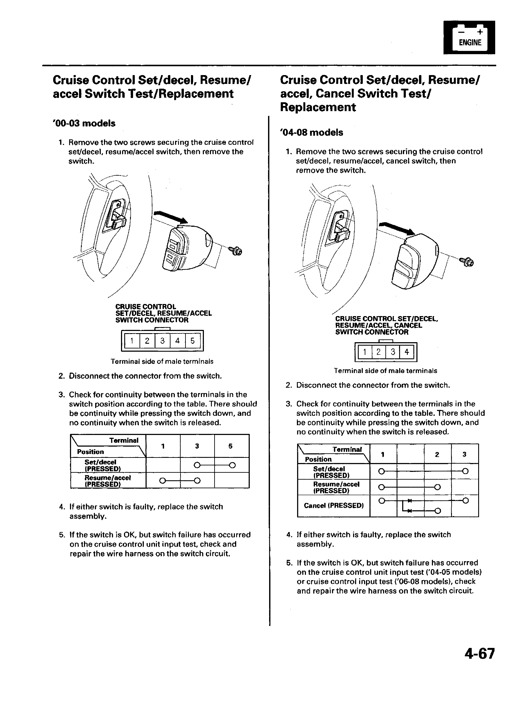

### Cruise Control Actuator Test — 2000–2005

Source: [PDF p.138, printed p.4-68](../page-images/p0138.png).

1. Disconnect the 4P connector from the cruise control actuator.
2. Remove the actuator cover.
3. Connect battery power to the No. 2 terminal of the 4P connector, and connect ground to the No. 1 terminal.
4. Check the magnetic clutch for proper engagement.
   You should hear a clicking sound and the output linkage should be locked.
5. If the output linkage is not locked, replace the cruise control actuator assembly.
6. With power and ground still connected as in step 3, connect battery power to the No. 4 terminal and ground to No. 3 terminal, and check that the output linkage starts to turn from the fully closed position and stops at the fully opened position by the motor in the actuator.
7. Reverse power and ground at connector terminals, No. 4 and No. 3, and check that the output linkage reverses and stops at the fully closed position.
   **T R A V E L**
8. If the output linkage moves sluggishly, or the motor does not operate properly, replace the cruise control actuator assembly.

### Cruise Control Actuator Replacement — 2000–2005

Source: [PDF p.139, printed p.4-69](../page-images/p0139.png).

1. Remove the actuator cover, and disconnect the 4P connector from the cruise control actuator.
2. Disconnect the actuator cable end (A) from the output linkage (B), and remove the cable (C) from the cruise control actuator.
3. Remove the cruise control actuator assembly.
   - Mounting fastener: M6 × 1.0, 9.8 N·m (1.0 kgf-m, 7.2 lb-ft)
4. Replace the actuator, and install the new cruise control actuator in the reverse order of removal.
5. Adjust the actuator cable on the cruise control actuator side (see page 4-71).

### Cruise Control Actuator Cable Replacement — 2000–2005

Source: [PDF p.140, printed p.4-70](../page-images/p0140.png).

1. Remove the actuator cover, and disconnect the 4P connector from the cruise control actuator.
2. Disconnect the actuator cable end (A), and remove the cable (B) from the cruise control actuator.
3. Remove the accelerator pedal assembly.
4. Disconnect the actuator cable end (A) from the arm (B) on the accelerator pedal assembly (C).
5. Replace the actuator cable, and install the new cable in the reverse order of removal.
6. Adjust the actuator cable on the cruise control actuator side (see page 4-71).

### Cruise Control Actuator Cable Adjustment — 2000–2005

Source: [PDF p.141, printed p.4-71](../page-images/p0141.png).

**'00–05 models**

1. Hold the cable sheath, removing all slack from the throttle cable.
2. Turn the adjusting nut (A) until it is **3 mm (1/8 in.)** away from the throttle cable bracket.

3. Tighten the locknut (B) to **9.8 N·m (1.0 kgf·m, 7.2 lbf·ft)**. The throttle cable deflection should now be **4–6 mm (0.16–0.24 in.)**.
4. Remove the actuator cover, then disconnect the actuator cable end from the cruise control actuator.
5. Turn the adjusting nut (A) until it is **9 mm (0.35 in.)** away from the actuator cable bracket when the throttle linkage starts open.
6. Pull the cable so the adjusting nut (A) touches the bracket, and tighten the locknut (B).
7. Make sure the throttle linkage starts to open when the actuator cable is pulled **9 mm (0.35 in.)** from the starting point by rotating the actuator linkage.

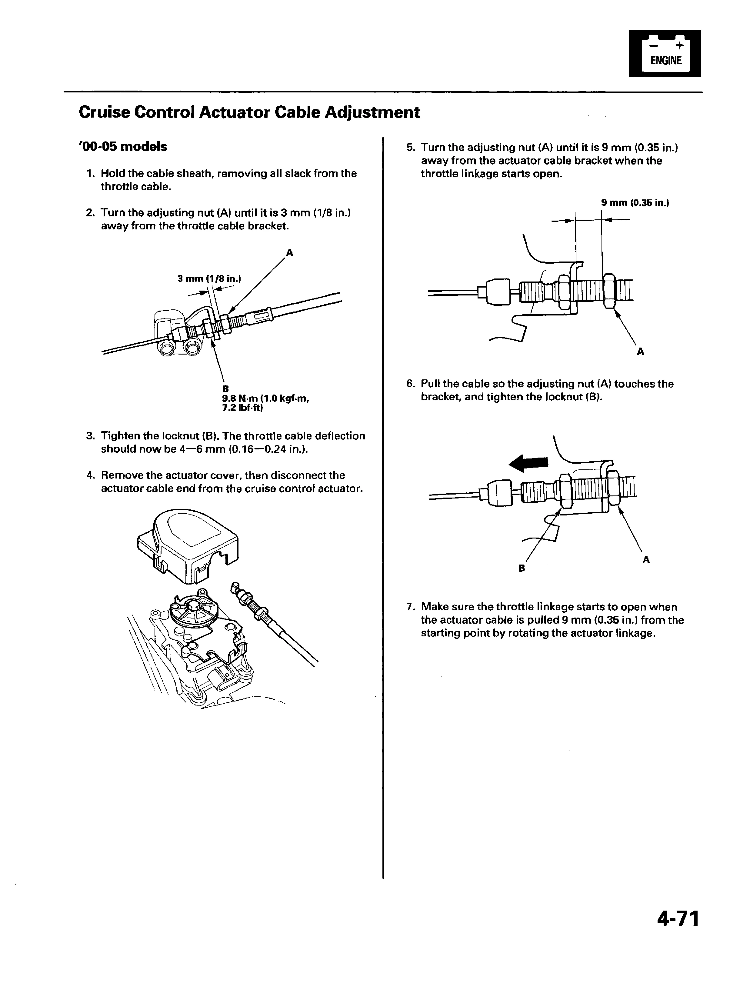

### Clutch Pedal Position Switch Test

Source: [PDF p.142, printed p.4-72](../page-images/p0142.png).

1. Disconnect the connector from the clutch pedal position switch, then remove the switch.

2. Check for continuity between the clutch pedal position switch connector terminals. There should be no continuity between the terminals with the button (A) released, and there should be continuity with the button pressed.

   **Clutch pedal position switch connector:** two male terminals, viewed from terminal side.

3. If the clutch pedal position switch is faulty, replace it.

4. Install the clutch pedal position switch, and adjust it (see page 12-7).
