# Engine Mechanical (Part B)

Reviewed transcription of PDF pages 219–294. This part spans the end of cylinder-head installation, engine block, engine lubrication, intake/exhaust, and start of engine cooling. Source-page links are retained for verification.

---

### Cylinder Head Installation — Continued

Source: [PDF p.219, printed p.6-57](../page-images/p0219.png).

46. **2000–2005:** Install brake booster vacuum hose (A), fuel return hose (B), and fuel feed hose (C), using **new washers (D)**. Both 2000–2003 and 2004–2005 illustrations specify **22 N·m (2.2 kgf·m, 16 lbf·ft)** at the labeled fitting.
47. **2006–2008:** Connect fuel feed hose (A), install quick-connect fitting cover (B), and install brake booster vacuum hose (C).
48. **2006–2008:** Install intake manifold cover.
49. **2000–2005:** Install throttle cable (p.11-167), then adjust it (p.11-168).
50. Install drive belt (p.4-42).

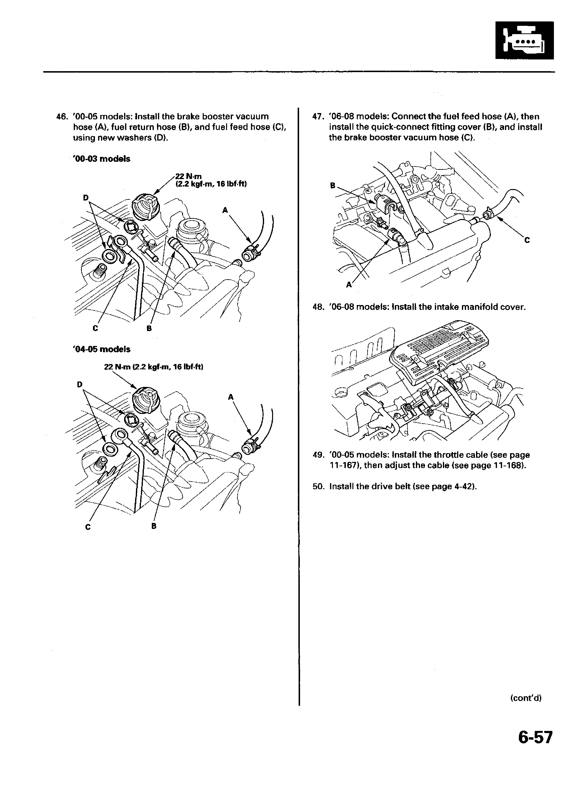

---

### Cylinder Head Installation — Continued

Source: [PDF p.220, printed p.6-58](../page-images/p0220.png).

51. **2000–2005:** Install intake air cleaner housing (A) and harness clamps (B); connect air control solenoid valve connector (C) and vacuum hoses (D).
52. **2006–2008:** Install intake air cleaner housing (A) and IAT sensor harness clamps (B).
53. **2000–2005:** Install air cleaner assembly (A) and housing cover (B); connect air hose (C) and breather pipe (D).
54. **2006–2008:** Install air cleaner assembly (A) and housing cover (B); attach MAP sensor harness (C) to holder, and connect IAT sensor connector (D) and breather pipe (E).

---

### Cylinder Head Installation — Completion

Source: [PDF p.221, printed p.6-59](../page-images/p0221.png).

55. Check all tubes, hoses, and connectors.
56. Wait at least **30 minutes** after assembly before adding engine oil.
57. Clean battery posts and terminals, assemble them, and grease to prevent corrosion.
58. Check for fuel leaks: turn ignition ON (II) without starting, let pump run about two seconds, repeat three times, then inspect fuel line.
59. Refill engine oil (p.8-6).
60. Refill coolant and bleed air with heater valve open (step 7 on p.10-9).
61. **2000–2005:** Perform ECM idle learn (p.11-140).
62. **2006–2008:** Perform CKP/CKP learn procedure (p.11-214).
63. Inspect idle speed: 2000–2005 (p.11-140); 2006–2008 (p.11-461).
64. Inspect ignition timing (p.4-24).
65. Enter audio anti-theft code and presets; set clock.

---

### Source Scan Gap

Source: [PDF p.222, printed p.6-60](../page-images/p0222.png).

This PDF page contains no recoverable procedure text. Its rendered image is a black scan artifact. No technical instruction is inferred from it.

---

### Engine Block — Chapter Contents

Source: [PDF p.223, printed p.7-1](../page-images/p0223.png).

- Special Tools — 7-2
- Component Location Index — 7-3
- Connecting Rod and Crankshaft End Play Inspection — 7-5
- Crankshaft Main Bearing Replacement — 7-6
- Connecting Rod Bearing Replacement — 7-8
- Oil Pan Removal — 7-10
- Crankshaft and Piston Removal — 7-10
- Crankshaft Inspection — 7-12
- Block and Piston Inspection — 7-13
- Cylinder Bore Honing — 7-15
- Piston, Pin, and Connecting Rod Replacement — 7-16
- Piston Ring Replacement — 7-19
- Piston Installation — 7-21
- Crankshaft Installation — 7-23
- Oil Pan Installation — 7-25
- Pulley End Crankshaft Oil Seal Installation, In Car — 7-26
- Transmission End Crankshaft Oil Seal Installation, In Car — 7-26
- Drain Bolt Installation — 7-27

---

### Engine Block — Special Tools

Source: [PDF p.224, printed p.7-2](../page-images/p0224.png).

| Ref. | Tool number | Description | Qty |
| --- | --- | --- | ---: |
| 1 | 07LAD-PT3010A | Seal Driver | 1 |
| 2 | 07749-0010000 | Handle Driver | 1 |
| 3 | 07948-SB00101 | Driver Attachment | 1 |

---

### Engine Block — Component Location Index

Source: [PDF p.225, printed p.7-3](../page-images/p0225.png).

The source exploded view identifies the lower block, dowel pins, main bearings, crankshaft, thrust washers, crankshaft oil seal, flywheel, washer, flywheel bolt, and drain bolt.

- Main bearings: oil clearance p.7-6; selection p.7-7.
- Crankshaft: end play p.7-5; inspection p.7-12; installation p.7-23.
- Crankshaft oil seal: in-car installation p.7-26.
- Drain bolt: installation p.7-27.

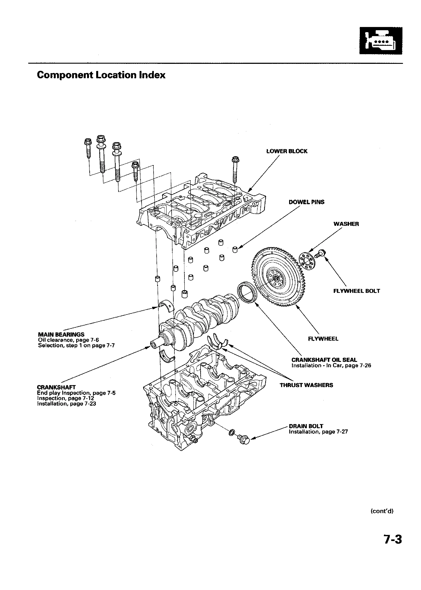

---

### Engine Block — Component Location Index, Continued

Source: [PDF p.226, printed p.7-4](../page-images/p0226.png).

- Piston rings: replacement p.7-19.
- Piston: removal p.7-10; measurement p.7-13; installation p.7-21.
- Piston pin: disassembly p.7-16; reassembly step 1 on p.7-18; inspection step 1 on p.7-17.
- Connecting rod: end play p.7-5; small-end measurement step 1 on p.7-17.
- Engine block: inspection p.7-13; cylinder bore honing p.7-15.
- Connecting rod bearings: clearance p.7-8; selection step 1 on p.7-8.
- Also identified: two snap rings, connecting rod bearing cap, and connecting rod bolt.

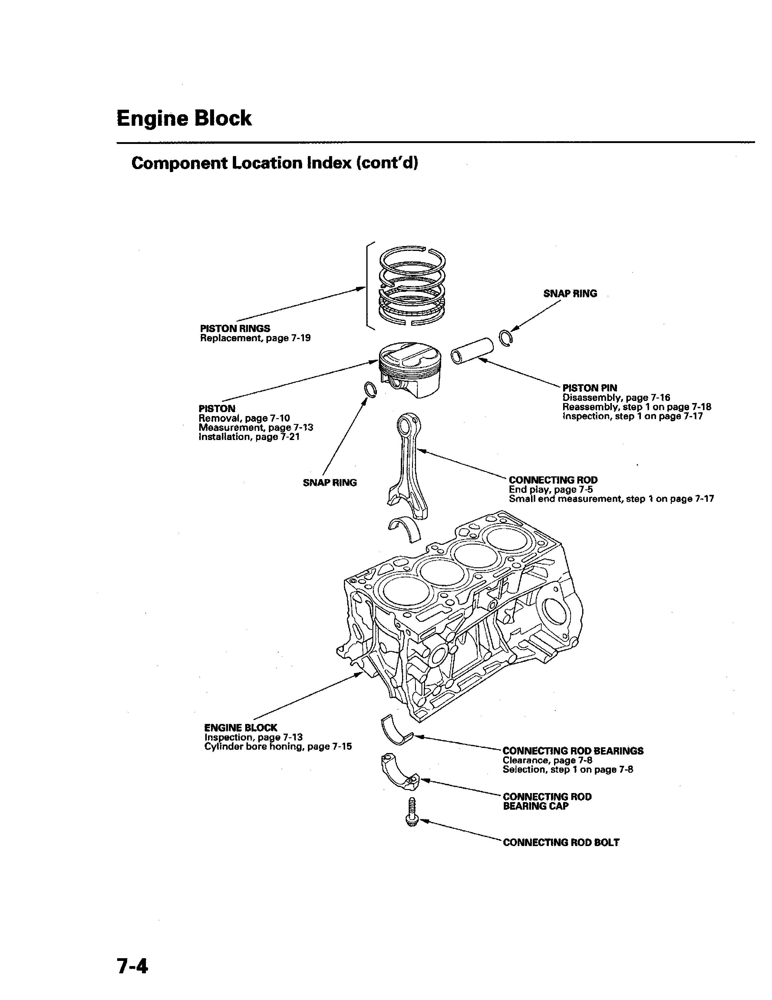

---

### Connecting Rod and Crankshaft End Play Inspection

Source: [PDF p.227, printed p.7-5](../page-images/p0227.png).

1. Remove oil pump (p.8-11).
2. Measure connecting rod end play with feeler gauge between rod and crankshaft. New **0.15–0.30 mm (0.006–0.012 in.)**; service limit **0.40 mm (0.016 in.)**.
3. If out of tolerance, install new connecting rod and recheck. If still out, replace crankshaft (p.7-10).
4. Push crankshaft away from dial indicator and zero gauge at its end. Pull crankshaft firmly back toward gauge and read end play. New **0.10–0.35 mm (0.004–0.014 in.)**; service limit **0.45 mm (0.018 in.)**.
5. If excessive, replace thrust washers and recheck. If still out, replace crankshaft (p.7-10).

---

### Crankshaft Main Bearing Replacement — Clearance Inspection

Source: [PDF p.228, printed p.7-6](../page-images/p0228.png).

1. Remove lower block and bearing halves (p.7-10).
2. Remove old liquid gasket from mating surfaces, bolts, and holes.
3. Clean lower block mating surface.
4. Clean journals and bearing halves with clean shop towel.
5. Place plastigauge across each main journal.
6. Reinstall bearings and lower block; torque bolts to **29 N·m (3.0 kgf·m, 22 lbf·ft) plus 60°**. **Do not rotate crankshaft during inspection.**
7. Remove lower block and bearings; measure widest plastigauge width. Main bearing-to-journal clearance: new **0.017–0.041 mm (0.0007–0.0016 in.)**; service limit **0.050 mm (0.0020 in.)**. If out, install complete same-color bearing and recheck. Do not file, shim, or scrape bearings or caps. If still wrong, try next larger or smaller color. If proper clearance remains unobtainable, replace crankshaft and start over.

---

### Main Bearing Selection

Source: [PDF p.229, printed p.7-7](../page-images/p0229.png).

1. Record five crank bore codes stamped on block end, from No.1 pulley end to No.5 flywheel end. Clean unreadable codes only with solvent or detergent; never wire brush or scrape.
2. Record main journal codes stamped on crankshaft No.1 web.
3. Choose bearings by bore and journal code. Color code is on bearing edge. If using two colors, either may go on top or bottom.

| Main journal code | Bore 1 / A / I | Bore 2 / B / II | Bore 3 / C / III | Bore 4 / D / IIII |
| --- | --- | --- | --- | --- |
| 1 / I | Pink/Yellow | Yellow | Yellow/Green | Green |
| 2 / II | Yellow | Yellow/Green | Green | Green/Brown |
| 3 / III | Yellow/Green | Green | Green/Brown | Brown |
| 4 / IIII | Green | Green/Brown | Brown | Brown/Black |
| 5 / IIIII | Green/Brown | Brown | Brown/Black | Black |
| 6 / IIIIII | Brown | Brown/Black | Black | Black/Blue |

Moving right means a larger crank bore and a thicker bearing; moving down means a smaller main journal and a thicker bearing. See source image for code locations.

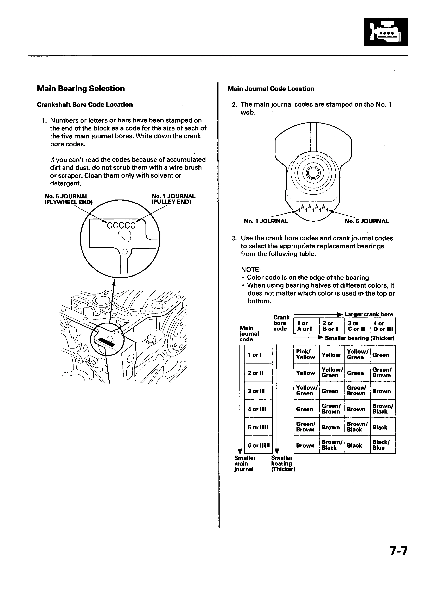

---

### Connecting Rod Bearing Replacement — Clearance Inspection

Source: [PDF p.230, printed p.7-8](../page-images/p0230.png).

1. Remove rod cap and bearing half (p.7-10).
2. Clean rod journal and bearing half with shop towel.
3. Place plastigauge across rod journal.
4. Reinstall bearing and cap; torque bolt to **25 N·m (2.5 kgf·m, 18 lbf·ft) plus 90°**. **Do not rotate crankshaft during inspection.**
5. Remove cap and bearing; measure widest plastigauge. New clearance **0.030–0.054 mm (0.0012–0.0021 in.)**; service limit **0.060 mm (0.0024 in.)**.
6. If out, install complete same-color bearing and recheck. Never file, shim, or scrape bearing or cap.
7. If still out, try next larger or smaller color. If proper clearance cannot be obtained, replace crankshaft and start over.

### Connecting Rod Bearing Selection

1. Inspect each rod for cracks and heat damage.
2. Big-end bore tolerance range is **0–0.024 mm (0–0.0009 in.)** in **0.006 mm (0.0002 in.)** increments, stamped as **1–4 or I–IIII** across rod and cap. Codes may vary between rods. Clean unreadable codes with solvent or detergent, never wire brush or scraper.

---

### Connecting Rod Bearing Selection — Continued

Source: [PDF p.231, printed p.7-9](../page-images/p0231.png).

3. Connecting rod journal codes are stamped on crankshaft No.1 web, for No.1–No.4 journals.
4. Select bearing using big-end bore code and rod journal code. Color code is on bearing edge.

| Rod journal code | Big end 1 / I | Big end 2 / II | Big end 3 / III | Big end 4 / IIII |
| --- | --- | --- | --- | --- |
| A / I | Red | Pink | Yellow | Green |
| B / II | Pink | Yellow | Green | Brown |
| C / III | Yellow | Green | Brown | Black |
| D / IIII | Green | Brown | Black | Blue |

Rightward is larger big-end bore; downward is smaller rod journal. Both directions require a thicker bearing. Refer to source for stamp locations.

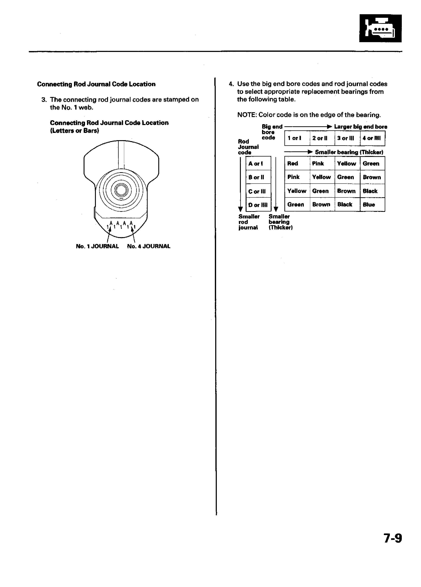

---

### Oil Pan Removal

Source: [PDF p.232, printed p.7-10](../page-images/p0232.png).

1. If engine is out of vehicle, go to step 3.
2. Drain engine oil (p.8-6).
3. Remove oil pan bolts and pan. If stuck, cut oil pan seal with oil seal cutter.

### Crankshaft and Piston Removal

1. Remove cam chain (p.6-13).
2. Remove oil pump (step 1 on p.8-11).
3. Remove any metal or hard-carbon ridge at cylinder top with ridge reamer (A), following its instructions; otherwise piston may be damaged during removal.
4. Remove **8 mm lower-block bolts** in illustrated **1–16 sequence**.

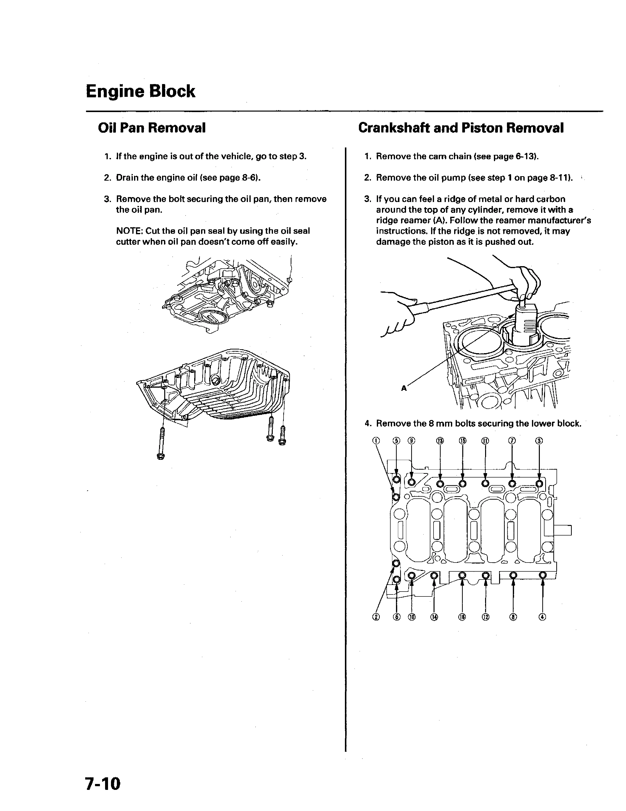

---

### Crankshaft and Piston Removal — Continued

Source: [PDF p.233, printed p.7-11](../page-images/p0233.png).

5. Loosen bearing cap bolts in illustrated **1–10 sequence, one-third turn at a time**, repeating until loose to prevent warpage.
6. Remove lower block and bearings, keeping bearings in order.
7. Remove rod caps and bearings, keeping them in order.
8. Lift crankshaft out without damaging journals.
9. Use wooden hammer handle (A) to drive out pistons (B).
10. Reinstall rod bearings and caps after removing each piston/rod assembly.
11. Mark each piston/rod assembly with its cylinder number for reassembly. **The existing rod number indicates bore size, not engine position.**

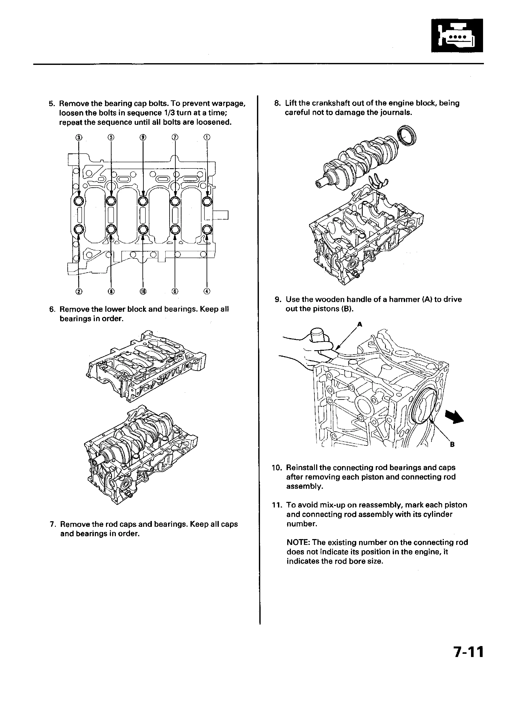

---

### Crankshaft Inspection — Out-of-Round and Taper

Source: [PDF p.234, printed p.7-12](../page-images/p0234.png).

1. Remove crankshaft (p.7-10).
2. Clean oil passages with pipe cleaners or suitable brush.
3. Check keyway and threads.
4. Measure rod and main journal out-of-round at middle in two cross directions. New maximum **0.004 mm (0.0002 in.)**; service limit **0.006 mm (0.0002 in.)**.
5. Measure taper at journal edges. New maximum **0.005 mm (0.0002 in.)**; service limit **0.006 mm (0.0002 in.)**.

### Crankshaft Inspection — Straightness

6. Put engine block on surface plate.
7. Install clean bearings at No.1 and No.5 main journals.
8. Lower crankshaft into block.
9. Measure total indicator runout on all main journals while rotating crankshaft two full turns. New maximum **0.02 mm (0.0008 in.)**; service limit **0.04 mm (0.0016 in.)**.

---

### Block and Piston Inspection

Source: [PDF p.235, printed p.7-13](../page-images/p0235.png).

1. Remove crankshaft and pistons (p.7-10).
2. Check piston for distortion or cracks.
3. Measure skirt diameter **16 mm (0.6 in.)** from bottom on 2000–2003 models or **10 mm (0.4 in.)** on 2004–2008 models. Piston size letters are on piston top; bore letters on block.

| Piston code | Standard (new) | Service limit |
| --- | --- | --- |
| No letter / A | 86.993–87.006 mm (3.4249–3.4254 in.) | **86.980 mm (3.4244 in.)** |
| B | 86.983–86.996 mm (3.4245–3.4250 in.) | **86.970 mm (3.4240 in.)** |

Oversize 0.25 piston: **87.233–87.246 mm (3.4344–3.4349 in.)**.

4. Remove old liquid gasket from lower-block mating surfaces, bolts, and holes.
5. Clean mating surfaces.
6. Put lower block on engine block.
7. Tighten bearing cap bolts to **29 N·m (3.0 kgf·m, 22 lbf·ft)** in illustrated **1–10 sequence**.
8. Turn bolts an additional **60°**.

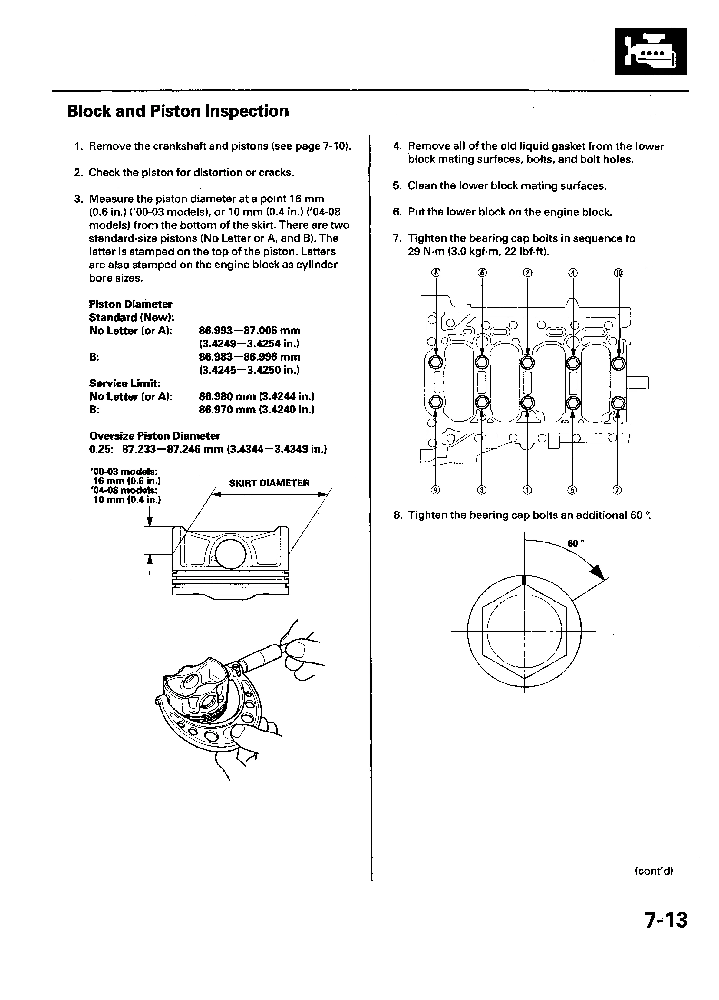

---

### Block and Piston Inspection — Continued

Source: [PDF p.236, printed p.7-14](../page-images/p0236.png).

9. Measure wear and taper in X and Y directions at three heights in each cylinder. If beyond oversize bore service limit, replace block; after reboring go to step 12.

| Bore code | Standard (new) |
| --- | --- |
| A / I | 87.010–87.020 mm (3.4256–3.4260 in.) |
| B / II | 87.000–87.010 mm (3.4252–3.4256 in.) |

Oversize 0.25: **87.250–87.260 mm (3.4350–3.4354 in.)**; maximum reboring **0.25 mm (0.01 in.)**. Bore taper limit, first versus third measurement: **0.05 mm (0.002 in.)**.

10. Hone scored or scratched bores.
11. Check block top warpage along edges and across center with precision straightedge. New maximum **0.07 mm (0.003 in.)**; service limit **0.10 mm (0.004 in.)**.

---

### Block and Piston Inspection — Piston-to-Cylinder Clearance

Source: [PDF p.237, printed p.7-15](../page-images/p0237.png).

12. Subtract piston diameter from cylinder bore diameter. New clearance **0.004–0.027 mm (0.0002–0.0011 in.)**. **Source conflict:** printed specification line states service limit **0.004 mm (0.0002 in.)**, while the adjacent piston diagram labels service limit **0.04 mm (0.002 in.)**. Verify against authoritative service information before using this limit.

### Cylinder Bore Honing

The liners are **FRM (fiber reinforced metal)**; follow this method only.

1. Measure bores (p.7-13). If reusing block, hone and remeasure. Hone scored or scratched bores.
2. Use rigid hone; GC-600-J or finer stones for nonferrous metal; **200–300 kPa (2–3 kgf/cm², 28–43 psi)** pressure; **45–50 rpm**; remove less than **0.02 mm (0.0008 in.)** in no more than **20 cycles**; oil lubricant; **60° crosshatch**; clean stones every five cycles.
3. Wash all metal particles out with hot soapy water. Dry and oil bores immediately. **Do not use solvent**, which redistributes grit.
4. If scoring remains at service limit, rebore. Light vertical scratches may remain only if not deep enough to catch a fingernail and not full bore length.

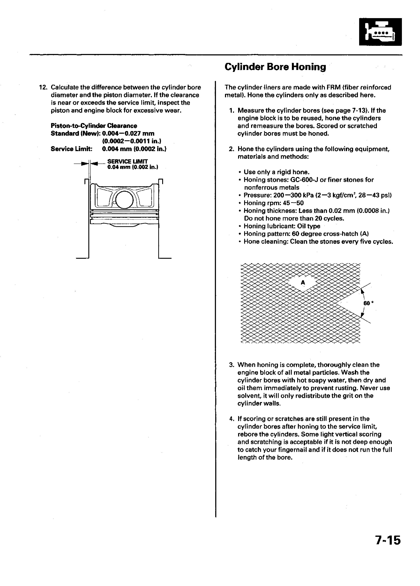

---

### Piston, Pin, and Connecting Rod Replacement — Disassembly

Source: [PDF p.238, printed p.7-16](../page-images/p0238.png).

1. Remove piston from block (p.7-10).
2. Oil piston-pin snap rings (A); turn them until gaps align with pin-bore cutouts (B). Avoid ring-groove damage.
3. Remove both snap rings carefully from cutouts. **Wear eye protection**; rings may fly out.
4. Heat piston/rod assembly to about **158 °F (70 °C)**, then remove piston pin.

---

### Piston, Pin, and Connecting Rod Inspection

Source: [PDF p.239, printed p.7-17](../page-images/p0239.png).

Inspect at room temperature.

1. Measure pin diameter: new **22.961–22.965 mm (0.9040–0.9041 in.)**; service limit **22.953 mm (0.9037 in.)**.
2. Zero dial indicator to pin diameter.
3. Measure pin-to-piston clearance: new **−0.002 to +0.005 mm (−0.00008 to +0.00020 in.)**; service limit **0.010 mm (0.0004 in.)**.
4. Measure pin-to-rod clearance: new **0.018–0.035 mm (0.0007–0.0014 in.)**; service limit **0.04 mm (0.0016 in.)**. Replace connecting rod and piston pin as a set.

---

### Piston, Pin, and Connecting Rod Replacement — Reassembly

Source: [PDF p.240, printed p.7-18](../page-images/p0240.png).

1. Install a new snap ring (A) on one side only.
2. Oil piston and rod pin bores and piston pin with new engine oil.
3. Heat piston to about **158 °F (70 °C)**.
4. Install pin (A), assembling piston (B) and rod (C) with **IN mark (D) and rod reference mark (E) on same side**.
5. Install remaining new snap ring (F).
6. Rotate snap rings until their gaps are at bottom of piston.

---

### Piston Ring Replacement

Source: [PDF p.241, printed p.7-19](../page-images/p0241.png).

1. Remove piston from block (p.7-10).
2. Remove old rings with ring expander (A).
3. Clean grooves with squared-off broken ring or fitted groove cleaner: top and second grooves **1.2 mm (0.05 in.)**, oil groove **2.0 mm (0.08 in.)**. Do not wire brush or cut grooves deeper. If separating piston from rod, postpone new rings.
4. Push a new ring into bore **15–20 mm (0.6–0.8 in.)** from bottom.
5. Measure end gap. If too small, verify ring type. If too large, recheck bore wear (p.7-13); rebore if over limit.

| Ring | Standard (new) | Service limit |
| --- | --- | --- |
| Top | 0.25–0.35 mm (0.010–0.014 in.) | 0.60 mm (0.024 in.) |
| Second | 0.60–0.75 mm (0.024–0.030 in.) | 0.90 mm (0.035 in.) |
| Oil | 0.20–0.70 mm (0.008–0.028 in.) | 0.80 mm (0.031 in.) |

---

### Piston Ring Replacement — Continued

Source: [PDF p.242, printed p.7-20](../page-images/p0242.png).

6. Install top ring with **R1** mark and second with **R2** mark; manufacturing marks face upward. Top ring standard A **2.8 mm (0.11 in.)**, B **1.2 mm (0.05 in.)**; second ring A **3.2 mm (0.13 in.)**, B **1.2 mm (0.05 in.)**.
7. Rotate rings in grooves to check for binding.
8. Position gaps as diagram shows: top ring and spacer ring gaps together opposite the oil-ring gaps, with second-ring gap about **45°** from oil-ring gap and oil-ring gaps about **90°** apart relative to piston pin axis. Refer to diagram for exact positions.
9. Measure ring-to-groove clearance, then restore step-8 positions. Top: new **0.045–0.090 mm (0.0018–0.0035 in.)**, limit **0.135 mm (0.005 in.)**. Second: new **0.040–0.070 mm (0.0016–0.0028 in.)**, limit **0.13 mm (0.005 in.)**.

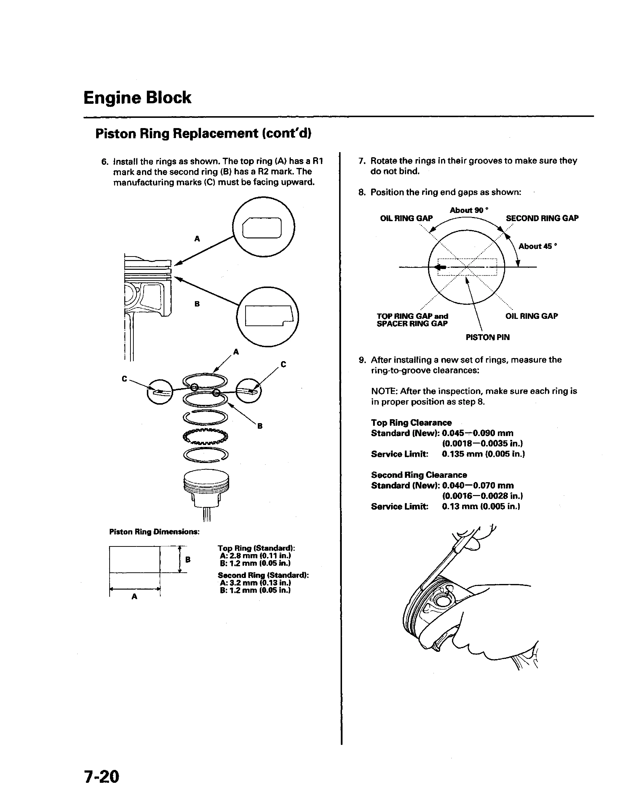

---

### Piston Installation — Crankshaft Already Installed

Source: [PDF p.243, printed p.7-21](../page-images/p0243.png).

1. Set crankshaft to BDC for each cylinder.
2. Oil piston, inside of ring compressor, and cylinder bore; attach compressor to piston.
3. Remove rod caps and verify bearings are secure.
4. Point **piston arrow (A)** toward cam chain side of engine.
5. Place piston in cylinder and tap it with wooden hammer handle (A). Hold ring compressor (B) downward so rings do not expand before entering bore.
6. When compressor pops free, check rod-to-crank-journal alignment before pushing piston into place.
7. Check rod bearing clearance with plastigauge (p.7-8).
8. Oil rod-bolt threads.
9. Install rod caps with bearings; tighten rod bolts in sequence to **25 N·m (2.5 kgf·m, 18 lbf·ft)**.
10. Tighten rod bolts an additional **90°**.

---

### Piston Installation — Crankshaft Not Installed

Source: [PDF p.244, printed p.7-22](../page-images/p0244.png).

1. Oil piston, inside of ring compressor, and cylinder bore; attach compressor to piston.
2. Remove rod caps and verify bearings are secure.
3. Point piston arrow (A) toward cam chain side of engine.
4. Place piston in cylinder and tap with wooden hammer handle (A), holding ring compressor (B) downward so rings do not expand before entering bore.
5. Position all pistons at TDC.

---

### Crankshaft Installation

Source: [PDF p.245, printed p.7-23](../page-images/p0245.png).

Special tools: handle driver **07749-0010000**; driver attachment **07948-SB00101**.

1. Remove old liquid gasket from lower-block mating surfaces, bolts, and bolt holes.
2. Clean lower-block mating surfaces.
3. Check rod bearing clearance with plastigauge (p.7-8).
4. Check main bearing clearance with plastigauge (p.7-6).
5. Install bearing halves in block and rods.
6. Oil main and rod bearings.
7. Hold crankshaft with rod journals No.2 and No.3 straight up; lower it into block.
8. Install thrust washers (A) at both edges of No.4 main bearing recess.
9. Oil rod-bolt threads.
10. Seat No.1 and No.4 rod journals; install rod caps and bolts finger-tight with cap bearing recess on same side as rod recess.
11. Rotate crankshaft clockwise; seat No.2 and No.3 journals and install caps and bolts finger-tight.
12. Tighten rod bolts in sequence to **25 N·m (2.5 kgf·m, 18 lbf·ft)**.
13. Tighten rod bolts another **90°**.
14. Apply liquid gasket **08717-0004, 08718-0001, 08718-0003, or 08718-0009** evenly along broken line shown on lower-block mating surface. Install parts within **5 minutes**; otherwise remove residue and reapply.

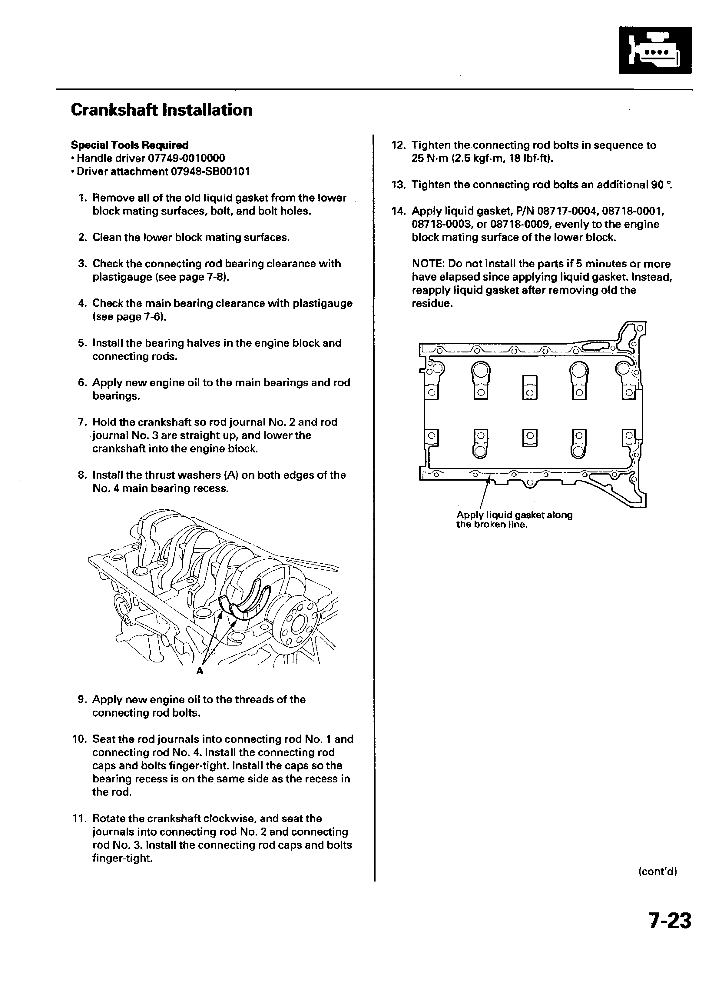

---

### Crankshaft Installation — Continued

Source: [PDF p.246, printed p.7-24](../page-images/p0246.png).

15. Put lower block on engine block.
16. Tighten bearing-cap bolts in illustrated **1–10 sequence** to **29 N·m (3.0 kgf·m, 22 lbf·ft)**.
17. Tighten bearing-cap bolts another **60°**.
18. Tighten 8 mm bolts in illustrated **1–16 sequence** to **22 N·m (2.2 kgf·m, 16 lbf·ft)**.
19. Use handle driver **07749-0010000** and driver attachment **07948-SB00101** to drive a new oil seal squarely into block to installed height specified on next page.

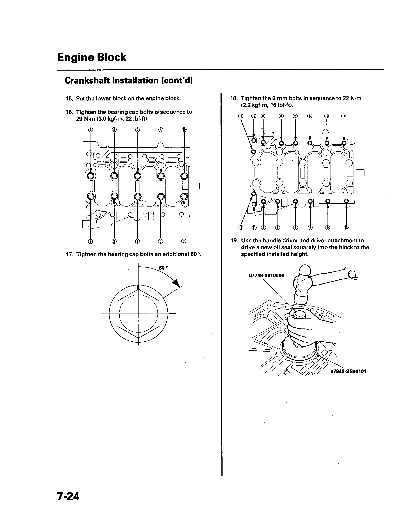

---

### Crankshaft Installation — Continued

Source: [PDF p.247, printed p.7-25](../page-images/p0247.png).

20. Measure distance between crankshaft (A) and oil seal (B): **5.5–6.5 mm (0.22–0.26 in.)** installed height.
21. Install oil pump (step 12, p.8-13).
22. Install cam chain (p.6-15).

### Oil Pan Installation

1. Remove old liquid gasket from mating surfaces, bolts, and holes.
2. Clean and dry oil-pan mating surfaces.
3. Apply liquid gasket **08717-0004, 08718-0001, 08718-0003, or 08718-0009** evenly along broken line shown on pan mating surface; install pan within **5 minutes**. Otherwise remove old residue and reapply.
4. Tighten bolts in **three steps**, using illustrated sequence; final torque **12 N·m (1.2 kgf·m, 8.7 lbf·ft)**.
5. Wait at least **30 minutes** after assembly before filling engine with oil.

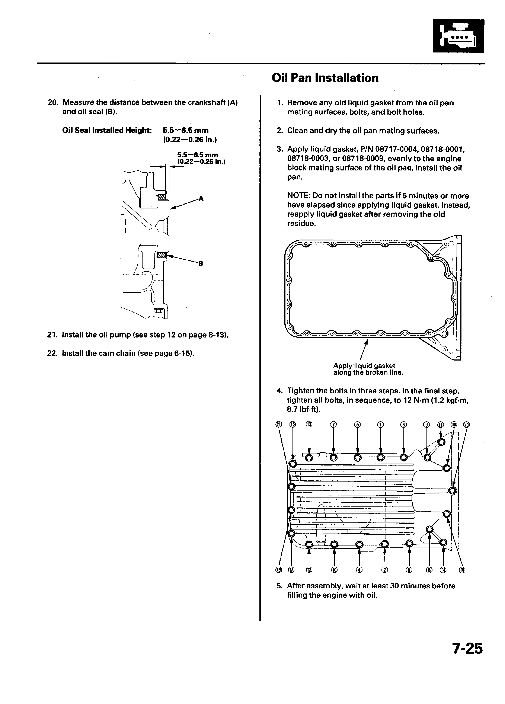

---

### Pulley-End Crankshaft Oil Seal Installation — In Car

Source: [PDF p.248, printed p.7-26](../page-images/p0248.png).

Special tool: seal driver **07LAD-PT3010A**.

1. Clean and dry crankshaft oil-seal housing.
2. Drive in crankshaft oil seal until seal driver bottoms against chain case.

### Transmission-End Crankshaft Oil Seal Installation — In Car

Special tools: handle driver **07749-0010000**; driver attachment **07948-SB00101**.

1. Clean and dry crankshaft oil-seal housing.
2. Drive a new oil seal squarely into block.
3. Measure crankshaft (A)-to-oil-seal (B) distance: **5.5–6.5 mm (0.22–0.26 in.)** installed height.

---

### Drain Bolt Installation

Source: [PDF p.249, printed p.7-27](../page-images/p0249.png).

Always use a **new washer**. Drain-bolt thread size shown: **28 × 1.0 mm**. Tighten to **83 N·m (8.5 kgf·m, 61 lbf·ft)**.

---

### Blank Source Scan

Source: [PDF p.250, printed p.blank](../page-images/p0250.png).

This PDF page has no readable service content. The scan contains a black artifact.

---

### Engine Lubrication — Contents

Source: [PDF p.251, printed p.8-1](../page-images/p0251.png).

| Topic | Printed page |
| --- | --- |
| Special Tools | 8-2 |
| Component Location Index | 8-3 |
| Symptom Troubleshooting Index | 8-4 |
| Oil Pressure Switch Test / Replacement | 8-5 |
| Oil Pressure Test / Engine Oil Replacement | 8-6 |
| Engine Oil Filter Replacement | 8-7 |
| Oil Cooler Center Bolt / Oil Cooler Replacement | 8-8 |
| Oil Jet Replacement / Inspection | 8-9 |
| Oil Pump Overhaul | 8-10 |

---

### Engine Lubrication — Special Tools

Source: [PDF p.252, printed p.8-2](../page-images/p0252.png).

| Tool number | Description | Quantity |
| --- | --- | ---: |
| 07912-6110001 | Oil filter wrench | 1 |

---

### Engine Lubrication — Component Location Index

Source: [PDF p.253, printed p.8-3](../page-images/p0253.png).

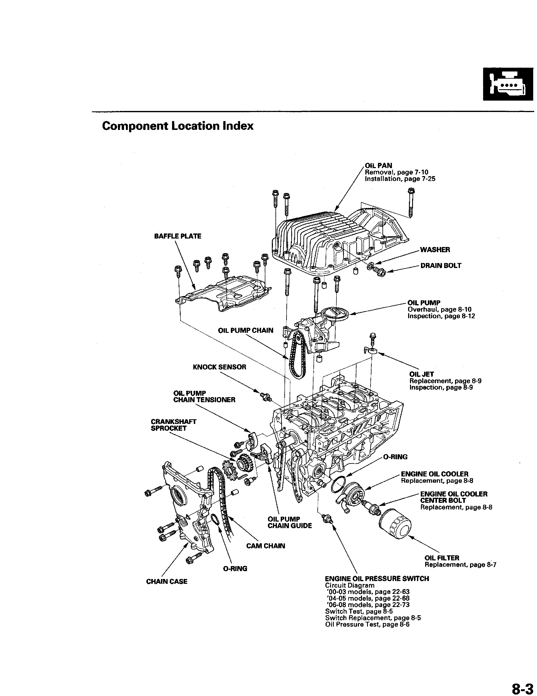

| Component | Related procedure |
| --- | --- |
| Oil pan | Removal p.7-10; installation p.7-25 |
| Baffle plate, washer, drain bolt | Locations shown in diagram |
| Oil pump | Overhaul p.8-10; inspection p.8-12 |
| Oil pump chain, oil pump chain tensioner, oil pump chain guide, crankshaft sprocket | Locations shown in diagram |
| Oil jet | Replacement and inspection p.8-9 |
| Engine oil cooler | Replacement p.8-8 |
| Engine oil cooler center bolt | Replacement p.8-8 |
| Oil filter | Replacement p.8-7 |
| Engine oil pressure switch | Circuit diagrams: 2000–2003 p.22-63, 2004–2005 p.22-68, 2006–2008 p.22-73; test/replacement p.8-5; oil-pressure test p.8-6 |
| Chain case, cam chain, knock sensor, O-rings | Locations shown in diagram |

---

### Engine Lubrication — Symptom Troubleshooting Index

Source: [PDF p.254, printed p.8-4](../page-images/p0254.png).

| Symptom | Diagnostic procedure | Also check |
| --- | --- | --- |
| Excessive engine oil consumption | 1. Verify oil filler cap, drain bolt, and oil filter are tight. 2. Check for oil leaks. 3. Check valve guides or stem seals (p.6-43). 4. Check piston rings (p.7-19). 5. Check engine internals, including cylinder walls and pistons. | — |
| Low-oil-pressure indicator does not light at ignition ON (II) | 1. For 2006–2008, run gauge assembly self-diagnostic (p.22-60). 2. Test oil-pressure switch (p.8-5). | Open wire between gauge assembly and pressure switch. |
| Low-oil-pressure indicator stays on | 1. Check oil level. 2. For 2006–2008, run gauge assembly self-diagnostic (p.22-60). 3. Test oil-pressure switch (p.8-5). 4. Check oil pressure (p.8-6). 5. Check filter for clogging. 6. Check oil screen for clogging. 7. Check relief valve. 8. Check oil pump (p.8-12). | Wire shorted to ground between gauge assembly and pressure switch. |

---

### Oil Pressure Switch Test and Replacement

Source: [PDF p.255, printed p.8-5](../page-images/p0255.png).

**Test:** Disconnect wire (A) from switch (B). Check continuity between positive terminal (C) and engine ground: continuity with engine stopped; no continuity when running. If incorrect, check oil level, then oil pressure (p.8-6).

**Replacement:** Disconnect wire and remove switch. Clean old liquid gasket from switch and hole. Apply a **very small amount** of liquid gasket to switch threads and install. Excess gasket can enter oil passage or switch end.

---

### Oil Pressure Test

Source: [PDF p.256, printed p.8-6](../page-images/p0256.png).

If indicator stays on with engine running, check oil level. If correct:

1. Replace oil-pressure switch temporarily with oil-pressure gauge (A).
2. Start engine; **stop immediately if gauge shows no oil pressure** and repair before continuing.
3. At operating temperature, after fan runs at least twice, oil at **176 °F (80 °C)**: minimum **250 kPa (2.5 kgf/cm², 36 psi) at idle** and **590 kPa (6.0 kgf/cm², 85 psi) at 3,000 rpm**.
4. If out of specification, inspect relief valve (p.8-10), clogged oil filter, and oil pump (p.8-12).

### Engine Oil Replacement

1. Warm engine.
2. Remove drain bolt (A) and drain oil. Tightening torque is **39 N·m (4.0 kgf·m, 29 lbf·ft)**; do not overtighten.
3. Reinstall bolt with **new washer (B)**.
4. Refill with recommended oil: **4.5 L (4.8 US qt)** at oil change; **4.8 L (5.1 US qt)** with filter; **5.6 L (5.9 US qt)** after overhaul.
5. Run engine more than **3 minutes** and check for leaks.

---

### Engine Oil Filter Replacement

Source: [PDF p.257, printed p.8-7](../page-images/p0257.png).

Special tool: oil filter wrench **07912-6110001**.

1. Remove filter with wrench.
2. Inspect new-filter threads (A) and rubber seal (B). Wipe engine-block seat and lightly oil seal. Use only a filter with built-in bypass system.
3. Install filter by hand.
4. Once rubber seal seats, tighten clockwise **7/8 turn**, or **22 N·m (2.2 kgf·m, 16 lbf·ft)** using wrench.

### Maintenance Minder Reset — 2006–2008 Models

6. Connect HDS to DLC (p.11-213).
7. Turn ignition ON (II).
8. Confirm HDS communicates with vehicle and ECM; if not, troubleshoot DLC circuit (p.11-367).
9. Choose **BODY ELECTRICAL**.
10. Choose **ADJUSTMENT** in **GAUGES** menu.
11. Choose **RESET** in **MAINTENANCE MINDER**.
12. Choose **RESETTING THE ENGINE OIL LIFE**; if MTF changed at same time, choose **RESETTING THE ENGINE OIL LIFE AND MTF**.
13. Reset maintenance information display (p.3-27).

---

### Engine Oil Filter Replacement — Continued

Source: [PDF p.258, printed p.8-8](../page-images/p0258.png).

5. If filter has eight outside numbers, seat rubber seal lightly against cooler and note bottom number; turn clockwise seven number positions. Example: from **2** at bottom to **1** at bottom. Mapping: 1→8, 2→1, 3→2, 4→3, 5→4, 6→5, 7→6, 8→7.
6. Fill to specified oil level, run engine more than **3 minutes**, and check for leakage.

### Oil Cooler Center Bolt / Oil Cooler Replacement

1. Remove oil filter (p.8-7).
2. Disconnect water bypass hoses.
3. Remove center bolt (A) and cooler (B).
4. Oil **new O-ring (C)**.
5. Install cooler and tighten center bolt to **74 N·m (7.5 kgf·m, 54 lbf·ft)**.
6. Reconnect bypass hoses.
7. Install new oil filter (p.8-7).

---

### Oil Jet Replacement

Source: [PDF p.259, printed p.8-9](../page-images/p0259.png).

1. Remove crankshaft (p.7-10).
2. Remove oil-jet bolt (A) and jet (B).
3. Reinstall jet carefully, tightening bolt precisely to **16 N·m (1.6 kgf·m, 12 lbf·ft)**.
4. Install crankshaft (p.7-10).

### Oil Jet Inspection

1. Remove jet. Confirm **1.5 mm (0.059 in.)** drill passes through **1.6 mm (0.062 in.)** nozzle; **1.1 mm (0.043 in.)** drill fits **1.2 mm (0.047 in.)** intake; check ball moves smoothly about **4.0 mm (0.16 in.)**; air pressure must reach at least **200 kPa (2.0 kgf/cm², 28 psi)** to unseat ball. Replace damaged or bent jet assembly.
2. Mounting torque is critical: **16 N·m (1.6 kgf·m, 12 lbf·ft)**.

---

### Oil Pump Overhaul — Exploded View

Source: [PDF p.260, printed p.8-10](../page-images/p0260.png).

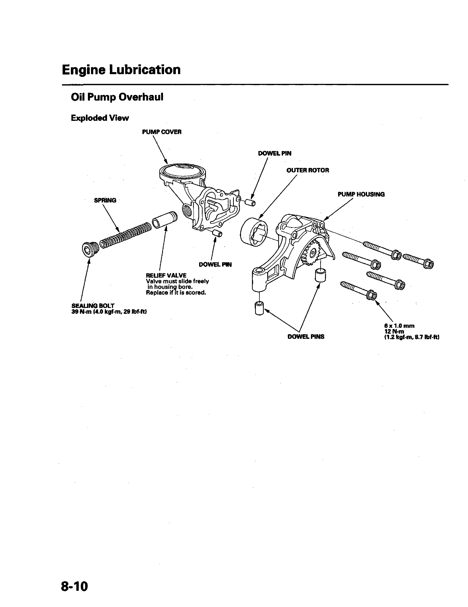

Components: pump cover, two cover dowel pins, outer rotor, pump housing, housing dowel pins, relief valve, spring, and sealing bolt. Relief valve must slide freely in housing bore; replace if scored. **Sealing bolt: 39 N·m (4.0 kgf·m, 29 lbf·ft). Housing bolts, 6 × 1.0 mm: 12 N·m (1.2 kgf·m, 8.7 lbf·ft).**

---

### Oil Pump Overhaul — Removal

Source: [PDF p.261, printed p.8-11](../page-images/p0261.png).

1. Remove cam chain (p.6-13).
2. Remove oil-pump chain tensioner.
3. Remove baffle plate.
4. Remove three bolts securing oil pump.
5. Remove oil pump (A), oil-pump chain (B), and crankshaft sprocket (C).

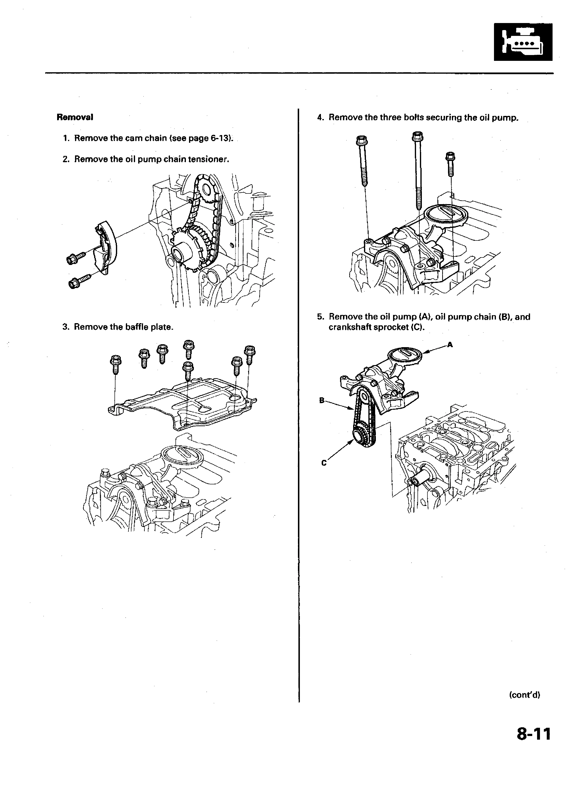

---

### Oil Pump Overhaul — Inspection

Source: [PDF p.262, printed p.8-12](../page-images/p0262.png).

6. Remove housing bolts; separate housing and cover.
7. Measure inner-to-outer rotor radial clearance. New **0.02–0.14 mm (0.001–0.006 in.)**; limit **0.20 mm (0.008 in.)**.
8. Measure housing-to-rotor axial clearance. New **0.02–0.07 mm (0.001–0.003 in.)**; limit **0.12 mm (0.005 in.)**.
9. Measure housing-to-outer rotor radial clearance. New **0.15–0.21 mm (0.006–0.008 in.)**; limit **0.23 mm (0.009 in.)**.
10. Inspect rotors and housing for scoring or damage; replace pump assembly if necessary.
11. Confirm pump turns freely. Replace pump assembly if any clearance exceeds limit.

---

### Oil Pump Overhaul — Installation

Source: [PDF p.263, printed p.8-13](../page-images/p0263.png).

12. Squeeze new oil-pump chain tensioner (A), and install supplied set clip (B).
13. Install crankshaft sprocket (A), oil-pump chain (B), and pump (C).
14. Tighten pump bolts: **8 × 1.25 mm to 22 N·m (2.2 kgf·m, 16 lbf·ft)**; **6 × 1.0 mm to 12 N·m (1.2 kgf·m, 8.7 lbf·ft)**.
15. Install baffle plate; tighten **6 × 1.0 mm bolts to 12 N·m (1.2 kgf·m, 8.7 lbf·ft)**.

---

### Oil Pump Overhaul — Installation Continued

Source: [PDF p.264, printed p.8-14](../page-images/p0264.png).

16. Set No.1 piston to TDC by aligning sprocket/crankshaft key (A) with block pointer (B).
17. Align **colored oil-pump chain link (A)** with crankshaft sprocket punch mark (B), as illustrated. (Source text calls it cam chain; diagram shows oil-pump chain. Verify exact chain identification before service.)
18. Install oil-pump chain guide (A) and tensioner (B) with set clip (C). **6 × 1.0 mm bolts: 12 N·m (1.2 kgf·m, 8.7 lbf·ft); 8 × 1.25 mm bolt: 22 N·m (2.2 kgf·m, 16 lbf·ft).**
19. Remove set clip from tensioner.
20. Install cam chain (p.6-15).

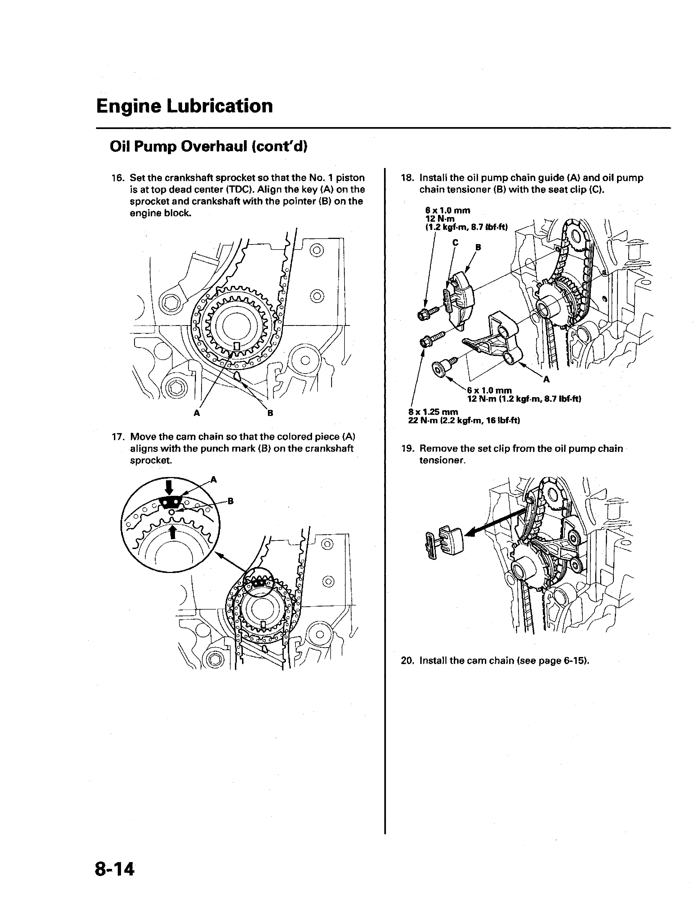

---

### Intake Manifold and Exhaust System — Contents

Source: [PDF p.265, printed p.contents](../page-images/p0265.png).

| Topic | Printed page |
| --- | --- |
| Intake Manifold Removal and Installation | 9-2 |
| Exhaust Manifold Removal and Installation | 9-4 |
| Exhaust Pipe and Muffler Replacement | 9-5 |

---

### Intake Manifold Removal and Installation — 2000–2005 Models

Source: [PDF p.266, printed p.9-2](../page-images/p0266.png).

Use **new O-rings and gaskets** when reassembling. Replace intake manifold if cracked or mating surface damaged. Exploded diagram shows throttle body, intake manifold and brackets, intake-air-temperature sensor, air-control valve, ECT sensor, water-outlet cover, IAC valve, bleed bolt, gaskets, and O-rings.

| Fastener | Torque |
| --- | --- |
| IAT sensor, 5 × 0.8 mm | 6 N·m (0.6 kgf·m, 4 lbf·ft) |
| Bleed bolt | 9.8 N·m (1.0 kgf·m, 7.2 lbf·ft) |
| ECT sensor and 6 × 1.0 mm fasteners | 12 N·m (1.2 kgf·m, 8.7 lbf·ft) |
| 8 × 1.25 mm fasteners | 22 N·m (2.2 kgf·m, 16 lbf·ft) |
| Intake-manifold bracket 10 × 1.25 mm fasteners | 44 N·m (4.5 kgf·m, 33 lbf·ft) |

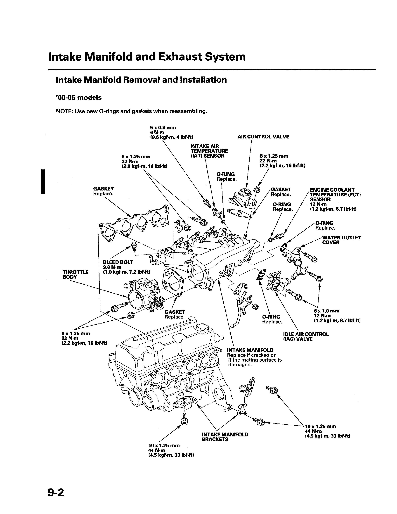

---

### Intake Manifold Removal and Installation — 2006–2008 Models

Source: [PDF p.267, printed p.9-3](../page-images/p0267.png).

Use **new O-rings and gaskets**. Replace manifold if cracked or mating surface is damaged. Diagram identifies MAP sensor, intake manifold, ECT sensor 1, throttle body, water-outlet cover, two manifold brackets, bleed bolt, gaskets, and O-rings.

| Fastener | Torque |
| --- | --- |
| MAP sensor, 5 × 0.8 mm | 4 N·m (0.4 kgf·m, 3 lbf·ft) |
| Bleed bolt | 9.8 N·m (1.0 kgf·m, 7.2 lbf·ft) |
| ECT sensor 1 and 6 × 1.0 mm fasteners | 12 N·m (1.2 kgf·m, 8.7 lbf·ft) |
| 8 × 1.25 mm fasteners | 22 N·m (2.2 kgf·m, 16 lbf·ft) |
| Intake-manifold brackets, 10 × 1.25 mm | 44 N·m (4.5 kgf·m, 33 lbf·ft) |

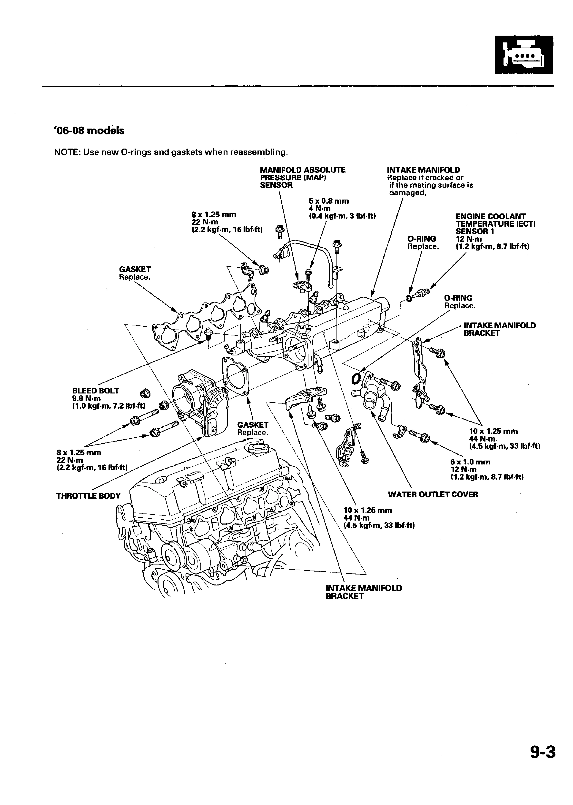

---

### Exhaust Manifold Removal and Installation

Source: [PDF p.268, printed p.9-4](../page-images/p0268.png).

Use **new gaskets and self-locking nuts** on reassembly. Diagram shows cylinder-head side cover, covers, manifold, manifold bracket, and washers. Fit washers with **smooth sides facing bracket**.

| Fastener/component | Torque |
| --- | --- |
| 6 × 1.0 mm cover fasteners | 12 N·m (1.2 kgf·m, 8.7 lbf·ft) |
| 6 × 1.0 mm sensor-adjacent fastener | 14 N·m (1.4 kgf·m, 10 lbf·ft) |
| 8 × 1.25 mm cover fasteners | 22 N·m (2.2 kgf·m, 16 lbf·ft) |
| Replacement 8 × 1.25 mm self-locking nut | 31 N·m (3.2 kgf·m, 23 lbf·ft) |
| Primary HO2S (2000–2005) or A/F sensor (2006–2008); 10 × 1.25 mm bracket fasteners | 44 N·m (4.5 kgf·m, 33 lbf·ft) |

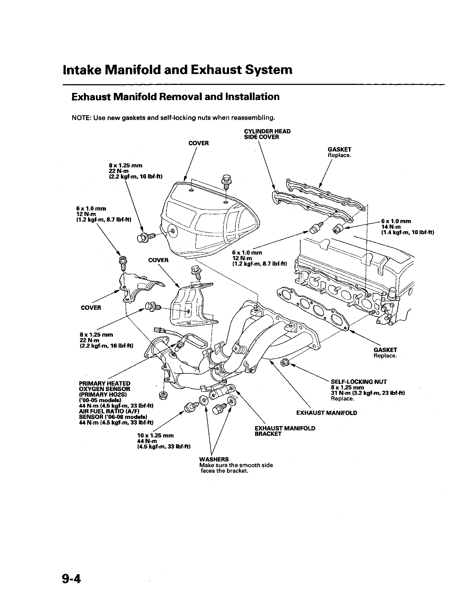

---

### Exhaust Pipe and Muffler Replacement — 2000–2003 Models

Source: [PDF p.269, printed p.9-5](../page-images/p0269.png).

Use **new gaskets and self-locking nuts**. Diagram identifies mufflers, heat shield, three-way catalytic converter (TWC), secondary heated oxygen sensor, and replacement gaskets.

| Fastener | Torque |
| --- | --- |
| Heat-shield 6 × 1.0 mm bolts | 12 N·m (1.2 kgf·m, 8.7 lbf·ft) |
| Replacement 8 × 1.25 mm converter bolts | 22 N·m (2.2 kgf·m, 16 lbf·ft); tighten in steps alternating side to side |
| Replacement 10 × 1.25 mm self-locking nuts | 33 N·m (3.4 kgf·m, 25 lbf·ft) |
| Secondary HO2S | 44 N·m (4.5 kgf·m, 33 lbf·ft) |

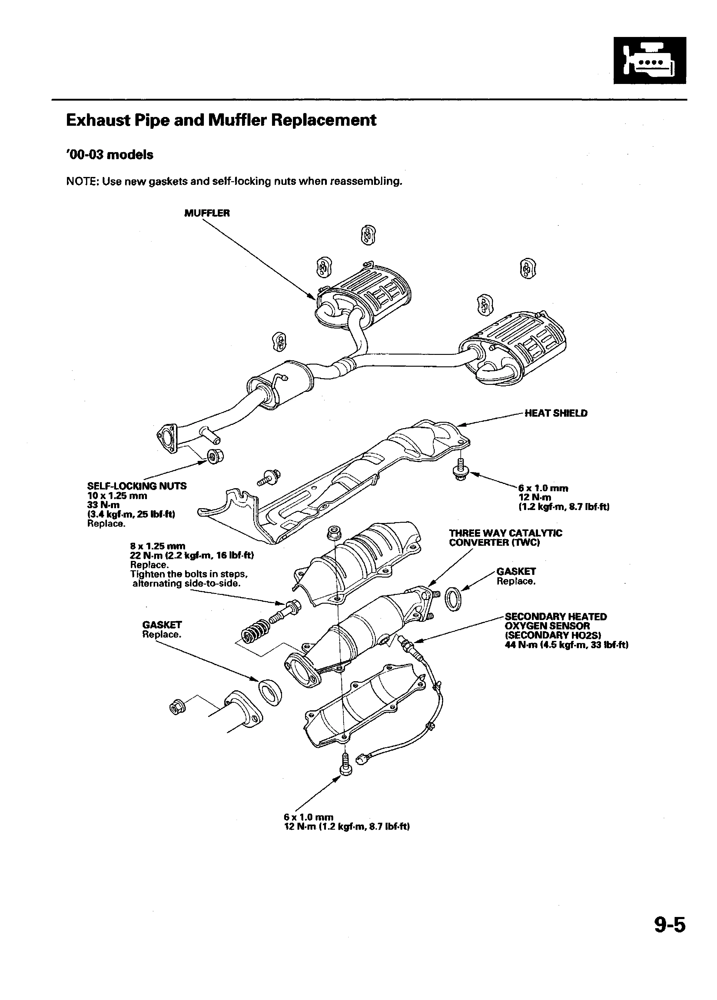

---

### Exhaust Pipe and Muffler Replacement — 2004–2008 Models

Source: [PDF p.270, printed p.9-6](../page-images/p0270.png).

Use **new gaskets and self-locking nuts**. Diagram shows model-year muffler variations, heat shields, TWC, secondary HO2S, and replacement gaskets.

| Fastener | Torque |
| --- | --- |
| 6 × 1.0 mm muffler/heat-shield fasteners | 9.5 or 12 N·m according to labeled diagram position |
| Replacement 8 × 1.25 mm converter bolts | 22 N·m (2.2 kgf·m, 16 lbf·ft); tighten in steps alternating side to side |
| Replacement 10 × 1.25 mm self-locking nuts | 33 N·m (3.4 kgf·m, 25 lbf·ft) |
| Secondary HO2S | 44 N·m (4.5 kgf·m, 33 lbf·ft) |

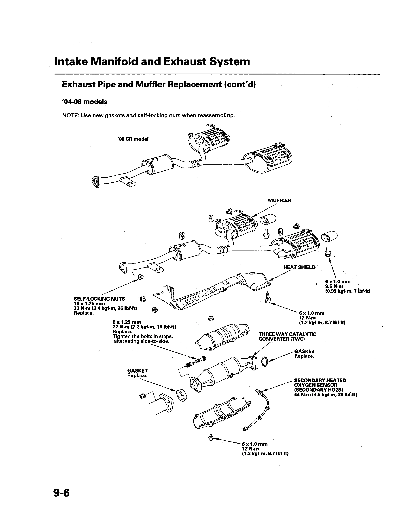

---

### Engine Cooling — Contents

Source: [PDF p.271, printed p.contents](../page-images/p0271.png).

**Cooling system:** Component Location Index p.10-2; Radiator Cap Test and Radiator Test p.10-6; Fan Motor Test and Thermostat Test p.10-7; Water Pump Inspection and Replacement p.10-8; Coolant Replacement p.10-9; Thermostat Replacement p.10-11; Radiator and Fan Replacement p.10-12.

**Fan controls:** Component Location Index p.10-13; Symptom Troubleshooting Index p.10-14; Circuit Diagram p.10-16; Radiator Fan Circuit Troubleshooting p.10-18; Radiator Fan Switch Circuit Troubleshooting (Open) p.10-22, (Short) p.10-23; Radiator Fan Switch Test p.10-23 and Replacement p.10-24.

---

### Cooling System — Component Location Index

Source: [PDF p.272, printed p.10-2](../page-images/p0272.png).

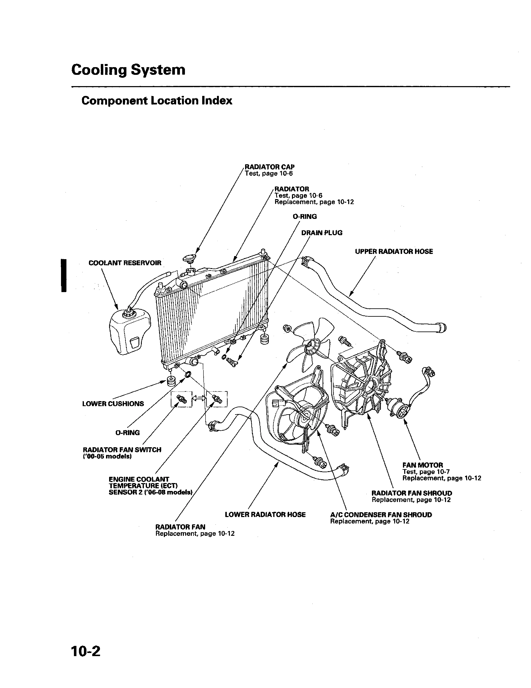

Locations shown: coolant reservoir, radiator cap (test p.10-6), radiator (test p.10-6; replacement p.10-12), O-rings, drain plug, upper and lower radiator hoses, lower cushions, radiator fan switch (2000–2005), ECT sensor 2 (2006–2008), radiator fan and shroud (replacement p.10-12), A/C condenser fan shroud (replacement p.10-12), and fan motor (test p.10-7; replacement p.10-12).

---

### Cooling System — Component Location Index, 2000–2005

Source: [PDF p.273, printed p.10-3](../page-images/p0273.png).

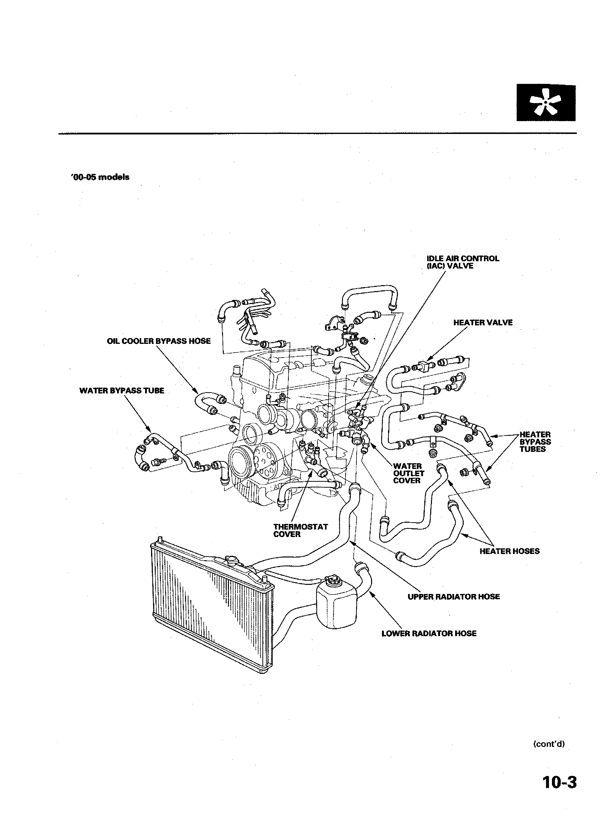

Locations shown: oil-cooler bypass hose, water bypass tube, IAC valve, heater valve, heater bypass tubes, heater hoses, water-outlet cover, thermostat cover, and upper/lower radiator hoses.

---

### Cooling System — Component Location Index, 2006–2008

Source: [PDF p.274, printed p.10-4](../page-images/p0274.png).

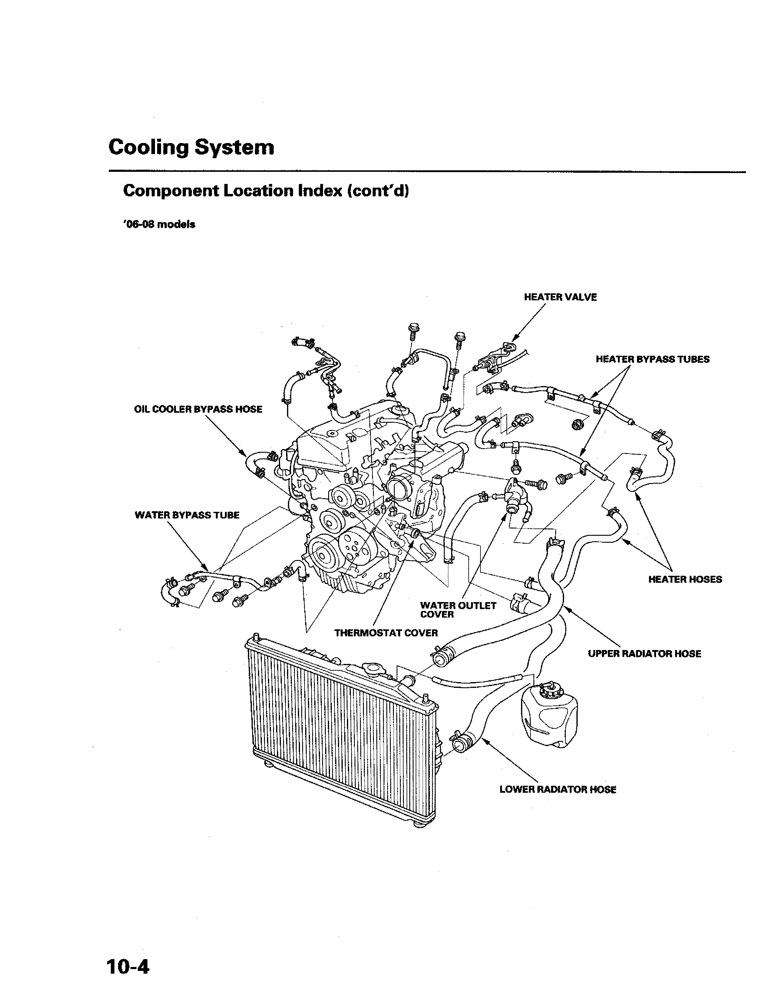

Locations shown: oil-cooler bypass hose, water bypass tube, heater valve, heater bypass tubes, heater hoses, water-outlet cover, thermostat cover, and upper/lower radiator hoses.

---

### Cooling System — Component Location Index, Continued

Source: [PDF p.275, printed p.10-5](../page-images/p0275.png).

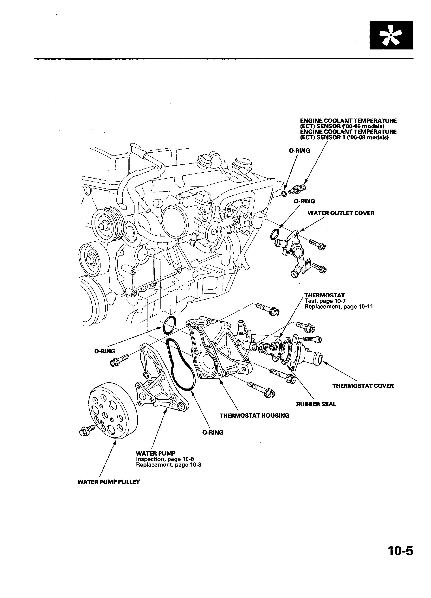

ECT sensor on 2000–2005, ECT sensor 1 on 2006–2008; O-rings; water-outlet cover; thermostat (test p.10-7, replacement p.10-11); rubber seal; thermostat cover and housing; water pump (inspection and replacement p.10-8); and water-pump pulley.

---

### Radiator Cap Test

Source: [PDF p.276, printed p.10-6](../page-images/p0276.png).

1. Remove radiator cap (A), wet seal with coolant, and install on pressure tester (B).
2. Apply **93–123 kPa (0.95–1.25 kgf/cm², 14–18 psi)**.
3. Check for pressure drop.
4. Replace cap if pressure drops.

### Radiator Test

1. With engine cool, carefully remove cap and fill radiator to top of filler neck.
2. Attach pressure tester and apply **93–123 kPa (0.95–1.25 kgf/cm², 14–18 psi)**.
3. Check for coolant leaks or pressure drop.
4. Remove tester and reinstall cap.

---

### Fan Motor Test

Source: [PDF p.277, printed p.10-7](../page-images/p0277.png).

1. Disconnect 2-pin connectors from radiator fan motor (A) and A/C condenser fan motor (B).
2. Connect battery power to **terminal 2** and ground to **terminal 1**, viewed from male-terminal side.
3. Replace either motor if it does not run or runs unevenly (p.10-12).

### Thermostat Test

Replace thermostat if open at room temperature. For a closed thermostat:

1. Suspend thermostat (A) in water, keeping thermometer (B) off container bottom.
2. Heat water, recording temperature when thermostat starts to open and is fully open.
3. Measure lift when fully open. Standard: **above 10.0 mm (0.39 in.)**; begins opening **169–176 °F (76–80 °C)**; fully open at **194 °F (90 °C)**.

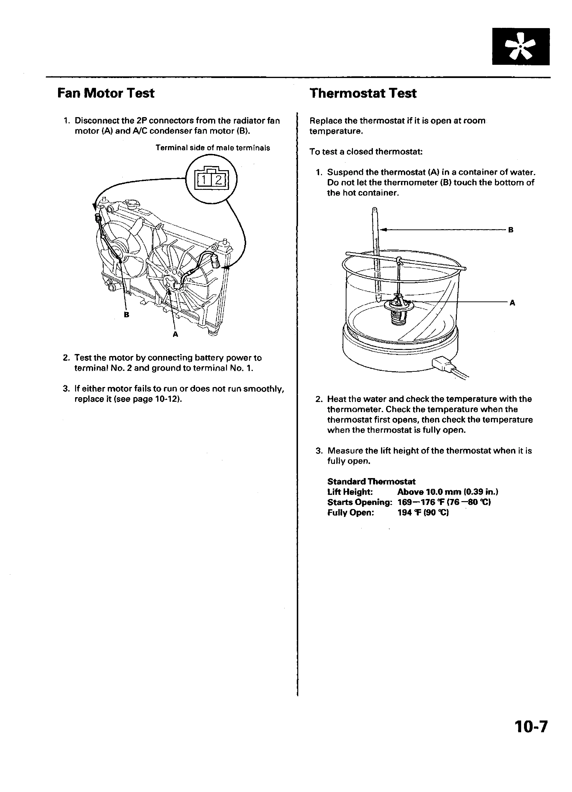

---

### Water Pump Inspection

Source: [PDF p.278, printed p.10-8](../page-images/p0278.png).

1. Loosen pulley bolts.
2. Remove drive belt (p.4-42).
3. Remove water-pump pulley.
4. Turn pulley counterclockwise; if it does not turn freely, replace pump. A little weeping from bleed holes (A) can be normal.

### Water Pump Replacement

1. Drain coolant (p.10-9).
2. Loosen pulley bolts.
3. Remove drive belt (p.4-42).
4. Remove pulley.
5. Remove six bolts and pump (A); **10 × 1.25 mm bolts: 44 N·m (4.5 kgf·m, 33 lbf·ft)** on installation.
6. Clean/inspect O-ring groove and thermostat-housing mating surface.
7. Install pump with **new O-ring (B)** in reverse order.
8. Refill and bleed cooling system (p.10-9, step 7).
9. Clean spilled coolant.

---

### Coolant Replacement

Source: [PDF p.279, printed p.10-9](../page-images/p0279.png).

1. Start engine, set heater to maximum heat, switch ignition to LOCK (0), and let engine/radiator cool to touch.
2. Remove radiator cap.
3. Loosen radiator drain plug (A) and drain coolant.
4. Remove right-side engine-block drain bolt (A).
5. Apply liquid gasket **08718-0009** to drain-bolt threads; reinstall with **new washer** and tighten securely. Diagram specifies **83 N·m (8.5 kgf·m, 61 lbf·ft)** for block drain bolt.
6. Tighten radiator drain plug securely.
7. Drain and reinstall reservoir; fill to MAX with **Honda Long Life Antifreeze/Coolant Type 2, P/N OL999-9001**.
8. Remove bleed cap (A) from heater bypass tube.

---

### Coolant Replacement — Continued

Source: [PDF p.280, printed p.10-10](../page-images/p0280.png).

9. Loosen intake-manifold air bleed bolt (A), and fill radiator to bottom of filler neck with **Honda Long Life Antifreeze/Coolant Type 2, P/N OL999-9001**. It is premixed 50/50; do not substitute coolant. Rinse spills from electrical parts or paint immediately. Capacity includes 0.6 L (0.16 US gal) reserve tank: **6.5 L (1.72 US gal)** at change; **7.6 L (2.01 US gal)** after overhaul.
10. When coolant runs steadily, tighten air bleed bolt to **9.8 N·m (1.0 kgf·m, 7.2 lbf·ft)**.
11. Reinstall heater-bypass bleed cap when coolant runs steadily.
12. With radiator cap off, run engine until fan comes on at least twice; top up to bottom of filler neck.
13. Tighten cap, rerun engine, and check leaks.
14. Clean spilled coolant.

**Maintenance Minder reset, 2006–2008:**

15. If Minder required coolant replacement, reset it (p.3-27) and stop. Otherwise continue.
16. Connect HDS to DLC (p.11-213).
17. Confirm HDS communicates with vehicle and ECM; if not, troubleshoot DLC (p.11-367).
18. Turn ignition ON (II).
19. Choose **BODY ELECTRICAL**.
20. Choose **ADJUSTMENT** in **GAUGE** menu.
21. Choose **RESET** in **MAINTENANCE MINDER**.
22. Choose **MAINTENANCE SUB ITEM 5 RESET**.
23. Reset maintenance information display (p.3-27).

---

### Thermostat Replacement

Source: [PDF p.281, printed p.10-11](../page-images/p0281.png).

1. Drain coolant (p.10-9).
2. Remove lower radiator hose and thermostat cover; remove thermostat.
3. Install thermostat with **new rubber seal**.
4. Install cover and lower hose. **6 × 1.0 mm cover bolts: 12 N·m (1.2 kgf·m, 8.7 lbf·ft).**
5. Refill and bleed cooling system (p.10-9, step 7).
6. Clean spills.

---

### Radiator and Fan Replacement

Source: [PDF p.282, printed p.10-12](../page-images/p0282.png).

1. Drain coolant (p.10-9).
2. Remove upper and lower radiator hoses.
3. For 2000–2005, disconnect fan-motor connectors and radiator-fan-switch connector.
4. For 2006–2008, disconnect fan-motor connectors and ECT sensor 2 connector.
5. Remove radiator upper brackets/cushions and lift radiator.
6. Remove both fan-shroud assemblies and other radiator parts.
7. Install in reverse order, seating upper and lower cushions securely.
8. Refill and bleed cooling system (p.10-9, step 7).
9. Clean spills.

Diagram torques: **6 × 1.0 mm upper bracket bolts 12 N·m (8.7 lbf·ft)**; **6 × 1.0 mm fan-shroud bolts 7 N·m (5 lbf·ft)**; radiator fan switch (2000–2005) **24 N·m (17 lbf·ft)**; ECT sensor 2 (2006–2008) **12 N·m (8.7 lbf·ft)**. Replace O-rings.

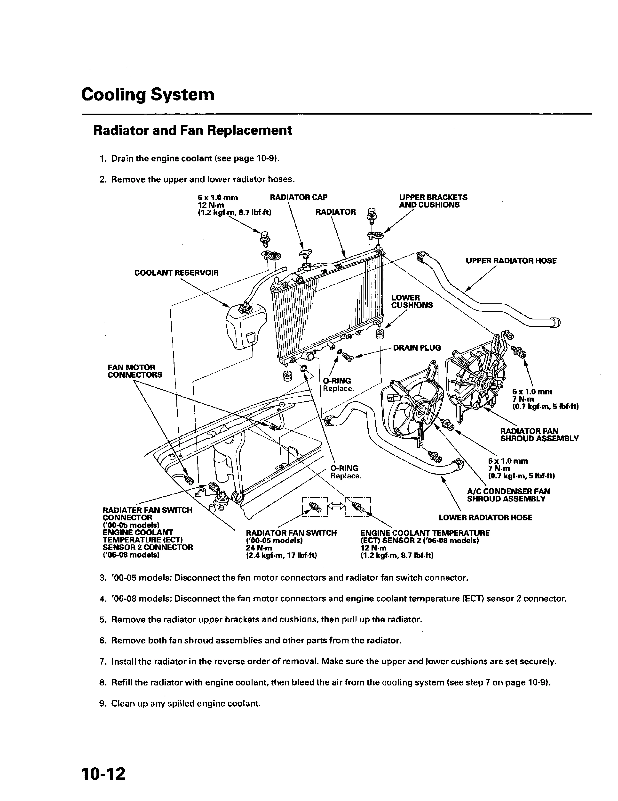

---

### Fan Controls — Component Location Index

Source: [PDF p.283, printed p.10-13](../page-images/p0283.png).

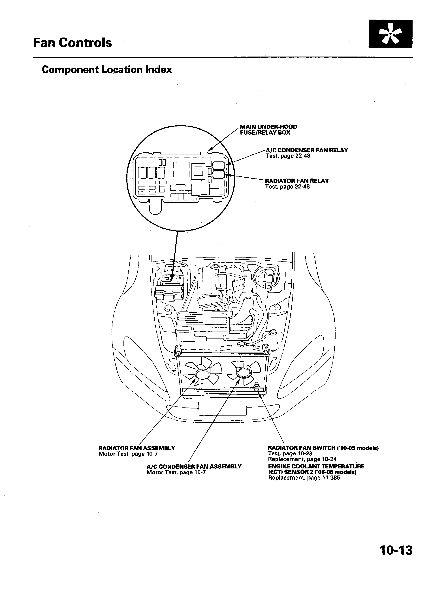

Main under-hood fuse/relay box contains A/C condenser fan relay and radiator fan relay (tests p.22-48). Radiator fan and A/C condenser fan assemblies have motor tests on p.10-7. Radiator fan switch (2000–2005) is tested p.10-23 and replaced p.10-24. ECT sensor 2 (2006–2008) replacement is on p.11-385.

---

### Fan Controls — Symptom Troubleshooting, 2000–2005

Source: [PDF p.284, printed p.10-14](../page-images/p0284.png).

**Overheating:** Check coolant level/leaks; radiator and A/C condenser blockage; coolant deterioration; fan shroud; fan motors (p.10-7), relays (p.22-48), and fan switch (p.10-23); radiator cap (p.10-6); thermostat (p.10-7); water pump (p.10-8); radiator and heater hoses/core blockage; cylinder-head gasket.

| Symptom | Diagnostic path | Also check |
| --- | --- | --- |
| Radiator fan never runs | Radiator fan circuit p.10-18 | Connector cleanliness and tightness |
| Fan does not run for cooling but runs with A/C | Fan switch open-circuit p.10-22 | Connectors |
| Fan runs with ignition ON, A/C off, coolant below 199 °F (93 °C) | Fan switch short-circuit p.10-23 | Connectors |
| A/C condenser fan does not run, but radiator fan runs with A/C | A/C fan circuit p.21-53 | HVAC DTCs p.21-5; connectors |
| Neither fan runs with A/C, but compressor runs | Common circuit p.21-54 | HVAC DTCs p.21-5; connectors |

---

### Fan Controls — Symptom Troubleshooting, 2006–2008

Source: [PDF p.285, printed p.10-15](../page-images/p0285.png).

**Overheating:** Check coolant level/leaks; radiator and A/C condenser blockage; coolant deterioration; fan shroud; fan motors (p.10-7) and relays (p.22-48); radiator cap (p.10-6); thermostat (p.10-7); water pump (p.10-8); radiator and heater hoses/core blockage; cylinder-head gasket.

| Symptom | Diagnostic path | Also check |
| --- | --- | --- |
| Radiator fan never runs | PGM-FI DTCs p.11-213, then radiator fan circuit p.10-20 | Connector cleanliness and tightness |
| Fan does not run for cooling but runs with A/C | PGM-FI DTCs p.11-213, then radiator fan circuit p.10-20 | Connectors |
| Fan runs with ignition ON, A/C off, coolant below 199 °F (93 °C) | PGM-FI DTCs p.11-213, then radiator fan circuit p.10-20 | Connectors |
| A/C condenser fan does not run, but radiator fan runs with A/C | A/C fan circuit p.21-53 | HVAC DTCs p.21-5; connectors |
| Neither fan runs with A/C, but compressor runs | Common circuit p.21-54 | HVAC DTCs p.21-5; connectors |

---

### Fan Controls — Circuit Diagram, 2000–2005

Source: [PDF p.286, printed p.10-16](../page-images/p0286.png).

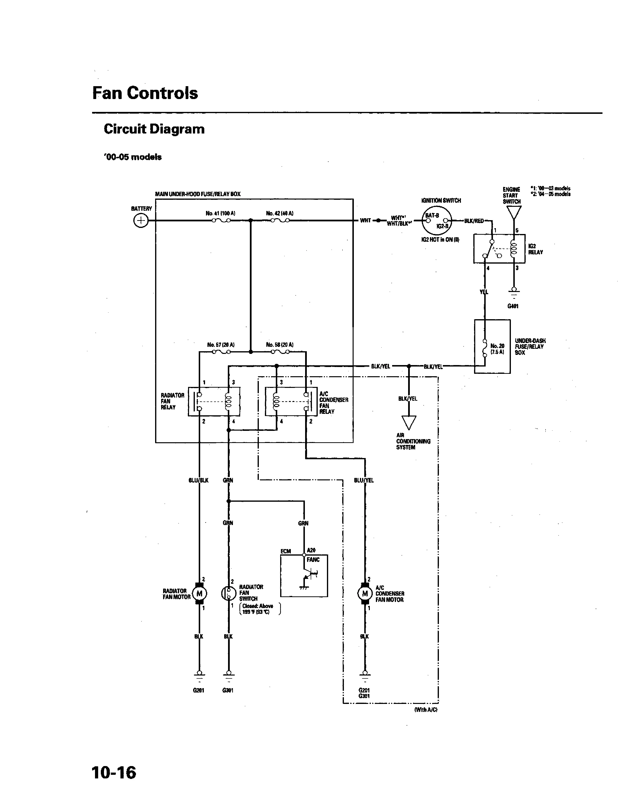

Source schematic covers main under-hood fuse/relay box, No.41/42/57/58 fuses, fan relays, ignition/start switch, under-dash No.20 fuse, radiator fan switch, ECM fan control, both fan motors, and grounds G201/G301. Model-year wire variants are shown in the drawing; use the diagram for pin-level tracing.

---

### Fan Controls — Circuit Diagram, 2006–2008

Source: [PDF p.287, printed p.10-17](../page-images/p0287.png).

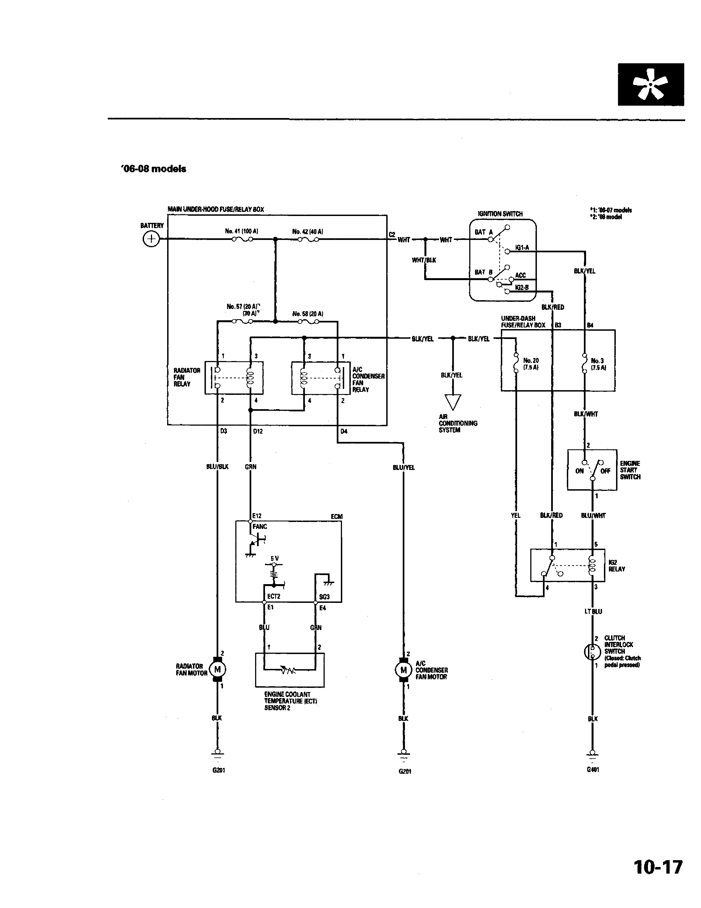

Source schematic includes No.57 fuse **20 A for 2006–2007** and **30 A for 2008**, ECT sensor 2 and ECM fan control, radiator/A/C relays and motors, ignition/start path, under-dash fuses, and grounds. Use drawing for connector and wire tracing.

---

### Radiator Fan Circuit Troubleshooting — 2000–2005, Steps 1–5

Source: [PDF p.288, printed p.10-18](../page-images/p0288.png).

1. Check under-hood fuses No.57 **20 A**, No.41 **100 A**, No.42 **40 A**, and under-dash No.20 **7.5 A**. Good → 2; blown → replace and recheck.
2. Remove radiator fan relay and test (p.22-48). Good → 3; bad → replace.
3. Measure relay 4P socket terminal **1** to body ground. Battery voltage → 4; none → replace main under-hood fuse/relay box.
4. Jumper relay socket terminals **1 and 2**. Fan runs → 5; not → 6.
5. Remove jumper; ignition ON (II); measure socket terminal **3** to ground. Battery voltage → 9; none → repair open wire between under-hood and under-dash fuse/relay boxes.

Refer to source page for socket terminal orientation.

---

### Radiator Fan Circuit Troubleshooting — 2000–2005, Steps 6–12

Source: [PDF p.289, printed p.10-19](../page-images/p0289.png).

6. Disconnect radiator fan motor 2P connector.
7. Check continuity relay 4P socket terminal **2** to motor connector terminal **2** (BLU/BLK). Yes → 8; no → repair open wire.
8. Check motor connector terminal **1** (BLK) to ground. Yes → replace motor; no → repair open ground wire or ground G201.
9. Reinstall radiator fan relay.
10. Disconnect radiator fan switch 2P connector.
11. Ignition LOCK (0), jumper switch connector terminals **1 and 2**, then ignition ON (II). Fan runs → replace switch; not → 12.
12. Ignition LOCK (0), remove jumper, then ignition ON (II). Measure switch connector terminal **2** (GRN) to ground. Battery voltage → repair open terminal-1 ground wire or G301; none → repair open terminal-2 wire to under-hood fuse/relay box.

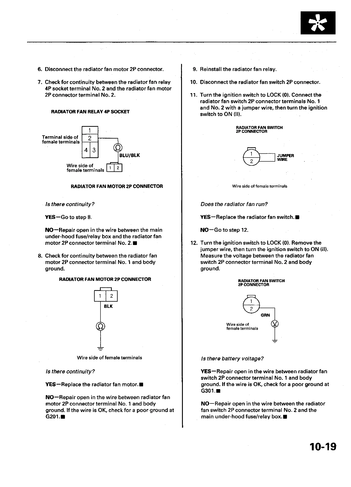

---

### Radiator Fan Circuit Troubleshooting — 2006–2008, Steps 1–6

Source: [PDF p.290, printed p.10-20](../page-images/p0290.png).

1. Check PGM-FI DTCs (p.11-213). If **P2183, P2184, or P2185**, troubleshoot DTC and recheck; otherwise 2.
2. 2006–2007: check under-hood No.57 **20 A**, No.41 **100 A**, No.42 **40 A**, and under-dash No.20 **7.5 A**.
3. 2008: same, except No.57 **30 A**. Good → 4; blown → replace and recheck.
4. Remove/test radiator fan relay (p.22-48). Good → 5; bad → replace.
5. Measure relay 4P socket terminal **1** to ground. Battery voltage → 6; none → replace main under-hood fuse/relay box.
6. Jumper socket terminals **1 and 2**. Fan runs → 7; not → 8.

Refer to source page for socket terminal orientation.

---

### Radiator Fan Circuit Troubleshooting — 2006–2008, Steps 7–10

Source: [PDF p.291, printed p.10-21](../page-images/p0291.png).

7. Remove jumper; ignition ON (II); measure relay socket terminal **3** to ground. Battery voltage → 11; none → repair open wire between under-hood and under-dash fuse/relay boxes.
8. Disconnect radiator fan motor 2P connector.
9. Check continuity relay socket terminal **2** to motor connector terminal **2** (BLU/BLK). Yes → 10; no → repair open wire.
10. Check motor connector terminal **1** (BLK) to ground. Yes → replace motor; no → repair open wire or ground G201.

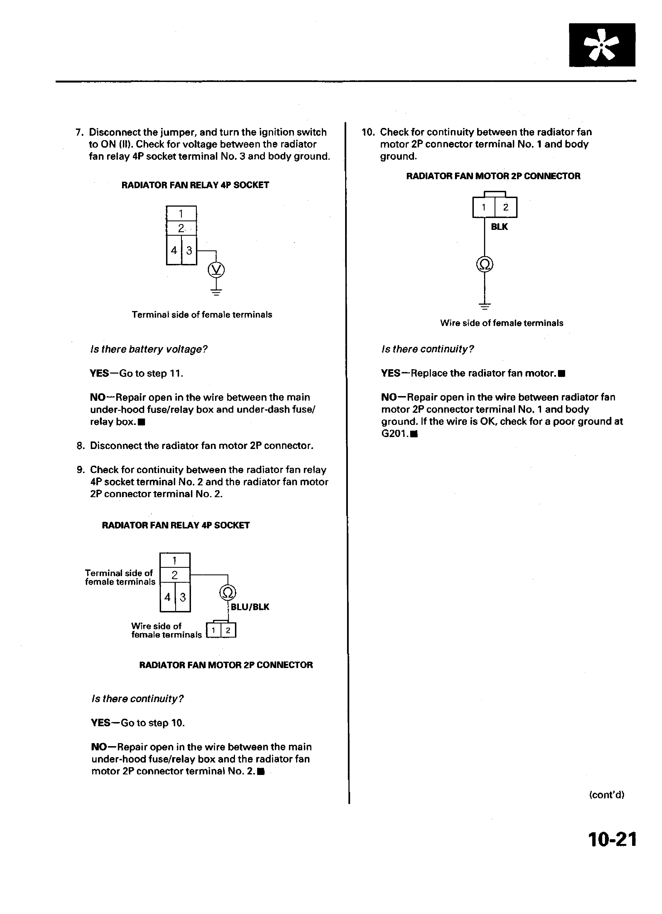

---

### Radiator Fan Circuit Troubleshooting — 2006–2008, Step 11

Source: [PDF p.292, printed p.10-22](../page-images/p0292.png).

Check continuity between radiator fan relay socket terminal **4** and ECM connector **E12**. Yes → update ECM software if needed (p.11-216) or substitute known-good ECM (p.11-217); replace original if symptom clears (p.11-389). No → repair open between E12 and under-hood fuse/relay box.

### Radiator Fan Switch Circuit Troubleshooting (Open) — 2000–2005

1. Disconnect fan switch 2P connector.
2. Ignition ON (II).
3. Measure switch connector terminal **2** (GRN) to ground. Battery voltage → 4; none → repair open to under-hood fuse/relay box.
4. Ignition LOCK (0), check connector terminal **1** (BLK) to ground. Continuity → replace switch; none → repair open ground wire or G301.

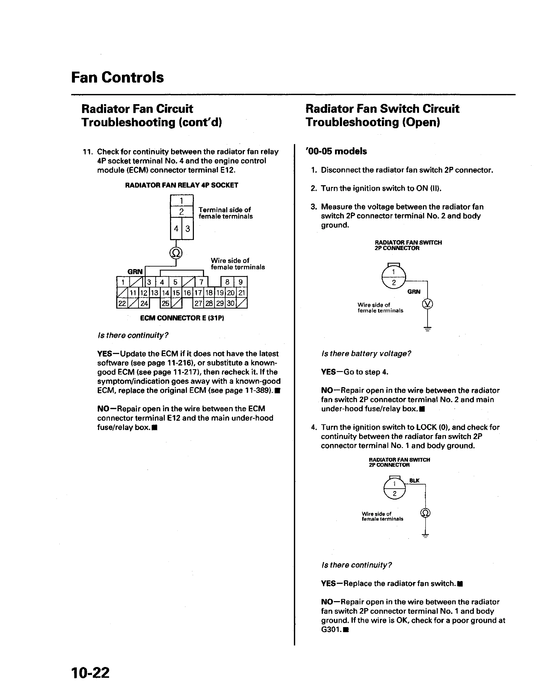

---

### Radiator Fan Switch Circuit Troubleshooting (Short) — 2000–2005

Source: [PDF p.293, printed p.10-23](../page-images/p0293.png).

1. Remove/test radiator fan relay (p.22-48). Good → 2; bad → replace relay.
2. Remove/test fan switch (pp.10-24, 10-23). Good → 3; bad → replace switch.
3. Disconnect ECM connector A (32P) and under-hood fuse/relay box 16P connector.
4. Check switch connector terminal **2** (GRN) to ground. Continuity → repair short to under-hood fuse/relay box; none → replace main under-hood fuse/relay box.

### Radiator Fan Switch Test — 2000–2005

1. Remove switch from radiator (p.10-24).
2. Suspend switch (A) in water.
3. Heat water, keeping thermometer (B) off container bottom.
4. Check continuity terminals **1–2**: switch **ON at 196–203 °F (91–95 °C)**; switches **OFF 5–15 °F (3–8 °C) below its ON temperature**.
5. Replace if necessary and install (p.10-24).

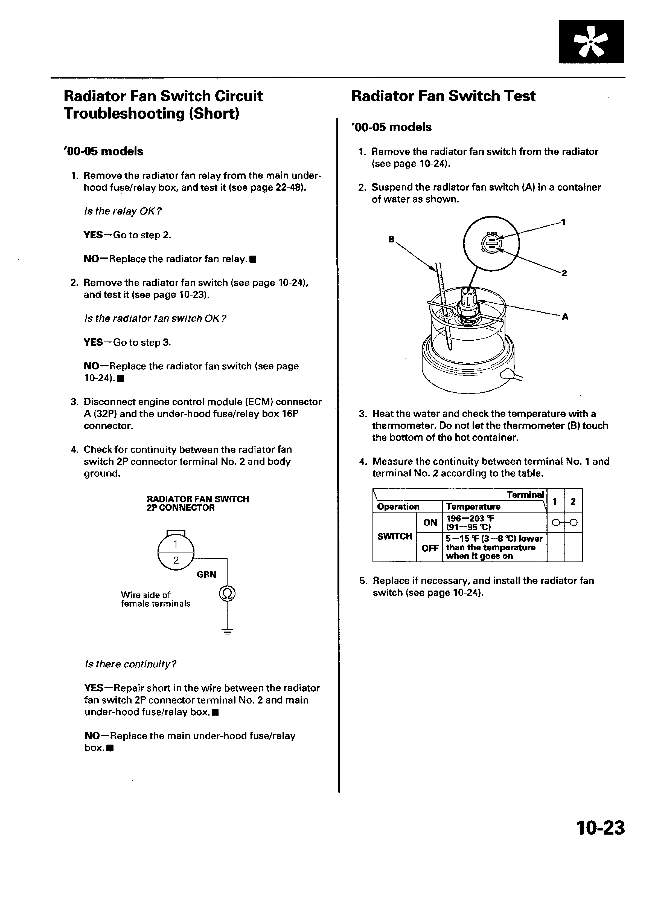

---

### Radiator Fan Switch Replacement — 2000–2005

Source: [PDF p.294, printed p.10-24](../page-images/p0294.png).

1. Drain coolant (p.10-9).
2. Disconnect switch connector; remove switch (A).
3. Install switch with **new O-ring (B)**.
4. Refill radiator and bleed cooling system (p.10-9, step 7).
