# Fuel and Emissions Systems (Part A)

Reviewed transcription of PDF pages 295–385 (printed pages 11-1–11-89). Diagnostic tables, system descriptions, readiness procedures, and the beginning of PGM-FI DTC troubleshooting are included. Source-page links and technical diagrams are retained for verification. The CMP sensor B troubleshooting procedure continues in Part B.

---

### Fuel and Emissions — Model-Year Index

<a id="p295"></a>
Source: [PDF p.295, printed p.chapter index](../page-images/p0295.png).

- 2000–2005 models: start at printed p.11-1.
- 2006–2008 models: start at printed p.11-211.
---

### Blank Source Scan

<a id="p296"></a>
Source: [PDF p.296, printed p.blank](../page-images/p0296.png).

No readable service content; scan has a black artifact.
---

### Fuel and Emissions Systems — 2000–2005 Contents

<a id="p297"></a>
Source: [PDF p.297, printed p.11-1](../page-images/p0297.png).

- Special Tools p.11-2; General Troubleshooting Information p.11-3; DTC Troubleshooting Index p.11-6; Symptom Troubleshooting Index p.11-10; System Description p.11-12; How to Set Readiness Codes p.11-40.

### PGM-FI System
- Component Location Index: 11-43
- DTC Troubleshooting: 11-45
- MIL Circuit Troubleshooting: 11-106
- DLC Circuit Troubleshooting: 11-110
- Injector Replacement: 11-112
- Primary H02S Replacement: 11-114
- Secondary H02S Replacement: 11-114
- ECM Replacement: 11-115

### VTEC
- Component Location Index: 11-116
- DTC Troubleshooting: 11-117
- Rocker Arm Oil Control Solenoid (VTEC Solenoid Valve) Inspection: 11-126

### Idle Control System
- Component Location Index: 11-127
- DTC Troubleshooting: 11-128
- A/C Signal Circuit Troubleshooting: 11-133
- Alternator FR Signal Circuit Troubleshooting: 11-135
- Starter Switch Signal Circuit Troubleshooting: 11-136
- Electrical Power Steering (EPS) Signal Circuit Troubleshooting: 11-137
- Brake Pedal Position Switch Signal Circuit Troubleshooting: 11-139
- Idle Speed Inspection: 11-140
- ECM Idle Learn Procedure: 11-140

### Fuel Supply System
- Component Location Index: 11-141
- PGM-FI Main Relay Circuit Troubleshooting: 11-142
- Fuel Pressure Relieving: 11-145
- Fuel Pressure Test: 11-145
- Fuel Pump Test: 11-147
- Fuel Line Inspection: 11-148
- Fuel Line/Quick-Connect Fitting Precautions: 11-150
- Fuel Line/Quick-Connect Fitting Removal: 11-150
- Fuel Line/Quick-Connect Fitting Installation: 11-151
- Fuel Pressure Regulator Replacement: 11-154
- Fuel Filter Replacement: 11-154
- Fuel Pump/Fuel Gauge Sending Unit Replacement: 11-155
- Fuel Tank Replacement: 11-156
- Fuel Gauge Sending Unit Test: 11-160
- Low Fuel Indicator Test: 11-161

### Intake Air System
- Component Location Index: 11-162
- Throttle Body Test: 11-163
- Throttle Position Sensor Signal Inspection: 11-164
- Throttle Body Removal/Installation: 11-165
- Throttle Body Disassembly/Reassembly: 11-166
- Throttle Cable Removal/Installation: 11-167
- Throttle Cable Adjustment: 11-168
- Air Cleaner Element Inspection/Replacement: 11-169

### Catalytic Converter System
- DTC Troubleshooting: 11-170

### PCV System
- DTC Troubleshooting: 11-171
- PCV Valve Inspection: 11-171
- PCV Valve Replacement: 11-172

### EVAP System
- Component Location Index: 11-173
- DTC Troubleshooting: 11-174
- EVAP Two Way Valve Test: 11-194
- Fuel Tank Vapor Control Valve Test: 11-195
- Fuel Tank Vapor Control Valve Replacement: 11-196

### Pulsed Secondary Air Injection System
- Component Location Index: 11-197
- DTC Troubleshooting: 11-198
- Air Pump/Air Pump Relay Removal/Installation: 11-208
- Air Pump Relay Test: 11-209
- Air Pump Electrical Current Sensor Removal/Installation: 11-209
---

### Fuel and Emissions Systems — Special Tools

<a id="p298"></a>
Source: [PDF p.298, printed p.11-2](../page-images/p0298.png).

| Ref. | Tool number | Description | Qty |
| --- | --- | --- | ---: |
| 1 | 07JAZ-001000B | Vacuum/Pressure Gauge, 0–4 in.Hg | 1 |
| 2 | 07SAZ-001000A | Backprobe Set | 2 |
| 3 | 07VAJ-0040100 | Fuel Pressure Gauge Attachment | 1 |
| 4 | 07406-004000B | Fuel Pressure Gauge | 1 |
| 5 | 07NAJ-P07010A | Pressure Gauge Adapter | 1 |
| 6-1 | 07406-0020201 | A/T Pressure Hose | 1 |
| 6-2 | 07406-0070301 | A/T Low Pressure Gauge with Panel | 1 |
| 6-3 | 07MAJ-PY4011A | A/T Pressure Hose, 2,210 mm | 1 |
| 6-4 | 07MAJ-PY40120 | A/T Pressure Hose Adapter | 1 |

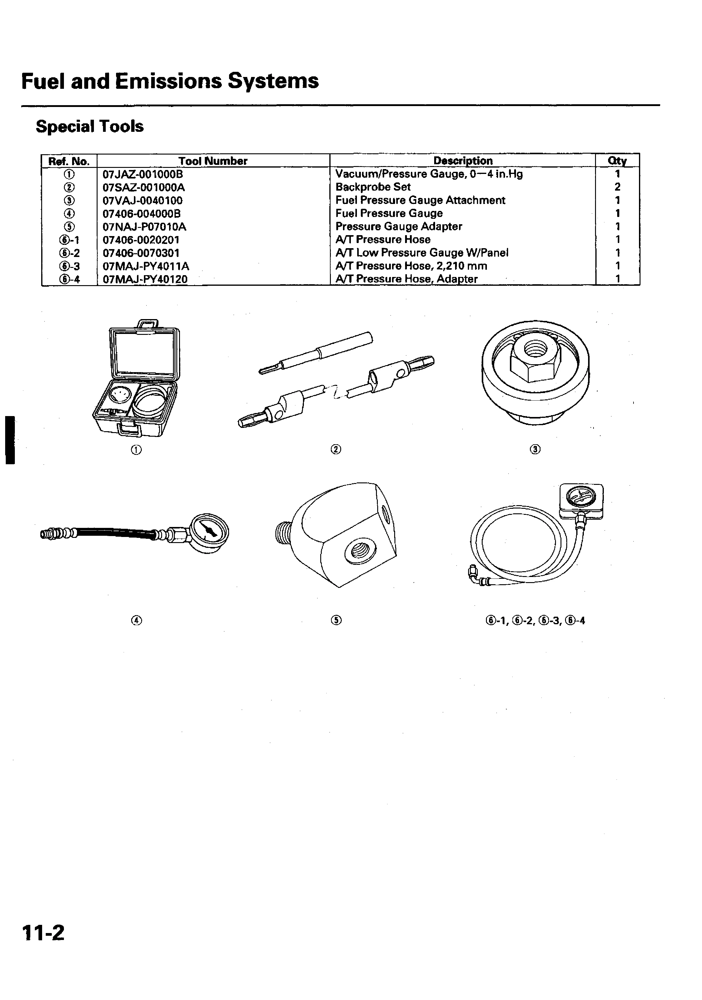
---

### General Troubleshooting Information

<a id="p299"></a>
Source: [PDF p.299, printed p.11-3](../page-images/p0299.png).

**Intermittent failures:** A system can fail and later check OK. If MIL is off, inspect related connectors for loose terminals or poor connections; ECM may extinguish MIL after intermittent fault.

**Service information:** Check for current ECM software and service procedures for the DTC or symptom.

**Opens and shorts:** Open = broken wire/connection. Short = accidental wire-to-ground or wire-to-wire connection. ECM circuits may behave incorrectly rather than stop outright.

**Using HDS or scan tool when MIL lights:**

1. Start engine and check MIL.
2. If MIL stays on, connect HDS/OBD II scan tool to DLC (A). DLC is under passenger dash on 2000–2001 and behind driver-side front console on 2002–2005.
3. Turn ignition ON (II).
4. Confirm communication with ECM and other systems; otherwise troubleshoot DLC circuit (p.11-110).
5. Note DTC and freeze data, then follow indicated DTC procedure. Freeze data records conditions at first detected malfunction, misfire or fuel-trim fault; HDS/scan tool can read DTCs, freeze and current data.
6. If no DTC, use MIL troubleshooting (p.11-106).

If MIL never lights but drivability is poor, use symptom troubleshooting. If an intermittent DTC cannot be duplicated after ECM reset, stop that procedure rather than replace ECM without evidence.
---

### General Troubleshooting Information — ECM Reset and Circuit Testing

<a id="p300"></a>
Source: [PDF p.300, printed p.11-4](../page-images/p0300.png).

After resetting ECM, perform idle learn (p.11-140). Reset using HDS/OBD II scan tool with ignition ON (II), engine off, clearing DTC; or switch ignition OFF and remove under-dash **No.25 BACK UP 7.5 A fuse** for **60 seconds**.

**End every troubleshooting session:** Reset ECM, perform idle learn, switch ignition OFF, and disconnect scan tool/HDS from DLC. Replacing ECM changes immobilizer code; rewrite it with HDS for engine start.

**ECM circuit testing:** Use digital multimeter **KS-AHM-32-003** or equivalent and backprobe set **07SAZ-001000A**. Connect backprobe adapters to patch cords and meter. Slide contoured probe gently from wire side to terminal end; when wire side is sealed/inaccessible, disconnect connector and probe from terminal side without force.

**NOTICE:** Never puncture wire insulation; punctures can cause poor or intermittent electrical connections.
---

### Substituting an ECM for Testing

<a id="p301"></a>
Source: [PDF p.301, printed p.11-5](../page-images/p0301.png).

Use a known-good donor ECM without programming it to test vehicle's key:

1. Disconnect test vehicle negative battery cable.
2. Cut temporary key from non-immobilizer blank.
3. Remove test vehicle ECM.
4. Mark removed test ECM with test VIN.
5. Disconnect donor vehicle negative battery cable.
6. Remove donor ECM and install it in test vehicle.
7. Tape donor key **head-to-head** with temporary test key (A); donor key (B) supplies recognized immobilizer code.
8. After testing, reinstall both ECMs and destroy temporary key.
9. Reconnect negative battery cable.

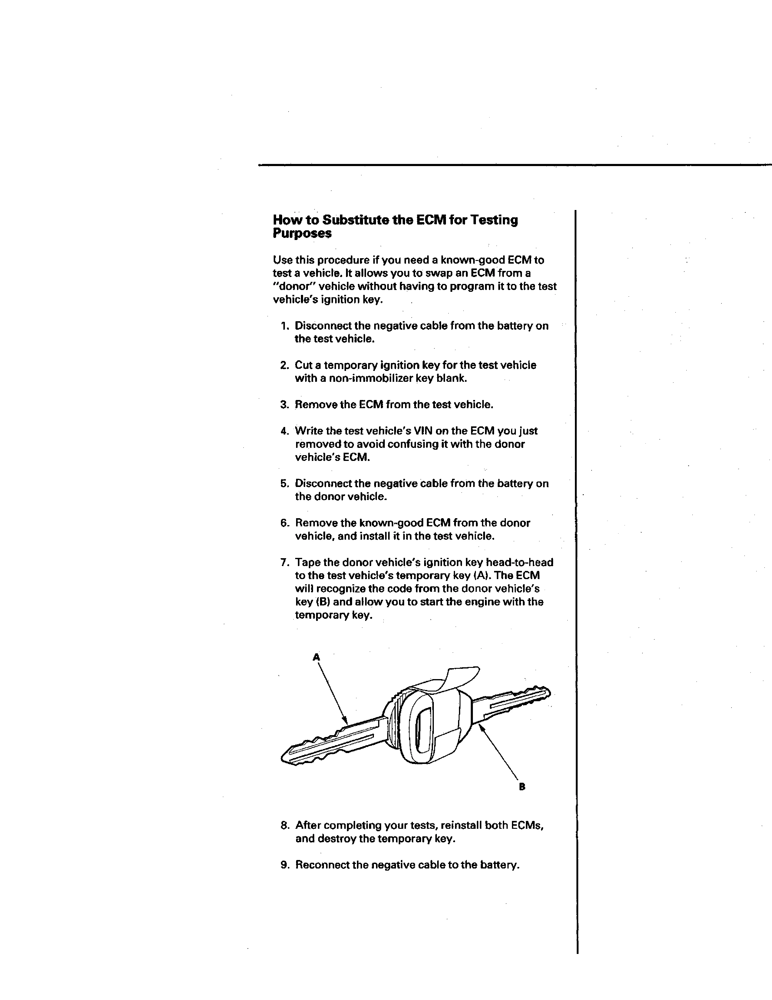
---

### DTC Troubleshooting Index — 2000–2005, Part 1

<a id="p302"></a>
Source: [PDF p.302, printed p.11-6](../page-images/p0302.png).

| DTC (MIL) | Two-cycle | Detection item | Page |
| --- | --- | --- | --- |
| P0107 (3) | — | MAP sensor circuit low voltage | 11-45 |
| P0108 (3) | — | MAP sensor circuit high voltage | 11-47 |
| P0112 (10) | — | IAT sensor circuit low voltage | 11-49 |
| P0113 (10) | — | IAT sensor circuit high voltage | 11-50 |
| P0116 (86) | P0116 | ECT sensor range/performance | 11-52 |
| P0117 (6) | — | ECT sensor circuit low voltage | 11-52 |
| P0118 (6) | — | ECT sensor circuit high voltage | 11-54 |
| P0122 (7) | — | TP sensor circuit low voltage | 11-56 |
| P0123 (7) | — | TP sensor circuit high voltage | 11-58 |
| P0125 (86)*4 | P0125 | ECT sensor malfunction/slow response | 11-59 |
| P0128 (87)*2 | P0128 | Cooling system malfunction | 11-59 |
| P0131 (1)*3 | — | Primary HO2S (sensor 1) circuit low voltage | 11-61 |
| P0131 (1)*4 | — | Primary HO2S (sensor 1) circuit low voltage | 11-62 |
| P0132 (1)*3 | — | Primary HO2S (sensor 1) circuit high voltage | 11-63 |
| P0132 (1)*4 | — | Primary HO2S (sensor 1) circuit high voltage | 11-64 |
| P0133 (61) | P0133 | Primary HO2S (sensor 1) slow response | 11-66 |
| P0134 (1)*6 | — | Primary HO2S (sensor 1) heater system malfunction | 11-67 |
| P0134 (1)*7 | — | Primary HO2S (sensor 1) heater system malfunction | 11-69 |
| P0135 (41) | — | Primary HO2S (sensor 1) heater circuit malfunction | 11-70 |
| P0137 (63) | P0136*5 / P0137*7 | Secondary HO2S (sensor 2) circuit low voltage | 11-73 |

**Footnotes:** *1 = blinking MIL with SCS line jumpered through HDS; *2 = 2002–2005; *3 = 2000–2003; *4 = 2004–2005; *5 = 2000–2004; *6 = 2004 only; *7 = 2005 only. The source table remains linked for exact model-year and MIL interpretation.

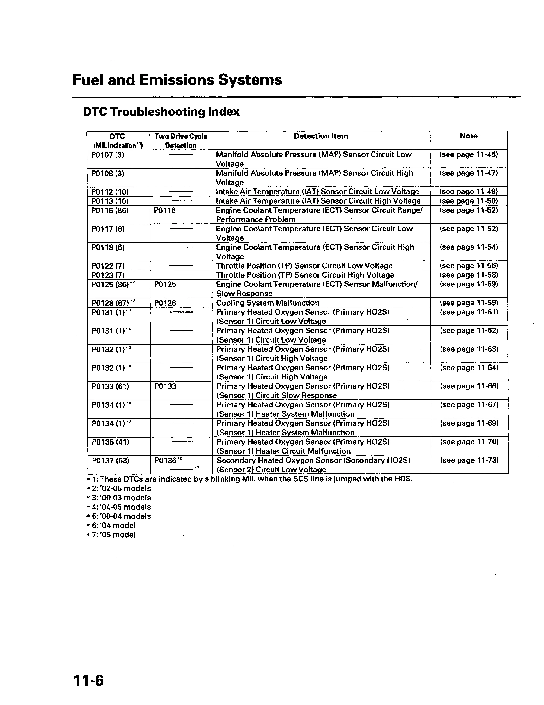
---

### DTC Troubleshooting Index — 2000–2005, Part 2

<a id="p303"></a>
Source: [PDF p.303, printed p.11-7](../page-images/p0303.png).

| DTC (MIL) | Two-cycle | Detection item | Page |
| --- | --- | --- | --- |
| P0138 (63)*5 | P0136 | Secondary HO2S (sensor 2) circuit high voltage | 11-74 |
| P0138 (63)*7 | — | Secondary HO2S (sensor 2) circuit high voltage | 11-75 |
| P0139 (63)*5 | P0139 | Secondary HO2S (sensor 2) slow response | 11-77 |
| P0141 (65) | — | Secondary HO2S (sensor 2) heater circuit malfunction | 11-70 |
| P0171 (45) | P0170*5 / P0171*7 | Fuel system too lean | 11-78 |
| P0172 (45) | P0170*5 / P0172*7 | Fuel system too rich | 11-78 |
| P0300 with P0301–P0304 | P1399*5 / P0300*7 | Random misfire detected | 11-79 |
| P0301 (71) | P1399*5 / P0301*7 | No.1 cylinder misfire | 11-80 |
| P0302 (72) | P1399*5 / P0302*7 | No.2 cylinder misfire | 11-80 |
| P0303 (73) | P1399*5 / P0303*7 | No.3 cylinder misfire | 11-80 |
| P0304 (74) | P1399*5 / P0304*7 | No.4 cylinder misfire | 11-80 |
| P0325 (23) | — | Knock sensor circuit malfunction | 11-85 |
| P0335 (4) | — | CKP sensor no signal | 11-86 |
| P0336 (4)*3 | — | CKP sensor intermittent interruption | 11-86 |
| P0339 (4)*4 | — | CKP sensor intermittent interruption | 11-86 |
| P0340 (8)*4 | — | CMP sensor A no signal | 11-88 |
| P0344 (8)*4 | — | CMP sensor A intermittent interruption | 11-88 |
| P0365 (58) | — | CMP sensor B no signal | 11-89 |
| P0369 (58)*4 | — | CMP sensor B intermittent interruption | 11-89 |

**Footnotes:** *1 = blinking MIL with SCS line jumpered through HDS; *2 = 2002–2005; *3 = 2000–2003; *4 = 2004–2005; *5 = 2000–2004; *6 = 2004 only; *7 = 2005 only. The source table remains linked for exact model-year and MIL interpretation.

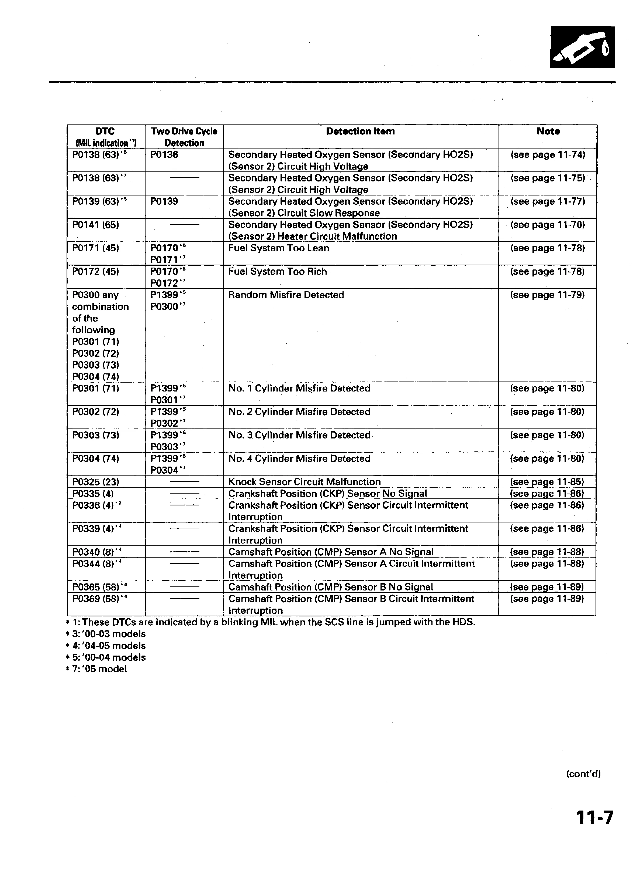
---

### DTC Troubleshooting Index — 2000–2005, Part 3

<a id="p304"></a>
Source: [PDF p.304, printed p.11-8](../page-images/p0304.png).

| DTC (MIL) | Two-cycle | Detection item | Page |
| --- | --- | --- | --- |
| P0410 (60) | P0410 | Air pump circuit malfunction | 11-198 |
| P0411 (60) | P0411 | Secondary air injection system incorrect flow | 11-202 |
| P0420 (67) | P0420 | Catalyst system efficiency below threshold | 11-170 |
| P0451 (91) | P0451 | FTP sensor circuit range/performance | 11-174 |
| P0452 (91) | P0450*5 / P0452*7 | FTP sensor circuit low voltage | 11-175 |
| P0453 (91) | P0450*5 / P0453*7 | FTP sensor circuit high voltage | 11-177 |
| P0497 (90) | P0497 | EVAP system low purge flow | 11-179 |
| P0500 (17) | — | VSS circuit malfunction | 11-91 |
| P0505 (14)*3 | — | Idle control system malfunction | 11-128 |
| P0506 (14)*4 | P0506 | Idle air control RPM lower than expected | 11-129 |
| P0507 (14)*4 | P0507 | Idle air control RPM higher than expected | 11-130 |
| P0511 (14)*4 | — | IAC valve circuit malfunction | 11-131 |
| P0607 (—)*4 | — | ECM internal circuit malfunction | 11-93 |
| P0630 (139)*4 | — | VIN not programmed or mismatch | 11-94 |
| P1106 (13)*3 | P1106 | BARO sensor range/performance | 11-95 |
| P1107 (13)*3 | — | BARO sensor circuit low voltage | 11-95 |
| P1108 (13)*3 | — | BARO sensor circuit high voltage | 11-95 |
| P1109 (13)*4 | — | BARO sensor circuit out of range high | 11-96 |
| P1121 (7) | P1121 | TP sensor signal lower than expected | 11-97 |
| P1122 (7) | P1122 | TP sensor signal higher than expected | 11-97 |
| P1128 (5) | P1128 | MAP sensor signal lower than expected | 11-98 |
| P1129 (5) | P1129 | MAP sensor signal higher than expected | 11-98 |

**Footnotes:** *1 = blinking MIL with SCS line jumpered through HDS; *3 = 2000–2003; *4 = 2004–2005; *5 = 2000–2004; *6 = 2004 only; *7 = 2005 only.

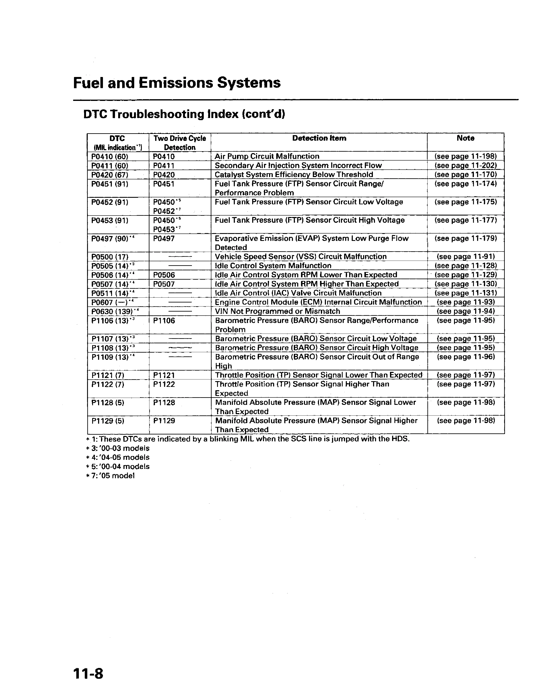
---

### DTC Troubleshooting Index — 2000–2005, Part 4

<a id="p305"></a>
Source: [PDF p.305, printed p.11-9](../page-images/p0305.png).

| DTC (MIL) | Two-cycle | Detection item | Page |
| --- | --- | --- | --- |
| P1259 (22)*3 | P1257 | VTEC system malfunction | 11-117 |
| P1297 (20) | — | ELD circuit low voltage | 11-99 |
| P1298 (20) | — | ELD circuit high voltage | 11-100 |
| P1361 (8)*3 | — | CMP sensor A circuit intermittent interruption | 11-88 |
| P1362 (8)*3 | — | CMP sensor A no signal | 11-88 |
| P1366 (58)*3 | — | CMP sensor B circuit intermittent interruption | 11-89 |
| P1367 (58)*3 | — | CMP sensor B no signal | 11-89 |
| P1410 (60)*3 | P1410 | Air pump malfunction | 11-204 |
| P1415 (83) | — | Air pump electrical current sensor circuit low voltage | 11-205 |
| P1416 (83) | — | Air pump electrical current sensor circuit high voltage | 11-207 |
| P1456 (90) | P1456 | EVAP control system leakage, fuel tank system | 11-183 |
| P1457 (90) | P1457 | EVAP control system leakage, canister system | 11-188 |
| P1519 (14)*3 | — | IAC valve circuit malfunction | 11-131 |
| P1607 (—)*3 | — | ECM internal circuit malfunction | 11-93 |
| P2195 (1)*6 | — | Primary HO2S (sensor 1) circuit low voltage | 11-102 |
| P2195 (1)*7 | — | Primary HO2S (sensor 1) circuit low voltage | 11-103 |
| P2227 (13)*4 | P2227 | BARO sensor range/performance | 11-95 |
| P2228 (13)*4 | — | BARO sensor circuit low voltage | 11-95 |
| P2229 (13)*4 | — | BARO sensor circuit high voltage | 11-95 |
| P2270 (63)*4 | P2270*7 | Secondary HO2S (sensor 2) signal stuck lean | 11-104 |
| P2271 (63)*4,*6 | P2271*7 | Secondary HO2S (sensor 2) signal stuck rich | 11-105 |
| P2279 (109)*4 | P2279 | Intake air system leak detected | 11-171 |
| P2297 (1)*4 | — | Primary HO2S (sensor 1) circuit high voltage | 11-105 |
| P2445 (60)*4 | P2445 | Air pump malfunction | 11-204 |
| P2646 (22)*4 | — | Rocker arm (VTEC) oil pressure switch circuit low voltage | 11-121 |
| P2647 (22)*4 | — | Rocker arm (VTEC) oil pressure switch circuit high voltage | 11-124 |

**Footnotes:** *1 = blinking MIL with SCS line jumpered through HDS; *3 = 2000–2003; *4 = 2004–2005; *5 = 2000–2004; *6 = 2004 only; *7 = 2005 only.

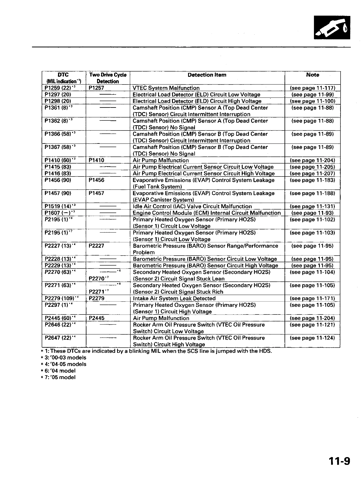
---

### Printed page 11-10

<a id="p306"></a>
Source: [PDF p.306, printed p.11-10](../page-images/p0306.png).

# Fuel and Emissions Systems
## Symptom Troubleshooting Index

These symptoms DO NOT trigger diagnostic trouble codes (DTCs) or cause the malfunction indicator lamp (MIL) to come on. If the MIL is reported on, check for DTCs. If the vehicle has one of these symptoms, do the diagnostic procedure for it, in the sequence listed, until you find the cause.

---

### Engine will not start
**(MIL works OK, no DTCs set)**
1. Test the battery (see page 22-47).
2. Test the starter (see page 4-7).
3. Test the fuel pump (see page 11-147).
4. Troubleshoot the PGM-FI main relay circuit (see page 11-142).

**Also check for:**
* Low compression
* No ignition spark
* Intake air leaks
* Locked up engine
* Broken cam chain
* Contaminated fuel

---

### Engine will not start
**(MIL comes on and stays on, or never comes on at all, no DTCs set)**
Troubleshoot the MIL circuit (see page 11-106).

---

### Engine will not start
**(immobilizer indicator stays on or flashes)**
Troubleshoot the immobilizer system (see page 22-192).

---

### Engine is hard to start
**(MIL works OK, no DTCs set)**
1. Test the battery (see page 22-47).
2. Check the fuel pressure (see page 11-145).

**Also check for:**
* Low compression
* Intake air leaks
* Contaminated fuel

---

### Cold fast idle too low
**(MIL works OK, no DTCs set)**
1. Do the E C M idle learn procedure (see page 11-140).
2. Check the idle speed (see page 11-140).

---

### Cold fast idle too high
**(MIL works OK, no DTCs set)**
1. Do the E C M idle learn procedure (see page 11-140).
2. Check the idle speed (see page 11-140).
3. Inspect/adjust the throttle cable (see page 11-168).
4. Test the throttle body (see page 11-163).

---

### Intake air leaks
**Idle speed fluctuates**
**(MIL works OK, no DTCs set)**
1. Do the E C M idle learn procedure (see page 11-140).
2. Check the idle speed (see page 11-140).
3. Inspect/adjust the throttle cable (see page 11-168).
4. Test the throttle body (see page 11-163).
5. Troubleshoot the A/C signal circuit (see page 11-133).

---

### Incorrect valve timing or clearance adjustment
**After warming up, idle speed is below specification without load**
**(MIL works OK, no DTCs set)**
1. Do the E C M idle learn procedure (see page 11-140).
2. Troubleshoot the alternator FR signal circuit (see page 11-135).
3. Troubleshoot the electrical power steering (EPS) signal circuit (see page 11-137).
4. Test the throttle body (see page 11-163).

**Also check for:**
* Faulty throttle cable
* Incorrect valve timing or clearance adjustment

---

### After warming up, idle speed is above specification without load
**(MIL works OK, no DTCs set)**
1. Do the E C M idle learn procedure (see page 11-140).
2. Troubleshoot the alternator FR signal circuit (see page 11-135).
3. Inspect the TP Sensor (see page 11-164).
4. Troubleshoot the A/C signal circuit (see page 11-133).
5. Troubleshoot the electrical power steering (EPS) signal circuit (see page 11-137).

**Also check for:**
* Intake air leaks

---
---

### Printed page 11-11

<a id="p307"></a>
Source: [PDF p.307, printed p.11-11](../page-images/p0307.png).

# Symptom Diagnostic procedure

## Low power
**(MIL works OK, no DTCs set)**

1. Test the fuel pressure (see page 11-145).
2. Test the throttle body (see page 11-163).
3. Inspect/adjust the throttle cable (see page 11-168).

**Possible causes:**
* Low compression
* Incorrect camshaft timing
* Incorrect engine oil level

## Engine stalls
**(MIL works OK, no DTCs set)**

1. Do the idle learn procedure (see page 11-140).
2. Test the fuel pressure (see page 11-145).
3. Check the idle speed (see page 11-140).
4. Troubleshoot the brake pedal position switch signal circuit (see page 11-139).

**Possible causes:**
* Intake air leaks
* Faulty harness and sensor connections

## Difficult to refuel
**(MIL works OK, no DTCs set)**

1. Test the fuel tank vapor control valve (see page 11-195).
2. Inspect the fuel tank signal tube between the fuel pipe and the fuel tank vapor control valve.
3. Inspect the fuel tank vent tube between the EVAP canister and the fuel tank vapor control valve.
4. Check the EVAP canister.

## Fuel overflows during refueling
**(No DTCs set)**

Replace the fuel tank vapor control valve (see page 11-196).

**Also check for:** Malfunctioning gas station filling nozzle.
---

### Printed page 11-12

<a id="p308"></a>
Source: [PDF p.308, printed p.11-12](../page-images/p0308.png).

# Fuel and Emissions Systems
## System Description
### Electronic Control System
The functions of the fuel and emissions control systems are managed by the engine control module (ECM).

### Fail-safe Function
When an abnormality occurs in the signal from a sensor, the ECM ignores the signal and assumes a pre-programmed value for the sensor that allows the engine to continue to run.

### Back-up Function
When an abnormality occurs in the ECM, the injectors are controlled by a back-up circuit independent of the system to permit minimal driving.

### Self-diagnosis
When an abnormality occurs in the signal from a sensor, the ECM supplies ground for the malfunction indicator lamp (MIL) and stores the diagnostic trouble code (DTC) in erasable memory. When the ignition is first turned on (II), the ECM supplies ground to the MIL for 15 to 20 seconds to check the MIL bulb condition. If all readiness codes are not set, the MIL will flash five times. If readiness codes are set to complete, the MIL will go out. The MIL may be turned off by the ECM if the problem that originally caused the MIL to be illuminated is an intermittent one.

### Two Driving Cycle Detection Method
To prevent false indications, the "two driving cycle detection method" is used for some self-diagnostic functions.
When an abnormality occurs, the ECM stores it in its memory. When the same abnormality recurs after the ignition switch is turned OFF and ON (II) again, the ECM turns on the MIL.
---

### Printed page 11-13

<a id="p309"></a>
Source: [PDF p.309, printed p.11-13](../page-images/p0309.png).

# ECM Data

The ECM data can be retrieved through an OBD II scan tool or HDS at the data link connector (DLC). These entries conform to SAE recommended practice; the HDS also reads additional data. Operating values are approximate. Unless noted, idle means a fully warmed engine in neutral with the A/C and accessories off.

| Data | Description | Operating value | Freeze data |
| --- | --- | --- | --- |
| Diagnostic trouble code (DTC) | The ECM stores a letter and four digits for a detected problem: SAE P0xxx/P2xxx or Honda P1xxx. | No output if no problem is detected | Yes |
| Engine speed | Computed from CKP sensor signals to determine injection timing and amount. | Nearly tachometer indication; idle 800 ± 50 rpm | Yes |
| Vehicle speed | Converted from VSS pulses. | Nearly speedometer indication | Yes |
| Manifold absolute pressure (MAP) | Intake manifold absolute pressure under engine load and speed. | Engine stopped: nearly atmospheric pressure; idle: 28–48 kPa (8.3–14.2 inHg, 210–360 mmHg) | Yes |
| Engine coolant temperature (ECT) | ECT thermistor converts coolant temperature to a voltage for fuel control. | Cold: ambient temperature and IAT; warm: about 176–212 °F (80–100 °C) | Yes |
| Primary and secondary heated oxygen sensors (HO2S, sensors 1 and 2) | Exhaust oxygen signals control air/fuel ratio; a leaner mixture gives lower sensor voltage, a richer mixture higher. | 0.0–1.4 V; idle about 0.1–0.9 V | No |

*Continued on printed p.11-14.*
---

### Printed page 11-14

<a id="p310"></a>
Source: [PDF p.310, printed p.11-14](../page-images/p0310.png).

# Fuel and Emissions Systems
## System Description (cont'd)
### ECM Data (cont'd)

#### Fuel system data

**Fuel System Status**
Fuel system status is indicated as "open" or "closed".
*   **Closed:** Based on the H02S output, the ECM determines the air/fuel ratio and controls the amount of injected fuel.
*   **Open:** Ignoring H02S output, the ECM refers to signals from the throttle position (TP), manifold absolute pressure (MAP), intake air temperature (IAT), barometric pressure (BARO) and engine coolant temperature (ECT) sensors to control the amount of injected fuel.

**Operating value:** closed at idle. **Freeze data:** yes.

**Short Term Fuel Trim**
The air fuel ratio correction coefficient for correcting the amount of injected fuel when the Fuel System Status is "closed". When the ratio is leaner than the stoichiometric ratio, the ECM increases short term fuel trim gradually, and the amount of injected fuel increases. The air fuel ratio gradually gets richer, causing a lower oxygen content in the exhaust gas. Consequently, the short term fuel trim is lowered, and the ECM reduces the amount of injected fuel. This cycle keeps the air/fuel ratio close to the stoichiometric ratio when in closed loop status.

**Operating value:** 0.73–1.47. **Freeze data:** yes.

**Long Term Fuel Trim**
Long term fuel trim is computed from short term fuel trim and indicates changes occurring in the fuel supply system over a long period.
*   If long term fuel trim is higher than 1.00, the amount of injected fuel must be increased.
*   If it is lower than 1.00, the amount of injected fuel must be reduced.

**Operating value:** 0.80–1.20. **Freeze data:** yes.

**Intake Air Temperature (IAT)**
The IAT sensor converts intake air temperature into voltage and signals the ECM. When intake air temperature is low, the internal resistance of the sensor increases, and the voltage signal is higher.
*   **With cold engine:** Same as ambient temperature and ECT

**Freeze data:** yes.

**Throttle Position**
Based on the accelerator pedal position, the opening angle of the throttle valve is indicated.
*   **At idle speed:** about 6%

**Freeze data:** yes.

**Ignition Timing**
Ignition timing is the ignition advance angle set by the ECM. The ECM matches ignition timing to the driving conditions.
*   **At idle speed:** 5° ± 5° BTDC with the SCS service signal line jumped with the HDS.

**Freeze data:** no.

**Calculated Load Value (CLV)**
CLV is the engine load calculated from the MAP data.
*   **At idle speed:** 22–42%
*   **At 2,500 rpm without load:** 27–48%

**Freeze data:** yes.
---

### Printed page 11-15

<a id="p311"></a>
Source: [PDF p.311, printed p.11-15](../page-images/p0311.png).

# ECM Electrical Connections

The source diagram shows ECM connections to the power supply, PGM-FI main relay, starter circuit, CMP/CKP and knock sensors, injectors, idle air control valve, MIL, alternator, immobilizer, and data link connector. Use the diagram for exact pin, fuse, and wire routing.

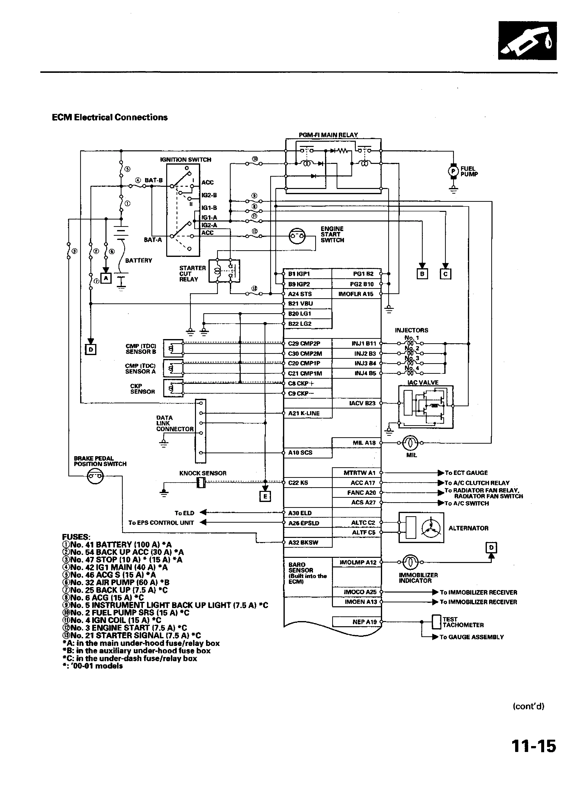
---

### Printed page 11-16

<a id="p312"></a>
Source: [PDF p.312, printed p.11-16](../page-images/p0312.png).

# ECM Electrical Connections (continued)

The source diagram shows ECM connections to the TP, FTP, VSS, MAP, oxygen, ECT and IAT sensors; ignition coils; air pump; EVAP valves; and VTEC oil-control circuit. Connector A/B/C terminal locations appear at the bottom of the diagram. Use the diagram for exact pin and wire routing.

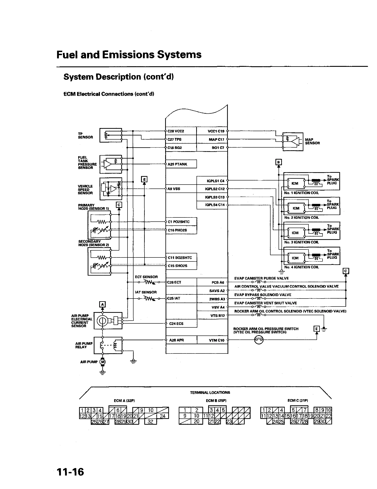
---

### Printed page 11-17

<a id="p313"></a>
Source: [PDF p.313, printed p.11-17](../page-images/p0313.png).

# ECM Inputs and Outputs at Connector A (32P)

| Terminal number | Wire color | Terminal name | Description and signal |
| --- | --- | --- | --- |
1 | YEL/GRN | MTR T/W | Sends ECT signal to ECT gauge. With ignition switch ON (II): duty controlled.
2 | RED | SAVS (AIR CONTROL VALVE VACUUM CONTROL SOLENOID VALVE) | Drives air control valve vacuum control solenoid valve. With ignition switch ON (II): battery voltage. With air pump working: about 0 V.
3 | ORN | 2WBS (EVAP BYPASS SOLENOID VALVE) | Drives EVAP bypass solenoid valve. With ignition switch ON (II): battery voltage.
4 | LT GRN/WHT | VSV (EVAP CANISTER VENT SHUT VALVE) | Drives EVAP canister vent shut valve. With ignition switch ON (II): battery voltage.
6 | RED/YEL | PCS (EVAP CANISTER PURGE VALVE) | Drives EVAP canister purge valve. With engine running, engine coolant below 149 °F (65 °C): battery voltage. With engine running, engine coolant above 149 °F (65 °C): duty controlled.
9 | BLU/WHT | VSS (VEHICLE SPEED SENSOR (VSS) INPUT SIGNAL) | Sends vehicle speed sensor (VSS) input signal. Depending on vehicle speed: pulses.
10 | BRN | SCS (SERVICE CHECK SIGNAL) | Detects service check connector signal (the signal causing a DTC indication). With the service check signal shorted with the HDS: about 0 V. With the service check signal opened: about 5.0 V or battery voltage.
12 | PNK | IMO LMP (IMMOBILIZER INDICATOR) | Drives immobilizer indicator. With immobilizer indicator turned ON: about 0 V. With immobilizer indicator turned OFF: battery voltage.
13 | PNK/BLU | IMO EN (IMMOBILIZER ENABLE SIGNAL) | Sends immobilizer enable signal.
15 | GRN/YEL | IMO FLR (IMMOBILIZER FUEL PUMP RELAY) | Drives fuel pump relay. 0 V for 2 seconds after turning ignition switch ON (II), then battery voltage.
17 | RED | ACC (A/C CLUTCH RELAY) | Drives A/C clutch relay. With compressor ON: about 0 V. With compressor OFF: battery voltage.
18 | GRN/ORN | MiL (MALFUNCTION INDICATOR LAMP) | Drives MIL. With MIL turned ON: about 0 V. With MIL turned OFF: battery voltage.
19 | BLU | NEP (ENGINE SPEED PULSE) | Outputs engine speed pulse. With engine running: pulses.
20 | GRN | FANC (RADIATOR FAN CONTROL) | Drives radiator fan relay. With radiator fan running: about 0 V. With radiator fan stopped: battery voltage.

**Wire side of female terminals**

> **NOTE:** Standard battery voltage is about 12 V.

---

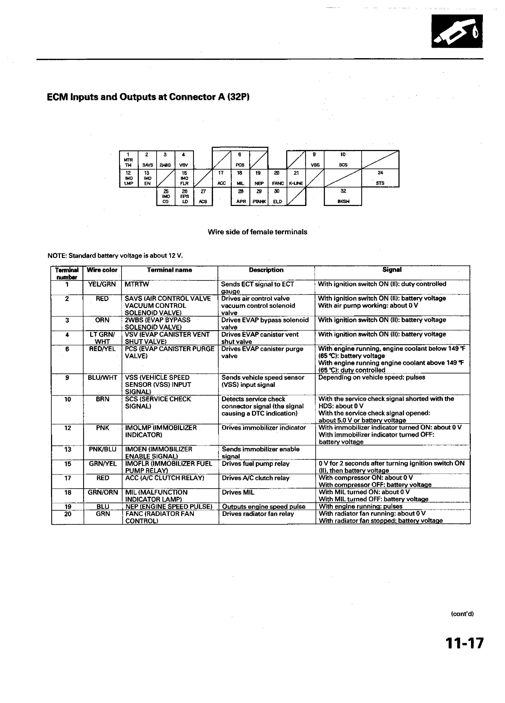
---

### Printed page 11-18

<a id="p314"></a>
Source: [PDF p.314, printed p.11-18](../page-images/p0314.png).

# Fuel and Emissions Systems
## System Description (cont'd)
### ECM Inputs and Outputs at Connector A (32P)

**Wire side of female terminals**

> **NOTE:** Standard battery voltage is about 12 V.

| Terminal number | Wire color | Terminal name | Description | Signal |
| :--- | :--- | :--- | :--- | :--- |
| 21 | GRY | K-LINE | Sends and receives scan tool signal | With ignition switch ON (II): battery voltage |
| 24 | BLU/ORN | STS (STARTER SWITCH SIGNAL) | Detects starter switch signal | With starter switch ON (III): battery voltage<br>With starter switch OFF: about 0 V |
| 25 | RED/BLU | IMOCO (IMMOBILIZER CODE) | Detects immobilizer signal | - |
| 26 | BLU/BLK | EPSLD (ELECTRICAL P/S LOAD DETECT) | Detects P/S load signal | With steering wheel at full lock: battery voltage momentarily<br>With steering wheel stationary: about 0 V |
| 27 | BLU/RED | ACS (A/C SWITCH SIGNAL) | Detects A/C switch signal | With A/C switch ON: about 0 V<br>With A/C switch OFF: about 5.0 V |
| 28 | BLU | APR (AIR PUMP RELAY) | Drives air pump relay | With ignition switch ON (II): about 0 V<br>With air pump working: battery voltage |
| 29 | LT GRN | PTANK (FUEL TANK PRESSURE (FTP) SENSOR) | Detects fuel tank pressure (FTP) sensor signal | With ignition switch ON (II) and fuel fill cap opened: about 2.5 V |
| 30 | GRN/RED | ELD (ELECTRICAL LOAD DETECTOR) | Detects ELD signal | With parking lights turned on at idle: about 2.5-3.5 V<br>With high beam headlights turned on at idle: about 1.5-2.5 V |
| 32 | WHT/BLK | BKSW (BRAKE PEDAL POSITION SWITCH) | Detects brake pedal position switch signal | With brake pedal released: about 0 V<br>With brake pedal pressed: battery voltage |
---

### Printed page 11-19

<a id="p315"></a>
Source: [PDF p.315, printed p.11-19](../page-images/p0315.png).

# ECM Inputs and Outputs at Connector B (25P)

**Wire side of female terminals**

> **NOTE:** Standard battery voltage is about 12 V.

| Terminal number | Wire color | Terminal name | Description | Signal |
| :--- | :--- | :--- | :--- | :--- |
| 1 | YEL/BLK | IGP1 (POWER SOURCE) | Power source for ECM control circuit | With ignition switch ON (II): battery voltage<br>With ignition switch OFF: about 0 V |
| 2 | BLK | PG1 (POWER GROUND) | Ground for ECM control circuit | Less than 1.0 V at all times |
| 3 | RED | INJ2 (No. 2 INJECTOR) | Drives No. 2 injector | With ignition switch ON (II): battery voltage<br>With engine running: duty controlled |
| 4 | BLU | INJ3 (No. 3 INJECTOR) | Drives No. 3 injector | With ignition switch ON (II): battery voltage<br>With engine running: duty controlled |
| 5 | YEL | INJ4 (No. 4 INJECTOR) | Drives No. 4 injector | With ignition switch ON (II): battery voltage<br>With engine running: duty controlled |
| 9 | YEL/BLK | IGP2 (POWER SOURCE) | Power source for ECM control circuit | With ignition switch ON (II): battery voltage<br>With ignition switch OFF: about 0 V |
| 10 | BLK | PG2 (POWER GROUND) | Ground for ECM control circuit | Less than 1.0 V at all times |
| 11 | BRN | INJ1 (No. 1 INJECTOR) | Drives No. 1 injector | With ignition switch ON (II): battery voltage<br>With engine running: duty controlled |
| 12 | GRN/YEL | VTS (ROCKER ARM OIL CONTROL SOLENOID (VTEC SOLENOID VALVE)) | Drives rocker arm oil control solenoid (VTEC solenoid valve) | With engine at low rpm: about 0 V<br>With engine at high rpm: battery voltage |
| 20 | BRN/YEL | LG1 (LOGIC GROUND) | Ground for ECM control circuit | Less than 1.0 V at all times |
| 21 | WHT/RED | VBU (VOLTAGE BACK UP) | Power source for ECM control circuit<br>Power source for DTC memory | Battery voltage at all times |
| 22 | BRN/YEL | LG2 (LOGIC GROUND) | Ground for ECM control circuit | Less than 1.0 V at all times |
| 23 | BLK/RED | IACV (IDLE AIR CONTROL VALVE) | Drives IAC valve | With engine running: duty controlled |
---

### Printed page 11-20

<a id="p316"></a>
Source: [PDF p.316, printed p.11-20](../page-images/p0316.png).

# Fuel and Emissions Systems
## System Description (cont'd)
### ECM Inputs and Outputs at Connector C (31P)

| Terminal number | Wire color | Terminal name | Description | Signal |
| :--- | :--- | :--- | :--- | :--- |
| 1 | BLK/WHT | PO2SHTC (PRIMARY HEATED OXYGEN SENSOR HEATER CONTROL) | Drives primary heated oxygen sensor heater | With ignition switch ON (II): battery voltage<br>With fully warmed up engine running: duty controlled |
| 2 | WHT/GRN | ALTC (ALTERNATOR CONTROL) | Sends alternator control signal | With fully warmed up engine running: about 8.0 V<br>With engine running at low electrical load: about 0 V |
| 4 | WHT | IGPLS1 (No. 1 IGNITION COIL PULSE) | Drives No. 1 ignition coil | With ignition switch ON (II): about 0 V<br>With engine running: pulses |
| 5 | WHT/RED | ALTF (ALTERNATOR FR SIGNAL) | Detects alternator FR signal | With fully warmed up engine running: about 0 V—battery voltage (depending on electrical load) |
| 7 | GRN/WHT | SG1 (SENSOR GROUND) | Ground for MAP sensor | Less than 1.0 V at all times |
| 8 | BLU | CKP+ (CKP SENSOR P+ SIDE) | Detects CKP sensor | With engine running: pulses |
| 9 | WHT | CKP- (CKP SENSOR M- SIDE) | Ground for CKP sensor | - |
| 10 | BLU/BLK | VTM (ROCKER ARM OIL PRESSURE SWITCH (VTEC OIL PRESSURE SWITCH) SIGNAL) | Detects rocker arm oil pressure switch (VTEC oil pressure switch) signal | With engine at low engine speed: about 0 V<br>With engine at high engine speed (vehicle running): battery voltage |
| 11 | BLK/WHT | SO2SHTC (SECONDARY HEATED OXYGEN SENSOR HEATER CONTROL) | Drives secondary heated oxygen sensor heater | With ignition switch ON (II): battery voltage<br>With fully warmed up engine running: duty controlled |
| 12 | WHT/GRN | IGPLS2 (No. 2 IGNITION COIL PULSE) | Drives No. 2 ignition coil | With ignition switch ON (II): about 0 V<br>With engine running: pulses |
| 13 | WHT/BLK | IGPLS3 (No. 3 IGNITION COIL PULSE) | Drives No. 3 ignition coil | With ignition switch ON (II): about 0 V<br>With engine running: pulses |
| 14 | WHT/BLU | IGPLS4 (No. 4 IGNITION COIL PULSE) | Drives No. 4 ignition coil | With ignition switch ON (II): about 0 V<br>With engine running: pulses |
| 15 | WHT/RED | SH02S (SECONDARY HEATED OXYGEN SENSOR, SENSOR 2) | Detects secondary heated oxygen sensor (sensor 2) signal | With throttle fully opened from idle with fully warmed up engine: above 0.6 V<br>With throttle quickly closed: below 0.4 V |
| 16 | WHT | PH02S (PRIMARY HEATED OXYGEN SENSOR, SENSOR 1) | Detects primary heated oxygen sensor (sensor 1) signal | With throttle fully opened from idle with fully warmed up engine: above 0.6 V<br>With throttle quickly closed: below 0.4 V |
| 17 | GRN/RED | MAP (MANIFOLD ABSOLUTE PRESSURE SENSOR) | Detects MAP sensor signal | With ignition switch ON (II): about 3.0 V<br>At idle: about 1.0 V (depending on engine speed) |
| 18 | GRN/YEL | SG2 (SENSOR GROUND) | Sensor ground | Less than 1.0 V at all times. |
| 19 | YEL/RED | VCC1 (SENSOR VOLTAGE) | Power source to MAP sensor | With ignition switch ON (II): about 5.0 V<br>With ignition switch OFF: about 0 V |

**Wire side of female terminals**

> **NOTE:** Standard battery voltage is about 12 V.

---

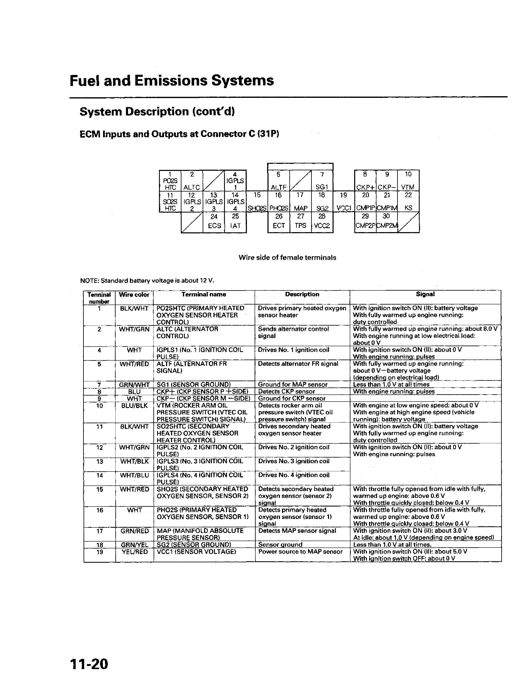
---

### Printed page 11-21

<a id="p317"></a>
Source: [PDF p.317, printed p.11-21](../page-images/p0317.png).

# ECM Inputs and Outputs at Connector C (31P)

**Wire side of female terminals**

> **NOTE:** Standard battery voltage is about 12 V.

### Terminal Details

| Terminal Number | Wire Color | Terminal Name | Description | Signal Behavior |
| :--- | :--- | :--- | :--- | :--- |
| 20 | GRN | CMP1P (CAMSHAFT POSITION (CMP) SENSOR (TOP DEAD CENTER (TDC) SENSOR) A P SIDE) | Detects CMP (TDC) sensor A | With engine running: pulses |
| 21 | RED | CMP1M (CAMSHAFT POSITION (CMP) SENSOR (TOP DEAD CENTER (TDC) SENSOR) A M SIDE) | Ground for CMP (TDC) sensor A | - |
| 22 | RED/BLU | KS (KNOCK SENSOR) | Detects knock sensor signal | With engine knocking: pulses |
| 24 | WHT/BLK | ECS (AIR PUMP ELECTRICAL CURRENT SENSOR) | Detects air pump electrical current sensor signal | With ignition switch ON (II): about 0.5 V<br>With air pump working: about 2.0–5.0 V |
| 25 | RED/YEL | IAT (INTAKE AIR TEMPERATURE SENSOR) | Detects IAT sensor signal | With ignition switch ON (II): about 0.1–4.8 V (depending on intake air temperature) |
| 26 | RED/WHT | ECT (ENGINE COOLANT TEMPERATURE SENSOR) | Detects ECT sensor signal | With ignition switch ON (II): about 0.1–4.8 V (depending on engine coolant temperature) |
| 27 | RED/BLK | TPS (THROTTLE POSITION SENSOR) | Detects TP sensor signal | With throttle fully open: about 4.8 V<br>With throttle fully closed: about 0.3 V |
| 28 | YEL/BLU | VCC2 (SENSOR VOLTAGE) | Provides sensor voltage | With ignition switch ON (II): about 5.0 V<br>With ignition switch OFF: about 0 V |
| 29 | YEL | CMP2P (CAMSHAFT POSITION (CMP) SENSOR (TOP DEAD CENTER (TDC) SENSOR) B P SIDE) | Detects CMP (TDC) sensor B | With engine running: pulses |
| 30 | BLK | CMP2M (CAMSHAFT POSITION (CMP) SENSOR (TOP DEAD CENTER (TDC) SENSOR) B M SIDE) | Ground for CMP (TDC) sensor B | - |

*(cont'd)*

**Page Reference:** 11-21

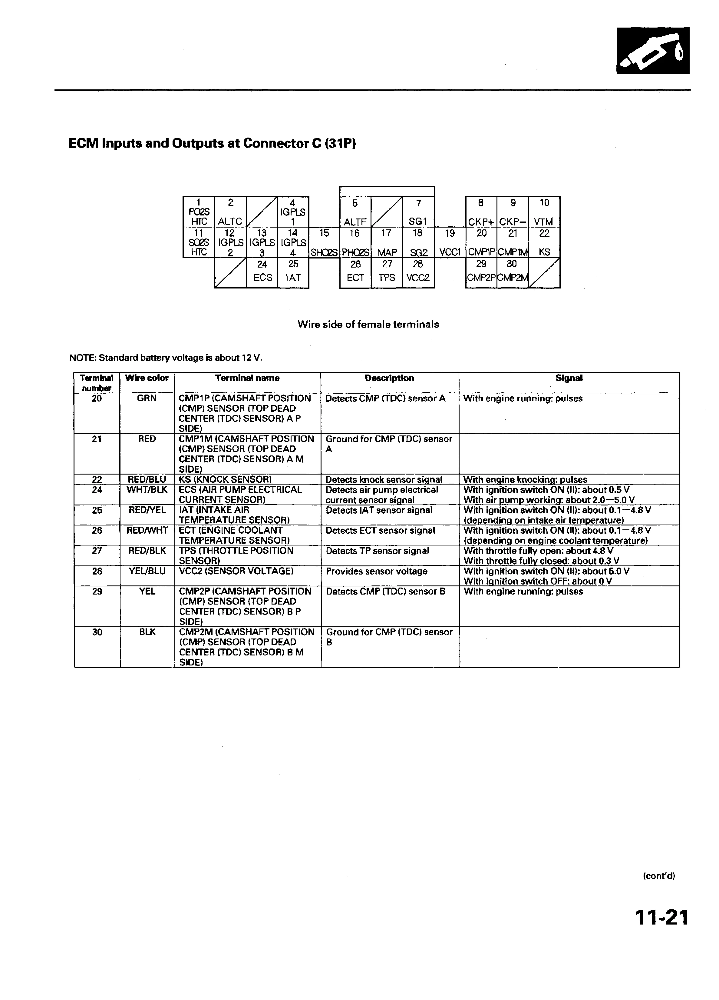
---

### Printed page 11-22

<a id="p318"></a>
Source: [PDF p.318, printed p.11-22](../page-images/p0318.png).

# Vacuum Hose Routing

The diagram identifies the fuel pressure regulator, air control valve, air control valve vacuum control solenoid valve, air control vacuum check valve and reservoir, EVAP canister purge valve, and purge joint. Follow the source diagram for hose routing.

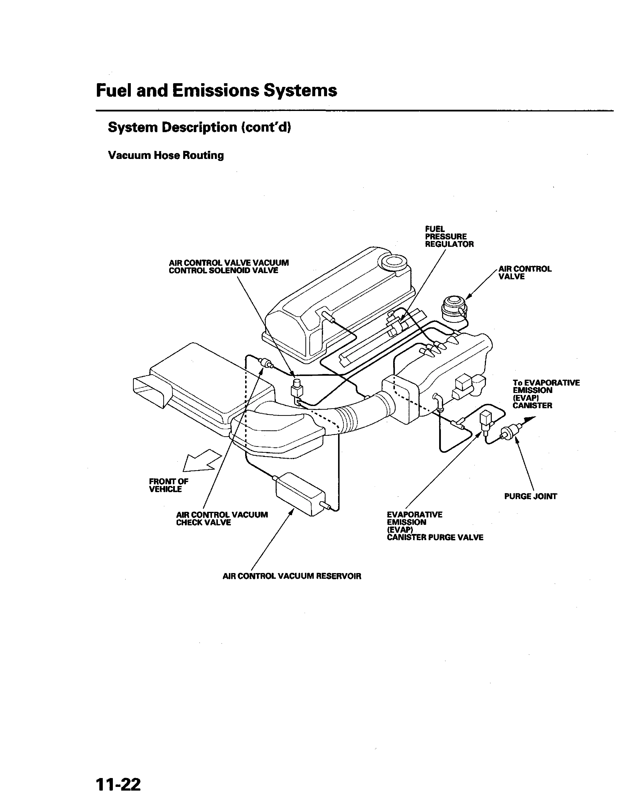
---

### Printed page 11-23

<a id="p319"></a>
Source: [PDF p.319, printed p.11-23](../page-images/p0319.png).

# Vacuum Distribution

The numbered source diagram maps the fuel, intake, air-pump, oxygen-sensor, PCV, and EVAP components and their connections. Follow the numbered source legend for exact component locations and line routing.

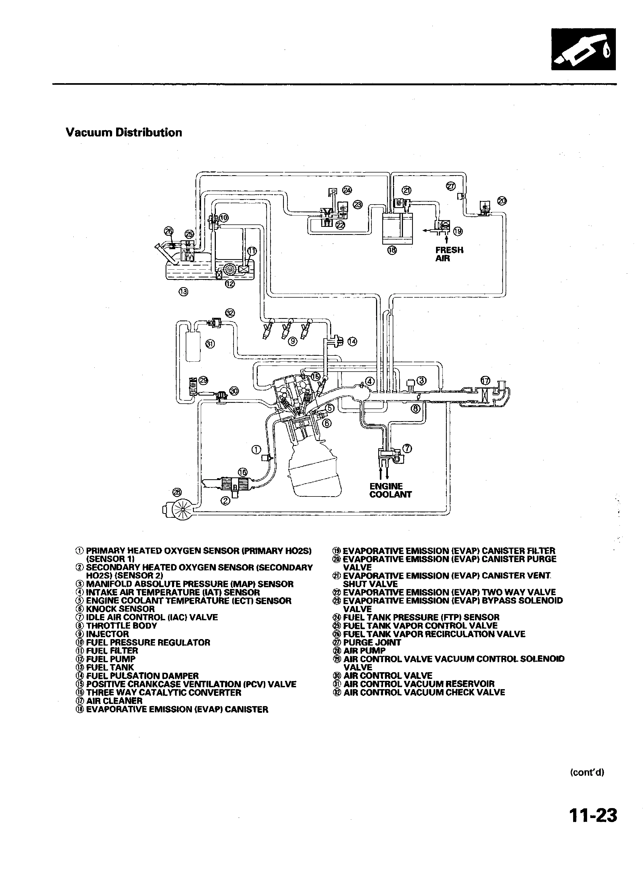
---

### Printed page 11-24

<a id="p320"></a>
Source: [PDF p.320, printed p.11-24](../page-images/p0320.png).

# Fuel and Emissions Systems
## System Description (cont'd)
### PGM-FI System
The programmed fuel injection (PGM-FI) system is a sequential multiport fuel injection system.

### Alternator Control
The alternator signals the ECM during charging. The ECM then controls the voltage generated at the alternator according to the electrical load determined by the ELD (Electrical Load Detector) and driving mode. This reduces engine load to improve fuel economy.

### A/C Switch
The A/C (air conditioning) switch signals the ECM whenever there is a demand for cooling.

### A/C Compressor Clutch Relay
When the ECM receives a demand for cooling from the A/C system, it delays the compressor from being energized, and enriches the mixture to assure smooth transition to the A/C mode.

### Barometric Pressure (BARO) Sensor
The BARO sensor is inside the ECM. It converts atmospheric pressure into a voltage signal that is used by the ECM to modify the basic duration of the fuel injection discharge.

### Crankshaft Position (CKP) Sensor
The CKP sensor determines timing for injection of each cylinder and also detects engine speed. The ECM detects misfiring by using the CKP sensor to monitor fluctuations in crankshaft speed. It will then set DTCs depending on how much misfiring occurs.

### Engine Coolant Temperature (ECT) Sensor
The ECT sensor is a temperature dependent resistor (thermistor). The resistance of the thermistor decreases as the engine coolant temperature increases.

### Intake Air Temperature (IAT) Sensor
The IAT sensor is a thermistor; resistance decreases as intake air temperature increases.
---

### Printed page 11-25

<a id="p321"></a>
Source: [PDF p.321, printed p.11-25](../page-images/p0321.png).

# Injector Timing and Duration

The ECM contains the memory for basic discharge duration at various engine speeds and manifold pressures. The basic discharge duration, after being read out from the memory, is further modified by signals sent from various sensors to obtain the final discharge duration.

By monitoring long term fuel trim, the ECM detects long term malfunctions in the fuel system, and will set a DTC if the malfunction occurs during two consecutive trips.

## Ignition Timing Control

The ECM contains the memory for basic ignition timing at various engine speeds and manifold pressures. It also adjusts the timing according to engine coolant temperature.

## Knock Sensor

The knock control system adjusts the ignition timing to minimize knock.

## Manifold Absolute Pressure (MAP) Sensor

The MAP sensor converts manifold absolute pressure into electrical signals to the ECM.

## Primary and Secondary Heated Oxygen Sensors (HO2S)

The heated oxygen sensors detect the oxygen content in the exhaust gas, then sends a signal to the ECM which varies the duration of injection accordingly. To stabilize its output, the sensors have an internal heater.

The primary sensor is installed in the exhaust pipe. The secondary sensor is installed in the TWC.

By controlling the air/fuel ratio with sensors, the deterioration of the primary sensor can be evaluated by its feedback period. When the feedback period exceeds a certain value during stable driving conditions, the sensor is considered deteriorated and the ECM sets a DTC.

## Starting Control

When the engine is started, the ECM provides a rich mixture by increasing injector duration.

---

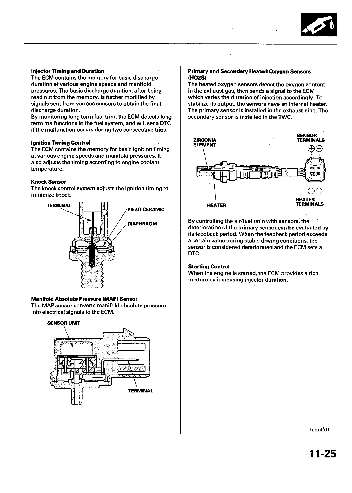
---

### Printed page 11-26

<a id="p322"></a>
Source: [PDF p.322, printed p.11-26](../page-images/p0322.png).

# Fuel and Emissions Systems
## System Description (cont'd)

### Throttle Position (TP) Sensor
The TP sensor is a potentiometer connected to the throttle valve shaft. As the throttle position changes, the sensor varies the signal voltage to the ECM. The TP sensor is not replaceable apart from the throttle body.

### Camshaft Position (CMP) Sensors (Top Dead Center Sensors)
The CMP A/B (TDC 1/2) sensor determines the ignition timing at start up (cranking) and when the crank angle is abnormal.

### Idle Control System
When the engine is cold, the A/C compressor is on, the transmission is in gear, the brake pedal is pressed, the P/S load is high, or the alternator is charging, the ECM sends signals to the IAC valve to maintain the correct idle speed. Refer to the system diagram to see the functional layout of the system.

### Brake Pedal Position Switch
The brake pedal position switch signals the ECM when the brake pedal is pressed.

### Electrical Power Steering (EPS) Signal
The EPS signals the ECM when the power steering load is high.

### Engine Start Switch
The engine start switch signals the ECM when the engine is cranking.

### Idle Air Control (IAC) Valve
To maintain the proper idle speed, the IAC valve changes the amount of air bypassing the throttle body in response to an electrical signal from the ECM.
---

### Printed page 11-27

<a id="p323"></a>
Source: [PDF p.323, printed p.11-27](../page-images/p0323.png).

# Fuel Supply System

## Fuel Cutoff Control
During deceleration with the throttle valve closed, current to the injectors is cut off to improve fuel economy at speeds over 1,050 rpm.

Fuel cutoff also occurs when engine speed exceeds 9,000 rpm, regardless of the position of the throttle valve, to protect the engine from over-revving.

## Fuel Pump Control
When the ignition is turned ON (II), the ECM grounds the PGM-FI main relay which feeds current to the fuel pump for 2 seconds to pressurize the fuel system. With the engine running, the ECM grounds the PGM-FI main relay and feeds current to the fuel pump. When the engine is not running and the ignition is ON (II), the ECM cuts ground to the PGM-FI main relay which cuts current to the fuel pump.

## PGM-FI Main Relay
The PGM-FI main relay contains two separate relays. One is energized whenever the ignition is ON (II), which supplies battery voltage to the ECM, power to the injectors, and power for the second relay. The second relay is energized to supply power to the fuel pump for 2 seconds when the ignition switch is ON (II), and when the engine is running or cranking.

## Intake Air System
Refer to the system diagram to see a functional layout of the system.

### Throttle Body
The throttle body is a single-barrel side draft type. The lower portion of the throttle valve is heated by engine coolant from the cylinder head.

### Catalytic Converter System
**TWC (Three Way Catalytic Converter)**
The TWC converts hydrocarbons (HC), carbon monoxide (CO), and oxides of nitrogen (NOx) in the exhaust gas to carbon dioxide (CO₂), nitrogen (N₂), and water vapor.
---

### Printed page 11-28

<a id="p324"></a>
Source: [PDF p.324, printed p.11-28](../page-images/p0324.png).

# Fuel and Emissions Systems
## System Description (cont'd)

### Positive Crankcase Ventilation (PCV) System
The PCV valve prevents blow-by gases from escaping into the atmosphere by venting them into the intake manifold.

### Evaporative Emission (EVAP) Control System
Refer to the system diagram to see a functional layout of the system.

#### EVAP Canister
The EVAP canister temporarily stores fuel vapor from the fuel tank until it can be purged back into the engine and burned.

#### EVAP Canister Purge Valve
When the engine coolant temperature is below 149 °F (65 °C), the ECM turns off the EVAP canister purge valve which cuts vacuum to the EVAP canister.

#### Fuel Tank Pressure (FTP) Sensor
The FTP sensor converts fuel tank absolute pressure into an electrical input to the ECM.

#### EVAP Canister Vent Shut Valve
The EVAP canister vent shut valve is on the EVAP canister and controls its venting.

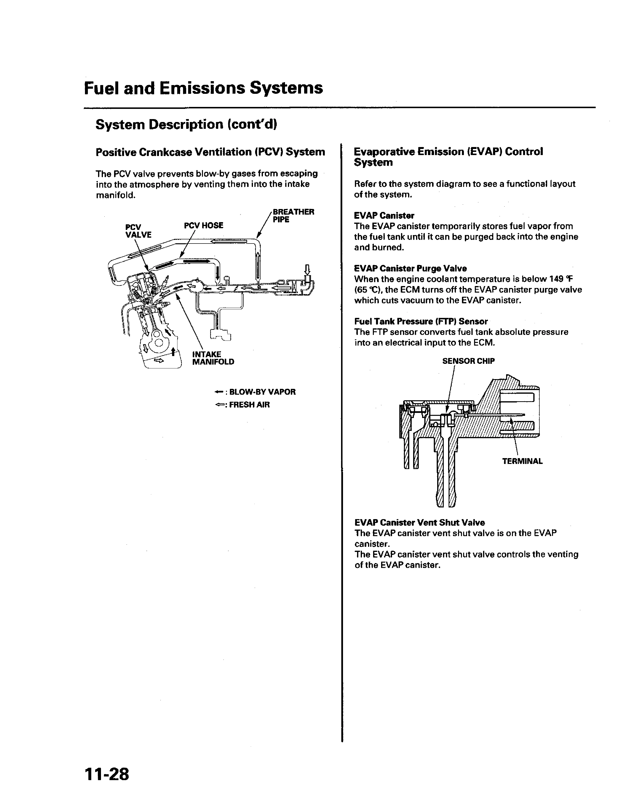
---

### Printed page 11-29

<a id="p325"></a>
Source: [PDF p.325, printed p.11-29](../page-images/p0325.png).

# Idle Control System Diagram

The idle speed of the engine is controlled by the idle air control (IAC) valve:
*   After the engine starts, the IAC valve opens for a certain amount of time. The amount of air is increased to raise the idle speed.
*   When the engine coolant temperature is low, the IAC valve is opened to obtain the proper fast idle speed. The amount of bypassed air is controlled in relation to engine coolant temperature.


---

# Intake Air System Diagram

This system supplies air for engine needs. A resonator in the air intake duct provides additional silencing as air is drawn into the system.


*(cont'd)*

****

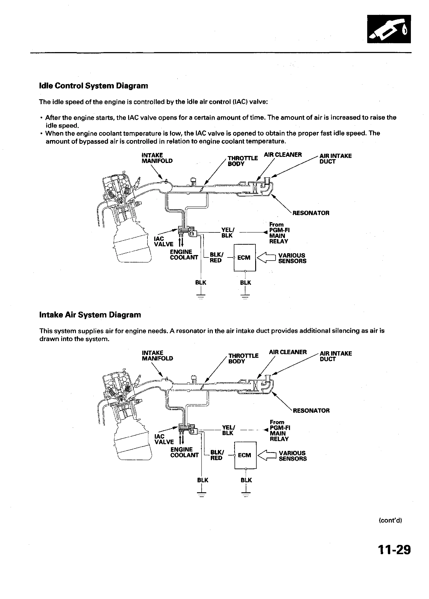
---

### Printed page 11-30

<a id="p326"></a>
Source: [PDF p.326, printed p.11-30](../page-images/p0326.png).

# Fuel and Emissions Systems
## System Description (cont'd)
### Pulsed Secondary Air Injection

The pulsed secondary air injection advances the activation of the catalytic converter and reduces the hydrocarbons (HC), carbon monoxide (CO), and oxides of nitrogen (NOx) in the exhaust gas.

**Operating Conditions:**
The system operates after the engine starts under these conditions:
*   The engine coolant temperature is between 32 °F and 158 °F (0 °C and 70 °C).
*   The difference is more than 36 °F (20 °C) between the engine coolant temperature when the engine is started and when the engine was stopped in the previous driving cycle.

**System Operation:**
When the engine is cold and first started, the air pump pumps fresh air into the exhaust ports. The amount of air entering the exhaust is regulated by an air control valve which is controlled by the ECM. The system does not work for more than 60 seconds at a time. Actual operating time will vary depending on the difference between engine coolant temperature and intake air temperature.

When fresh air reacts with any unburned exhaust gases, the exhaust gas temperatures rise. This rise in temperature promotes faster warm-up of the catalytic converter, resulting in cleaner emissions during cold start-up.

When the air induction system is not operating, the air control solenoid closes the air control valve to prevent any exhaust gases from flowing back into the system.

---

**Diagram Labels:**
*   AIR CONTROL VACUUM CHECK VALVE
*   No. 6 ACG (15 A) FUSE
*   AIR PUMP (60 A) FUSE
*   AIR PUMP RELAY
*   AIR CONTROL VALVE VACUUM CONTROL SOLENOID VALVE
*   AIR PUMP
*   AIR CONTROL VACUUM RESERVOIR

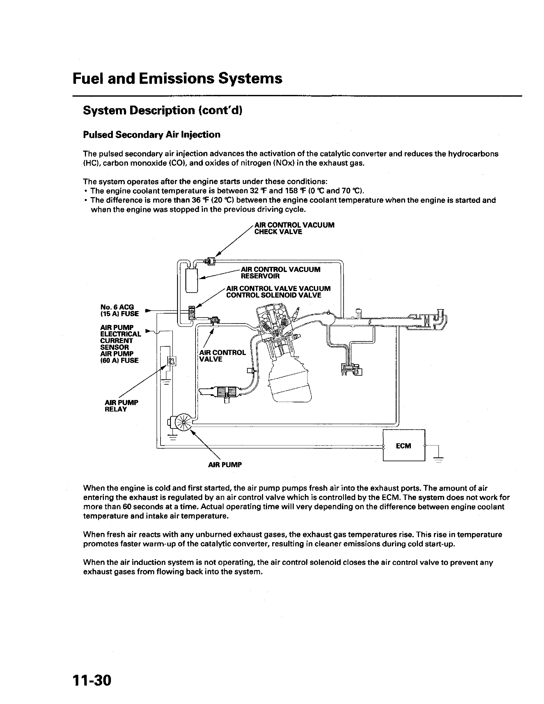
---

### Printed page 11-31

<a id="p327"></a>
Source: [PDF p.327, printed p.11-31](../page-images/p0327.png).

# Evaporative Emission (EVAP) Control Diagram

The EVAP controls minimize the amount of fuel vapor escaping to the atmosphere. Vapor from the fuel tank is temporarily stored in the EVAP canister until it can be purged from the canister into the engine and burned.

* The EVAP canister is purged by drawing fresh air through it and a port on the intake manifold. The purging vacuum is controlled by the EVAP canister purge valve, which is open whenever engine coolant temperature is above 149°F (65°C).
* When vapor pressure in the fuel tank is higher than the set value of the EVAP two way valve, the valve opens and regulates the flow of fuel vapor to the EVAP canister.
* During refueling, the fuel tank vapor control valve opens with the pressure in the fuel tank, and feeds the fuel vapor to the EVAP canister.

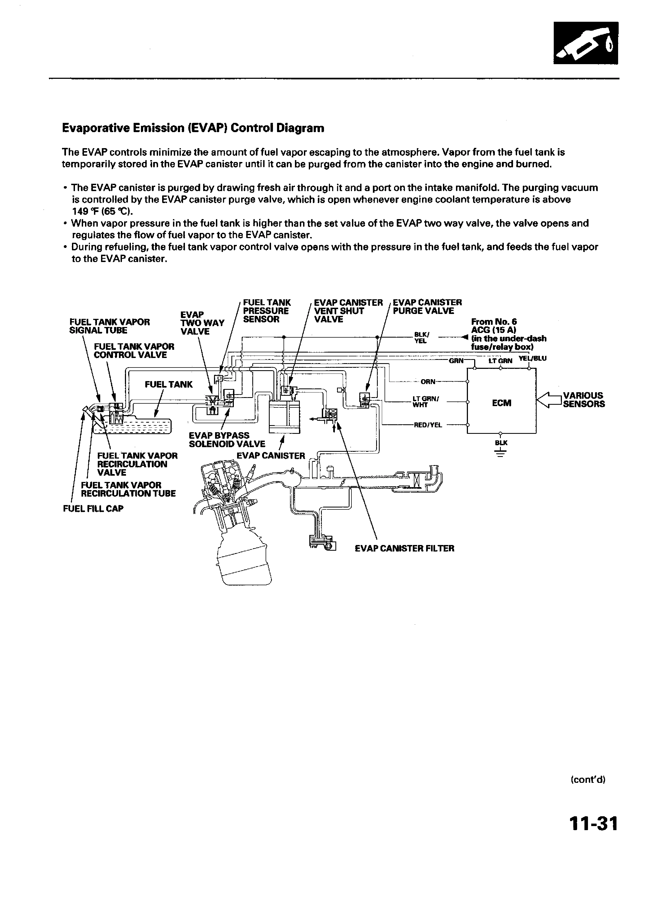
---

### Printed page 11-32

<a id="p328"></a>
Source: [PDF p.328, printed p.11-32](../page-images/p0328.png).

# ECM Circuit Diagram

This page is a wiring diagram. Use the source diagram for exact ECM terminal numbers, connectors, wire colors, and circuit paths.

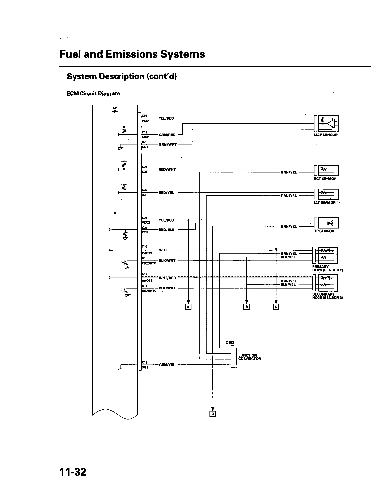
---

### Printed page 11-33

<a id="p329"></a>
Source: [PDF p.329, printed p.11-33](../page-images/p0329.png).

# ECM Circuit Diagram (continued)

This page is a wiring diagram. Use the source diagram for exact ECM terminal numbers, connectors, wire colors, and circuit paths.

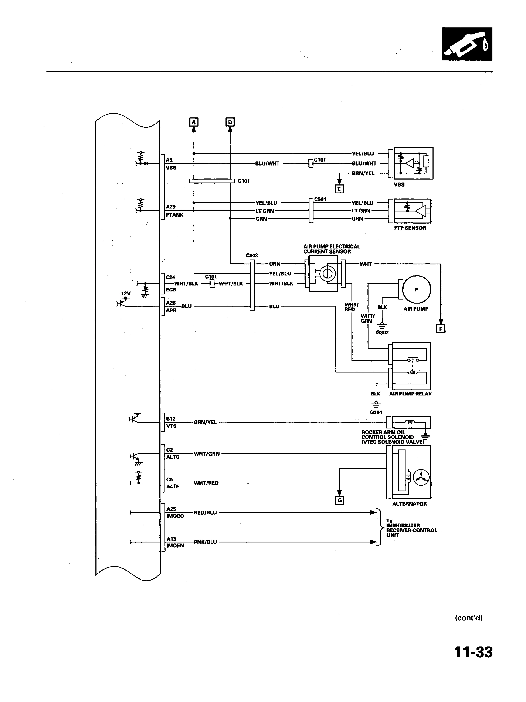
---

### Printed page 11-34

<a id="p330"></a>
Source: [PDF p.330, printed p.11-34](../page-images/p0330.png).

# ECM Circuit Diagram (continued)

This page is a wiring diagram. Use the source diagram for exact ECM terminal numbers, connectors, wire colors, and circuit paths.

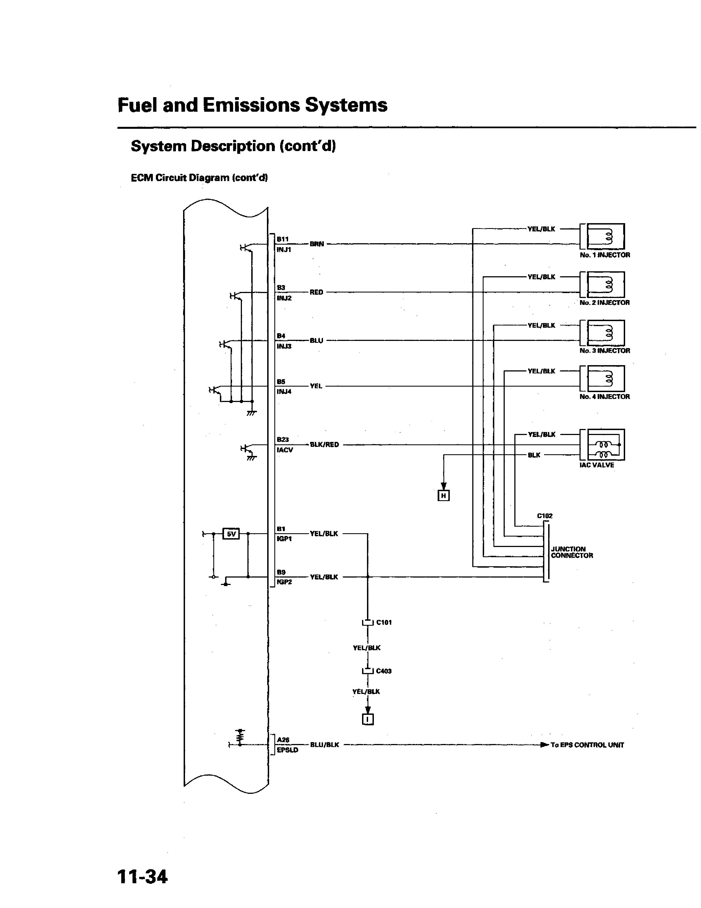
---

### Printed page 11-35

<a id="p331"></a>
Source: [PDF p.331, printed p.11-35](../page-images/p0331.png).

# ECM Circuit Diagram (continued)

This page is a wiring diagram. Use the source diagram for exact ECM terminal numbers, connectors, wire colors, and circuit paths.

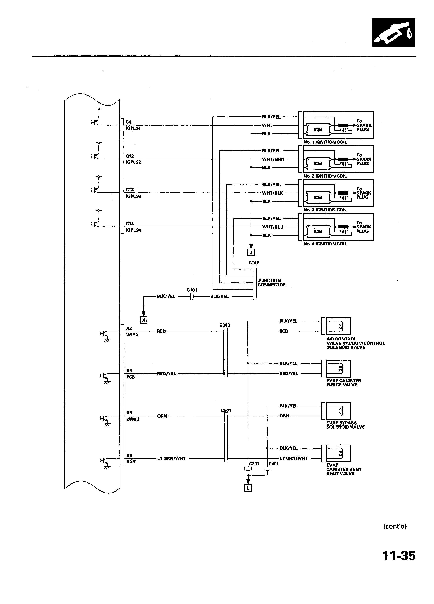
---

### Printed page 11-36

<a id="p332"></a>
Source: [PDF p.332, printed p.11-36](../page-images/p0332.png).

# ECM Circuit Diagram (continued)

This page is a wiring diagram. Use the source diagram for exact ECM terminal numbers, connectors, wire colors, and circuit paths.

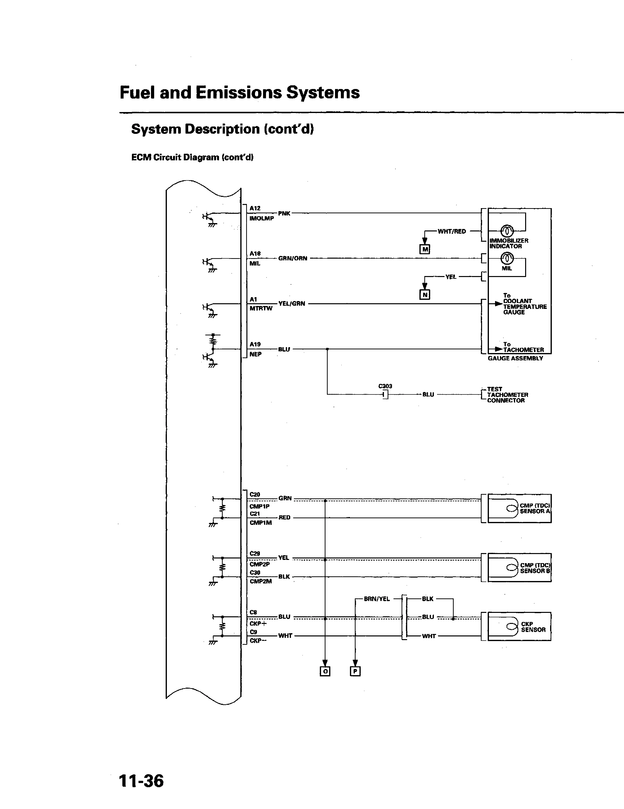
---

### Printed page 11-37

<a id="p333"></a>
Source: [PDF p.333, printed p.11-37](../page-images/p0333.png).

# ECM Circuit Diagram (continued)

This page is a wiring diagram. Use the source diagram for exact ECM terminal numbers, connectors, wire colors, and circuit paths.

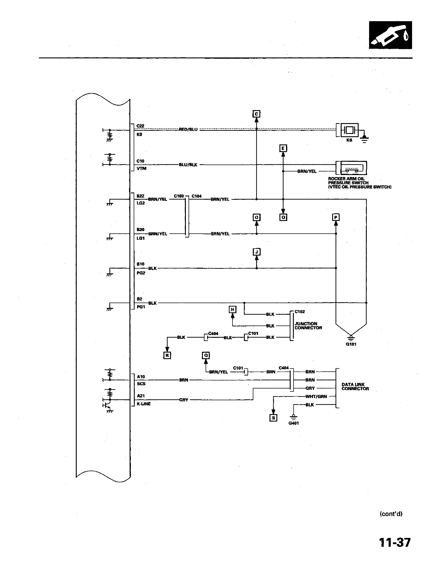
---

### Printed page 11-38

<a id="p334"></a>
Source: [PDF p.334, printed p.11-38](../page-images/p0334.png).

# ECM Circuit Diagram (continued)

This page is a wiring diagram. Use the source diagram for exact ECM terminal numbers, connectors, wire colors, and circuit paths.

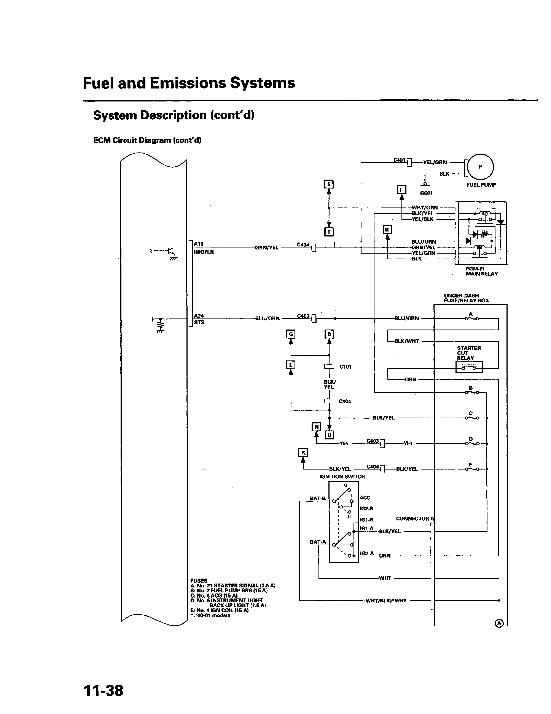
---

### Printed page 11-39

<a id="p335"></a>
Source: [PDF p.335, printed p.11-39](../page-images/p0335.png).

# ECM Circuit Diagram (continued)

This page is a wiring diagram. Use the source diagram for exact ECM terminal numbers, connectors, wire colors, and circuit paths.

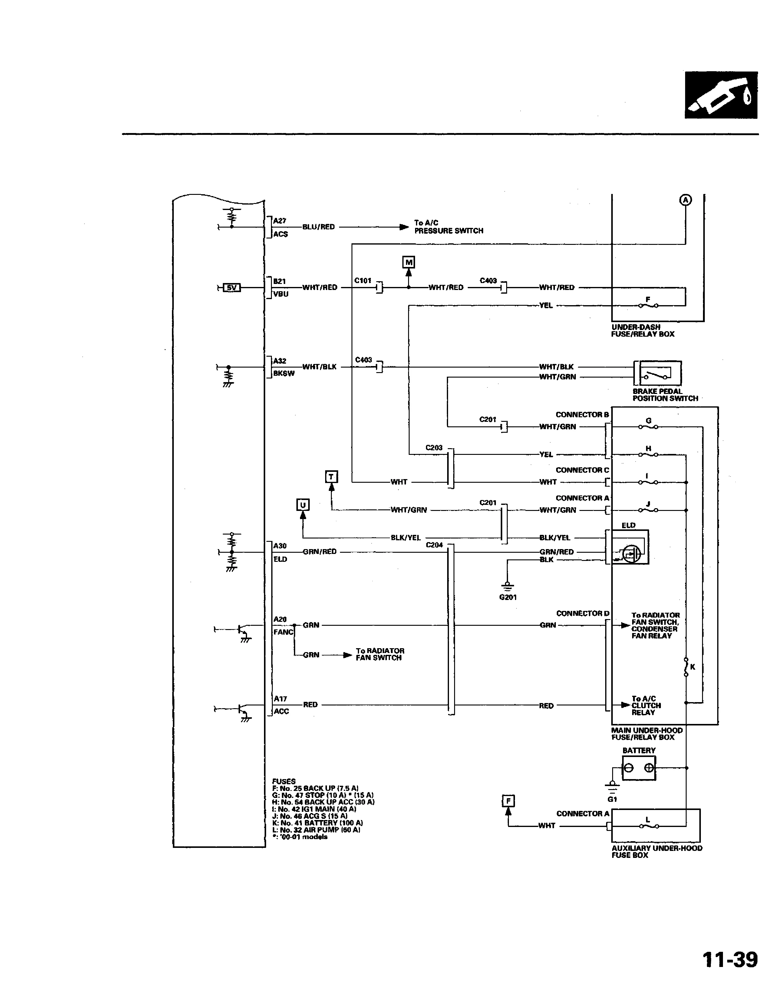
---

### Printed page 11-40

<a id="p336"></a>
Source: [PDF p.336, printed p.11-40](../page-images/p0336.png).

# Fuel and Emissions Systems
## How to Set Readiness Codes
### Malfunction Indicator Lamp (MIL) Indication
#### (In relation to Readiness Codes)

The vehicle has certain "readiness codes" that are part of the on-board diagnostics for the emissions systems.

If the vehicle's battery has been disconnected or gone dead, if the DTCs have been cleared, or if the ECM has been reset, these codes are reset to incomplete. In some states, part of the emissions testing is to make sure these codes are set to complete. If all of them are not set to complete, the vehicle may fail the emission test, or the test cannot be finished.

To check if the readiness codes are complete, turn the ignition switch ON (II), but do not start the engine. The MIL will come on for 15—20 seconds. If it then goes off, the readiness codes are complete. If it blinks several times, one or more readiness codes are not complete.

To set readiness codes from incomplete to complete, do the procedure for the appropriate code.

---

### Catalytic Converter Monitor and Readiness Code

**NOTE:**
*   Do not turn the ignition switch off during the procedure.
*   All readiness codes are cleared when the battery is disconnected or when the ECM is cleared with an OBD II scan tool or the HDS.
*   Low ambient temperatures or excessive stop-and-go traffic may increase the drive time needed to switch the readiness code from incomplete to complete.
*   The readiness code will not switch to complete until all the enable criteria are met.
*   If a fault in the secondary HO2S system caused the MIL to come on, the readiness code cannot be set to complete until you correct the fault.

#### Enable Criteria
*   ECT sensor at 158 °F (70 °C) or more.
*   IAT sensor at 20 °F (- 7 °C) or more.
*   Vehicle speed is steady, and vehicle speed sensor (VSS) reads more than 25 mph (40 km/h).

#### Procedure
**When using the HDS**
1. Connect the HDS to the vehicle's data link connector (DLC), and bring up the READINESS CODEs screen for Catalyst in the DTCs MENU.
2. Start the engine.
3. Test-drive the vehicle under stop-and-go conditions with short periods of steady cruise. After about 5 miles (8 km), the readiness code should switch to completed.
4. If the readiness code is still not set to complete, check for a Temporary DTC with the HDS. If there is no DTC, one or more of the enable criteria were probably not met; repeat the procedure.

**When using a scan tool**
1. Connect a scan tool to the vehicle's data link connector (DLC), and bring up the tool's generic OBD II mode.
2. Start the engine.
3. Test-drive the vehicle under stop-and-go conditions with short periods of steady cruise. After about 5 miles (8 km), the readiness code should switch from incomplete to complete.
4. If the readiness code is still set to incomplete, check for a Temporary DTC. If there is no DTC, one or more of the enable criteria were probably not met; repeat the procedure.
---

### Printed page 11-41

<a id="p337"></a>
Source: [PDF p.337, printed p.11-41](../page-images/p0337.png).

# Page 337: S2000 Fuel and Emissions Part A

## Evaporative Emission (EVAP) Control System Monitor and Readiness Code

**NOTE:**
*   All readiness codes are cleared when the battery is disconnected or when the ECM is cleared with an OBD II scan tool or the HDS.
*   The enable criteria must be repeated if the intake air temperature (IAT) drops lower than 36 °F (20 °C) from its value at engine start up.

### Enable Criteria
*   At engine start up, ECT SENSOR and IAT SENSOR are higher than 32 °F (0 °C), but lower than 95 °F (35 °C).
*   At engine start up, the ECT SENSOR and IAT SENSOR are within 12 °F (7 °C) of each other.

### Procedure

#### When using the HDS
1.  Connect the HDS to the vehicle's data link connector (DLC).
2.  Start the engine.
3.  Select EVAP TEST in the INSPECTION MENU with the HDS, then select the FUNCTION TEST in the EVAP TEST MENU.
    *   If the functions are normal, readiness is complete.
    *   If the functions are not normal, go to the next step.
4.  If the readiness code is still not set to complete, check for a Temporary DTC. If there is no DTC, one or more of the enable criteria were probably not met; repeat the procedure.

#### When using a scan tool
1.  Connect a scan tool to the vehicle's data link connector (DLC), and bring up the tool's generic OBD II mode.
2.  Start the engine.
3.  Test-drive the vehicle under stop-and-go conditions with short periods of steady cruise. After about 2.5 miles (4.0 km), the readiness code should switch from incomplete to complete.
4.  If the readiness code is still set to incomplete, check for a Temporary DTC. If there is no DTC, one or more of the enable criteria were probably not met; repeat the procedure.

---

## HO2S Monitor and Readiness Code

**NOTE:**
*   Do not turn the ignition switch off during the procedure.
*   All readiness codes are cleared when the battery is disconnected or when the ECM is cleared with an OBD II scan tool or the HDS.

### Enable Criteria
*   ECT SENSOR at 140 °F (60 °C) or more.

### Procedure

#### When using the HDS
1.  Start the engine.
2.  Test-drive the vehicle under stop-and-go conditions with short periods of steady cruise. During the drive, decelerate (with the throttle fully closed) for 5 seconds. After about 3.5 miles (5.6 km), the readiness code should switch from incomplete to completed.
3.  Check the readiness codes screen for the HO2S in the DTCs MENU with the HDS.
    *   If the screen shows complete, readiness is complete.
    *   If the screen shows not complete, go to the next step.
4.  Check for a Temporary DTC. If there is no DTC, the enable criteria were probably not met. Select the DATA LIST Menu. Check the ECT in the ALL DATA LIST with the HDS. If the ECT is lower than 140 °F (60 °C), run the engine until it is higher than 140 °F (60 °C), then repeat the procedure.

#### When using a scan tool
1.  Connect a scan tool to the vehicle's data link connector (DLC), and bring up the tool's generic OBD II mode.
2.  Start the engine.
3.  Test-drive the vehicle under stop-and-go conditions with short periods of steady cruise. During the drive, decelerate (with the throttle fully closed) for 5 seconds. After about 3.5 miles (5.6 km), the readiness code should switch from incomplete to complete.
4.  If the readiness code is still set to incomplete, check for a Temporary DTC. if there is no DTC, the enable criteria was probably not met; repeat the procedure.

*(cont'd) 11-41*
---

### Printed page 11-42

<a id="p338"></a>
Source: [PDF p.338, printed p.11-42](../page-images/p0338.png).

# Fuel and Emissions Systems
## How to Set Readiness Codes (cont'd)

### HO2S Heater Monitor Readiness Code
**NOTE:** All readiness codes are cleared when the battery is disconnected or when the ECM is cleared with an OBD II scan tool or the HDS.

**Procedure**
1. Connect a scan tool or the HDS to the vehicle's data link connector (DLC). Bring up the tool's generic OBD II mode (scan tool only).
2. Start the engine, and let it idle for 1 minute. The readiness code should switch from incomplete to complete.
3. If the readiness code is still set to incomplete, check for a Temporary DTC. If there is no DTC, repeat the procedure.

---

### Secondary Air Injection (AIR) System Monitor and Readiness Code
**NOTE:**
*   All readiness codes are cleared when the battery is disconnected or the ECM is cleared with an OBD II scan tool or the HDS.

**Enable Criteria**
*   At engine start up, ECT sensor and IAT sensor higher than 32 °F (0 °C), but lower than 95 °F (35 °C).
*   At engine start up, ECT sensor and IAT sensor are within 12 °F (7 °C) of each other.
*   Altitude below 2,400 m (7,874 ft).

---

### Misfire Monitor and Readiness Code
*   This readiness code is always set to available because misfiring is continuously monitored.
*   Monitoring pauses, and the misfire counter resets, if the vehicle is driven over a rough road.
*   Monitoring also pauses, and the misfire counter holds at its current value, if the throttle position changes more than a predetermined value, or if driving conditions fall outside the range of any related enable criteria.

---

### Fuel System Monitor and Readiness Code
*   This readiness code is always set to available because the fuel system is continuously monitored during closed loop operation.
*   Monitoring pauses when the catalytic converter, EVAP control system, and HO2S monitors are active.
*   Monitoring also pauses when any related enable criteria are not being met. Monitoring resumes when the enable criteria is again being met.

---

### Comprehensive Component Monitor and Readiness Code
This readiness code is always set to available because the comprehensive component monitor is continuously running whenever the engine is cranking or running.

**Procedure**
1. Connect a scan tool or the HDS to the vehicle's data link connector (DLC). Bring up the tool's generic OBD II mode (scan tool only).
2. Start the engine, and let it idle for 1 minute. The readiness code should switch from incomplete to complete.
3. If the readiness code is still set to incomplete, check for a Temporary DTC. If there is no DTC, repeat the procedure.
---

### Printed page 11-43

<a id="p339"></a>
Source: [PDF p.339, printed p.11-43](../page-images/p0339.png).

# PGM-FI System Component Location Index

The source diagram locates the crankshaft position (CKP) sensor and related PGM-FI components; follow its callouts and page references for service access.

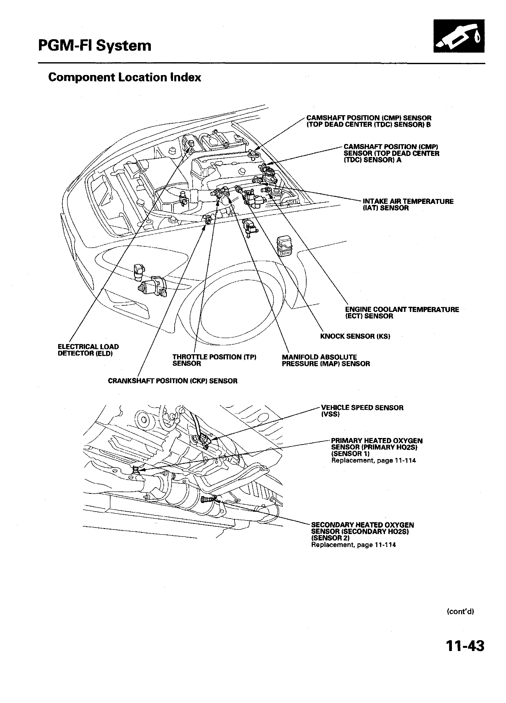
---

### Printed page 11-44

<a id="p340"></a>
Source: [PDF p.340, printed p.11-44](../page-images/p0340.png).

# PGM-FI System Component Location Index (continued)

The source diagram locates the injectors, data link connector, and other PGM-FI components; follow its callouts and page references for service access.

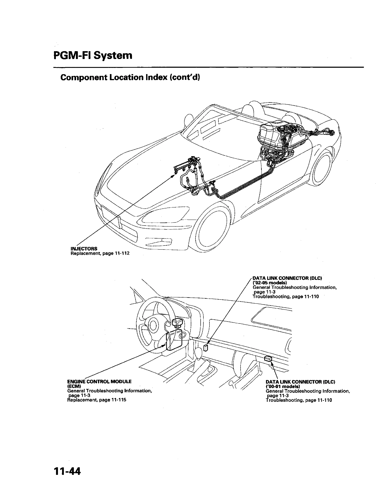
---

### Printed page 11-45

<a id="p341"></a>
Source: [PDF p.341, printed p.11-45](../page-images/p0341.png).

# DTC Troubleshooting

## DTC P0107: MAP Sensor Circuit Low Voltage

> **NOTE:** Before you troubleshoot, record all freeze data and review the general troubleshooting information (see page 11-3).

### Step 1
1. Turn the ignition switch ON (**II**).
2. Check the MAP with a scan tool or the HDS.
   Is about 101 kPa (30 in.Hg, 760 mmHg), or 2.9 V indicated?

   - **YES**—Intermittent failure, the system is OK at this time. Check for poor connections or loose terminals at the MAP sensor and at the ECM.
   - **NO**—Go to step 3.

### Step 2
3. Turn the ignition switch OFF.
4. Disconnect the MAP sensor 3P connector.
5. Turn the ignition switch ON (**II**).
6. Measure voltage between MAP sensor 3P connector terminals No. 1 and No. 2.

> **MAP S E N S O R 3P C O N N E C T O R**
> - **VCC1 (YEL/RED)**
> - **SG1 (GRN/WHT)**
> *(Wire side of female terminals)*

Is there about 5 V?

   - **YES**—Go to step 8.
   - **NO**—Go to step 7.

### Step 3
7. Measure voltage between ECM connector terminals C19 and C7.

See the source connector diagram for ECM C19 (VCC1) and C7 (SG1).

Is there about 5 V?

   - **YES**—Repair open in the wire between the ECM (**C19**) and the MAP sensor.
   - **NO**—Substitute a known-good ECM (see page 11-5), then recheck. If normal MAP is indicated, replace the original ECM (see page 11-115).

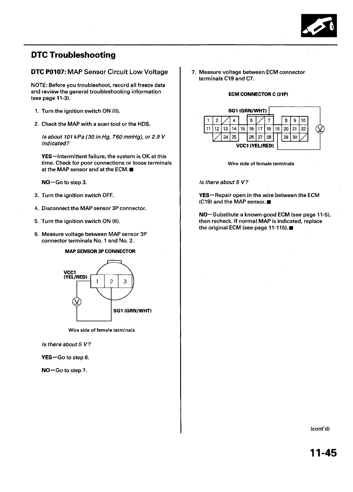
---

### Printed page 11-46

<a id="p342"></a>
Source: [PDF p.342, printed p.11-46](../page-images/p0342.png).

# DTC P0107: MAP Sensor Circuit Low Voltage (continued)

8. Check MAP with a scan tool or HDS. **About 2 kPa (0.6 inHg, 15 mmHg), or 0.5 V or less?**
   - **Yes:** Go to step 9.
   - **No:** Replace the MAP sensor (p.11-166).
9. Turn the ignition switch OFF.
10. Disconnect ECM connector C (31P).
11. Check continuity between MAP sensor connector terminal No. 3 (MAP, GRN/RED) and body ground, from the wire side of the female terminals. **Is there continuity?**
   - **Yes:** Repair the short in the wire between ECM C17 and the MAP sensor.
   - **No:** Substitute a known-good ECM (p.11-5), then recheck. If MAP indication is normal, replace the original ECM (p.11-115).

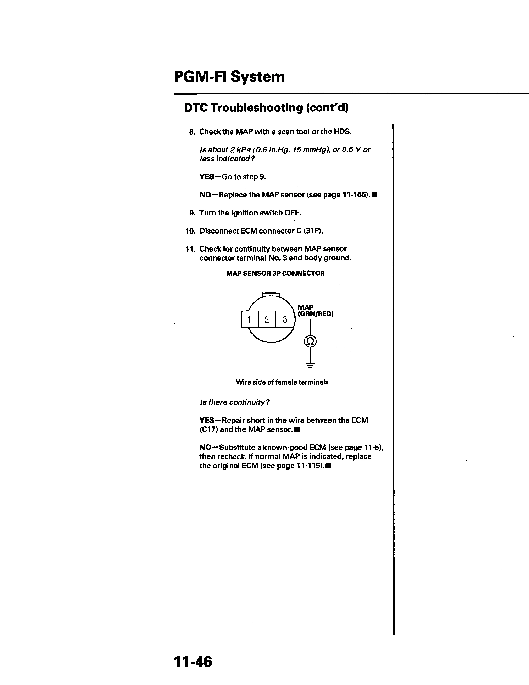
---

### Printed page 11-47

<a id="p343"></a>
Source: [PDF p.343, printed p.11-47](../page-images/p0343.png).

# DTC P0108: MAP Sensor Circuit High Voltage

**NOTE:** Before you troubleshoot, record all freeze data and review the general troubleshooting information (see page 11-3).

1. Start the engine. Hold the engine speed at 3,000 rpm without load (in neutral) until the radiator fan comes on, then let it idle.
2. Check the MAP with a scan tool or the HDS. Is about 101 kPa (30 in.Hg, 760 mmHg), or 2.9 V or more indicated?
   - **YES** — Go to step 3.
   - **NO** — Intermittent failure, the system is OK at this time. Check for poor connections or loose terminals at the MAP sensor and at the ECM.

3. Turn the ignition switch OFF.
4. Disconnect the MAP sensor 3P connector.
5. Install a jumper wire between MAP sensor 3P connector terminals No. 2 and No. 3.

   **Diagram Label:** MAP SENSOR 3P CONNECTOR
   - **SG1 (GRN/WHT)**
   - **MAP (GRN/RED)**
   - **JUMPER WIRE** (Wire side of female terminals)

6. Turn the ignition switch ON (II).
7. Check the MAP with a scan tool or the HDS. Is about 101 kPa (30 in.Hg, 760 mmHg), or 2.9 V or more indicated?
   - **YES** — Go to step 8.
   - **NO** — Replace the MAP sensor (see page 11-166).

8. Turn the ignition switch OFF.
9. Remove the jumper wire.
10. Turn the ignition switch ON (II).
11. Measure voltage between MAP sensor connector terminals No. 1 and No. 2.

    **Diagram Label:** MAP SENSOR 3P CONNECTOR
    - **VCC1 (YEL/RED)**
    - **SG1 (GRN/WHT)**
    - **Wire side of female terminals**

Is there about 5 V?
   - **YES** — Go to step 16.
   - **NO** — Go to step 12.

*(cont'd)*
---

### Printed page 11-48

<a id="p344"></a>
Source: [PDF p.344, printed p.11-48](../page-images/p0344.png).

# DTC P0108: MAP Sensor Circuit High Voltage (continued)

12. Turn the ignition switch OFF.
13. Disconnect ECM connector C (31P).
14. Connect MAP sensor 3P connector terminal No. 3 (MAP, GRN/RED) to body ground with a jumper wire.
15. Check continuity between ECM connector terminal C7 (SG1, GRN/WHT) and body ground. **Is there continuity?**
   - **Yes:** Substitute a known-good ECM (p.11-5), then recheck. If MAP indication is normal, replace the original ECM (p.11-115).
   - **No:** Repair the open wire between ECM C7 and the MAP sensor.
16. Turn the ignition switch OFF.
17. Install a jumper wire between ECM connector terminals C7 and C17. See source diagram for the terminal positions.
18. Turn the ignition switch ON (II).
19. Check MAP with a scan tool or HDS. **About 101 kPa (30 inHg, 760 mmHg), or 2.9 V or more?**
   - **Yes:** Substitute a known-good ECM (p.11-5), then recheck. If MAP indication is normal, replace the original ECM (p.11-115).
   - **No:** Repair the open wire between ECM C17 and the MAP sensor.

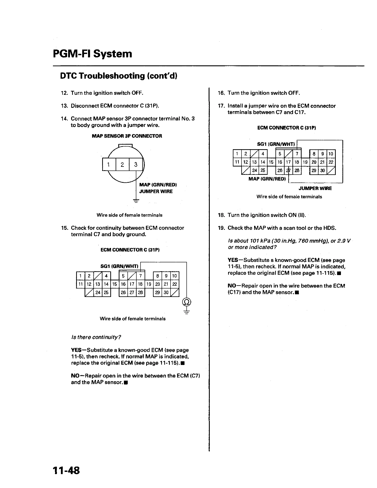
---

### Printed page 11-49

<a id="p345"></a>
Source: [PDF p.345, printed p.11-49](../page-images/p0345.png).

# DTC P0112: IAT Sensor Circuit Low Voltage

**NOTE:** Before you troubleshoot, record all freeze data and review the general troubleshooting information (see page 11-3).

1. Turn the ignition switch ON (II).
2. Check the IAT with a scan tool or the HDS.
   Is about 302 °F (150 °C) or more, or 0 V indicated?
   - **YES** — Go to step 3.
   - **NO** — Go to step 10.

3. Turn the ignition switch OFF.
4. Disconnect the IAT sensor 2P connector.
5. Turn the ignition switch ON (II).
6. Check the IAT with a scan tool or the HDS.
   Is about 302 °F (150 °C) or more, or 0 V indicated?
   - **YES** — Go to step 7.
   - **NO** — Replace the IAT sensor (see page 9-2).

7. Turn the ignition switch OFF.
8. Disconnect ECM connector C (31P).
9. Check the continuity between IAT sensor 2P connector terminal No. 2 and body ground.

   **IAT SENSOR 2P CONNECTOR**
   *Wire side of female terminals*

   Is there continuity?
   - **YES** — Repair short in the wire between the ECM (C25) and the IAT sensor.
   - **NO** — Substitute a known-good ECM (see page 11-5), then recheck. If normal IAT is indicated, replace the original ECM (see page 11-115).

10. Check the temperature reading on the scan tool or the HDS. Be aware that if the engine is warm, the reading will be higher than ambient temperature. If the engine is cold, the IAT and ECT will have the same value.
    Is the correct ambient temperature indicated?
    - **YES** — Intermittent failure, the system is OK at this time. Check for poor connections or loose terminals at the IAT sensor and at the ECM.
    - **NO** — Replace the IAT sensor (see page 9-2).

11-49
---

### Printed page 11-50

<a id="p346"></a>
Source: [PDF p.346, printed p.11-50](../page-images/p0346.png).

# DTC P0113: IAT Sensor Circuit High Voltage

**Before troubleshooting:** Record freeze data and review general troubleshooting information (p.11-3).

1. Turn the ignition switch ON (II).
2. Check IAT with a scan tool or HDS. **About −4 °F (−20 °C) or less, or 5 V?**
   - **Yes:** Go to step 3.
   - **No:** Intermittent failure; check for poor connections or loose terminals at the IAT sensor and ECM.
3. Turn the ignition switch OFF.
4. Disconnect the IAT sensor 2P connector.
5. Jumper connector terminals No. 1 (SG2, GRN/YEL) and No. 2 (IAT, RED/YEL).
6. Turn the ignition switch ON (II).
7. Check IAT with a scan tool or HDS. **About −4 °F (−20 °C) or less, or 5 V?**
   - **Yes:** Go to step 8.
   - **No:** Replace the IAT sensor (p.9-2).
8. Turn the ignition switch OFF.
9. Remove the jumper wire.
10. Turn the ignition switch ON (II).
11. Measure voltage between IAT sensor 2P connector terminal No. 2 and body ground. **About 5 V?**
    - **Yes:** Go to step 13 on the next page.
    - **No:** Go to step 12.
12. Measure voltage between ECM connector terminal C25 and body ground. **About 5 V?**
    - **Yes:** Repair the open wire between ECM C25 and the IAT sensor.
    - **No:** Substitute a known-good ECM (p.11-5), then recheck. If IAT indication is normal, replace the original ECM (p.11-115).

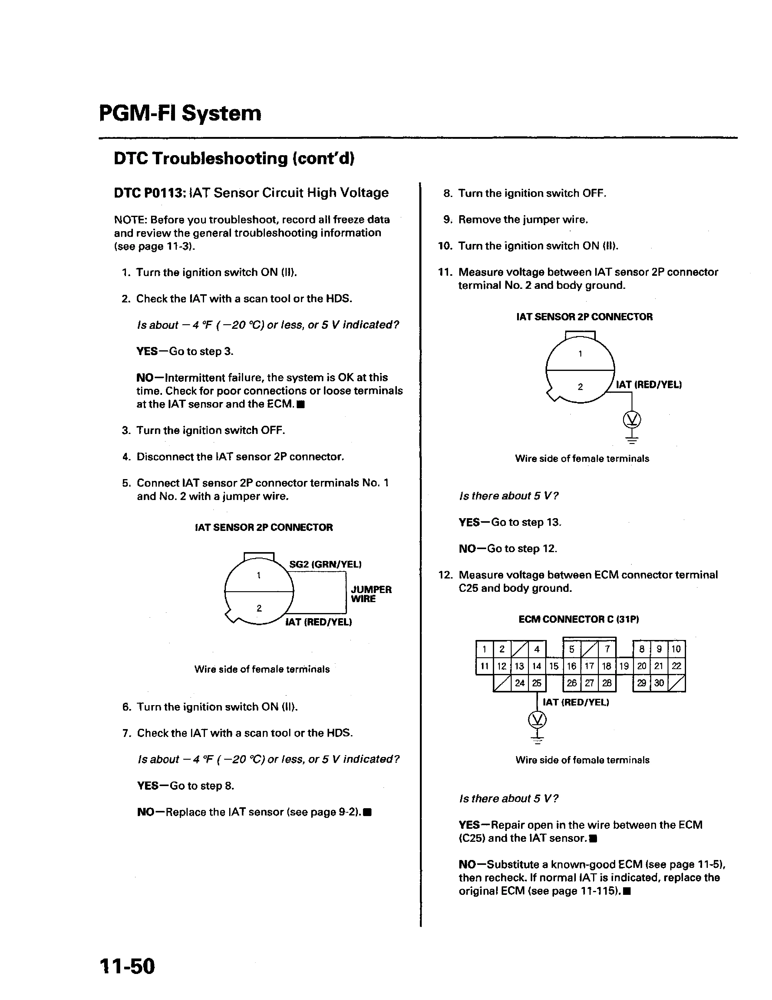
---

### Printed page 11-51

<a id="p347"></a>
Source: [PDF p.347, printed p.11-51](../page-images/p0347.png).

# DTC P0113: IAT Sensor Circuit High Voltage (continued)

13. Turn the ignition switch OFF.
14. Disconnect ECM connector C (31P).
15. Jumper IAT sensor 2P connector terminal No. 1 (SG2, GRN/YEL) to body ground.
16. Check continuity between ECM connector terminal C18 and body ground. **Is there continuity?**
    - **Yes:** Substitute a known-good ECM (p.11-5), then recheck. If IAT indication is normal, replace the original ECM (p.11-115).
    - **No:** Repair the open wire between ECM C18 and the IAT sensor.

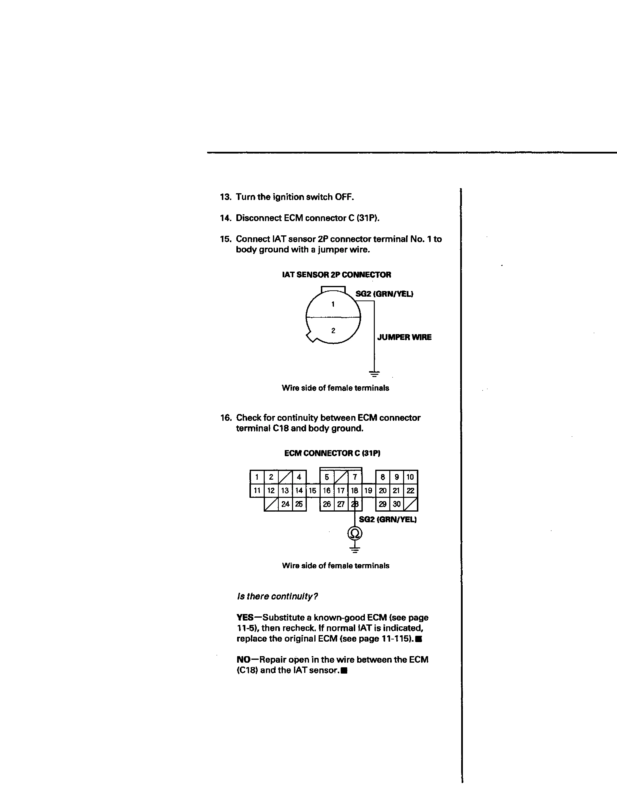
---

### Printed page 11-52

<a id="p348"></a>
Source: [PDF p.348, printed p.11-52](../page-images/p0348.png).

# PGM-FI System
## DTC Troubleshooting (cont'd)

### DTC P0116: ECT Sensor Circuit Range/Performance Problem

**NOTE:**
*   Before you troubleshoot record all freeze data and review the general troubleshooting information (see page 11-3).
*   If DTC P0117 and/or P0118 are stored at the same time as DTC P0116, troubleshoot those DTCs first, then recheck for DTC P0116.

1. Turn the ignition switch ON (II).
2. Check the ECT with a scan tool or the HDS.
   Is about 176 °F (80 °C) or more, or 0.86 V or less indicated?
   *   **YES** — Go to step 3.
   *   **NO** — Go to step 7.

3. Note the coolant temperature from step 2.
4. Turn the ignition switch OFF.
5. Cool the engine for 1 hour.
6. Check the ECT with a scan tool or the HDS.
   Did the ECT change 3.6 °F (2 °C) or more?
   *   **YES** — Intermittent failure, the system is OK at this time. Check the thermostat and the cooling system.
   *   **NO** — Replace the ECT sensor (see page 9-2).

7. Note the coolant temperature from step 2.
8. Start the engine. Hold the engine speed at 3,000 rpm without load (in neutral) until the radiator fan comes on, then let it idle.
9. Check the ECT with a scan tool or the HDS.
   Does the ECT change 3.6 °F (2 °C) or more?
   *   **YES** — Intermittent failure, the system is OK at this time. Check the thermostat and the cooling system.
   *   **NO** — Replace the ECT sensor (see page 9-2).

### DTC P0117: ECT Sensor Circuit Low Voltage

**NOTE:** Before you troubleshoot, record all freeze data and review the general troubleshooting information (see page 11-3).

1. Turn the ignition switch ON (II).
2. Check the ECT with a scan tool or the HDS.
   Is 302 °F (150 °C) or higher, or 0 V indicated?
   *   **YES** — Go to step 3.
   *   **NO** — Intermittent failure, the system is OK at this time. Check for poor connections or loose wires at the ECT sensor and at the ECM.

3. Turn the ignition switch OFF.
4. Disconnect the ECT sensor 2P connector.
5. Turn the ignition switch ON (II).
6. Check the ECT with a scan tool or the HDS.
   Is 302 °F (150 °C) or higher, or 0 V indicated?
   *   **YES** — Go to step 7.
   *   **NO** — Replace the ECT sensor (see page 9-2).

7. Turn the ignition switch OFF.
8. Disconnect ECM connector C (31P).

---
---

### Printed page 11-53

<a id="p349"></a>
Source: [PDF p.349, printed p.11-53](../page-images/p0349.png).

# DTC P0117: ECT Sensor Circuit Low Voltage (continued)

9. Check continuity between ECT sensor 2P connector terminal No. 2 (ECT, RED/WHT) and body ground, from the wire side of the female terminals. **Is there continuity?**
   - **Yes:** Repair the short in the wire between ECM C26 and the ECT sensor.
   - **No:** Substitute a known-good ECM (p.11-5), then recheck. If ECT indication is normal, replace the original ECM (p.11-115).


---

### Printed page 11-54

<a id="p350"></a>
Source: [PDF p.350, printed p.11-54](../page-images/p0350.png).

# PGM-FI System
## DTC Troubleshooting (cont'd)
### DTC P0118: ECT Sensor Circuit High Voltage

**NOTE:** Before you troubleshoot, record all freeze data and review the general troubleshooting information (see page 11-3).

1. Turn the ignition switch ON (**II**).
2. Check the **ECT** with a scan tool or the **HDS**.
   Is **-4°F (-20 °C)** or less, or **5 V** indicated?
   - **YES — Go to step 3.**
   - **NO — Intermittent failure, the system is OK at this time. Check for poor connections or loose terminals at the ECT sensor and at the ECM.**

3. Turn the ignition switch OFF.
4. Disconnect the **ECT** sensor **2P** connector.
5. Connect **ECT** sensor **2P** connector terminals No. 1 and No. 2 with a jumper wire.

   > **E C T S E N S O R 2P C O N N E C T O R**
   > **S G 2 (G R N / Y E L)**
   > **J U M P E R W I R E**
   > **E C T (R E D / W H T)**

6. Turn the ignition switch ON (**II**).
7. Check the **ECT** with a scan tool or the **HDS**.
   Is **-4°F (-20 °C)** or less, or **5 V** indicated?
   - **YES — Go to step 8.**
   - **NO — Replace the ECT sensor (see page 9-2).**

8. Turn the ignition switch OFF.
9. Remove the jumper wire.
10. Turn the ignition switch ON (**II**).
11. Measure voltage between **ECT** sensor **2P** connector terminal No. 2 and body ground.

    > **E C T S E N S O R 2P C O N N E C T O R**
    > **E C T (R E D / W H T)**
    > Wire side of female terminals

    Is there about **5 V**?
    - **YES — Go to step 13.**
    - **NO — Go to step 12.**

    Wire side of female terminals
---

### Printed page 11-55

<a id="p351"></a>
Source: [PDF p.351, printed p.11-55](../page-images/p0351.png).

# DTC P0118: ECT Sensor Circuit High Voltage (continued)

12. Measure voltage between ECM connector terminal C26 (ECT, RED/WHT) and body ground. **About 5 V?**
    - **Yes:** Repair the open wire between ECM C26 and the ECT sensor.
    - **No:** Substitute a known-good ECM (p.11-5), then recheck. If ECT indication is normal, replace the original ECM (p.11-115).
13. Turn the ignition switch OFF.
14. Disconnect ECM connector C (31P).
15. Jumper ECT sensor 2P connector terminal No. 1 (SG2, GRN/YEL) to body ground.
16. Check continuity between ECM connector terminal C18 and body ground. **Is there continuity?**
    - **Yes:** Substitute a known-good ECM (p.11-5), then recheck. If ECT indication is normal, replace the original ECM (p.11-115).
    - **No:** Repair the open wire between ECM C18 and the ECT sensor.

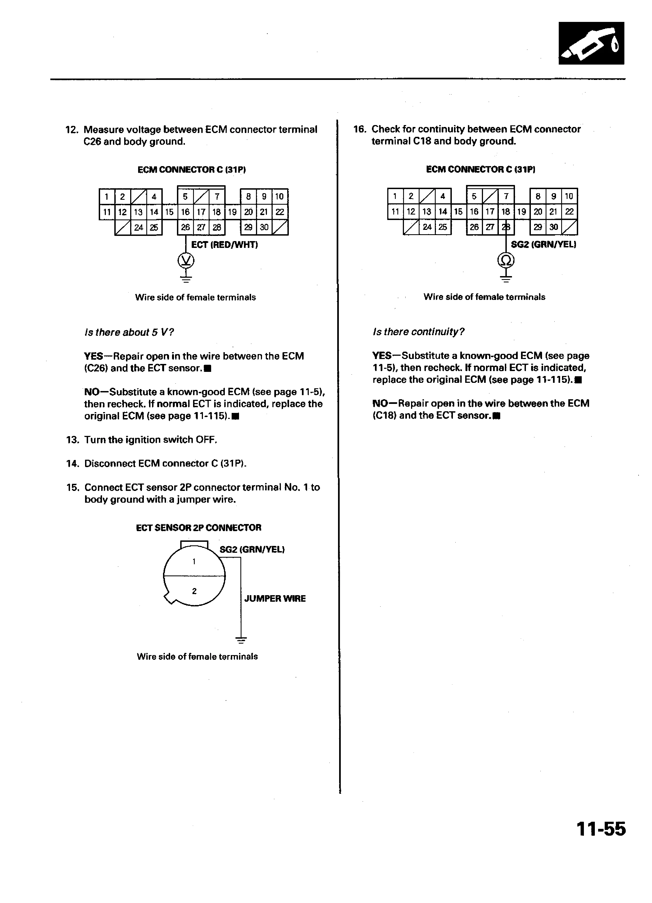
---

### Printed page 11-56

<a id="p352"></a>
Source: [PDF p.352, printed p.11-56](../page-images/p0352.png).

# PGM-FI System
## DTC Troubleshooting (cont'd)
### DTC P0122:TP Sensor Circuit Low Voltage

**NOTE:** Before you troubleshoot, record all freeze data and review the general troubleshooting information (see page 11-3).

1. Turn the ignition switch ON (**II**).
2. Check the throttle position with a scan tool or the HDS.
   Is there about **6 %** when the throttle is fully closed and about **90 %** when the throttle is fully opened?
   - **YES**—Intermittent failure, the system is OK at this time. Check for poor connections or loose wires at the TP sensor and at the ECM.
   - **NO**—Go to step 3.

3. Turn the ignition switch OFF.
4. Disconnect the TP sensor 3P connector.
5. Turn the ignition switch ON (**II**).
6. Measure voltage between TP sensor 3P connector terminals No. 1 and No. 3.

   **TP SENSOR 3P CONNECTOR**
   ```
     1       2       3
    SG 2 (GRN/YEL) VCC 2 (YEL/BLU)
   ```
   *Wire side of female terminals*

   Is there about **5 V**?
   - **YES**—Go to step 7.
   - **NO**—Go to step 13.

7. Turn the ignition switch OFF.
8. At the sensor side, measure resistance between TP sensor 3P connector terminals No. 1 and No. 2 with the throttle fully closed.

   **TP SENSOR 3P CONNECTOR**
   ```
     Terminal side of male terminals
   ```
   Is there about **0.5- 0.9 kΩ**?
   - **YES**—Go to step 9.
   - **NO**—Replace the throttle body (see page 11-165).

9. At the sensor side, measure resistance between TP sensor 3P connector terminals No. 2 and No. 3 with the throttle fully closed.

   **TP SENSOR 3P CONNECTOR**
   ```
     VCC 2
     Terminal side of male terminals
   ```
   Is there about **4.5 kΩ**?
   - **YES**—Go to step 10.
   - **NO**—Replace the throttle body (see page 11-165).

10. Reconnect the TP sensor 3P connector.
---

### Printed page 11-57

<a id="p353"></a>
Source: [PDF p.353, printed p.11-57](../page-images/p0353.png).

# DTC P0122: TP Sensor Circuit Low Voltage (continued)

11. Turn the ignition switch ON (II).
12. Measure voltage between ECM connector terminals C18 (SG2, GRN/YEL) and C27 (TPS, RED/BLK). **About 0.3 V with the throttle fully closed and about 4.5 V fully open?**
    - **Yes:** Substitute a known-good ECM (p.11-5), then recheck. If TP sensor voltage is now normal, replace the original ECM (p.11-115).
    - **No:** Repair the short in the wire between ECM C27 and the TP sensor.
13. Measure voltage between ECM connector terminals C18 (SG2) and C28 (VCC2, YEL/BLU). **About 5 V?**
    - **Yes:** Repair the open wire between ECM C28 and the TP sensor.
    - **No:** Substitute a known-good ECM (p.11-5), then recheck. If the prescribed voltage is now available, replace the original ECM (p.11-115).

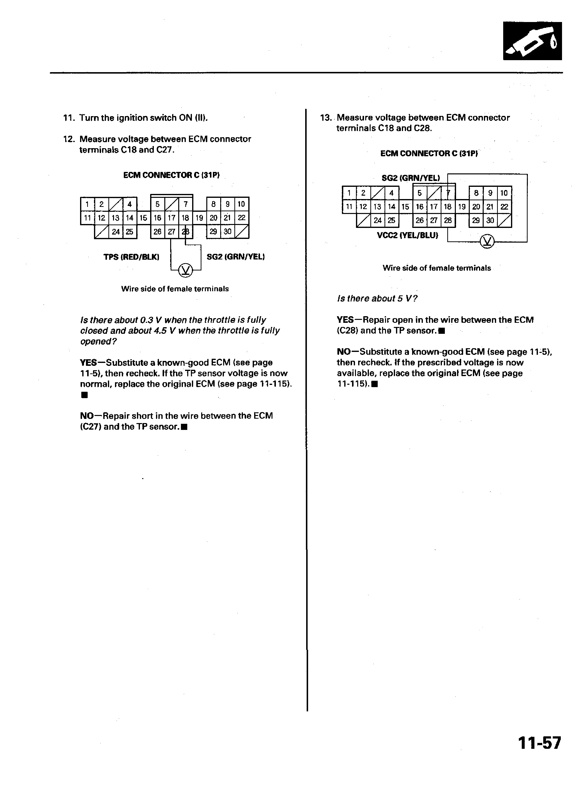
---

### Printed page 11-58

<a id="p354"></a>
Source: [PDF p.354, printed p.11-58](../page-images/p0354.png).

# PGM-FI System
## DTC Troubleshooting (cont'd)
### DTC P0123: TP Sensor Circuit High Voltage

**NOTE:** Before you troubleshoot, record all freeze data and review the general troubleshooting information (see page 11-3).

1. Turn the ignition switch ON (**II**).
2. Check the throttle position with a scan tool or the HDS.
   Is there about **6 %** when the throttle is fully closed and about **90 %** when the throttle is fully opened?
   - **YES**—Intermittent failure, the system is OK at this time. Check for poor connections or loose terminals at the TP sensor and at the ECM .
   - **NO**—Go to step 3.

3. Turn the ignition switch OFF.
4. Disconnect the TP sensor 3P connector.
5. Turn the ignition switch ON (**II**).
6. Measure voltage between TP sensor 3P connector terminals No. 1 and No. 3.

See the source connector diagram for terminal positions.

Is there about **5 V**?
- **YES**—Replace the throttle body (see page 11-165).
- **NO**—Go to step 7.

7. Measure voltage between ECM connector terminals C18 and C28.

See the source connector diagram for terminal positions.

Is there about **5 V**?
- **YES**—Repair open in the wire between the ECM (C18) and the TP sensor.
- **NO**—Substitute a known-good ECM (see page 11-5), then recheck. If the prescribed voltage is now available replace the original ECM (see page 11-115).
---

### Printed page 11-59

<a id="p355"></a>
Source: [PDF p.355, printed p.11-59](../page-images/p0355.png).

# DTC P0125: ECT Sensor Malfunction/Slow Response (2004–2005)

> NOTE: Before you troubleshoot, record all freeze data and review the general troubleshooting information (see page 11-3).

1. Start the engine, and let it idle.
2. Check the ECT with a scan tool or the HDS. Is about 86 °F (30 °C) or less, or 2.61 V or more indicated?
   - **YES** — Go to step 3.
   - **NO** — Intermittent failure, the system is OK at this time. Check the thermostat and the cooling system.

3. Let the engine idle for 6 minutes.
4. Check the ECT with a scan tool or the HDS. Is about 86 °F (30 °C) or less, or 2.61 V or more indicated?
   - **YES** — Replace the ECT sensor (see page 9-2).
   - **NO** — Intermittent failure, the system is OK at this time. Check the thermostat and the cooling system.

---

# DTC P0128: Cooling System Malfunction

**(2002–2005 models)**

> NOTE:
> - Before you troubleshoot, record all freeze data and review the general troubleshooting information (see page 11-3).
> - If the DTCs listed below are stored at the same time as DTC P0128, troubleshoot those DTCs first, then recheck for P0128.

| Related DTC | Description |
| :--- | :--- |
| P0107, P0108, P1128, P1129 | Manifold absolute pressure (MAP) sensor |
| P1106**, P1107**, P1108** (P2227, P2228, P2229)* | Barometric pressure (BARO) sensor |
| P1259** (P2646, P2647)* | VTEC system |
| P0116, P0117, P0118 (P0125)* | Engine coolant temperature (ECT) sensor |
| P0112, P0113 | Intake air temperature (IAT) sensor |
| P0335, P0336 | Crankshaft position (CKP) sensor |
| P0300 | Random misfire detected |
| P0301, P0302, P0303, P0304 | No. 1, No. 2, No. 3, or No. 4 Cylinder misfire detected |
| P0505** (P0506, P0507)* | Idle control system |
| P1519** (P0511)* | Idle air control (IAC) valve |

> * = 2004–2005 models; ** = 2002–2003 models

DTC P0128 can occasionally set when the hood is opened while the engine is running.

1. Check the engine coolant level.
   Is the engine coolant level low?
   - **YES** — Refill the engine coolant. If necessary, repair the coolant leakage.
   - **NO** — Go to step 2.

2. Turn the ignition switch ON (II), and make sure the A/C is off.
---

### Printed page 11-60

<a id="p356"></a>
Source: [PDF p.356, printed p.11-60](../page-images/p0356.png).

# PGM-FI System
## DTC Troubleshooting (cont'd)

### 3. Check the radiator fan.

**Does the radiator fan keep running?**

*   **YES** — Check the radiator fan circuit (see page 10-18), radiator fan switch circuit for open (see page 10-22), radiator fan switch circuit for short (see page 10-23) and the radiator fan switch (see page 10-23). if they are OK, substitute a known-good ECM (see page 11-5), then recheck. If the symptom/indication goes away, replace the original ECM (see page 11-115).
*   **NO** — Replace the thermostat (see page 10-11).
---

### Printed page 11-61

<a id="p357"></a>
Source: [PDF p.357, printed p.11-61](../page-images/p0357.png).

# DTC P0131: Primary HO2S (Sensor 1) Circuit Low Voltage ('00-03 models)

**NOTE:** Before you troubleshoot, record all freeze data and review the general troubleshooting information (see page 11-3).

1. Reset the ECM (see page 11-4).
2. Start the engine. Hold the engine speed at 3,000 rpm without load (in neutral) until the radiator fan comes on.
3. Check the primary HO2S (Sensor 1) output voltage with a scan tool or the HDS during acceleration using wide open throttle.

Does the voltage stay at 0.5 V or less?

* **YES** — Go to step 4.
* **NO** — Intermittent failure, the system is OK at this time. Check for poor connections or loose terminals at the primary HO2S (Sensor 1) and at the ECM.

4. Check the fuel pressure (see page 11-145).

Is it normal?

* **YES** — Go to step 5.
* **NO** — Repair the fuel supply system.

5. Turn the ignition switch OFF.
6. Disconnect the primary HO2S (Sensor 1) 4P connector.
7. Start the engine, and let it idle.
8. Check the primary HO2S (Sensor 1) output voltage with a scan tool or the HDS.

Does it stay at 0.5 V or less?

* **YES** — Go to step 9.
* **NO** — Replace the primary HO2S (Sensor 1) (see page 11-114).

9. Turn the ignition switch OFF.
10. Disconnect ECM connector C (31P).
11. Check for continuity between primary HO2S (Sensor 1) 4P connector terminal No. 1 and body ground.

**PRIMARY HO2S (SENSOR 1) 4P CONNECTOR**

The test uses connector terminal No. 1 (PHO2S, WHT). See the source connector diagram.

Is there continuity?

* **YES** — Repair short in the wire between the ECM (C16) and the primary HO2S (Sensor 1).
* **NO** — Substitute a known-good ECM (see page 11-5), then recheck. If the symptom/indication goes away, replace the original ECM (see page 11-115).

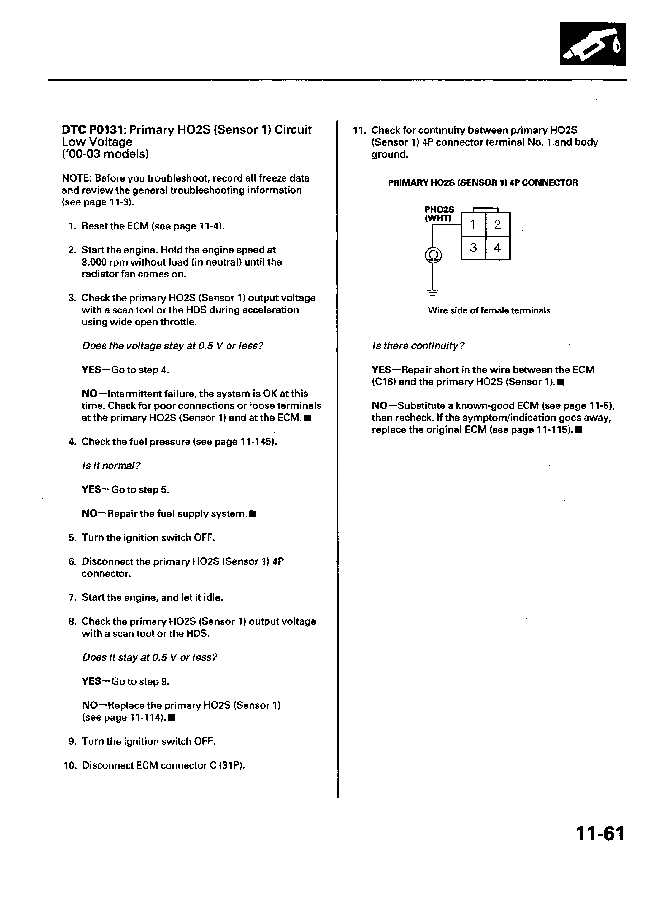
---

### Printed page 11-62

<a id="p358"></a>
Source: [PDF p.358, printed p.11-62](../page-images/p0358.png).

# PGM-FI System
## DTC Troubleshooting (cont'd)
### DTC P0131: Primary HO2S (Sensor 1) Circuit Low Voltage ('04-05 models)

**NOTE:** Before you troubleshoot, record all freeze data and review the general troubleshooting information (see page 11-3).

1. Reset the ECM (see page 11-4).
2. Start the engine. Hold the engine speed at 3,000 rpm without load (in neutral) until the radiator fan comes on.
3. Check the primary HO2S (Sensor 1) output voltage with a scan tool or the HDS during acceleration using wide open throttle.
   - Does the voltage stay at 0.1 V or less?
     - **YES** — Go to step 4.
     - **NO** — Intermittent failure, the system is OK at this time. Check for poor connections or loose terminals at the primary HO2S (Sensor 1) and at the ECM.

4. Turn the ignition switch OFF.
5. Disconnect the primary HO2S (Sensor 1) 4P connector.
6. Turn the ignition switch ON (II).
7. Check the primary HO2S (Sensor 1) output voltage with a scan tool or the HDS.
   - Is there 0.1 V or less?
     - **YES** — Go to step 8.
     - **NO** — Replace the primary HO2S (Sensor 1) (see page 11-114).

8. Turn the ignition switch OFF.
9. Disconnect ECM connector C (31P).
10. Check for continuity between primary HO2S (Sensor 1) 4P connector terminal No. 1 and body ground.

**PRIMARY HO2S (SENSOR 1) 4P CONNECTOR**
See the source connector diagram for pin positions.
   - Is there continuity?
     - **YES** — Repair short in the wire between the ECM (C16) and the primary HO2S (Sensor 1).
     - **NO** — Substitute a known-good ECM (see page 11-5), then recheck. If the symptom/indication goes away, replace the original ECM (see page 11-115).

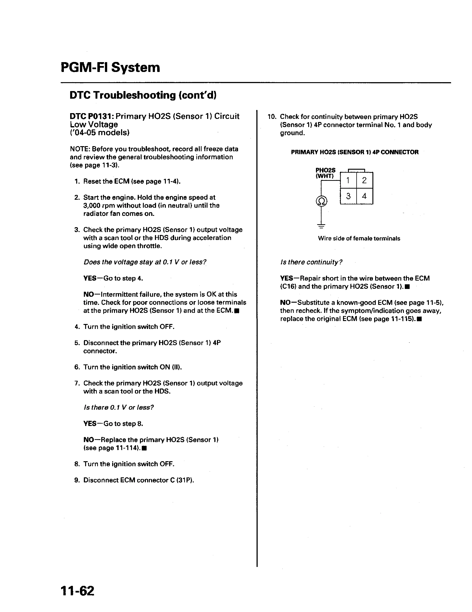
---

### Printed page 11-63

<a id="p359"></a>
Source: [PDF p.359, printed p.11-63](../page-images/p0359.png).

# DTC P0132: Primary HO2S (Sensor 1) Circuit High Voltage (2000–2003)

> **NOTE:** Before you troubleshoot, record all freeze data and review the general troubleshooting information (see page 11-3).

1. Reset the ECM (see page 11-4).
2. Start the engine. Hold the engine speed at 3,000 rpm without load (in neutral) until the radiator fan comes on.
3. Check the primary HO2S (Sensor 1) output voltage with a scan tool or the HDS.

Does the voltage stay at 0.9 V or more?

* **YES** — Go to step 4.
* **NO** — Intermittent failure, the system is OK at this time. Check for poor connections or loose terminals at the primary HO2S (Sensor 1) and at the ECM.

4. Check the fuel pressure (see page 11-145).

Is it normal?

* **YES** — Go to step 5.
* **NO** — Repair the fuel supply system.

5. Turn the ignition switch OFF.
6. Disconnect the primary HO2S (Sensor 1) 4P connector.
7. Connect primary HO2S (Sensor 1) 4P connector terminals No. 1 and No. 2 with a jumper wire.

**Primary HO2S 4P connector:** Jumper terminals No. 1 (PHO2S, WHT) and No. 2 (SG2, GRN/YEL).

See the source connector diagram for pin positions.

8. Turn the ignition switch ON (II).
9. Check the primary HO2S (Sensor 1) output voltage with a scan tool or the HDS.

Is there 0.9 V or more?

* **YES** — Go to step 10.
* **NO** — Replace the primary HO2S (Sensor 1) (see page 11-114).

10. Turn the ignition switch OFF.
11. Connect ECM connector terminals C16 and C18 with a jumper wire.

**ECM connector C (31P):** Jumper C16 and C18.

See the source connector diagram for pin positions.

12. Turn the ignition switch ON (II).
13. Check the primary HO2S (Sensor 1) output voltage with a scan tool or the HDS.

Is there 0.9 V or more?

* **YES** — Substitute a known-good ECM (see page 11-5), then recheck. If the symptom/indication goes away, replace the original ECM (see page 11-115).
* **NO** — Repair open in the wire between the ECM (C16, C18) and the primary HO2S (Sensor 1).

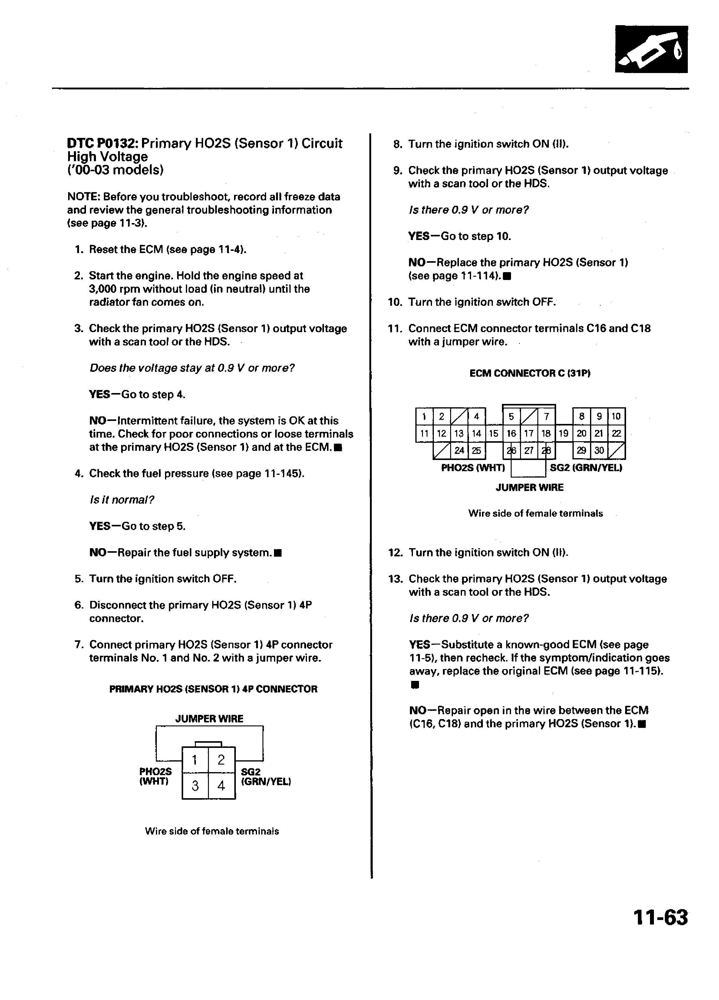
---

### Printed page 11-64

<a id="p360"></a>
Source: [PDF p.360, printed p.11-64](../page-images/p0360.png).

# PGM-FI System
## DTC Troubleshooting (cont'd)
### DTC P0132: Primary HO2S (Sensor 1) Circuit High Voltage (2004–2005)

> **NOTE:** Before you troubleshoot, record all freeze data and review the general troubleshooting information (see page 11-3).

1. Reset the ECM (see page 11-4).
2. Start the engine. Hold the engine speed at 3,000 rpm without load (in neutral) until the radiator fan comes on.
3. Check the primary HO2S (Sensor 1) output voltage with a scan tool or the HDS.
   Does the voltage stay at 3.5 V or more?
   - **YES** — Go to step 4.
   - **NO** — Intermittent failure, the system is OK at this time. Check for poor connections or loose terminals at the primary HO2S (Sensor 1) and at the ECM.

4. Turn the ignition switch OFF.
5. Disconnect the primary HO2S (Sensor 1) 4P connector.
6. Connect primary HO2S (Sensor 1) 4P connector terminals No. 1 and No. 2 with a jumper wire.

   **PRIMARY HO2S (SENSOR 1) 4P CONNECTOR JUMPER WIRE**
   See the source connector diagram for pin positions.
   *Wire side of female terminals*

7. Turn the ignition switch ON (II).
8. Check the primary HO2S (Sensor 1) output voltage with a scan tool or the HDS.
   Is there 3.5 V or more?
   - **YES** — Go to step 9.
   - **NO** — Replace the primary HO2S (Sensor 1) (see page 11-114).

9. Turn the ignition switch OFF.
10. Disconnect the jumper wire.
11. Connect primary HO2S (Sensor 1) 4P connector terminal No. 1 to body ground with a jumper wire.

    **PRIMARY HO2S (SENSOR 1) 4P CONNECTOR**
    See the source connector diagram for pin positions.
    *JUMPER WIRE*
    *Wire side of female terminals*

12. Turn the ignition switch ON (II).
13. Check the primary HO2S (Sensor 1) output voltage with a scan tool or the HDS.
    Is there 3.5 V or more?
    - **YES** — Repair open in the wire between the ECM (C16) and the primary HO2S (Sensor 1).
    - **NO** — Go to step 14.

14. Turn the ignition switch OFF.
15. Disconnect the jumper wire.
16. Disconnect ECM connector C (31P).

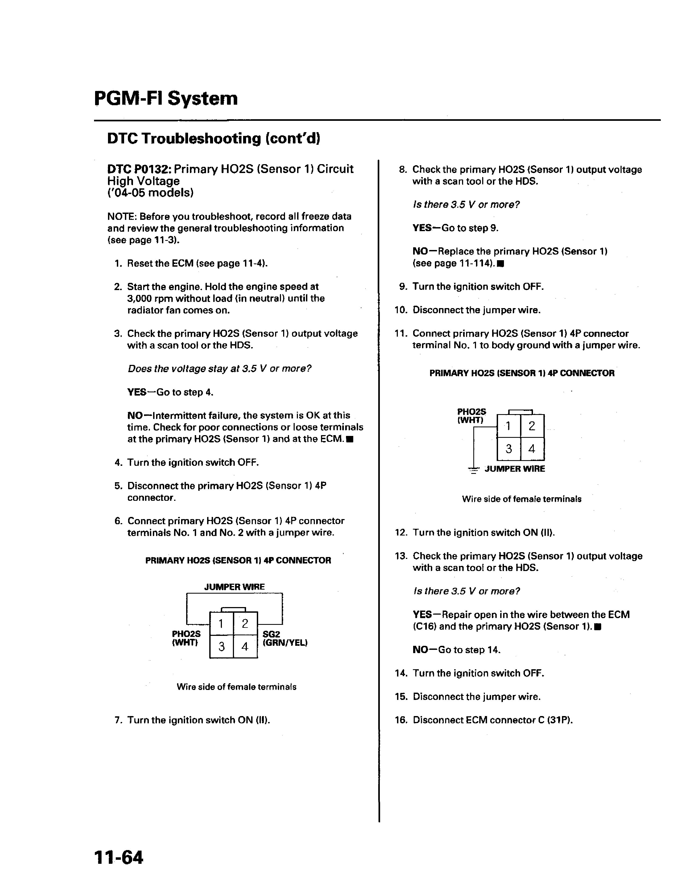
---

### Printed page 11-65

<a id="p361"></a>
Source: [PDF p.361, printed p.11-65](../page-images/p0361.png).

# DTC P0132: Primary HO2S (Sensor 1) Circuit High Voltage, 2004–2005 (continued)

17. Jumper primary HO2S (sensor 1) 4P connector terminal No. 2 (SG2, GRN/YEL) to body ground.
18. Check continuity between ECM connector terminal C18 and body ground. **Is there continuity?**
    - **Yes:** Substitute a known-good ECM (p.11-5), then recheck. If the symptom goes away, replace the original ECM (p.11-115).
    - **No:** Repair the short in the wire between ECM C18 and the primary HO2S (sensor 1). The source explicitly says “short.”

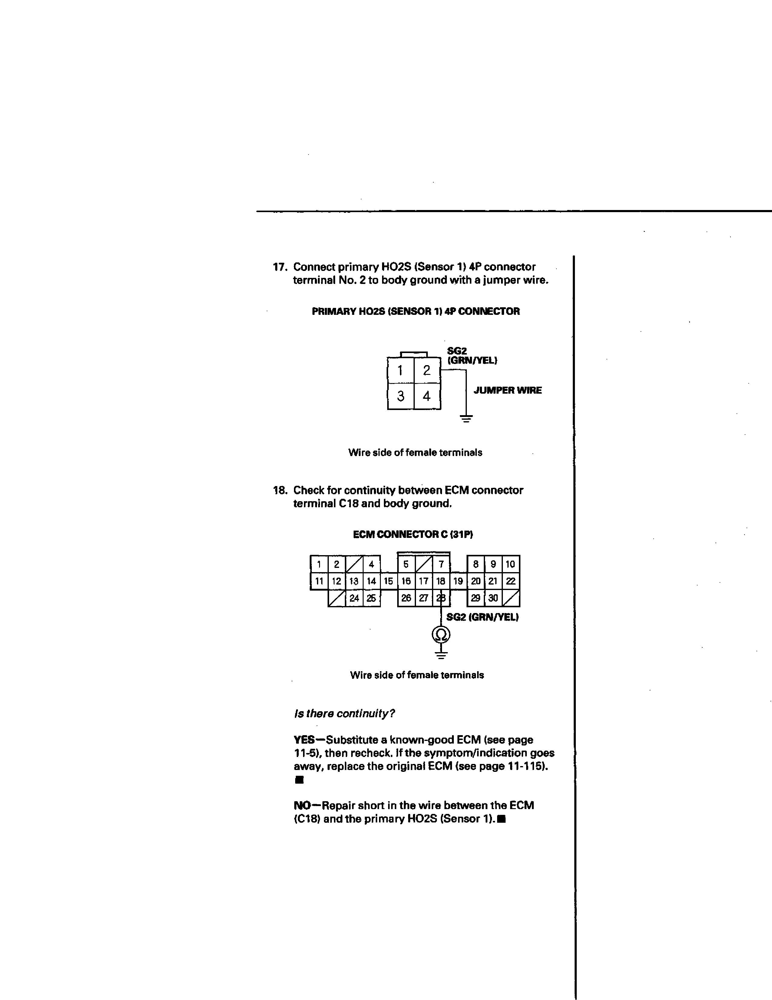
---

### Printed page 11-66

<a id="p362"></a>
Source: [PDF p.362, printed p.11-66](../page-images/p0362.png).

# PGM-FI System
## DTC Troubleshooting (cont'd)
### DTC P0133: Primary HO2S (Sensor 1) Circuit Slow Response

**NOTE:**
*   Before you troubleshoot, record all freeze data and review the general troubleshooting information (see page 11-3).
*   If DTC P0131, P0132, and/or P0135 are stored at the same time as DTC P0133, troubleshoot those DTCs first, then recheck for DTC P0133.

**Procedure:**
1.  Reset the ECM (see page 11-4).
2.  Start the engine. Hold the engine speed at 3,000 rpm without load (in neutral) until the radiator fan comes on.
3.  Test-drive under these conditions:
    *   Transmission in 6th gear
    *   55 mph (89 km/h) steady speed
    *   Until readiness code or Temporary DTC P0133 comes on
4.  Check for a Temporary DTC with a scan tool or the HDS.

**Decision Path:**
*   **Is Temporary DTC P0133 indicated?**
    *   **YES**—Replace the primary HO2S (Sensor 1) (see page 11-114).
    *   **NO**—Intermittent failure, the system is OK at this time. Check for poor connections or loose terminals at the primary HO2S (Sensor 1) and at the ECM.
---

### Printed page 11-67

<a id="p363"></a>
Source: [PDF p.363, printed p.11-67](../page-images/p0363.png).

# DTC P0134: Primary HO2S (Sensor 1) Heater
## System Malfunction (2004 model)

**NOTE:**
*   Before you troubleshoot, record all freeze and review the general troubleshooting information (see page 11-3).
*   If the vehicle was out of fuel and the engine stalled before this DTC was stored, refuel, and clear the DTC with the HDS.

1.  Reset the ECM (see page 11-4).
2.  Start the engine. Hold the engine speed at 3,000 rpm without load (in neutral) until the radiator fan comes on.
3.  Check the primary HO2S (Sensor 1) output voltage with a scan tool or the HDS.
    *   Does the voltage stay at 1.5 V or more?
        *   **YES** — Go to step 4.
        *   **NO** — Intermittent failure, the system is OK at this time. Check for poor connections or loose terminals at the primary HO2S (Sensor 1) and at the ECM.

4.  Turn the ignition switch OFF.
5.  Disconnect the primary HO2S (Sensor 1) 4P connector.
6.  Connect primary HO2S (Sensor 1) 4P connector terminals No. 1 and No. 2 with a jumper wire.
    * See the source connector diagram for terminal positions.

7.  Turn the ignition switch ON.
8.  Check the primary HO2S (Sensor 1) output voltage with the HDS or a scan tool.
    *   Is there 1.5 V or more?
        *   **YES** — Go to step 9.
        *   **NO** — Replace the primary HO2S (Sensor 1) (see page 11-114).

9.  Turn the ignition switch OFF.
10. Disconnect the jumper wire.
11. Connect primary HO2S (Sensor 1) 4P connector terminal No. 1 to body ground with a jumper wire.
    *   **PRIMARY HO2S (SENSOR 1) 4P CONNECTOR**
        *   **PHO2S (WHT)**
        *   **JUMPER WIRE**
        *   Wire side of female terminals
        *   `1` — `2`
        *   `3` — `4`
    *   **PRIMARY HO2S (SENSOR 1) 4P CONNECTOR (cont'd)**
        *   **PHO2S (WHT)**
        *   **SG2 (GRN/YEL)**
        *   Wire side of female terminals

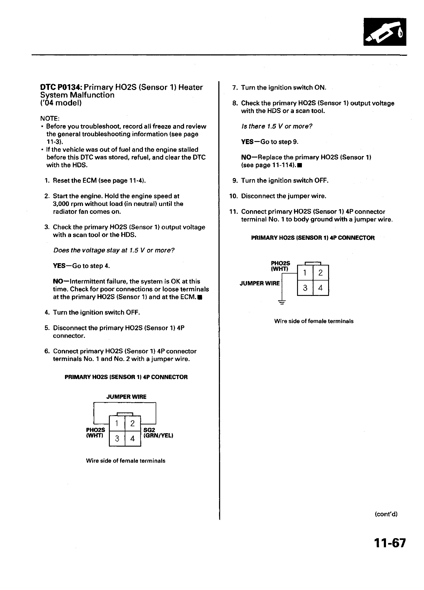
---

### Printed page 11-68

<a id="p364"></a>
Source: [PDF p.364, printed p.11-68](../page-images/p0364.png).

# DTC P0134: Primary HO2S (Sensor 1) Heater System Malfunction, 2004 (continued)

12. Turn the ignition switch ON (II).
13. Check primary HO2S output voltage with a scan tool or HDS. **1.5 V or more?**
    - **Yes:** Repair the open wire between ECM C16 and the primary HO2S.
    - **No:** Go to step 14.
14. Turn the ignition switch OFF.
15. Disconnect the jumper wire.
16. Disconnect ECM connector C (31P).
17. Jumper primary HO2S 4P connector terminal No. 2 (SG2, GRN/YEL) to body ground.
18. Check continuity between ECM connector terminal C18 and body ground. **Is there continuity?**
    - **Yes:** Substitute a known-good ECM (p.11-5), then recheck. If the symptom goes away, replace the original ECM (p.11-115).
    - **No:** Repair the open wire between ECM C18 and the primary HO2S.

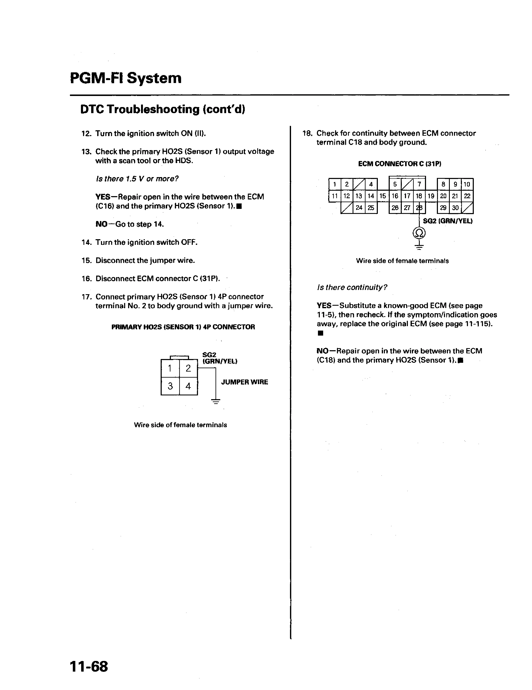
---

### Printed page 11-69

<a id="p365"></a>
Source: [PDF p.365, printed p.11-69](../page-images/p0365.png).

# DTC P0134: Primary HO2S (Sensor 1) Heater
## System Malfunction (2005 model)

**NOTE:**
*   Before you troubleshoot, record all freeze data and review the general troubleshooting information (see page 11-3).
*   If the vehicle was out of fuel and the engine stalled before this DTC was stored, refuel, and clear the DTC with a scan tool or the HDS.

1.  Reset the ECM (see page 11-4).
2.  Start the engine. Hold the engine speed at 3,000 rpm without load (in neutral) until the radiator fan comes on.
3.  Check the primary HO2S (Sensor 1) output voltage with a scan tool or the HDS.
    *   Does the voltage stay at 1.5-3.5 V?
        *   **YES** — Go to step 4.
        *   **NO** — Intermittent failure, the system is OK at this time. Check for poor connections or loose terminals at the primary HO2S (Sensor 1) and at the ECM.

4.  Turn the ignition switch OFF.
5.  Disconnect the primary HO2S (Sensor 1) 4P connector.
6.  Connect primary HO2S (Sensor 1) 4P connector terminals No. 1 and No. 2 with a jumper wire.

See the source connector diagram for terminal positions.

7.  Turn the ignition switch ON.
8.  Check the primary HO2S (Sensor 1) output voltage with a scan tool or the HDS.
    *   Is there 1.5-3.5 V?
        *   **YES** — Go to step 9.
        *   **NO** — Replace the primary HO2S (Sensor 1) (see page 11-114).

9.  Turn the ignition switch OFF.
10. Disconnect the jumper wire.
11. Connect primary HO2S (Sensor 1) 4P connector terminal No. 1 to body ground with a jumper wire.

See the source connector diagram for terminal positions.

12. Turn the ignition switch ON (II).
13. Check the primary HO2S (Sensor 1) output voltage with a scan tool or the HDS.
    *   Is there 1.5-3.5 V?
        *   **YES** — Repair open in the wire between the ECM (C16) and the primary HO2S (Sensor 1).
        *   **NO** — Go to step 14.

14. Turn the ignition switch OFF.
15. Disconnect the jumper wire.
16. Disconnect ECM connector C (31P).

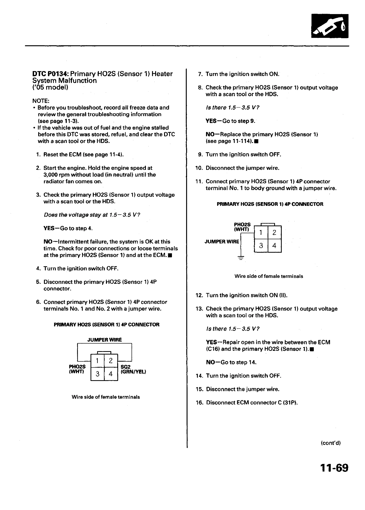
---

### Printed page 11-70

<a id="p366"></a>
Source: [PDF p.366, printed p.11-70](../page-images/p0366.png).

# DTC P0134: Primary HO2S (Sensor 1) Heater System Malfunction, 2005 (continued)

17. Jumper primary HO2S 4P connector terminal No. 2 (SG2, GRN/YEL) to body ground.
18. Check continuity between ECM connector terminal C18 and body ground. **Is there continuity?**
    - **Yes:** Substitute a known-good ECM (p.11-5), then recheck. If the symptom goes away, replace the original ECM (p.11-115).
    - **No:** Repair the short in the wire between ECM C18 and the primary HO2S. The source explicitly says “short.”

# DTC P0135: Primary HO2S Heater Circuit Malfunction; DTC P0141: Secondary HO2S Heater Circuit Malfunction

**Before troubleshooting:** Record freeze data and review the general information (p.11-3). An asterisk in the source applies to P0141.

1. Reset the ECM (p.11-4).
2. Start the engine.
3. Check for a temporary or stored DTC with a scan tool or HDS. **P0135 or P0141 indicated?**
    - **Yes:** Continue at step 4 on the next page.
    - **No:** Intermittent failure; check for poor connections or loose terminals at the relevant HO2S and ECM.

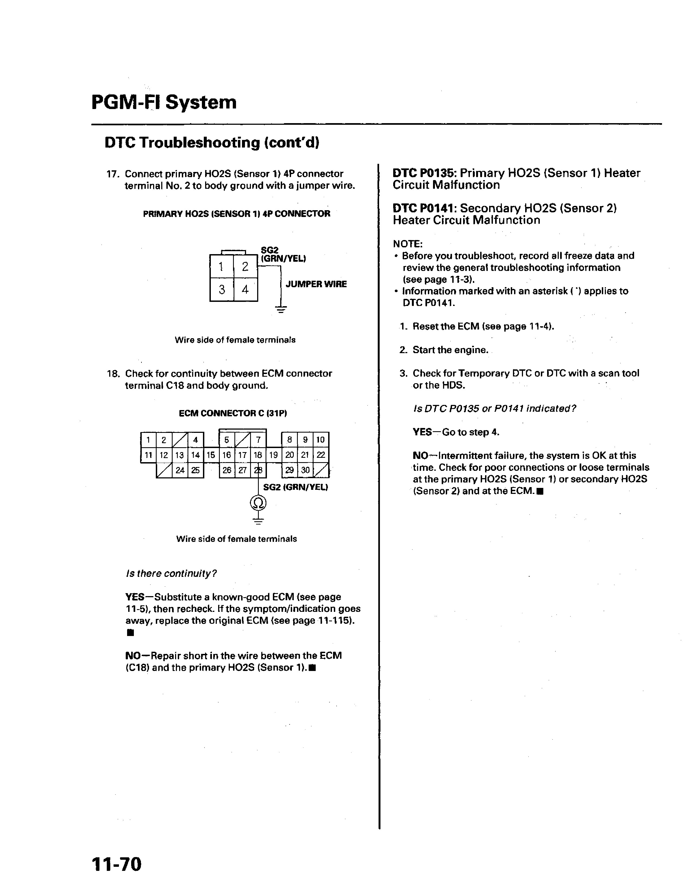
---

### Printed page 11-71

<a id="p367"></a>
Source: [PDF p.367, printed p.11-71](../page-images/p0367.png).

# DTC P0135 / P0141: HO2S Heater Circuit Malfunction (continued)

An asterisk (*) marks the secondary HO2S (sensor 2) path for P0141.

4. Turn the ignition switch OFF.
5. Disconnect the primary or secondary* HO2S 4P connector.
6. At the sensor side, measure resistance between 4P connector terminals No. 3 and No. 4. **About 3.3 Ω for primary, or 12–14.3 Ω for secondary*?**
   - **Yes:** Go to step 7.
   - **No:** Replace the primary or secondary* HO2S (p.11-114).
7. At the sensor side, check each terminal, No. 3 and No. 4, for continuity to body ground. **Any continuity?**
   - **Yes:** Replace the primary or secondary* HO2S (p.11-114).
   - **No:** Go to step 8.
8. Turn the ignition switch ON (II).
9. Measure voltage between 4P connector terminals No. 3 and No. 4. **Battery voltage?**
   - **Yes:** Go to step 10 on the next page.
   - **No:** Go to step 13 on the next page.

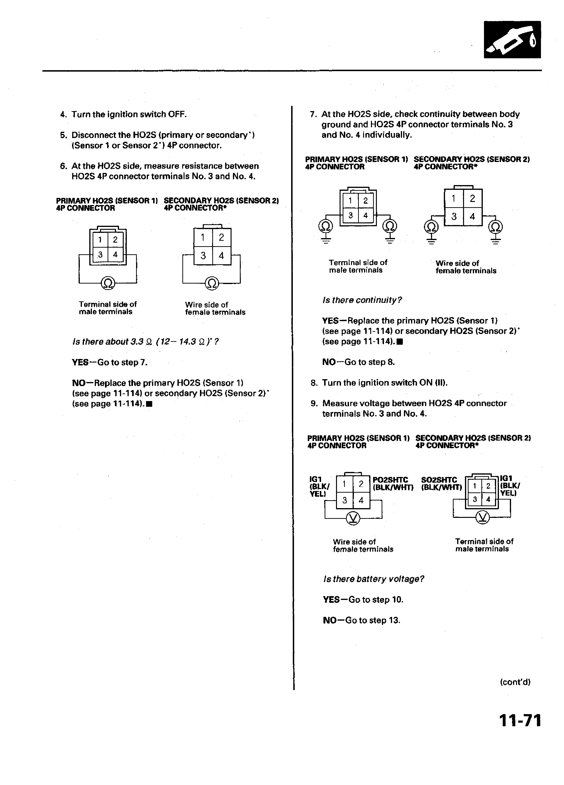
---

### Printed page 11-72

<a id="p368"></a>
Source: [PDF p.368, printed p.11-72](../page-images/p0368.png).

# DTC P0135 / P0141: HO2S Heater Circuit Malfunction (continued)

An asterisk (*) marks the secondary HO2S (sensor 2) path for P0141.

10. Turn the ignition switch OFF.
11. Disconnect ECM connector C (31P).
12. Check continuity between ECM C1 (primary) or C11* (secondary) and body ground. **Is there continuity?**
    - **Yes:** Repair the short in the wire between ECM C1/C11* and the relevant HO2S.
    - **No:** Substitute a known-good ECM (p.11-5), then recheck. If the symptom goes away, replace the original ECM (p.11-115).
13. Measure voltage between primary HO2S connector terminal No. 3, or secondary HO2S terminal No. 4*, and body ground. **Battery voltage?**
    - **Yes:** Go to step 14.
    - **No:** Repair the open wire between the relevant HO2S and No. 6 ACG (15 A) fuse.
14. Turn the ignition switch OFF.
15. Reconnect the HO2S 4P connector.
16. Disconnect ECM connector C (31P).
17. Turn the ignition switch ON (II).
18. Measure voltage between ECM B2 and C1 (or B2 and C11*). **0.1 V or less?**
    - **Yes:** Repair the open wire between ECM C1/C11* and the relevant HO2S.
    - **No:** Substitute a known-good ECM (p.11-5), then recheck. If the symptom goes away, replace the original ECM (p.11-115).

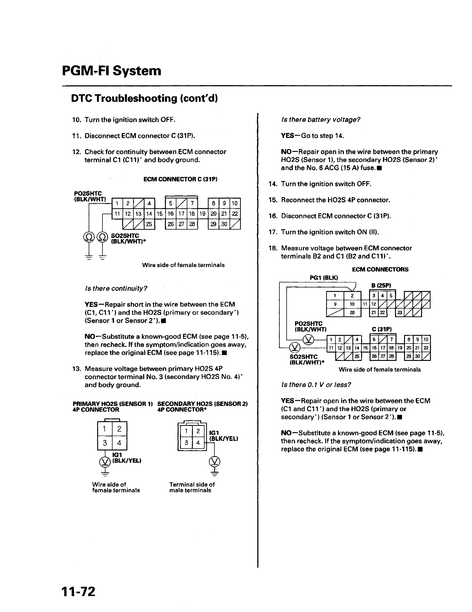
---

### Printed page 11-73

<a id="p369"></a>
Source: [PDF p.369, printed p.11-73](../page-images/p0369.png).

# DTC P0137: Secondary HO2S (Sensor 2) Circuit Low Voltage

**NOTE:** Before you troubleshoot record all freeze data and review the general troubleshooting information (see page 11-3).

1. Reset the ECM (see page 11-4).
2. Start the engine. Hold the engine speed at 3,000 rpm without load (in neutral) until the radiator fan comes on.
3. Check the secondary HO2S (Sensor 2) output voltage at 3,000 rpm with a scan tool or the HDS.
   - Does the voltage stay at 0.3 V or less?
     - **YES** — Go to step 4.
     - **NO** — Intermittent failure, the system is OK at this time. Check for poor connections or loose terminals at the secondary HO2S (Sensor 2) and at the ECM.

4. Turn the ignition switch OFF.
5. Disconnect the secondary HO2S (Sensor 2) 4P connector.
6. Start the engine.
7. Check the secondary HO2S (Sensor 2) output voltage with a scan tool or the HDS.
   - Does the voltage stay at 0.3 V or less?
     - **YES** — Go to step 8.
     - **NO** — Replace the secondary HO2S (Sensor 2) * (see page 11-114).

8. Turn the ignition switch OFF.
9. Disconnect ECM connector C (31P).
10. Check for continuity between secondary HO2S (Sensor 2) 4P connector terminal No. 2 and body ground.

**SECONDARY HO2S (SENSOR 2) 4P CONNECTOR**
See the source connector diagram for pin positions.

Is there continuity?
- **YES** — Repair short in the wire between the ECM (C15) and the secondary HO2S (Sensor 2).
- **NO** — Substitute a known-good ECM (see page 11-5), then recheck. If the symptom/indication goes away, replace the original ECM (see page 11-115).

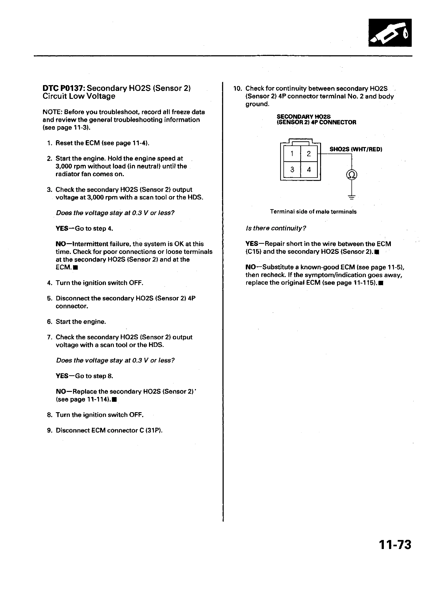
---

### Printed page 11-74

<a id="p370"></a>
Source: [PDF p.370, printed p.11-74](../page-images/p0370.png).

# PGM-FI System
## DTC Troubleshooting (cont'd)
### DTC P0138: Secondary HO2S (Sensor 2) Circuit High Voltage ('00-04 models)

**NOTE:** Before you troubleshoot, record all freeze data and review the general troubleshooting information (see page 11-3).

1. Reset the ECM (see page 11-4).
2. Start the engine. Hold the engine speed at 3,000 rpm without load (in neutral) until the radiator fan comes on.
3. Check the secondary HO2S (Sensor 2) output voltage at 3,000 rpm with a scan tool or the HDS. Does the voltage stay at 0.6 V or more?
   - **YES** — Go to step 4.
   - **NO** — Intermittent failure, the system is OK at this time. Check for poor connections or loose terminals at the secondary HO2S (Sensor 2) and at the ECM.

4. Turn the ignition switch OFF.
5. Disconnect the secondary HO2S (Sensor 2) 4P connector.
6. Connect secondary HO2S (Sensor 2) 4P connector terminals No. 1 and No. 2 with a jumper wire.
   > **SECONDARY HO2S (SENSOR 2) 4P CONNECTOR**
   > **JUMPER WIRE**
   > SG2 (GRN/YEL) SHO2S (WHT/RED)
   > Terminal side of male terminals

7. Turn the ignition switch ON (II).
8. Check the secondary HO2S (Sensor 2) output voltage with a scan tool or the HDS.
   Is there 0.6 V or more?
   - **YES** — Go to step 9.
   - **NO** — Replace the secondary HO2S (Sensor 2)* (see page 11-114).

9. Turn the ignition switch OFF.
10. Disconnect the jumper wire.
11. Connect ECM connector terminals C15 and C18 with a jumper wire.
    > **ECM CONNECTOR C (31P)**
    > **JUMPER WIRE**
    > SHO2S (WHT/RED) SG2 (GRN/YEL)
    > 1 2 3 / 5 6 8 9 10 / / 13 14 15 16 17 18 19 20 21 / 23 / 25 26 27 28 29 30 / Wire side of female terminals

12. Turn the ignition switch ON (II).
13. Check the secondary HO2S (Sensor 2) output voltage with a scan tool or the HDS.
    Is there 0.6 V or more?
    - **YES** — Substitute a known-good ECM (see page 11-5), then recheck. If the symptom/indication goes away, replace the original ECM (see page 11-115).
    - **NO** — Repair open in the wire between the ECM (C15, C18) and the secondary HO2S (Sensor 2).l

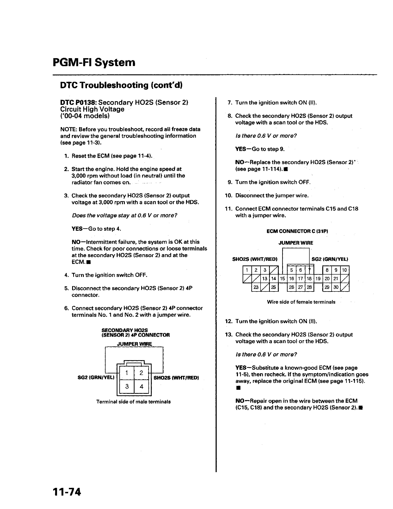
---

### Printed page 11-75

<a id="p371"></a>
Source: [PDF p.371, printed p.11-75](../page-images/p0371.png).

# DTC P0138: Secondary HO2S (Sensor 2) Circuit High Voltage (2005)

**NOTE:** Before you troubleshoot, record all freeze data and review the general troubleshooting information (see page 11-3).

1. Reset the ECM (see page 11-4).
2. Start the engine. Hold the engine speed at 3,000 rpm without load (in neutral) until the radiator fan comes on.
3. Check the secondary HO2S (Sensor 2) output voltage at 3,000 rpm with a scan tool or the HDS. Does the voltage stay at 3.0 V or more?
   - **YES** — Go to step 4.
   - **NO** — Intermittent failure, the system is OK at this time. Check for poor connections or loose terminals at the secondary HO2S (Sensor 2) and at the ECM .

4. Turn the ignition switch OFF.
5. Disconnect the secondary HO2S (Sensor 2) 4P connector.
6. Connect secondary HO2S (Sensor 2) 4P connector terminals No. 1 and No. 2 with a jumper wire.
   - **S E C O N D A R Y HO2S**
   - **( S E N S O R 2) 4P C O N N E C T O R**
   - **J U M P E R W I R E**
   - **S G 2 (GRN/YEL)** | **S HO2S (WHT/RED)**
   - Terminal side of male terminals

7. Turn the ignition switch ON (II).
8. Check the secondary HO2S (Sensor 2) output voltage with a scan tool or the HDS.
   Is there 3.0 V or more?
   - **YES** — Go to step 9.
   - **NO** — Replace the secondary HO2S (Sensor 2) (see page 11-114).

9. Turn the ignition switch OFF.
10. Disconnect the jumper wire.
11. Connect ECM connector terminals C15 and C18 with a jumper wire.
    - **ECM C O N N E C T O R C (31P)**
    - **J U M P E R W I R E**
    - **S HO2S (WHT/RED)** | **S G 2 (GRN/YEL)**
    - *Diagram labels:* 1, 2, 3 / 5, 6 r, 8, 9, 10 / 13, 14, 15, 16, 17, 18, 19, 20, 21 / 23 / 25, 26, 27, 28, 29, 30
    - Wire side of female terminals

12. Turn the ignition switch ON (II).

*(cont'd)*

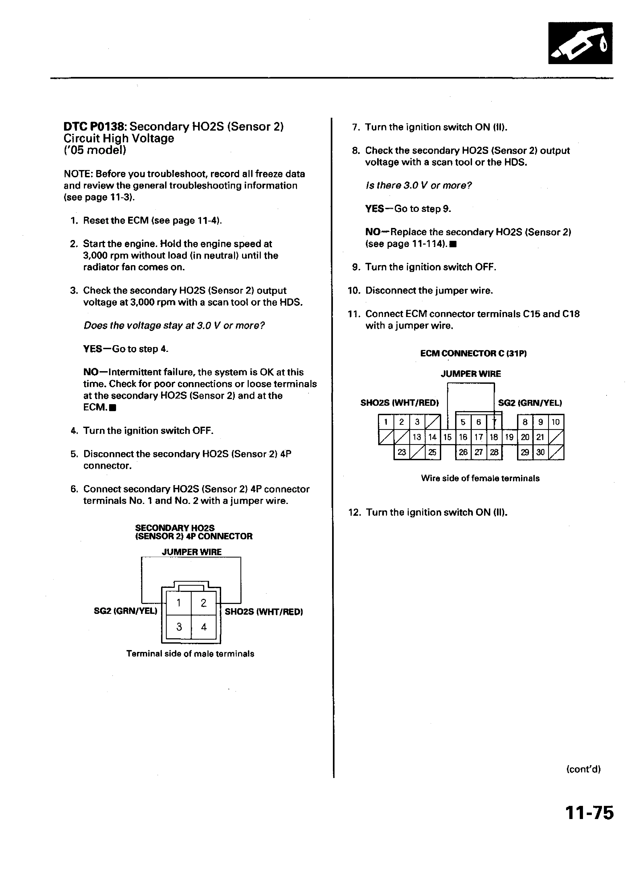
---

### Printed page 11-76

<a id="p372"></a>
Source: [PDF p.372, printed p.11-76](../page-images/p0372.png).

# DTC P0138: Secondary HO2S (Sensor 2) Circuit High Voltage, 2005 (continued)

13. Check secondary HO2S output voltage with a scan tool or HDS. **3.0 V or more?**
    - **Yes:** Substitute a known-good ECM (p.11-5), then recheck. If the symptom goes away, replace the original ECM (p.11-115).
    - **No:** Go to step 14.
14. Turn the ignition switch OFF.
15. Disconnect the jumper wire.
16. Jumper secondary HO2S 4P connector terminal No. 2 (SHO2S, WHT/RED) to body ground.
17. Check secondary HO2S output voltage. **3.0 V or more?**
    - **Yes:** Repair the open wire between ECM C15 and the secondary HO2S.
    - **No:** Go to step 18.
18. Turn the ignition switch OFF.
19. Disconnect the jumper wire.
20. Disconnect ECM connector C (31P).
21. Jumper secondary HO2S 4P connector terminal No. 1 (SG2, GRN/YEL) to body ground.
22. Check continuity between ECM connector terminal C18 and body ground. **Is there continuity?**
    - **Yes:** Substitute a known-good ECM (p.11-5), then recheck. If the symptom goes away, replace the original ECM (p.11-115).
    - **No:** Repair the open wire between ECM C18 and the secondary HO2S.

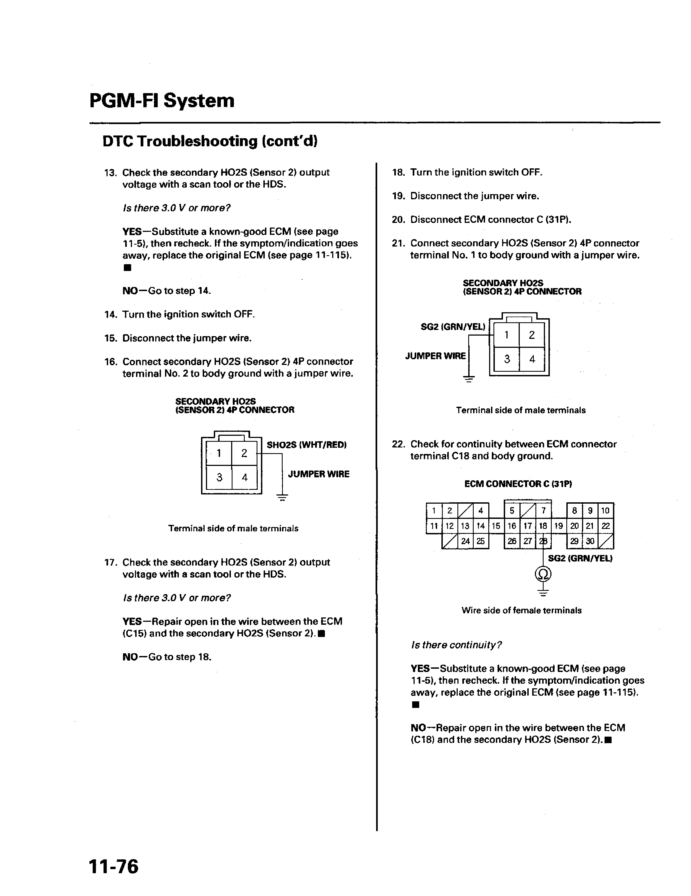
---

### Printed page 11-77

<a id="p373"></a>
Source: [PDF p.373, printed p.11-77](../page-images/p0373.png).

# DTC P0139: Secondary HO2S (Sensor 2) Circuit Slow Response (2000–2004)

**NOTE:** Before you troubleshoot, record all freeze data and review the general troubleshooting information (see page 11-3).

1. Reset the ECM (see page 11-4).
2. Start the engine. Hold the engine speed at 3,000 rpm without load (in neutral) until the radiator fan comes on.
3. Check the secondary HO2S (Sensor 2) output voltage at 3,000 rpm with a scan tool or the HDS. Does the voltage stay within 0.3-0.6 V for 2 minutes?

   - **YES**—Replace the secondary HO2S (Sensor 2) (see page 11-114).
   - **NO**—Intermittent failure, the system is OK at this time. Check for poor connections or loose terminals at the secondary HO2S (Sensor 2) and at the ECM.
---

### Printed page 11-78

<a id="p374"></a>
Source: [PDF p.374, printed p.11-78](../page-images/p0374.png).

# PGM-FI System
## DTC Troubleshooting (cont'd)

### DTC P0171: Fuel System Too Lean
### DTC P0172: Fuel System Too Rich

**NOTE:**
*   Before you troubleshoot, record all freeze data and review the general troubleshooting information (see page 11-3).
*   If some of the DTCs listed below are stored at the same time as DTC P0171 and/or P0172, troubleshoot those DTCs first, then recheck for P0171 and/or P0172.

| DTC Code(s) | Description |
| :--- | :--- |
| P0107, P0108, P1128, P1129 | Manifold absolute pressure (MAP) sensor |
| P0135 | Primary heated oxygen sensor (primary HO2S) (Sensor 1) heater |
| P0137, P0138 | Secondary HO2S (Sensor 2) |
| P0141 | Secondary HO2S (Sensor 2) heater |
| P1259 (P2646, P2647) * | VTEC system |

*   *: '04-05 models

---

1. Check the fuel pressure (see page 11-145).

**Is fuel pressure OK?**

*   **YES — Go to step 2.**
*   **NO — Check these items:**
    *   If the pressure is too high. Check the fuel pressure regulator, and the fuel return pipe.
    *   If the pressure is too low. Check the fuel pump, the fuel feed pipe, the fuel filter, and the fuel pressure regulator.

2. Start the engine. Hold the engine speed at 3,000 rpm without load (in neutral) until the radiator fan comes on.

3. Check the primary HO2S (Sensor 1) output with a scan tool or the HDS.

**Does it stay less than 0.3 V or more than 0.6 V?**

*   **YES — Replace the primary HO2S (Sensor 1)** (see page 11-114).
*   **NO — Go to step 4.**

4. Turn the ignition switch OFF.

5. With a vacuum pump, apply vacuum to the EVAP canister purge valve from the intake manifold side.

**Does it hold vacuum?**

*   **YES — Check the valve clearances and adjust if necessary. If the valve clearances are OK, replace the injectors.**
*   **NO — Replace the EVAP canister purge valve.**

---
---

### Printed page 11-79

<a id="p375"></a>
Source: [PDF p.375, printed p.11-79](../page-images/p0375.png).

# DTC P0300: Random Misfire and Any Combination of the Following:
DTC P0301: No. 1 Cylinder Misfire Detected
DTC P0302: No. 2 Cylinder Misfire Detected
DTC P0303: No. 3 Cylinder Misfire Detected
DTC P0304: No. 4 Cylinder Misfire Detected

**NOTE:**
*   Before you troubleshoot record all freeze data and review the general troubleshooting information (see page 11-3).
*   If the misfiring is frequent enough to trigger detection of increased emissions during two consecutive driving cycles, the MIL will come on, and DTC P0300 (and some combination of P0301 through P0304) will be stored.
*   If the misfiring is frequent enough to damage the catalyst, the MIL will blink whenever the misfiring occurs, and DTC P0300 (and some combination of P0301 through P0304) will be stored. When the misfiring stops, the MIL will remain on.

**1.** Troubleshoot the following DTCs first if any of them were stored along with the random misfire DTC(s):
*   P0107, P0108, P1128, P1129: Manifold absolute pressure (MAP) sensor
*   P0131, P0132: Primary heated oxygen sensor (primary HO2S) (Sensor 1)
*   P0171, P0172: Fuel metering
*   P0335, P0336: Crankshaft position (CKP) sensor
*   P0505 (P0506, P0507)*: Idle control system
*   P1259 (P2646, P2647)*: VTEC system
*   P1361, P1362, P1366, P1367 (P0340, P0344, P0365, P0369)*: Camshaft position (CMP) sensor (top dead center (TDC) Sensor) A/B
*   P0511*: Idle air control (IAC) valve
*   * : '04-05 models

**2.** Test-drive the vehicle to verify the symptom.

**3.** Find the symptom in the chart, and do the related procedures in the order listed until you find the cause.

| Symptom | Procedure(s) | Also check for: |
| :--- | :--- | :--- |
| Random misfire only at low RPM and load | Check fuel pressure (see page 11-145). | • Low compression.<br>• Low quality fuel. |
| Random misfire only during acceleration | Check fuel pressure (p.11-145). | Check for VTEC malfunction (p.6-8). |
| Random misfire at high RPM and load, or under random conditions | Check fuel pressure (p.11-145). | Correct valve clearance (p.6-10). |


---

### Printed page 11-80

<a id="p376"></a>
Source: [PDF p.376, printed p.11-80](../page-images/p0376.png).

# PGM-FI System
## DTC Troubleshooting (cont'd)

### DTC P0301: No. 1 Cylinder Misfire Detected
### DTC P0302: No. 2 Cylinder Misfire Detected
### DTC P0303: No. 3 Cylinder Misfire Detected
### DTC P0304: No. 4 Cylinder Misfire Detected

**NOTE:**
*   Before you troubleshoot record all freeze data and review the general troubleshooting information (see page 11-3).
*   Information marked with an asterisk (*) applies to'00-04 models.
*   Information marked with double asterisk (* *) applies to'05 model.

1. After checking and recording the freeze data, reset the ECM (see page 11-4). If there is no freeze data of the misfire, just clear the DTC.
2. Start the engine, listen for a clicking sound at the injector at the problem cylinder.
   Does it click?
   *   **YES** — Go to step 3.
   *   **NO** — Go to step 30.

3. Turn the ignition switch OFF.
4. Exchange the ignition coil from the problem cylinder with one from another cylinder.
5. Test-drive the vehicle several times in the range of the freeze data or under various conditions if there was no freeze data.
6. Check for Temporary DTC or DTC with a scan tool or the HDS.
   Is DTC P0301, P0302, P0303, or P0304 or Temporary DTC P1399* (P0301, P0302, P0303, or P0304)** indicated?
   *   **YES** — Go to step 7.
   *   **NO** — Intermittent misfire due to poor contact at the ignition coil connector (no misfire at this time).

7. Determine which cylinder(s) had the misfire.
   Does the misfire occur in the other cylinder where the ignition coil was exchanged?
   *   **YES** — Replace the faulty ignition coil.B
   *   **NO** — Go to step 8.

8. Turn the ignition switch OFF.
9. Exchange the spark plug from the problem cylinder with one from another cylinder.
10. Test-drive the vehicle several times in the range of the freeze data or under various conditions if there was no freeze data.
11. Check for Temporary DTC or DTC with a scan tool or the HDS.
    Is DTC P0301, P0302,P0303 or P0304 or Temporary DTC P1399* (P0301, P0302, P0303, or P0304)* * indicated?
    *   **YES** — Go to step 12.
    *   **NO** — Intermittent misfire due to spark plug fouling, etc. (no misfire at this time).

12. Determine which cylinder had the misfire.
    Does the misfire occur in the other cylinder where the spark plug was exchanged?
    *   **YES** — Replace the faulty spark plug.
    *   **NO** — Go to step 13.

13. Turn the ignition switch OFF.
14. Exchange the injector from the problem cylinder with one from the another cylinder.
15. Let the engine idle for 2 minutes.
16. Test-drive the vehicle several times in the range of the freeze data or under various conditions if there was no freeze data.
---

### Printed page 11-81

<a id="p377"></a>
Source: [PDF p.377, printed p.11-81](../page-images/p0377.png).

# DTC P0301–P0304: Cylinder Misfire (continued)

17. Check for a temporary or stored P0301–P0304, or temporary P1399* (P0301–P0304**), with a scan tool or HDS. **Indicated?**
    - **Yes:** Go to step 18.
    - **No:** Intermittent misfire due to poor contact at the injector connector; no misfire now.
18. Determine the misfiring cylinder. **Did the misfire move to the cylinder that received the exchanged injector?**
    - **Yes:** Replace the faulty injector (p.11-112).
    - **No:** Go to step 19.
19. Turn the ignition switch OFF.
20. Disconnect the ignition coil 3P connector from the problem cylinder.
21. Turn the ignition switch ON (II).
22. Measure voltage between ignition coil connector terminal No. 3 (IG, BLK/YEL) and body ground. **Battery voltage?**
    - **Yes:** Go to step 23.
    - **No:** Repair the open wire between the No. 4 IGN COIL (15 A) fuse and the ignition coil.
23. Turn the ignition switch OFF.
24. Check continuity between ignition coil connector terminal No. 2 (GND, BLK) and body ground. **Continuity?**
    - **Yes:** Go to step 25.
    - **No:** Repair the open wire between the ignition coil and G101.
25. Disconnect ECM connector C (31P).
26. Check continuity between body ground and the ECM terminal for the affected cylinder:

| Cylinder | DTC | ECM terminal | Wire color |
| --- | --- | --- | --- |
| 1 | P0301 | C4 | WHT |
| 2 | P0302 | C12 | WHT/GRN |
| 3 | P0303 | C13 | WHT/BLK |
| 4 | P0304 | C14 | WHT/BLU |

**Continuity?** Yes: repair the short between ECM and coil. No: go to step 27.


---

### Printed page 11-82

<a id="p378"></a>
Source: [PDF p.378, printed p.11-82](../page-images/p0378.png).

# DTC P0301–P0304: Cylinder Misfire (continued)

27. Jumper ignition coil 3P connector terminal No. 1 to body ground, using the wire for the affected cylinder below.
28. Check continuity between body ground and the corresponding ECM terminal.

| Cylinder | DTC | Coil wire | ECM terminal |
| --- | --- | --- | --- |
| 1 | P0301 | WHT | C4 |
| 2 | P0302 | WHT/GRN | C12 |
| 3 | P0303 | WHT/BLK | C13 |
| 4 | P0304 | WHT/BLU | C14 |

**Continuity?** Yes: go to step 29. No: repair the open wire between ECM and ignition coil.

29. Check engine compression. **Compression OK?** Yes: substitute a known-good ECM (p.11-5), then recheck; replace the original ECM (p.11-115) if the symptom goes away. No: repair the engine.
30. Turn the ignition switch OFF.
31. Disconnect ECM connector B (25P).
32. Turn the ignition switch ON (II).
33. Measure voltage between body ground and the ECM injector terminal for the affected cylinder:

| Cylinder | DTC | ECM terminal | Wire color |
| --- | --- | --- | --- |
| 1 | P0301 | B11 | BRN |
| 2 | P0302 | B3 | RED |
| 3 | P0303 | B4 | BLU |
| 4 | P0304 | B5 | YEL |

**Battery voltage?** Yes: go to step 34. No: go to step 42.

34. Turn the ignition switch OFF.
35. Disconnect the injector 2P connector from the problem cylinder.


---

### Printed page 11-83

<a id="p379"></a>
Source: [PDF p.379, printed p.11-83](../page-images/p0379.png).

# Diagnostic Procedure: Injector Malfunction

## Step 36
At the injector side, measure resistance between injector 2P connector terminals No. 1 and No. 2.

**INJECTOR 2P CONNECTOR**
- Terminal side of male terminals
- **IGP INJ**

Is there 10–13 Ω?
- **YES** — Go to step 37.
- **NO** — Replace the injector (see page 11-112).

## Step 37
Exchange the injector from the problem cylinder with one from another cylinder.

## Step 38
Let the engine idle for 2 minutes.

## Step 39
Test-drive the vehicle several times in the range of the freeze data or under various conditions if there was no freeze data.

## Step 40
Check for Temporary DTC or DTC with a scan tool.
Is DTC P0301, P0302, P0303, or P0304 or Temporary DTC P1399* (P0301, P0302 P0303, or P0304)* indicated?
- **YES** — Go to step 41.
- **NO** — Intermittent misfire due to injector malfunction, etc.

## Step 41
Determine which cylinder had the misfire.
Does the misfire occur in the other cylinder where the injector was exchanged?
- **YES** — Replace the faulty injector.
- **NO** — Substitute a known-good ECM (see page 11-5), then recheck. If the symptom/indication goes away, replace the original ECM (see page 11-115).

## Step 42
Turn the ignition switch OFF.

## Step 43
Disconnect injector 2P connector from the problem cylinder.

## Step 44
Turn the ignition switch ON (II).

## Step 45
Measure voltage between injector 2P connector terminal No. 2 and body ground.

**INJECTOR 2P CONNECTOR**
- Wire side of female terminals
- **IGP (YEL/BLK)**

Is there battery voltage?
- **YES** — Go to step 46.
- **NO** — Repair open in the wire between the injector and the PGM-FI main relay.

## Step 46
Turn the ignition switch OFF.
---

### Printed page 11-84

<a id="p380"></a>
Source: [PDF p.380, printed p.11-84](../page-images/p0380.png).

# DTC P0301–P0304: Cylinder Misfire (continued)

47. Check continuity between body ground and the ECM injector terminal for the problem cylinder:

| Cylinder | DTC | ECM terminal | Wire color |
| --- | --- | --- | --- |
| 1 | P0301 | B11 | BRN |
| 2 | P0302 | B3 | RED |
| 3 | P0303 | B4 | BLU |
| 4 | P0304 | B5 | YEL |

**Continuity?** Yes: repair the short between ECM and injector. No: go to step 48.

48. Jumper injector 2P connector terminal No. 1 to body ground on the problem cylinder. Wire colors: cylinder 1 BRN, 2 RED, 3 BLU, 4 YEL.
49. Check continuity between body ground and the corresponding ECM terminal in the table above. **Continuity?**
    - **Yes:** Replace the injector, then recheck.
    - **No:** Repair the open wire between ECM and injector.


---

### Printed page 11-85

<a id="p381"></a>
Source: [PDF p.381, printed p.11-85](../page-images/p0381.png).

# DTC P0325: Knock Sensor Circuit Malfunction

**NOTE:** Before you troubleshoot, record all freeze data and review the general troubleshooting information (see page 11-3).

1. Reset the ECM (see page 11-4).
2. Start the engine. Hold the engine speed at 3,000 rpm without load (in neutral) until the radiator fan comes on, then let it idle.
3. Hold the engine speed at 3,000—4,000 rpm for 10 seconds.
4. Check for Temporary DTC or DTC with a scan tool or the HDS.

**Is DTC P0325 indicated?**
- **YES** — Go to step 5.
- **NO** — Intermittent failure, the system is OK at this time. Check for poor connections or loose terminals at the knock sensor and at the ECM.

5. Turn the ignition switch OFF.
6. From underneath the vehicle, reach above the front of the starter motor, and disconnect the knock sensor 1P connector.
7. Disconnect ECM connector C (31P), then check for continuity between ECM connector terminals C22 and body ground.

See the source connector diagram for ECM C22 (KS, RED/BLU).

**Is there continuity?**
- **YES** — Repair short in the wire between the ECM (C22) and the knock sensor.
- **NO** — Go to step 8.

8. Connect the knock sensor 1P connector terminal body ground with a jumper wire.

See the source connector diagram for the knock sensor terminal.


---

### Printed page 11-86

<a id="p382"></a>
Source: [PDF p.382, printed p.11-86](../page-images/p0382.png).

# PGM-FI System
## DTC Troubleshooting (cont'd)

### Step 9
Check for continuity between ECM connector terminal C22 and body ground.

**ECM CONNECTOR C (31P)**
See the source connector diagram for pin positions.
**KS (RED/BLU)**
Wire side of female terminals

Is there continuity?
- **YES** — Go to step 10.
- **NO** — Repair open in the wire between the ECM (C22) and the knock sensor. •

### Step 10
Substitute a known-good knock sensor.

### Step 11
Check for Temporary DTC or DTC with a scan tool or the HDS.
Is DTC P0325 indicated?
- **YES** — Substitute a known-good ECM (see page 11-5), then recheck. If the symptom/indication goes away, replace the original ECM (see page 11-115).
- **NO** — Replace the original knock sensor. •

---

### DTC P0335: CKP Sensor No Signal
### DTC P0336: CKP Sensor Circuit Intermittent Interruption ('00-03 models)
### DTC P0339: CKP Sensor Circuit Intermittent Interruption ('04-05 models)

**NOTE:**
- Before you troubleshoot, record all freeze data and review the general troubleshooting information (see page 11-3).
- Information marked with an asterisk (*) applies to '00-03 models.
- Information marked with double asterisk (**) applies to '04-05 models.

### Step 1
Reset the ECM (see page 11-4).

### Step 2
Start the engine.

### Step 3
Check for Temporary DTC or DTC with a scan tool or the HDS.
Is DTC P0335 and/or P0336* (P0339**)?
- **YES** — Go to step 4.
- **NO** — Intermittent failure, the system is OK at this time. Check for poor connections or loose terminals at the CKP sensor and at the ECM. •

### Step 4
Turn the ignition switch OFF.

### Step 5
Disconnect the CKP sensor 3P connector.


---

### Printed page 11-87

<a id="p383"></a>
Source: [PDF p.383, printed p.11-87](../page-images/p0383.png).

# DTC P0335 / P0336 / P0339: CKP Sensor (continued)

6. At the sensor side, measure resistance between CKP 3P connector terminals No. 1 and No. 2. **1,850–2,450 Ω?**
    - **Yes:** Go to step 7.
    - **No:** Replace the CKP sensor (p.6-6).
7. At the sensor side, check terminals No. 1 and No. 2 individually for continuity to body ground. **Any continuity?**
    - **Yes:** Replace the CKP sensor (p.6-3).
    - **No:** The source says “go to step 7,” although step 8 follows; consult the source before proceeding.
8. Reconnect the CKP sensor 3P connector.
9. Disconnect ECM connector C (31P) and measure resistance between C8 and C9. **1,850–2,450 Ω?**
    - **Yes:** Go to step 10.
    - **No:** Repair the open wire between ECM C8/C9 and CKP sensor.
10. Check continuity between ECM C8 and body ground. **Is there continuity?**
    - **Yes:** Repair the short between ECM C8 and CKP sensor.
    - **No:** Substitute a known-good ECM (p.11-5), then recheck. If the symptom goes away, replace the original ECM (p.11-115).


---

### Printed page 11-88

<a id="p384"></a>
Source: [PDF p.384, printed p.11-88](../page-images/p0384.png).

# PGM-FI System
## DTC Troubleshooting (cont'd)

### DTC P0340: CMP Sensor A No Signal
*('04-05 models)*

### DTC P0344: CMP Sensor A Circuit Intermittent Interruption
*('04-05 models)*

### DTC P1361: CMP (TDC) Sensor A Circuit Intermittent Interruption
*('00-03 models)*

### DTC P1362: CMP (TDC) Sensor A No Signal
*('00-03 models)*

**NOTE:**
*   Before you troubleshoot, record all freeze data and review the general troubleshooting information (see page 11-3).
*   Information marked with an asterisk (*) applies to '04-05 models.
*   Information marked with double asterisk (**) applies to '00-03 models.

1.  Reset the ECM (see page 11-4).
2.  Start the engine.
3.  Check for Temporary DTC or DTC with a scan tool or the HDS.
    *   `Is DTC P0344*` (`P1361**`) or `P0340*` (`P1362**`) indicated?
        *   **YES — Go to step 4.**
        *   **NO — Intermittent failure, the system is OK at this time. Check for poor connections or loose terminals at CMP (TDC) sensor A and at the ECM.**

4.  Turn the ignition switch OFF.
5.  Disconnect CMP (TDC) sensor A 2P connector.
6.  At the sensor side, measure resistance between CMP (TDC) sensor 2P connector terminals No. 1 and No. 2.
    *   **CMP (TDC) SENSOR A 2P CONNECTOR**
        *   `| -., 1 . L—. |`
        *   `| 1 2 |`
        *   *(Terminal side of male terminals)*
    *   Is there 1,850–2,450 Ω ?
        *   **YES — Go to step 7.**
        *   **NO — Replace CMP (TDC) sensor A (see page 6-3).**

7.  At the sensor side, check for continuity to body ground on both terminals individually.
    *   **CMP (TDC) SENSOR A 2P CONNECTOR**
        *   *(Terminal side of male terminals)*
    *   Is there continuity?
        *   **YES — Replace CMP (TDC) sensor A (see page 6-3).**
        *   **NO — Go to step 8.**

8.  Reconnect CMP (TDC) sensor A 2P connector.
9.  Disconnect ECM connector C (31P).
---

### Printed page 11-89

<a id="p385"></a>
Source: [PDF p.385, printed p.11-89](../page-images/p0385.png).

# DTC P0340 / P0344 / P1361 / P1362: CMP Sensor A (continued)

10. Measure resistance between ECM connector terminals C20 and C21. **1,850–2,450 Ω?**
    - **Yes:** Go to step 11.
    - **No:** Repair an open or short in the faulty sensor wire(s).
11. Check continuity between ECM terminal C20 and body ground. **Continuity?**
    - **Yes:** Repair the short to ground in the faulty sensor wire(s).
    - **No:** Substitute a known-good ECM (p.11-5), then recheck. If the symptom goes away, replace the original ECM (p.11-115).

# CMP Sensor B DTCs

- **P0365:** CMP sensor B no signal, 2004–2005.
- **P0369:** CMP sensor B intermittent interruption, 2004–2005.
- **P1366:** CMP/TDC sensor B intermittent interruption, 2000–2003.
- **P1367:** CMP/TDC sensor B no signal, 2000–2003.

**Before troubleshooting:** Record freeze data and review general troubleshooting information (p.11-3). Source footnote * applies to 2004–2005; ** to 2000–2003.

1. Reset the ECM (p.11-4).
2. Start the engine.
3. Check for a temporary or stored DTC with a scan tool or HDS. **P0369* (P1366**) or P0365* (P1367**) indicated?**
    - **Yes:** Go to step 4.
    - **No:** Intermittent failure; check for poor connections or loose terminals at CMP/TDC sensor B and ECM.
4. Turn the ignition switch OFF.
5. Disconnect the CMP/TDC sensor B 2P connector. The procedure continues in chapter 07b.


