# Body Electrical (Part A)

Honda S2000 service manual, PDF pp. 1492–1588 (printed section 22, contents through page 22-96). Covers relay and control unit locations, connectors, fuse and power distribution, battery and relay tests, ignition switch tests, and gauge diagnostics.

---

### Printed page contents

Source: [PDF p.1492](../page-images/p1492.png).

# Body Electrical — Contents (PDF page 1492)

## Body Electrical

- Special Tools 22-2
- General Troubleshooting Information 22-3

## Relay and Control Unit Locations

- Relay and control unit locations 22-7
- Connectors and Harnesses 22-11
- Fuse/Relay Boxes 22-38
- Power Distribution 22-41
- Ground Distribution 22-45
- Under-hood Fuse/Relay Box Removal and Installation 22-46

## Battery

- Battery Test 22-47

## Relays

- Power Relay Test 22-48

## Ignition Switch

- Test 22-51

## Gauges

- Component Location Index 22-52
- Gauge Bulb Replacement 22-56
- Self-diagnostic Function 22-60
- Circuit Diagram 22-63
- DTC Troubleshooting Index 22-78
- Symptom Troubleshooting Index 22-79
- DTC Troubleshooting 22-80
- Symptom Troubleshooting 22-86
- Rewriting the ODO Data and Transferring the Maintenance Minder Data to a New Gauge Assembly 22-88
- Gauge Assembly Replacement 22-89
- Outside Air Temperature Indicator Calibration 22-90
- Outside Air Temperature Sensor Test 22-92
- Outside Air Temperature Sensor Replacement 22-92
- VSS Replacement 22-93
- Vehicle Speed Signal Circuit Troubleshooting 22-94
- Resetting the Maintenance Required Indicator 22-97
- Tachometer Circuit Troubleshooting 22-98
- Coolant Temperature Gauge Circuit Troubleshooting 22-101

## Reminder Systems

- Component Location Index 22-103
- Circuit Diagram 22-104
- System Input Test 22-106

## Exterior Lights

- Component Location Index 22-110
- Circuit Diagram 22-113
- Back-up Lights Circuit Diagram 22-124
- Brake Lights Circuit Diagram 22-124
- Combination Light Switch Test/Replacement 22-126
- Daytime Running Lights Control Unit Input Test 22-127
- Daytime Running Lights Subcontrol Unit Input Test 22-131
- HID Lamp System Troubleshooting 22-133
- HID Bulb Removal 22-136
- HID Unit Replacement 22-138
- Bulb Replacement 22-138
- Headlight Replacement 22-139
- Headlight Adjustment 22-140
- Side Turn Signal Light Replacement 22-141
- Taillight Replacement 22-142
- Taillight/Brake Light LED Replacement 22-142
- High Mount Brake Light Replacement 22-143
- License Plate Light Replacement 22-143
- Brake Pedal Position Switch Test 22-144

## Turn Signal/Hazard Warning Lights

- Component Location Index 22-145
- Circuit Diagram 22-146
- Turn Signal/Hazard Relay Input Test 22-147
- Hazard Warning Switch Test/Replacement 22-148

## Interior Lights

- Component Location Index 22-149
- Circuit Diagram 22-150
- Ceiling Light/Spotlight Test 22-151
- Trunk Light Test 22-152
- Trunk Lid Latch Switch Test 22-152

## Dash Lights Brightness Controller

- Circuit Diagram 22-153
- Controller Input Test 22-155

## Accessory Power Sockets

- Component Location Index 22-159
- Circuit Diagram 22-160
- Accessory Power Socket Test/Replacement 22-161

## Horns

- Component Location Index 22-162
- Circuit Diagram 22-163
- Horn Test/Replacement 22-164
- Horn Switch Test 22-165

### Printed page contents

Source: [PDF p.1493](../page-images/p1493.png).

# Body Electrical — Contents (PDF page 1493)

## Trunk Lid Opener

- Component Location Index 22-166
- Circuit Diagram 22-167
- Trunk Lid Opener Switch Test 22-168
- Trunk Lid Opener Solenoid Test 22-168

## Power Mirrors

- Component Location Index 22-169
- Circuit Diagram 22-170
- Function Test 22-171
- Power Mirror Switch Test 22-172
- Power Mirror Actuator Test 22-172
- Power Mirror Actuator Replacement 22-173

## Wipers/Washers

- Component Location Index 22-174
- Circuit Diagram 22-176
- Intermittent Wiper Circuit Input Test 22-180
- Wiper/Washer Switch Test/Replacement 22-182
- Wiper Motor Test .. 22-183
- Washer Motor Test 22-183
- Washer Reservoir Replacement 22-184
- Wiper Motor Replacement 22-185
- Washer Tube Replacement 22-186

## Immobilizer System

- Component Location Index 22-187
- System Description 22-188
- Circuit Diagram 22-192
- Troubleshooting 22-194
- System Check 22-213
- Status Log 22-214
- Imoes Unit Input Test/Replacement 22-215
- Immobilizer Receiver Unit Replacement 22-217
- Immobilizer Control Unit-Receiver Replacement 22-217
- Immobilizer Key Registration 22-218

## Power Windows

- Component Location Index 22-219
- Circuit Diagram 22-220
- Master Switch Test 22-221
- Power Window Master Switch Input Test 22-222
- Passenger's Power Window Switch Test/Replacement 22-225
- Driver's Power Window Motor Test 22-226
- Passenger's Power Window Motor Test 22-226

## Keyless/Power Door Lock System

- Component Location Index 22-227
- Circuit Diagram 22-228
- Keyless Door Lock Control Unit Input Test 22-229
- Ignition Key Switch Test 22-232
- Driver's Door Lock Knob Switch Test 22-232
- Driver's Door Lock Actuator Test 22-233
- Passenger's Door Lock Actuator Test 22-233
- Driver's Door Key Cylinder Switch Test ... 22-234
- Transmitter Test 22-234
- Keyless Transmitter Programming/ Deleting-Manual Method 22-235

## Convertible Top

- Component Location Index 22-236
- Circuit Diagram 22-238
- System Description 22-240
- Convertible Top Switch Test 22-241
- Convertible Top Control Unit Input Test 22-242
- Convertible Top Motor Test 22-245

## Removable Hardtop

- Component Location Index 22-247
- Convertible Top Disable Switch Test 22-248

## Rear Window Defogger

- Component Location Index 22-249
- Circuit Diagram 22-251
- Switch Test 22-254
- Function Test 22-256
- Defogger Wire Repair 22-257

## Audio System

- Component Location Index 22-258
- Symptom Troubleshooting Index 22-259
- System Description 22-260
- Circuit Diagram 22-264
- Self-diagnostic Function 22-266
- Symptom Troubleshooting 22-267
- Sound Quality Diagnosis 22-281
- Audio Remote Switch Replacement 22-287
- Audio Remote Switch Test 22-287
- Audio Unit Removal/Installation 22-288
- Door Speaker Replacement 22-288
- Rear Speaker Replacement 22-289
- Tweeter Replacement 22-289
- AM/FM Antenna Replacement 22-290

### Printed page 22-2

Source: [PDF p.1494](../page-images/p1494.png).

# Body Electrical — Special Tools

| Ref. No. | Tool number | Description | Qty |
| --- | --- | --- | ---: |
| 1 | 07AAZ-SDBA100 | Diagnostics CD | 1 |
| 2 | 07AAZ-SDBA200 (ABEX-TCD-725B) | Skip Test CD | 1 |
| 3 | 07AAZ-SDBA300 (ABEX-TCD-721) | Skip Test CD | 1 |
| 4 | 07AAJ-S3MA100 | HID Bulb Test Light | 1 |
| 5 | 07TAZ-001020A | Back Probe Adaptor | 1 |

The source page illustrates the CDs, test light, and back probe adaptor.

### Printed page 22-3

Source: [PDF p.1495](../page-images/p1495.png).

# S2000 Body Electrical - Page 1495

## General Troubleshooting Information
### Tips and Precautions
#### Before Troubleshooting
1. Check applicable fuses in the appropriate fuse/relay box.
2. Check the battery for damage, state of charge, and clean and tight connections.

**NOTICE:**
*   Do not quick-charge a battery unless the battery ground cable has been disconnected, otherwise you will damage the alternator diodes.
*   Do not attempt to crank the engine with the battery ground cable loosely connected or you will severely damage the wiring.

3. Check the alternator-compressor belt tension.

### Handling Connectors
*   Make sure the connectors are clean and have no loose wire terminals.
*   Make sure multiple cavity connectors are packed with dielectric grease (except watertight connectors).
*   All connectors have push-down release type locks (**A**).

*   Some connectors have a clip on their side used to attach them to a mount bracket on the body or on another component. This clip has a pull type lock.
*   Some mounted connectors cannot be disconnected unless you first release the lock and remove the connector from its mount bracket (**A**).

*   Never try to disconnect connectors by pulling on their wires; pull on the connector halves instead.
*   Always reinstall plastic covers.
*   Before connecting connectors, make sure the terminals (**A**) are in place and not bent.

### Printed page 22-4

Source: [PDF p.1496](../page-images/p1496.png).

# Body Electrical
## General Troubleshooting Information (cont'd)

*   Check for loose retainers (**A**) and rubber seals (**B**).

*   The backs of some connectors are packed with dielectric grease. Add grease if necessary. If the grease is contaminated, replace it.
*   Insert the connector all the way and make sure it is securely locked.
*   Position wires so that the open end of the cover faces down.

## Handling Wires and Harnesses

*   Secure wires and wire harnesses to the frame with their respective wire ties at the designated locations.
*   Remove clips carefully; don't damage their locks (**A**).

*   After installing harness clips, make sure the harness doesn't interfere with any moving parts.
*   Keep wire harnesses away from exhaust pipes and other hot parts, from sharp edges of brackets and holes, and from exposed screws and bolts.
*   Seat grommets in their grooves properly (**A**). Do not leave grommets distorted (**B**).

---
**Page Reference:** 22-4

### Printed page 22-5

Source: [PDF p.1497](../page-images/p1497.png).

# Testing and Repairs

**Do not use wires or harnesses with broken insulation.**
Replace them or repair them by wrapping the break with electrical tape.

**After installing the parts, make sure that no wires are pinched under them.**

**When using electrical test equipment, follow the manufacturer's instructions and those described in this manual.**

**If possible, insert the probe of the tester from the wire side (except waterproof connector).**

**Use back probe adapter 07TAZ-001020A.**

## Five-step Troubleshooting

### 1. Verify The Complaint
Turn on all the components in the problem circuit to verify the customer complaint. Note the symptoms. Do not begin disassembly or testing until you have narrowed down the problem area.

### 2. Analyze The Schematic
Look up the schematic for the problem circuit. Determine how the circuit is supposed to work by tracing the current paths from the power feed through the circuit components to ground. If several circuits fail at the same time, the fuse or ground is a likely cause.

Based on the symptoms and your understanding of the circuit operation, identify one or more possible causes of the problem.

### 3. Isolate The Problem By Testing The Circuit
Make circuit tests to check the diagnosis you made in step 2. Keep in mind that a logical, simple procedure is the key to efficient troubleshooting. Test for the most likely cause of failure first. Try to make tests at points that are easily accessible.

### 4. Fix The Problem
Once the specific problem is identified, make the repair. Be sure to use proper tools and safe procedures.

### 5. Make Sure The Circuit Works
Turn on all components in the repaired circuit in all modes to make sure you've fixed the entire problem. If the problem was a blown fuse, be sure to test all of the circuits on the fuse. Make sure no new problems turn up and the original problem does not recur.

• Refer to the instructions in the Honda Terminal Kit for identification and replacement of connector terminals.

---

### Printed page 22-6

Source: [PDF p.1498](../page-images/p1498.png).

# Body Electrical
## General Troubleshooting Information
### Wire Color Codes
The following abbreviations are used to identify wire colors in the circuit schematics:
| Abbreviation | Color |
| :--- | :--- |
| WHT | White |
| YEL | Yellow |
| BLK | Black |
| BLU | Blue |
| GRN | Green |
| RED | Red |
| ORN | Orange |
| PNK | Pink |
| BRN | Brown |
| GRY | Gray |
| PUR | Purple |
| LT BLU | Light Blue |
| LT GRN | Light Green |
The wire insulation has one color or one color with another color stripe. The second color is the stripe.

---
### How to Check for DTCs with the Honda Diagnostic System (HDS) ('06-08 models)
1. Connect the Honda Diagnostic System (HDS) to the Data Link Connector (DLC) (A) located behind the driver's side of the front console.
   > **NOTE:** For specific operations, refer to the user's manual that came with the Honda Diagnostic System (HDS).
2. Make sure the HDS communicates with the vehicle and the gauge assembly. If it does not communicate, troubleshoot the DLC circuit (see page 11-367).
3. Select the **TEST MODE MENU** and check for Diagnostic Trouble Code (DTCs), and note them. Refer to the Troubleshooting Index and begin the appropriate troubleshooting procedure.

### Printed page 22-7

Source: [PDF p.1499](../page-images/p1499.png).

# Relay and Control Unit Locations — Engine Compartment ('00–05)

The [source location diagram](../page-images/p1499.png) identifies the EPS control unit, intermittent wiper relay ('02–05), auxiliary under-hood fuse box, ABS modulator-control unit, and air pump relay.

The main under-hood fuse/relay box inset identifies headlight relay 1 (right), headlight relay 2 (left), horn relay, blower motor relay, A/C condenser fan relay, radiator fan relay, A/C compressor clutch relay, and electrical load detector (ELD). Use the source diagram for their exact positions.

### Printed page 22-8

Source: [PDF p.1500](../page-images/p1500.png).

# Relay and Control Unit Locations — Engine Compartment ('06–08)

The [source location diagram](../page-images/p1500.png) identifies the EPS control unit, auxiliary under-hood fuse box, intermittent wiper relay, and VSA modulator-control unit.

The main under-hood fuse/relay box inset identifies headlight relay 1 (right), headlight relay 2 (left), horn relay, blower motor relay, radiator fan relay, electrical load detector (ELD), and the A/C condenser fan and A/C compressor clutch relays (with A/C). Use the source diagram for their exact positions.

### Printed page 22-9

Source: [PDF p.1501](../page-images/p1501.png).

# Relay and Control Unit Locations — Dashboard

The [source dashboard diagram](../page-images/p1501.png) locates these components:

- High beam cut relay (Canada models); intermittent wiper relay ('00–01); rear window defogger relay ('02–08).
- Keyless door lock control unit; cruise control unit ('00–05); ECM; TPMS control unit ('08).
- Throttle actuator control module and its relay ('06–08); IMOES unit ('08).
- Accessory power socket relay (CR model).
- Under-dash fuse/relay box, with turn signal/hazard relay, taillight relay, starter cut relay, and rear window defogger relay (with hardtop, '00–01).

The source diagram also lists relay wire colors; consult it when identifying individual terminals.

### Printed page 22-10

Source: [PDF p.1502](../page-images/p1502.png).

# Relay and Control Unit Locations — Dashboard and Door

The [source location diagram](../page-images/p1502.png) identifies:

- Ignition coil relay and A/F sensor relay ('06–08).
- PGM-FI main relay ('00–05); PGM-FI main relay 1 (FI main) and main relay 2 (fuel pump) ('06–08).
- Daytime running lights control unit (except '00–05 USA models) and daytime running lights subcontrol unit ('06–08 USA models).
- IG2 cut relay and ACC cut relay; audio unit and SRS unit.
- Convertible top control unit (except CR model); power window master switch with built-in control unit.
- Rear window defogger change relay ('02–08).

The source diagram gives component positions and relay wire colors; consult it for those details.

### Printed page 22-11

Source: [PDF p.1503](../page-images/p1503.png).

# Connectors and Harnesses — Connector Index

Identification numbers are prefixed with **C** for connectors, **G** for ground terminals, or **T** for non-ground terminals. The [source table](../page-images/p1503.png) separates engine compartment, dashboard, and other locations.

| Harness | Engine compartment | Dashboard | Other (floor, door, trunk, roof) | Detail page |
| --- | --- | --- | --- | --- |
| Antenna amplifier subharness | | C551 | | 22-32 |
| Battery ground cable | G1, (−) | | | 22-12 |
| CKP sensor subharness¹ | C105 | | | 22-16 |
| Dashboard wire harness A | | C101–C103, C204, C303, C304, C402–C404, C451, C453, C501–C506, G501, G502 | | 22-26 |
| Dashboard wire harness B (left branch) | | C301, C302, C401–C404, G401 | | 22-22 |
| Dashboard wire harness B (right branch) | | C201–C203, C451–C453, G402 | | 22-24 |
| Driver's door wire harness | | C502 | | 22-34 |
| Engine ground cable | T5, G2 | | | 22-12 |
| Engine wire harness² | T101–T103, G101 | C101–C104 | | 22-14 |
| Engine wire harness¹ | C105, T101, T103, G101 | C101–C104 | | 22-16 |
| EPS gearbox ground cable | T4, G4 | | | 22-12 |
| EPS subharness | C351, T1, T6, (+), G351 | | | 22-12 |
| Hardtop subharness³ | | | C601, C901 | 22-36 |
| Hardtop wire harness³ | | | C901, G901 | 22-36 |
| Ignition switch lead | | | | 22-33 |
| Left engine compartment wire harness | C351, G301–G305 | C301–C305 | | 22-20 |
| Passenger's door wire harness | | C504 | | 22-35 |
| Rear window defogger ground wire³ | | | G902 | 22-36 |
| Rear window defogger subharness⁴ | | | C602 | 22-37 |
| Rear wire harness (left branch) | | C401, C501, C505 | C601–C603, G601 | 22-30 |
| Rear wire harness (right branch) | | | G602 | 22-32 |
| Right engine compartment wire harness | G201 | C201–C205 | | 22-18 |
| Roof wire harness | | C452 | | 22-32 |
| SRS main harness | | C205, C305, C503 | C603, G801 | 22-33 |
| Starter cable | T2, T3, T7, G3 | | | 22-12 |

¹ '06–08 models. ² '00–05 models. ³ With hardtop. ⁴ '02–08 models.

### Printed page 22-12

Source: [PDF p.1504](../page-images/p1504.png).

# Connectors and Harnesses — Connector to Harness Index

| Harness | Connector or terminal | Ref | Cavities | Location | Connects to |
| --- | --- | ---: | ---: | --- | --- |
| EPS subharness | EPS control unit connector C | 2 | 2 | Right side of engine compartment | |
| EPS subharness | C351 | 8 | 2 | Left side of engine compartment | Left engine compartment wire harness (22-20) |
| EPS subharness | T1 | 1 | | Right side of engine compartment | Main under-hood fuse/relay box |
| EPS subharness | T6 | 7 | | Left side of engine compartment | Auxiliary under-hood fuse box |
| EPS subharness | G351 | 3 | | Right side of engine compartment | Body ground, via EPS subharness |
| EPS subharness | (+) | | | Battery | Battery positive terminal |
| Battery ground cable | G1 | 4 | | Right side of engine compartment | Body ground, via battery ground cable |
| Battery ground cable | (−) | | | Battery | Battery negative terminal |
| Starter cable | T2 | 9 | | Left side of engine compartment | Starter motor |
| Starter cable | T3 | 11 | | Left side of engine compartment | Engine block |
| Starter cable | T7 | 6 | | Left side of engine compartment | Auxiliary under-hood fuse box |
| Starter cable | G3 | 5 | | Left side of engine compartment | Body ground, via starter cable |
| Engine ground cable | T5 | 10 | | Left side of engine compartment | Engine block |
| Engine ground cable | G2 | 12 | | Rear beam | Rear beam ground, via engine ground cable |
| EPS gearbox ground cable | T4 | 13 | | Left side of engine compartment | EPS gearbox |
| EPS gearbox ground cable | G4 | 14 | | Front beam | Front beam ground, via EPS gearbox ground cable |

The [source table](../page-images/p1504.png) gives the printed layout and reference arrows.

### Printed page 22-13

Source: [PDF p.1505](../page-images/p1505.png).

# Connectors and Harnesses — Engine Compartment Location Diagram

The [source diagram](../page-images/p1505.png) locates the battery ground cable, EPS subharness, starter cable, engine ground cable, and EPS gearbox ground cable. Numbered callouts **1–14** correspond to the connector and terminal references in the preceding page's index. It also marks the battery positive (+) and negative (−) terminals. Use the diagram for physical positions and routing.

### Printed page 22-14

Source: [PDF p.1506](../page-images/p1506.png).

# Connectors and Harnesses — Engine Wire Harness ('00–05 models)

Connector to harness index. Reference numbers match the [source location diagram](../page-images/p1507.png).

| Connector or terminal | Ref | Cavities | Location | Connects to | Notes |
| --- | ---: | ---: | --- | --- | --- |
| A/C compressor | 25 | 1 | Left side of engine compartment |  |  |
| Alternator | 26 | 4 | Left side of engine compartment |  |  |
| Back-up light switch | 10 | 2 | Middle of transmission |  |  |
| CKP sensor | 31 | 3 | Middle of engine |  |  |
| CMP (TDC) sensor A | 13 | 2 | Middle of engine |  |  |
| CMP (TDC) sensor B | 6 | 2 | Right side of engine compartment |  |  |
| ECM connector B | 15 | 25 | Behind left kick panel |  |  |
| ECM connector C | 16 | 31 | Behind left kick panel |  |  |
| Engine coolant temperature (ECT) sensor | 34 | 2 | Middle of engine |  |  |
| Idle air control (IAC) valve | 20 | 3 | Left side of engine compartment |  |  |
| Intake air temperature (IAT) sensor | 21 | 2 | Left side of engine compartment |  |  |
| Knock sensor | 28 | 1 | Middle of engine |  |  |
| MAP sensor | 24 | 3 | Left side of engine compartment |  |  |
| No. 1 ignition coil | 3 | 3 | Middle of engine |  |  |
| No. 2 ignition coil | 4 | 3 | Middle of engine |  |  |
| No. 3 ignition coil | 5 | 3 | Middle of engine |  |  |
| No. 4 ignition coil | 7 | 3 | Middle of engine |  |  |
| No. 1 injector | 32 | 2 | Middle of engine |  |  |
| No. 2 injector | 30 | 2 | Middle of engine |  |  |
| No. 3 injector | 33 | 2 | Middle of engine |  |  |
| No. 4 injector | 22 | 2 | Middle of engine |  |  |
| Primary heated oxygen sensor (PH02S) | 9 | 4 | Middle of transmission |  |  |
| Rocker arm oil control solenoid (VTEC solenoid valve) | 36 | 1 | Right side of engine compartment |  |  |
| Rocker arm oil pressure switch (VTEC oil pressure switch) | 2 | 2 | Right side of engine compartment |  |  |
| Secondary heated oxygen sensor (SH02S) | 11 | 4 | Middle of transmission |  |  |
| Starter solenoid | 23 | 1 | Left side of engine compartment |  |  |
| Throttle position (TP) sensor | 29 | 3 | Left side of engine compartment |  |  |
| Vehicle speed sensor (VSS) | 12 | 3 | Middle of transmission |  |  |
| C101 | 14 | 16 | Behind left kick panel | Dashboard wire harness A (see page 22-26) |  |
| C102 (Junction connector) | 18 | 20 | Behind left kick panel |  |  |
| C103 (Connect to C104) | 17 | 2 | Behind left kick panel |  |  |
| C104 (Connect to C103) | 19 | 2 | Behind left kick panel |  |  |
| T101 | 1 | | Main under-hood fuse/relay box | | |
| T102 | 27 | | Alternator | | |
| T103 | 35 | | Oil pressure switch | | |
| G101 | 8 | | Rear of engine | Engine ground, via engine wire harness | |

### Printed page 22-15

Source: [PDF p.1507](../page-images/p1507.png).

# Engine Wire Harness Location Diagram ('00–05 models)

The [source diagram](../page-images/p1507.png) maps numbered references **1–36** to the components, connectors, and terminals listed on printed page 22-14. It gives their physical positions in the engine compartment and has a magnified view of ground terminal **8**. Use the diagram for routing and position.

### Printed page 22-16

Source: [PDF p.1508](../page-images/p1508.png).

# Connectors and Harnesses — Engine Wire Harness ('06–08 models)

| Connector or terminal | Ref | Cavities | Location | Connects to | Notes |
| --- | ---: | ---: | --- | --- | --- |
| A/C compressor | 23 | 1 | Left side of engine compartment | * | With A/C |
| A/F sensor | 9 | 4 | Middle of transmission |  |  |
| Alternator | 24 | 4 | Left side of engine compartment |  |  |
| Alternator | 25 | 1 | Left side of engine compartment |  |  |
| Back-up light switch | 10 | 2 | Middle of transmission |  |  |
| CMP sensor | 6 | 3 | Right side of engine compartment |  |  |
| ECM connector A | 15 | 31 | Behind left kick panel |  |  |
| ECM connector B | 16 | 24 | Behind left kick panel |  |  |
| Engine coolant temperature (ECT) sensor | 32 | 2 | Middle of engine |  |  |
| Knock sensor | 26 | 1 | Middle of engine |  |  |
| MAP sensor | 22 | 3 | Left side of engine compartment |  |  |
| No. 1 ignition coil | 3 | 3 | Middle of engine |  |  |
| No. 2 ignition coil | 4 | 3 | Middle of engine |  |  |
| No. 3 ignition coil | 5 | 3 | Middle of engine |  |  |
| No. 4 ignition coil | 7 | 3 | Middle of engine |  |  |
| No. 1 injector | 30 | 2 | Middle of engine |  |  |
| No. 2 injector | 27 | 2 | Middle of engine |  |  |
| No. 3 injector | 31 | 2 | Middle of engine |  |  |
| No. 4 injector | 19 | 2 | Middle of engine |  |  |
| Output shaft (countershaft) speed sensor | 12 | 3 | Middle of transmission |  |  |
| Rocker arm oil control solenoid (VTEC solenoid valve) | 2 | 1 | Right side of engine compartment |  |  |
| Rocker arm oil pressure switch (VTEC oil pressure switch) | 34 | 2 | Right side of engine compartment |  |  |
| Secondary heated oxygen sensor (SHO2S) | 11 | 4 | Middle of transmission |  |  |
| Starter solenoid | 20 | 1 | Left side of engine compartment |  |  |
| Throttle body | 21 | 6 | Left side of engine compartment |  |  |
| C101 | 14 | 16 | Behind left kick panel | Dashboard wire harness A (see page 22-26) |  |
| C102 | 13 | 6 | Behind left kick panel | Dashboard wire harness A (see page 22-26) |  |
| C103 | 17 | 13 | Behind left kick panel | Dashboard wire harness A (see page 22-26) |  |
| C104 (Junction connector) | 18 | 20 | Behind left kick panel |  |  |
| C105 | 28 | 3 | Middle of engine | CKP sensor subharness |  |
| T101 | 1 |  | Main under-hood fuse/relay box |  |  |
| T103 | 33 |  | Oil pressure switch |  |  |
| G101 | 8 |  | Rear of engine | Engine ground, via engine wire harness |  |

## CKP Sensor Subharness ('06–08 models)

| Connector or terminal | Ref | Cavities | Location | Connects to |
| --- | ---: | ---: | --- | --- |
| CKP sensor | 29 | 3 | Middle of engine | |
| C105 | 28 | 3 | Middle of engine | Engine wire harness |

*A/C compressor is present with A/C. Reference numbers match the [source location diagram](../page-images/p1509.png).*

### Printed page 22-17

Source: [PDF p.1509](../page-images/p1509.png).

# Engine Wire Harness Location Diagram ('06–08 models)

The [source diagram](../page-images/p1509.png) maps references **1–34** to the connectors and terminals on printed page 22-16. It identifies the engine wire harness and CKP sensor subharness, and magnifies ground terminal **8**. Use the diagram for exact physical positions and routing.

### Printed page 22-18

Source: [PDF p.1510](../page-images/p1510.png).

# Connectors and Harnesses — Right Engine Compartment Wire Harness

| Connector or terminal | Ref | Cavities | Location | Connects to | Notes |
| --- | ---: | ---: | --- | --- | --- |
| A/C pressure switch | 4 | 2 | Middle of engine compartment |  | With A/C |
| A/C condenser fan motor | 1 | 2 | Left side of engine compartment |  | With A/C |
| Electrical load detector (ELD) (see page 22-38) | 15 | 3 | Under-hood fuse/relay box (see page 22-38) |  |  |
| EPS control unit connector A | 16 | 2 | Right side of engine compartment |  |  |
| EPS control unit connector B | 18 | 14 | Right side of engine compartment |  |  |
| EPS torque sensor | 2 | 3 | Left side of engine compartment |  |  |
| EPS motor | 3 | 2 | Left side of engine compartment |  |  |
| Horn (low) | 6 | 1 | Middle of engine compartment |  |  |
| Horn (high) | 29 | 1 | Right side of engine compartment |  | '02-08 models |
| Main under-hood fuse/relay box connector A (see page 22-38) | 28 | 18 | Right side of engine compartment |  |  |
| Main under-hood fuse/relay box connector B (see page 22-38) | 27 | 7 | Right side of engine compartment |  |  |
| Main under-hood fuse/relay box connector C (see page 22-38) | 26 | 3 | Right side of engine compartment |  |  |
| Main under-hood fuse/relay box connector D (see page 22-38) | 25 | 16 | Right side of engine compartment |  |  |
| Outside air temperature sensor | 5 | 2 | Behind front bumper |  | '06-08 models |
| Radiator fan motor | 7 | 2 | Right side of engine compartment |  |  |
| Right front impact sensor | 12 | 2 | Right side of engine compartment |  | '06-08 models |
| Right front parking light | 14 | 2 | Behind right headlight |  | '00-03 models |
| Right front parking/side marker light | 14 | 2 | Behind right headlight |  | '04-08 models |
| Right front turn signal light | 13 | 2 | Behind right headlight |  |  |
| Right front wheel speed sensor | 11 | 2 | Right side of engine compartment |  |  |
| Right headlight (high beam) | 9 | 3 | Behind right headlight |  |  |
| Right headlight (low beam) | 10 | 2 | Behind right headlight |  |  |
| Right side turn signal light | 19 | 2 | Right side of engine compartment |  |  |
| Windshield washer motor | 17 | 2 | Right side of engine compartment |  |  |
| C201 | 22 | 16 | Behind right side of dash | Dashboard wire harness B (22-24) | |
| C202 | 23 | 6 | Behind right side of dash | Dashboard wire harness B (22-24) | '00–05 models |
| C202 | 23 | 8 | Behind right side of dash | Dashboard wire harness B (22-24) | '06–08 models |
| C203 | 21 | 7 | Behind right side of dash | Dashboard wire harness B (22-24) | '06–08 models |
| C204 | 20 | 18 | Behind right side of dash | Dashboard wire harness A (22-26) | '00–05 models |
| C204 | 20 | 20 | Behind right side of dash | Dashboard wire harness A (22-26) | '06–08 models |
| C205 | 24 | 4 | Behind right side of dash | SRS main harness (22-33) | '06–08 models |
| G201 | 8 | | Right side of engine compartment | Body ground, via right engine compartment wire harness | |

Reference numbers correspond to the [source location diagram](../page-images/p1511.png).

### Printed page 22-19

Source: [PDF p.1511](../page-images/p1511.png).

# Right Engine Compartment Wire Harness Location Diagram

The [source diagram](../page-images/p1511.png) maps numbered references **1–29** to the preceding connector index. It includes magnified views of the main under-hood fuse/relay box connectors **25–28** and ground **8**. Use the diagram for exact physical positions and routing.

### Printed page 22-20

Source: [PDF p.1512](../page-images/p1512.png).

# Connectors and Harnesses — Left Engine Compartment Wire Harness

| Connector or terminal | Ref | Cavities | Location | Connects to | Notes |
| --- | ---: | ---: | --- | --- | --- |
| ABS modulator-control unit | 30 | 25 | Left side of engine compartment |  | '00-05 models |
| Accelerator pedal position sensor | 13 | 6 | Left side of engine compartment |  | '06-08 models |
| Air control solenoid valve | 33 | 2 | Left side of engine compartment |  |  |
| Air pump electric current sensor connector A | 16 | 2 | Left side of engine compartment |  | '00-05 models |
| Air pump electric current sensor connector B | 17 | 3 | Left side of engine compartment |  | '00-05 models |
| Air pump motor | 5 | 2 | Left side of engine compartment |  | '00-05 models |
| Air pump relay connector A | 7 | 2 | Left side of engine compartment |  | '00-05 models |
| Air pump relay connector B | 4 | 2 | Left side of engine compartment |  | '00-05 models |
| Auxiliary under-hood fuse box connector A (see page 22-40) | 28 | 2 | Auxiliary under-hood fuse box |  |  |
| Auxiliary under-hood fuse box connector B (see page 22-40) | 14 | 3 | Auxiliary under-hood fuse box |  |  |
| Brake fluid level switch | 21 | 2 | Left side of engine compartment |  |  |
| Cruise control actuator | 32 | 4 | Left side of engine compartment |  | '00-05 models |
| Engine coolant temperature (ECT) sensor 2 | 1 | 2 | Left side of engine compartment |  | '06-08 models |
| EVAP canister purge valve | 31 | 2 | Left side of engine compartment |  |  |
| Intake air temperature (IAT) sensor | 34 | 2 | Middle of engine compartment |  | '06-08 models |
| Intermittent wiper relay | 19 | 5 | Left side of engine compartment |  | '02-08 models |
| Left front impact sensor | 9 | 2 | Left side of engine compartment |  | '06-08 models |
| Left front parking light | 12 | 2 | Behind left headlight |  | '00-03 models |
| Left front parking/side marker light | 12 | 2 | Behind left headlight |  | '04-08 models |
| Left front turn signal light | 10 | 2 | Behind left headlight |  |  |
| Left front wheel speed sensor | 11 | 2 | Left side of engine compartment |  |  |
| Left headlight (high beam) | 6 | 3 | Behind left headlight |  |  |
| Left headlight (low beam) | 8 | 2 | Behind left headlight |  |  |
| Left side turn signal light | 18 | 2 | Left side of engine compartment |  |  |
| Radiator fan switch | 1 | 2 | Left side of engine compartment |  | '00-05 models |
| Test tachometer connector | 20 | 2 | Left side of engine compartment |  |  |
| VSA modulator-control unit | 30 | 47 | Left side of engine compartment |  | '06-08 models |
| Windshield wiper motor | 27 | 5 | Left side of engine compartment |  |  |
| C301 | 22 | 14 | Under left side of dash | Dashboard wire harness B (22-22) | |
| C302 | 26 | 16 | Under left side of dash | Dashboard wire harness B (22-22) | |
| C303 | 25 | 14 | Under left side of dash | Dashboard wire harness A (22-26) | '00–05 models |
| C303 | 25 | 20 | Under left side of dash | Dashboard wire harness A (22-26) | '06–08 models |
| C304 | 23 | 8 | Under left side of dash | Dashboard wire harness A (22-26) | '06–08 models |
| C305 | 24 | 4 | Under left side of dash | SRS main harness (22-33) | '06–08 models |
| C351 | 29 | 2 | Left side of engine compartment | EPS subharness (22-12) | |
| G301 | 2 | | Left side of engine compartment | Body ground via left engine compartment wire harness | |
| G302 | 3 | | Left side of engine compartment | Body ground via left engine compartment wire harness | |
| G303 | 13 | | Left side of engine compartment | Body ground via left engine compartment wire harness | |

Reference numbers correspond to the [source location diagram](../page-images/p1513.png).

### Printed page 22-21

Source: [PDF p.1513](../page-images/p1513.png).

# Left Engine Compartment Wire Harness Location Diagram

The [source diagram](../page-images/p1513.png) maps references **1–34** to the preceding connector index. It includes magnified views for grounding points **2** and **3** and connector **15**. Use the diagram for physical positions and routing.

### Printed page 22-22

Source: [PDF p.1514](../page-images/p1514.png).

# Connectors and Harnesses — Dashboard Wire Harness B (Left Branch)

| Connector or terminal | Ref | Cavities | Location | Connects to | Notes |
| --- | ---: | ---: | --- | --- | --- |
| Accessory power socket relay | 8 | 4 | Under left side of dash |  | CR model |
| Brake pedal position switch | 16 | 4 | Under left side of dash |  |  |
| Cable reel | 21 | 4 | Under left side of dash |  |  |
| Clutch pedal position switch | 11 | 2 | Under left side of dash |  |  |
| Clutch interlock switch | 13 | 2 | Under left side of dash |  |  |
| Combination light switch | 20 | 16 | Under left side of dash |  |  |
| Cruise control unit | 12 | 14 | Under left side of dash |  |  |
| High beam cut relay | 9 | 4 | Under left side of dash |  | Except '00–05 USA models |
| Ignition key switch | 3 | 7 | Under left side of dash |  |  |
| Intermittent wiper relay | 10 | 5 | Under left side of dash |  | '00–01 models |
| Immobilizer receiver unit | 2 | 5 | Under left side of dash |  | '00–05 models |
| Immobilizer control unit-receiver | 2 | 7 | Under left side of dash |  | '06–08 models |
| Rear window defogger relay | 10 | 5 | Under left side of dash |  | '02–08 models |
| Throttle actuator control module relay | 7 | 4 | Under left side of dash |  | '06–08 models |
| TPMS control unit | 4 | 20 | Under left side of dash |  | '08 model |
| Wiper/washer switch | 1 | 14 | Under left side of dash |  |  |
| C301 | 14 | 14 | Under left side of dash | Left engine compartment wire harness (22-20) |  |
| C302 | 15 | 16 | Under left side of dash | Left engine compartment wire harness (22-20) |  |
| C401 | 6 | 22 | Behind left kick panel | Rear wire harness (22-30) |  |
| C402 | 19 | 4 | Under left side of dash | Dashboard wire harness A (22-26) | '00–01 models |
| C402 | 19 | 6 | Under left side of dash | Dashboard wire harness A (22-26) | '02–07 models |
| C402 | 18 | 6 | Under left side of dash | Dashboard wire harness A (22-26) | '08 model |
| C403 | 18 | 16 | Under left side of dash | Dashboard wire harness A (22-26) | '00–07 models |
| C403 | 19 | 16 | Under left side of dash | Dashboard wire harness A (22-26) | '08 model |
| G404 | 17 | 24 | Under left side of dash | Dashboard wire harness A (22-26) | As printed; verify connector prefix against wiring diagram |
| G401 | 5 |  | Under left side of dash | Body ground via dashboard wire harness B |  |

The source prints **G404** with 24 cavities even though G normally denotes a ground terminal. Verify its prefix against the circuit diagram before using that reference. The [source location diagram](../page-images/p1515.png) maps the numbered references.

### Printed page 22-23

Source: [PDF p.1515](../page-images/p1515.png).

# Dashboard Wire Harness B — Left Branch Location Diagram

The [source diagram](../page-images/p1515.png) maps numbered references **1–21** to the preceding connector index, identifies the under-dash fuse/relay box, and shows the harness continuing into the right branch. Reference **5** has a magnified ground view. Use the diagram for exact positions and routing.

### Printed page 22-24

Source: [PDF p.1516](../page-images/p1516.png).

# Connectors and Harnesses — Dashboard Wire Harness B (Right Branch)

| Connector or terminal | Ref | Cavities | Location | Connects to | Notes |
| --- | ---: | ---: | --- | --- | --- |
| A/F sensor relay | 2 | 5 | Under middle of dash |  | '06–08 models |
| ACC cut relay | 32 | 5 | Under middle of dash |  |  |
| Air mix control motor | 9 | 7 | Under middle of dash |  |  |
| Blower motor | 13 | 2 | Under right side of dash |  |  |
| Convertible top motor emergency connector A | 22 | 2 | Under right side of dash |  |  |
| Convertible top motor emergency connector B | 23 | 2 | Under right side of dash |  |  |
| Convertible top control unit connector A | 12 | 14 | Under right side of dash |  |  |
| Convertible top switch | 30 | 6 | Middle of floor between seats |  |  |
| Daytime running lights control unit | 5 | 14 | Under middle of dash |  | Except '00–05 USA models |
| Daytime running lights subcontrol unit | 6 | 14 | Under middle of dash |  | '06–08 USA models |
| Data link connector (DLC) | 8 | 16 | Under middle of dash |  | '00–01 models |
| Data link connector (DLC) | 30 | 16 | Under middle of dash |  | '02–08 models |
| Diode (DRL) | 4 | 2 | Under middle of dash |  | Canada models |
| Evaporator temperature sensor | 10 | 2 | Under right side of dash |  |  |
| Hazard warning switch | 26 | 10 | Middle of floor between seats |  |  |
| IG2 cut relay | 33 | 5 | Under middle of dash |  |  |
| Ignition coil relay | 1 | 5 | Under middle of dash |  | '06-08 models |
| IMOES unit | 19 | 5 | Under right side of dash |  | '08 model |
| Mode control motor | 7 | 7 | Under middle of dash |  |  |
| Parking brake switch | 25 | 1 | Middle of floor between seats |  | '00-03 models |
| Parking brake switch | 25 | 2 | Middle of floor between seats |  | '04-08 models |
| PGM-FI main relay | 31 | 7 | Under middle of dash |  | '00-05 models |
| PGM-FI main relay 1 (FI main) | 3 | 4 | Under middle of dash |  | '06-08 models |
| PGM-FI main relay 2 (fuel pump) | 31 | 4 | Under middle of dash |  | '06-08 models |
| Power transistor | 11 | 5 | Under right side of dash |  |  |
| Rear window defogger switch | 28 | 5 | Middle of floor between seats |  | Hardtop, '00–01 models |
| Rear window defogger switch | 27 | 6 | Middle of floor between seats |  | '06–08 models |
| Recirculation control motor | 14 | 7 | Under right side of dash |  |  |
| C201 | 17 | 16 | Under right side of dash | Right engine compartment wire harness (22-18) |  |
| C202 | 24 | 6 | Under right side of dash | Right engine compartment wire harness (22-18) | '00-05 models |
| C202 | 24 | 8 | Under right side of dash | Right engine compartment wire harness (22-18) | '06-08 models |
| C203 | 16 | 7 | Under right side of dash | Right engine compartment wire harness (22-18) |  |
| C451 | 18 | 16 | Under right side of dash | Dashboard wire harness A (22-26) |  |
| C452 | 21 | 2 | Under right side of dash | Roof wire harness (22-32) |  |
| C453 | 15 | 12 | Under right side of dash | Dashboard wire harness A (22-26) | '06–08 models |
| G402 | 20 |  | Under right side of dash | Body ground via dashboard wire harness B |  |

Reference numbers correspond to the [source location diagram](../page-images/p1517.png).

### Printed page 22-25

Source: [PDF p.1517](../page-images/p1517.png).

# Dashboard Wire Harness B — Right Branch Location Diagram

The [source diagram](../page-images/p1517.png) maps references **1–33** to the preceding connector index, shows the harness continuing from the left branch, and magnifies ground **20**. Use the diagram for physical positions and routing.

### Printed page 22-26

Source: [PDF p.1518](../page-images/p1518.png).

# Connectors and Harnesses — Dashboard Wire Harness A

| Connector or terminal | Ref | Cavities | Location | Connects to | Notes |
| --- | ---: | ---: | --- | --- | --- |
| Audio remote switch | 10 | 6 | Under left side of dash |  |  |
| Audio unit connector A | 22 | 20 | Behind audio unit |  |  |
| Audio unit connector B | 30 | 14 | Behind audio unit |  | Optional equipment, '04–08 models |
| Convertible top control unit connector B | 25 | 10 | Under right side of dash |  |  |
| Cruise control main switch | 13 | 6 | Under left side of dash |  |  |
| ECM connector A | 11 | 32 | Behind left kick panel |  | '00–05 models |
| ECM connector D | 11 | 17 | Behind left kick panel |  | '06–08 models |
| ECM connector E | 12 | 31 | Behind left kick panel |  | '06–08 models |
| Engine start switch | 7 | 5 | Under left side of dash |  |  |
| Gauge assembly connector A | 19 | 14 | Behind gauge assembly |  | '00–03 models |
| Gauge assembly connector B | 18 | 12 | Behind gauge assembly |  | '00–03 models |
| Gauge assembly connector C | 17 | 20 | Behind gauge assembly |  | '00–03 models |
| Gauge assembly connector D | 16 | 16 | Behind gauge assembly |  | '00–03 models |
| Gauge assembly connector A | 19 | 22 | Behind gauge assembly |  | '04–08 models |
| Gauge assembly connector B | 16 | 30 | Behind gauge assembly |  | '04–08 models |
| Heater control panel | 20 | 30 | Under middle of dash |  |  |
| Keyless door lock control unit | 9 | 18 | Under left side of dash |  |  |
| Rear window defogger switch | 31 | 6 | Under middle of dash |  | '02–05 models |
| Security LED connector | 8 | 2 | Under left side of dash |  | Optional equipment, '04–08 models |
| Throttle actuator control module | 29 | 16 | Behind right kick panel |  | '06–08 models |
| VSA OFF switch | 31 | 6 | Under middle of dash |  | '06–08 models |

## Harness connections

### Engine wire harness (see page 22-14)

*   **C101**: Ref 4; 16 cavities. Location: Behind left kick panel.
*   **C102**: Ref 5; 6 cavities. Location: Behind left kick panel. Models: '06-08 (see page 22-16).
*   **C103**: Ref 6; 13 cavities. Location: Behind left kick panel. Models: '06-08 (see page 22-16).

### Right engine compartment wire harness (see page 22-18)

*   **C204**: Ref 27; 18 cavities. Location: Under left side of dash. Models: '00-05.
*   **C204**: Ref 27; 20 cavities. Location: Under left side of dash. Models: '06-08 (see page 22-18).

### Left engine compartment wire harness (see page 22-20)

*   **C303**: Ref 33; 14 cavities. Location: Under left side of dash. Models: '00-05.
*   **C303**: Ref 33; 20 cavities. Location: Under left side of dash. Models: '06-08 (see page 22-20).
*   **C304**: Ref 32; 8 cavities. Location: Under left side of dash. Models: '06-08 (see page 22-20).

### Dashboard wire harness B (see page 22-22)

*   **C402**: Ref 34; 4 cavities. Location: Under left side of dash. Models: '00-01.
*   **C402**: Ref 34; 6 cavities. Location: Under left side of dash. Models: '02-07.
*   **C402**: Ref 14; 6 cavities. Location: Under left side of dash. Models: '08 (see page 22-22).
*   **C403**: Ref 14; 16 cavities. Location: Under left side of dash. Models: '00-07 (see page 22-22).
*   **C403**: Ref 34; 16 cavities. Location: Under left side of dash. Models: '08 (see page 22-22).
*   **C404**: Ref 15; 24 cavities. Location: Under left side of dash.

### Dashboard wire harness B (see page 22-24)

*   **C451**: Ref 26; 16 cavities. Location: Under right side of dash.
*   **C453**: Ref 24; 12 cavities. Location: Under right side of dash. Models: '06-08.

The [source location diagram](../page-images/p1519.png) maps the numbered references.

### Printed page 22-27

Source: [PDF p.1519](../page-images/p1519.png).

# Dashboard Wire Harness A Location Diagram

The [source diagram](../page-images/p1519.png) maps numbered references **1–37** to the connector index on printed page 22-26 and its continuation. It includes magnified views of grounding points **36** and **37** and marks the dashboard wire harness A route. Use the diagram for physical positions.

### Printed page 22-28

Source: [PDF p.1520](../page-images/p1520.png).

# Connectors and Harnesses — Dashboard Wire Harness A (continued)

| Connector or terminal | Ref | Cavities | Location | Connects to | Notes |
| --- | ---: | ---: | --- | --- | --- |
| C501 | 2 | 14 | Behind left kick panel | Rear wire harness (see page 22-30) | '00–03 models |
| C501 | 2 | 17 | Behind left kick panel | Rear wire harness (see page 22-30) | '04–05 models |
| C501 | 2 | 21 | Behind left kick panel | Rear wire harness (see page 22-30) | '06–08 models |
| C502 | 3 | 18 | Behind left kick panel | Driver's door wire harness (see page 22-34) | '00–03 models |
| C502 | 3 | 20 | Behind left kick panel | Driver's door wire harness (see page 22-34) | '04–08 models |
| C503 | 35 | 3 | Under left side of dash | SRS main harness (see page 22-33) | '00–05 models |
| C503 | 35 | 6 | Under left side of dash | SRS main harness (see page 22-33) | '06–08 models |
| C504 | 28 | 14 | Behind right kick panel | Passenger's door wire harness (see page 22-35) | '00–03 models |
| C504 | 28 | 16 | Behind right kick panel | Passenger's door wire harness (see page 22-35) | '04–08 models |
| C505 | 1 | 6 | Behind left kick panel | Rear wire harness (see page 22-30) | '04–05 models |
| C505 | 1 | 12 | Behind left kick panel | Rear wire harness (see page 22-30) | '06–08 models |
| C506 | 21 | 4 | Behind audio unit | Headrest speaker subharness | Optional equipment, '04–08 models |
| C551 | 23 | 2 | Behind audio unit | Antenna amplifier subharness (see page 22-32) |  |

| G501 | 37 | | | Body ground via dashboard wire harness A | |
| G502 | 36 | | | Body ground via dashboard wire harness A | |

Ground points **G501** and **G502** are located by callouts **37** and **36** on the [source diagram](../page-images/p1521.png).

### Printed page 22-29

Source: [PDF p.1521](../page-images/p1521.png).

# Dashboard Wire Harness A Location Diagram (continued)

The [source diagram](../page-images/p1521.png) maps connector references **1–37** to the index on printed pages 22-26 and 22-28. Magnified views show grounds **36** and **37**. Use the diagram for exact positions and routing.

### Printed page 22-30

Source: [PDF p.1522](../page-images/p1522.png).

# Connectors and Harnesses — Rear Wire Harness (Left Branch)

| Connector or terminal | Ref | Cavities | Location | Connects to | Notes |
| --- | ---: | ---: | --- | --- | --- |
| Driver's door switch | 4 | 1 | Behind left corner gusset |  |  |
| Driver's left rear speaker | 28 | 3 | Under driver's roll bar |  | '06–08 models |
| Driver's right rear speaker | 29 | 2 | Under driver's roll bar |  | '06–08 models |
| Driver's seat belt buckle switch | 3 | 2 | Under driver's seat |  |  |
| Driver's seat position sensor | 30 | 2 | Under driver's seat |  | '06–08 models |
| EVAP bypass solenoid valve | 9 | 2 | Left side of under floor |  |  |
| EVAP canister vent shut valve | 10 | 2 | Left side of under floor |  |  |
| Fuel pump/fuel gauge sending unit | 25 | 5 | Middle of fuel tank |  |  |
| Fuel tank pressure sensor | 8 | 3 | Left side of under floor |  |  |
| High mount brake light | 21 | 2 | Middle of trunk lid |  |  |
| Left convertible top motor | 5 | 2 | Behind left corner gusset |  |  |
| Left back-up light | 17 | 2 | Behind left taillight assembly |  | '00–03 models |
| Left back-up light | 19 | 2 | Behind left taillight assembly |  | '04–08 models |
| Left brake/taillight | 16 | 3 | Behind left taillight assembly |  | '00–03 models |
| Left brake/side marker/taillight | 16 | 3 | Behind left taillight assembly |  | '04–08 models |
| Left rear side marker light | 15 | 2 | Behind left taillight assembly |  | '00–03 models |
| Left rear turn signal light | 18 | 2 | Behind left taillight assembly |  |  |
| Left rear wheel speed sensor | 7 | 2 | Left side of trunk |  |  |
| Noise condenser | 11 | 2 | Left side of trunk |  | '02–08 models |
| Rear window defogger change relay | 13 | 5 | Left side of trunk |  | '02–08 models |
| Rear window defogger diode | 12 | 2 | Left side of trunk |  | '02–08 models |
| Sensor cluster | 27 | 6 | Behind rear console |  | '06–08 models |
| Trunk light | 23 | 2 | Middle of trunk |  |  |
| Trunk lid opener solenoid/latch switch | 20 | 3 | Middle of trunk lid |  |  |
| Trunk lid opener switch | 26 | 2 | Behind rear console between seat-back |  |  |
| XM receiver | 22 | 14 | Left side of trunk |  | Optional equipment, '04–08 models |
| C401 | 1 | 22 | Behind left kick panel | Dashboard wire harness B (22-22) |  |
| C501 | 2 | 14 | Behind left kick panel | Dashboard wire harness A (22-26) | '00–03 models |
| C501 | 2 | 17 | Behind left kick panel | Dashboard wire harness A (22-26) | '04–05 models |
| C501 | 2 | 21 | Behind left kick panel | Dashboard wire harness A (22-26) | '06–08 models |
| C505 | 31 | 6 | Behind left kick panel | Dashboard wire harness A (22-26) | '04–05 models |
| C505 | 31 | 12 | Behind left kick panel | Dashboard wire harness A (22-26) | '06–08 models |
| C601 | 6 | 4 | Left side of trunk | Hardtop subharness (22-36) | '00–05 models |
| C601 | 6 | 3 | Left side of trunk | Hardtop subharness (22-36) | '06–08 models |
| C602 | 14 | 2 | Left side of trunk | Rear window defogger subharness (22-37) | '02–08 models |
| C603 | 27 | 8 | Behind rear console | SRS main harness (22-33) | '06–08 models |
| G601 | 24 |  |  | Body ground via rear wire harness |  |

Reference numbers correspond to the [source location diagram](../page-images/p1523.png).

### Printed page 22-31

Source: [PDF p.1523](../page-images/p1523.png).

# Rear Wire Harness — Left Branch Location Diagram

The [source diagram](../page-images/p1523.png) maps references **1–31** to the rear harness connector index. It marks the harness continuing to the right branch and magnifies ground **24**. Use the diagram for exact positions and routing.

### Printed page 22-32

Source: [PDF p.1524](../page-images/p1524.png).

# Connectors and Harnesses — Rear Right Branch, Roof, and Antenna Amplifier

The [source page](../page-images/p1524.png) includes a location diagram with references **1–19**, the rear harness continuation, roof harness, and antenna amplifier subharness.

| Harness | Connector or terminal | Ref | Cavities | Location | Connects to | Notes |
| --- | --- | ---: | ---: | --- | --- | --- |
| Rear wire harness (right branch) | Accessory power socket | 1 | 2 | Behind rear console between seatbacks |  |  |
| Rear wire harness (right branch) | License plate light | 18 | 2 | Behind rear bumper |  |  |
| Rear wire harness (right branch) | Passenger's door switch | 9 | 1 | Behind right corner gusset |  |  |
| Rear wire harness (right branch) | Passenger's left rear speaker | 8 | 2 | Under passenger's roll bar |  | '06–08 models |
| Rear wire harness (right branch) | Passenger's right rear speaker | 2 | 3 | Under passenger's roll bar |  | '06–08 models |
| Rear wire harness (right branch) | Passenger's seat belt buckle switch | 6 | 3 | Under passenger's seat |  | '06–08 models |
| Rear wire harness (right branch) | Passenger's weight sensor unit | 7 | 6 | Under passenger's seat |  | '06–08 models |
| Rear wire harness (right branch) | Right convertible top motor | 10 | 2 | Behind right corner gusset |  |  |
| Rear wire harness (right branch) | Right back-up light | 15 | 2 | Behind right taillight |  | '00–03 models |
| Rear wire harness (right branch) | Right back-up light | 17 | 2 | Behind right taillight |  | '04–08 models |
| Rear wire harness (right branch) | Right brake/taillight | 14 | 3 | Behind right taillight |  | '00–03 models |
| Rear wire harness (right branch) | Right brake/side marker/taillight | 14 | 3 | Behind right taillight |  | '04–08 models |
| Rear wire harness (right branch) | Right rear side marker light | 13 | 2 | Behind right taillight |  | '00–03 models |
| Rear wire harness (right branch) | Right rear turn signal light | 16 | 2 | Behind right taillight |  |  |
| Rear wire harness (right branch) | Right rear wheel speed sensor | 11 | 2 | Right side of trunk |  |  |
| Roof wire harness | Ceiling light/spotlight | 3 | 4 | Roof area |  |  |
| Roof wire harness | C452 | 5 | 2 | Under right side of dash | Dashboard wire harness B (see page 22-24) |  |
| Antenna amplifier subharness | Antenna amplifier | 12 | 2 | Right front of trunk |  |  |
| Antenna amplifier subharness | C551 | 4 | 2 | Behind audio unit | Dashboard wire harness A (see page 22-26) |  |
| Rear wire harness (right branch) | G602 | 19 | | | Body ground via rear wire harness | |

### Printed page 22-33

Source: [PDF p.1525](../page-images/p1525.png).

# Connectors and Harnesses — SRS Main Harness and Ignition Switch Lead

## SRS main harness

| Connector or terminal | Ref | Cavities | Location | Connects to | Notes |
| --- | ---: | ---: | --- | --- | --- |
| Cable reel | 5 | 2 | Under left side of dash |  | '00–05 models |
| Cable reel | 5 | 4 | Under left side of dash |  | '06–08 models |
| Driver's seat belt tensioner | 12 | 2 | Behind driver's seatback |  |  |
| Memory erase signal (MES) connector | 1 | 2 | Under-dash fuse/relay box |  |  |
| Passenger's airbag inflator | 8 | 2 | Under right side of dash |  | '00–05 models |
| Passenger's airbag inflator | 8 | 4 | Under right side of dash |  | '06–08 models |
| Passenger's seat belt tensioner | 10 | 2 | Behind passenger's seatback |  |  |
| SRS unit | 6 | 18 | Middle of floor |  | '00–05 models |
| SRS unit connector A | 6 | 28 | Middle of floor |  | '06–08 models |
| SRS unit connector B | 7 | 28 | Middle of floor |  | '06–08 models |
| Under-dash fuse/relay box connector A (22-39) | 2 | 2 | Under-dash fuse/relay box |  |  |
| C205 | 9 | 4 | Under right side of dash | Right engine compartment wire harness (22-18) | '06–08 models |
| C305 | 14 | 4 | Under left side of dash | Left engine compartment wire harness (22-20) | '06–08 models |
| C503 | 4 | 3 | Under left side of dash | Dashboard wire harness A (22-26) | '00–05 models |
| C503 | 4 | 6 | Under left side of dash | Dashboard wire harness A (22-26) | '06–08 models |
| C603 | 11 | 8 | Behind rear console | Rear wire harness (22-30) | '06–08 models |
| G801 | 13 |  | Middle of floor | Body ground via SRS main harness |  |

## Ignition switch lead

| Connector or terminal | Ref | Cavities | Location | Connects to | Notes |
| --- | ---: | ---: | --- | --- | --- |
| Under-dash fuse/relay box connector B (22-39) | 3 | 7 | Under left side of dash |  |  |

The [source location diagram](../page-images/p1525.png) maps references **1–14**.

### Printed page 22-34

Source: [PDF p.1526](../page-images/p1526.png).

# Connectors and Harnesses — Driver's Door Wire Harness

| Connector or terminal | Ref | Cavities | Location | Connects to | Notes |
| --- | ---: | ---: | --- | --- | --- |
| Driver's door key cylinder switch | 7 | 2 | Driver's door |  |  |
| Driver's door lock actuator | 8 | 2 | Driver's door |  |  |
| Driver's door lock knob switch | 9 | 3 | Driver's door |  |  |
| Driver's door speaker | 3 | 2 | Driver's door |  |  |
| Driver's power window motor | 6 | 4 | Driver's door |  |  |
| Left power mirror actuator | 1 | 3 | Driver's door |  |  |
| Left tweeter | 10 | 2 | Driver's door |  | '02–08 models |
| Power mirror switch | 5 | 10 | Driver's door |  |  |
| Power window master switch | 4 | 14 | Driver's door |  |  |
| C502 | 2 | 18 | Behind left kick panel | Dashboard wire harness A (22-26) | '00–03 models |
| C502 | 2 | 20 | Behind left kick panel | Dashboard wire harness A (22-26) | '04–08 models |

The [source door diagram](../page-images/p1526.png) maps references **1–10**.

### Printed page 22-35

Source: [PDF p.1527](../page-images/p1527.png).

# Connectors and Harnesses — Passenger's Door Wire Harness

| Connector or terminal | Ref | Cavities | Location | Connects to | Notes |
| --- | ---: | ---: | --- | --- | --- |
| Passenger's door lock actuator | 6 | 2 | Passenger's door |  |  |
| Passenger's door speaker | 3 | 2 | Passenger's door |  |  |
| Passenger's power window motor | 5 | 2 | Passenger's door |  |  |
| Passenger's power window switch | 4 | 6 | Passenger's door |  |  |
| Right power mirror actuator | 1 | 3 | Passenger's door |  |  |
| Right tweeter | 7 | 2 | Passenger's door |  | '02–08 models |
| C504 | 2 | 14 | Behind right kick panel | Dashboard wire harness A (22-26) | '00–03 models |
| C504 | 2 | 16 | Behind right kick panel | Dashboard wire harness A (22-26) | '04–08 models |

The [source door diagram](../page-images/p1527.png) maps references **1–7**.

### Printed page 22-36

Source: [PDF p.1528](../page-images/p1528.png).

# Connectors and Harnesses — Hardtop

## Hardtop subharness

| Connector or terminal | Ref | Cavities | Location | Connects to | Notes |
| --- | ---: | ---: | --- | --- | --- |
| Convertible top disable switch | 5 | 2 | Behind left corner gusset |  |  |
| C601 | 3 | 4 | Behind left rear side trim | Rear wire harness (22-30) | '00–05 models |
| C601 | 3 | 3 | Behind left rear side trim | Rear wire harness (22-30) | '06–08 models |
| C901 | 7 | 3 | Behind left rear side trim | Hardtop wire harness |  |

## Hardtop wire harness

| Connector or terminal | Ref | Cavities | Location | Connects to | Notes |
| --- | ---: | ---: | --- | --- | --- |
| Rear window defogger connector (+) | 4 | 1 | Left side of hardtop |  |  |
| C901 | 8 | 3 | Left side of hardtop | Hardtop subharness |  |
| G901 | 6 |  | Left C-pillar | Body ground via hardtop wire harness |  |

## Rear window defogger ground wire

| Connector or terminal | Ref | Cavities | Location | Connects to | Notes |
| --- | ---: | ---: | --- | --- | --- |
| Rear window defogger connector (−) | 2 | 1 | Right side of hardtop |  |  |
| G902 | 1 |  | Right side of hardtop | Body ground via rear window defogger ground wire |  |

The [source hardtop diagram](../page-images/p1528.png) maps references **1–8**.

### Printed page 22-37

Source: [PDF p.1529](../page-images/p1529.png).

# Connectors and Harnesses — Rear Window Defogger Subharness ('02–08 models)

| Connector or terminal | Ref | Cavities | Location | Connects to | Notes |
| --- | ---: | ---: | --- | --- | --- |
| Rear window defogger connector (+) | 1 | 1 | Left side of rear window |  |  |
| Rear window defogger connector (−) | 2 | 1 | Left side of rear window |  |  |
| C602 | 3 | 2 | Left side of trunk | Rear wire harness (22-30) |  |

The [source convertible-top diagram](../page-images/p1529.png) maps references **1–3** and shows the subharness at the rear window.

### Printed page 22-38

Source: [PDF p.1530](../page-images/p1530.png).

# Fuse/Relay Boxes — Main Under-hood Box

| Socket | Ref | Terminals | Connects to |
| --- | ---: | ---: | --- |
| A | 15 | 18 | Right engine compartment wire harness (22-18) |
| A/C compressor clutch relay | 3 | 4 |  |
| A/C condenser fan relay | 1 | 4 |  |
| B | 14 | 7 | Right engine compartment wire harness (22-18) |
| Blower motor relay | 11 | 4 |  |
| C | 13 | 3 | Right engine compartment wire harness (22-18) |
| D | 12 | 16 | Right engine compartment wire harness (22-18) |
| Diode | 9 | 2 |  |
| Electrical load detector (ELD) | 4 | 3 | Right engine compartment wire harness (22-18) |
| Horn relay | 10 | 4 |  |
| Headlight relay 1 | 7 | 4 |  |
| Headlight relay 2 | 8 | 4 |  |
| Radiator fan relay | 2 | 4 |  |
| T1 | 6 |  | EPS subharness (22-12) |
| T101 | 5 |  | Engine wire harness (22-14, 22-16) |

The [source layout](../page-images/p1530.png) shows socket and fuse positions.

### Printed page 22-39

Source: [PDF p.1531](../page-images/p1531.png).

# Fuse/Relay Boxes — Under-dash Box

| Socket | Ref | Terminals | Connects to |
| --- | ---: | ---: | --- |
| A | 3 | 2 | SRS main harness (22-33) |
| B | 1 | 7 | Ignition switch lead (22-33) |
| C | 7 | 1 | Optional connector |
| D | 8 | 1 | Optional connector |
| E | 9 | 1 | Optional connector |
| Memory erase signal (MES) connector | 5 | 2 | SRS main harness (22-33) |
| Rear window defogger relay ('00–01 models) | 6 | 4 |  |
| Starter cut relay | 4 | 4 |  |
| Taillight relay | 2 | 4 |  |
| Turn signal/hazard relay | 10 | 3 |  |

The [source layout](../page-images/p1531.png) shows relay and fuse positions.

### Printed page 22-40

Source: [PDF p.1532](../page-images/p1532.png).

# Fuse/Relay Boxes — Auxiliary Under-hood Box

| Socket | Ref | Terminals | Connects to |
| --- | ---: | ---: | --- |
| A | 2 | 2 | Left engine compartment wire harness (22-20) |
| B | 1 | 3 | Left engine compartment wire harness (22-20) |

The [source layout](../page-images/p1532.png) identifies socket positions **1** and **2**.

### Printed page 22-41

Source: [PDF p.1533](../page-images/p1533.png).

# Power Distribution — Main Under-hood Fuse/Relay Box

| Fuse | Rating | Wire color | Components or circuits protected |
| ---: | ---: | --- | --- |
| 41 | 100 A | - | Battery, Power distribution |
| 42 | 40 A | WHT | Ignition switch (BAT) |
| 43 | 20 A | RED/WHT | Daytime running lights control unit*3, Right headlight (high/low beam) |
| 44 | Not used | - | - |
| 45 | 20 A | RED/YEL | Daytime running lights control unit*3, Gauge assembly, High beam indicator, High beam cut relay*3, Left headlight (high/low beam) |
| 46 | 15 A | WHT/GRN | Data link connector (DLC), PGM-FI main relay ('00-05 models), CMP sensor ('06-08 models), CKP sensor ('06-08 models), ECM ('06-08 models) |
| 47 | 10 A*1 | WHT/GRN | ABS modulator-control unit ('00-05 models), Brake lights, Cruise control unit ('00-05 models), ECM, High mount brake light, Horn(s) |
| 47 | 15 A*2 | WHT/GRN | ABS modulator-control unit ('00-05 models), Brake lights, Cruise control unit ('00-05 models), ECM, High mount brake light, Horn(s) |
| 48 | 20 A | WHT/RED | ABS modulator-control unit ('00-05 models), VSA modulator-control unit ('06-08 models) |
| 49 | 10 A | WHT/BLK | Hazard warning lights |
| 50 | 30 A | WHT/BLU | ABS modulator-control unit ('00-05 models), VSA modulator-control unit ('06-08 models) |
| 51 | 40 A | WHT/BLK | No. 17 and 18 fuses (in the under-dash fuse/relay box) |
| 52 | 20 A | GRY/RED | Right convertible top motor |
| 53 | 20 A*5 | BLU | Accessory power socket (CR model) |
| 54 | 30 A | YEL | No. 22,23,24,25,26, and 27 fuses (in the under-dash fuse/relay box) |
| 55 | 20 A | GRY | Left convertible top motor |
| 56 | 40 A | BLU/WHT | Blower motor |
| 57 | 20 A*4 | BLU/BLK | Radiator fan motor |
| 57 | 30 A*5 | BLU/BLK | Radiator fan motor |
| 58 | 20 A | BLU/YEL | A/C condenser fan motor (with A/C) |
| 58 | 20 A | BLU/RED | A/C compressor clutch (with A/C) |
| 59 | 20 A | YEL | No. 14,15,16, and 21 fuses (in the under-dash fuse/relay box) |

Footnotes: *1 '00–01; *2 '02–07; *3 except '00–05 USA; *4 '00–07; *5 '08 model. Fuse 57 changes from 20 A to 30 A in '08. Fuse 58 has two listed wire colors and A/C loads. Use the [source box layout](../page-images/p1533.png) for physical fuse positions.

### Printed page 22-42

Source: [PDF p.1534](../page-images/p1534.png).

# Power Distribution — Under-dash Fuse/Relay Box

| Fuse | Rating | Wire color | Components or circuits protected |
| ---: | ---: | --- | --- |
| 1 | 10A | GRN or PNK | SRS unit (VB) |
| 2 | 15A | GRN or BLK/YEL | SRS unit (VA) |
| 2 | 15A | BLK/YEL | Fuel pump, Immobilizer control unit-receiver ('06-08 models), PGM-FI main relay ('00-05 models), Imoes unit ('08 model), Passenger's weight sensor ('06-08 models), Passenger's airbag cut off indicator ('08 model) |
| 3 | 7.5 A | BLK/WHT | ACC cut relay ('08 model), Engine start switch |
| 4 | 15A | BLK/YEL | Ignition coils ('00-05 models) |
| 5 | 7.5 A | YEL | Back-up lights, Charging system light ('04-05 models), DRL indicator, EPS control unit, Gauge assembly, Keyless door lock control unit, Convertible top control unit, TPMS control unit ('08 model) |
| 6 | 15A | BLK/YEL | Air control solenoid valve, Alternator, Charging system indicator ('00-03 models), Cruise control unit, Cruise control main switch, ELD, EVAP bypass solenoid valve, EVAP canister vent shut valve, EVAP canister purge valve, Primary and secondary heated oxygen sensors, Rear window defogger change relay ('02-05 models) |
| 7 | 7.5 A | RED/BLU | Turn signal/hazard relay |
| 8 | 20 A | GRN/BLK | Power window master switch, Windshield wiper motor, Intermittent wiper relay |
| 9 | 10A | YEL/RED | Accessory power socket (Except '08 model without spare tire), Accessory power socket relay ('08 model without spare tire), Audio unit, Audio remote switch, Convertible top switch light |
| 10 | 7.5 A | YEL/BLU | A/F sensor relay (LAF) ('06-08 models) |
| 11 | 7.5 A | YEL/GRN | Throttle actuator control module relay ('06-08 models) |
| 12 | 15A | BLK/WHT | Windshield washer motor, Convertible top switch |
| 13 | 7.5 A | BLU/ORN | Intermittent wiper driving circuit (in the gauge assembly) |
| 14 | 15A | BLU/WHT | Throttle actuator control module ('06-08 models) |
| 15 | 20 A*2 / 15 A*3 | WHT/RED | A/F sensor (sensor 1) ('06-08 models), EVAP canister vent shut valve ('06-08 models) |
| 16 | 15 A | BLK/YEL | Ignition coils ('06-08 models), ignition coil relay ('06-08 models) |
| 17 | 20 A | GRN/WHT | Driver's power window motor |
| 18 | 20 A | BLU/BLK | Passenger's power window motor, Convertible top control unit |
| 19 | 7.5 A | YEL/BLK | ABS modulator-control unit ('00-05 models), Daytime running lights control unit*1, Daytime running lights subcontrol unit ('06-08 USA models), Power mirror actuator, Rear window defogger relay |
| 20 | 7.5 A | BLK/YEL | A/C compressor clutch relay, A/C condenser fan relay, Blower motor relay, Heater control panel, Radiator fan relay, Recirculation control motor |
| 21 | 7.5 A | BLU/ORN*2 / RED*3 | ECM, PGM-FI main relay ('00-05 models), TPMS control unit ('08 model) |
| 22 | 15A | WHT/BLU | Audio unit |
| 23 | 10A | WHT/GRN | Audio remote switch lights, Audio unit light, Convertible top switch lights, Cruise control main switch light, Front parking lights, Gauge lights, Hazard warning switch light, Heater control panel lights, Keyless door lock control unit, License plate light, Option connector, Rear side marker lights, Taillights, Rear window defogger switch light, Passenger's airbag cutoff indicator illumination light ('06-08 models), VSA OFF switch light |
| 24 | 7.5 A | WHT/BLU | Ceiling/spotlights, Trunk light |
| 25 | 7.5 A | WHT/RED | ECM, Gauge assembly, Heater control panel, Immobilizer indicator light, Convertible top control unit, Immobilizer control unit-receiver ('06-08 models), IMOES unit ('08 model) |
| 26 | 15A | WHT | Keyless door lock control unit, Trunk lid opener solenoid |
| 27 | 10A | RED/BLU | Daytime running lights control unit*1 |
| 28 | Not used | - | - |

Footnotes: *1 except '00–05 USA models; *2 '00–07 models; *3 '08 model. Fuse 2 has two BLK/YEL circuit entries in the source table. The [box layout](../page-images/p1535.png) shows fuse locations.

### Printed page 22-43

Source: [PDF p.1535](../page-images/p1535.png).

# Under-dash Fuse/Relay Box — Location Diagram

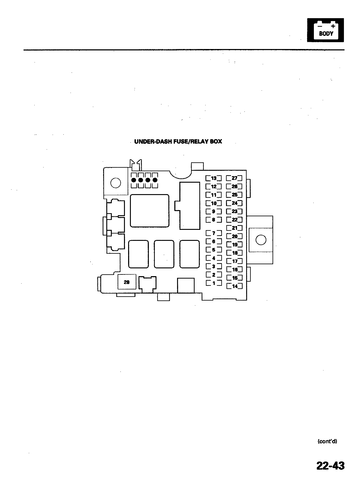

The diagram locates fuses 1–13 in the left vertical bank, 14–27 in the right vertical bank, and fuse 28 separately at lower left. See the fuse-to-components index on printed page 22-42 for ratings and circuits.

### Printed page 22-44

Source: [PDF p.1536](../page-images/p1536.png).

# Power Distribution — Auxiliary Under-hood Fuse Box

| Fuse Number | Amps | Wire Color | Component(s) or Circuit(s) Protected |
| :--- | :--- | :--- | :--- |
| 32 | 60 A | WHT | Air pump electric current sensor ('00-05 models) |
| 33 | 70 A | WHT/RED | EPS control unit |
| 34 | 20 A | WHT/GRN | Rear window defogger |
| 35 | Not used | - | - |
| 36 | Not used | - | - |

The [source diagram](../page-images/p1536.png) shows the fuse locations.

### Printed page 22-45

Source: [PDF p.1537](../page-images/p1537.png).

# Ground Distribution

## Ground to Components Index

| Code | Description |
| :--- | :--- |
| **G1** | Battery |
| **G2** | Engine block |
| **G3** | Engine block |
| **G4** | EPS gearbox |
| **G101** | CKP sensor, Data link connector (DLC) ('00-05 models), ECM (PG1 and PG2 are BLK; LG1 and LG2 are BRN/YEL), IAC valve ('00-05 models), Ignition coils, Immobilizer control unit-receiver, PGM-FI main relay ('00-05 models), Rocker arm oil pressure switch (VTEC oil pressure switch), Throttle actuator control module, VSS ('00-05 models) |
| **G101 shielding** | Shielding between the ECM and these components has BRN/YEL wires: CKP sensor, TDC sensor 1 and 2 (CMP sensor A and B) ('00-05 models), Primary HO2S ('00-05 models), Secondary HO2S , Knock sensor |
| **G201** | A/C condenser fan motor (with A/C), Blower motor relay, ELD, EPS control unit, Radiator fan motor, Right front parking light ('00-03 models), Right front parking/side marker light ('04-08 models), Right front turn signal light, Right headlight (low beam) ('00-03 models), Right side turn signal light, Windshield washer motor |
| **G301** | Air pump relay, Brake fluid level switch, Cruise control actuator, Intermittent wiper relay ('02-08 models), Left front parking light ('00-03 models), Left front parking/side marker light ('04-08 models), Left front turn signal light, Left headlight (low beam) ('00-03 models), Left side turn signal light, Radiator fan switch ('00-05 models), Windshield wiper motor |
| **G302** | Air pump ('00-05 models) |
| **G303** | ABS modulator-control unit ('00-05 models) (2 wires), VSA modulator-control unit ('06-08 models) |
| **G351** | EPS control unit |
| **G401** | Accessory power socket relay (CR model), Clutch interlock switch, Clutch pedal position switch, Combination light switch, Data link connector (DLC), Daytime running lights subcontrol unit ('06-08 USA models) (2 wires), Ignition key switch, Intermittent wiper relay ('00-03 models), Rear window defogger switch ('00-01 models), TPMS control unit ('08 model), Turn signal/hazard relay, Windshield wiper/washer switch |
| **G402** | Convertible top control unit (3 wires), Cruise control unit ('00-05 models), Daytime running lights control unit (Except '00-05 USA models) (2 wires), EPS control unit, Heater control panel, Power transistor, Rear window defogger switch ('06-08 models) |
| **G501** | Audio remote switch, Convertible top control unit, Cruise main switch, Driver's door key cylinder switch, Driver's door lock actuator, Engine start switch, Gauge assembly (2 wires), Headlights (low beam) ('04-08 models), Keyless door lock control unit, Passenger's power window switch, Power mirror switch, Power window master switch, Rear window defogger switch ('02-05 models) |
| **G502** | Audio unit |
| **G601** | Accessory power socket, Condenser ('02-08 models), Convertible top disable switch, Driver's seat belt buckle switch, Fuel gauge sending unit ('00-05 models) (2 wires), Fuel pump, High mount brake light, Passenger's seat belt buckle switch, Passenger's weight sensor unit, Rear window defogger (convertible top for '02-08 models), Rear window defogger (with hard top), Rear window defogger subharness connector (option) ('00-01 models), Trunk lid opener solenoid/latch switch, plus everything grounded through G901 |
| **G602** | Back-up lights, License plate light, Rear side marker lights, Rear turn signal lights, Taillights |
| **G801** | SRS unit (2 wires) |
| **G901** | Convertible top disable switch, Rear window defogger relay ('00-01 models), plus everything grounded through G601 |
| **G902** | Rear window defogger |

### Printed page 22-46

Source: [PDF p.1538](../page-images/p1538.png).

# Under-hood Fuse/Relay Box
## Removal and Installation
### Removal
1. Make sure you have the anti-theft code for the audio system, then write down the audio presets.
2. Make sure the ignition switch is OFF.
3. Disconnect the negative battery cable, then disconnect the positive cable, and wait at least 3 minutes.
4. Remove the bolts (A) for the EPS subharness and engine wire harness terminals from the main under-hood fuse/relay box.
5. Remove the bolts (B) securing the main under-hood fuse/relay box.
6. Remove the bottom cover from the main under-hood fuse/relay box.
7. Disconnect the connectors from the main under-hood fuse/relay box.
8. Carefully remove the relays by prying under the base of the relay.

**NOTE:** Do not use pliers. Pliers will damage the relays, which could cause the engine to stall or not start.

### Installation
1. Install the relays and connect the connectors to the under-hood fuse/relay box, then install the under-hood fuse/relay box in the reverse order of removal.
2. Install the removed parts in the reverse order of removal.
3. Connect the positive cable to the battery, then connect the negative cable to the battery.
4. Enter the anti-theft code for the audio system, then enter the audio presets, and set the clock.
5. Confirm that all systems work properly.

### Printed page 22-47

Source: [PDF p.1539](../page-images/p1539.png).

# Battery
## Battery Test

### WARNING
A battery can explode if you do not follow the proper procedure, causing serious injury to anyone nearby. Follow all procedures carefully and keep sparks and open flames away from the battery.

Use either a JCI or Bear ARBST tester, and follow the manufacturer's procedures. If you don't have one of these computerized testers, follow this conventional test procedure:

1. Be sure the temperature of the electrolyte is between 70 °F (21 °C) and 100 °F (38 °C).
2. Inspect the battery case for cracks or leaks.
   - If the case is damaged, replace the battery.
   - If the case looks OK, go to step 3.
3. Check the indicator EYE.
   - If the EYE indicates the battery is charged, go to step 4.
   - If the EYE indicates a low charge, go to step 7.
4. Apply a 300 A load for 15 seconds to remove the surface charge.
5. Wait 15 seconds, then apply a test load of 280 A for 15 seconds.
6. Record battery voltage.
   - If voltage is above 9.6 V, the battery is OK.
   - If voltage is below 9.6 V, go to step 7.
7. Charge the battery on High (40 A) until the EYE shows the battery is charged, plus an additional 30 minutes. If the battery charge is very low, it may be necessary to bypass the charger's polarity protection circuitry.
   - If the EYE indicates the battery is charged within 3 hours, the battery is OK
   - If the EYE indicates the battery is not charged within 3 hours, replace the battery.

### Printed page 22-48

Source: [PDF p.1540](../page-images/p1540.png).

# Relays

## Power Relay Test

Use this chart to identify the type of relay, then do the test listed for it.

> **NOTE:** For the turn signal/hazard relay input test (see page 22-147).

### Relay Test List

| Relay Name | Type | Notes |
| :--- | :--- | :--- |
| Accessory power socket relay | Normally open, type A | *4 |
| A/C compressor clutch relay | Normally open, type A | |
| A/C condenser fan relay | Normally open, type A | |
| A/F sensor relay | Normally open, type A | *3 |
| Throttle actuator control module relay | Normally open, type A | *3 |
| Headlight relay 1 | Normally open, type A | |
| Headlight relay 2 | Normally open, type A | |
| High beam cut relay | Normally open, type A | (Except '00-05 USA models) |
| Horn relay | Normally open, type A | |
| Ignition coil relay | Normally open, type A | *3 |
| PGM-FI main relay 1 | Normally open, type A | *3 |
| PGM-FI main relay 2 | Normally open, type A | *3 |
| Radiator fan relay | Normally open, type A | |
| Starter cut relay | Normally open, type A | |
| Taillight relay | Normally open, type A | |
| Rear window defogger relay | Normally open, type A | |
| Blower motor relay | Normally open, type B | |
| Intermittent wiper relay | Five terminal, type A | *2 |
| ACC cut relay | Five terminal, type B | |
| IG2 cut relay | Five terminal, type B | |
| Intermittent wiper relay | Five terminal, type B | *1 |
| Rear window defogger change relay | Five terminal, type B | *2 |
| Rear window defogger relay | Five terminal, type B | |

**Model Year Restrictions:**
*   *1: '00-01 models
*   *2: '02-08 models
*   *3: '06-08 models
*   *4: CR model

---

## Normally-open type A Test Procedure

Check for continuity between the terminals.

*   There should be continuity between the No. 1 and No. 2 terminals when battery positive terminal is connected to the No. 4 terminal, and battery negative terminal is connected to the No. 3 terminal.
*   There should be no continuity between the No. 1 and No. 2 terminals when power is disconnected.

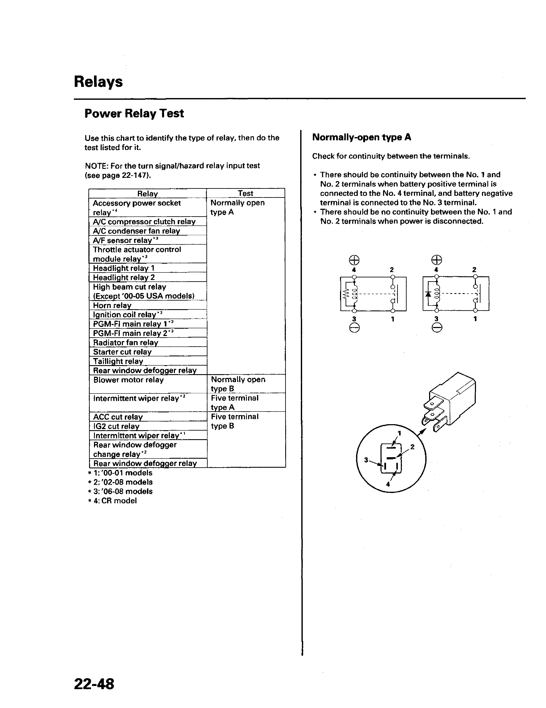

### Printed page 22-49

Source: [PDF p.1541](../page-images/p1541.png).

# Normally-open type B

Check for continuity between the terminals.

* There should be continuity between the No. 3 and No. 4 terminals when battery positive terminal is connected to the No. 1 terminal, and battery negative terminal is connected to the No. 2 terminal.
* There should be no continuity between the No. 3 and No. 4 terminals when power is disconnected.

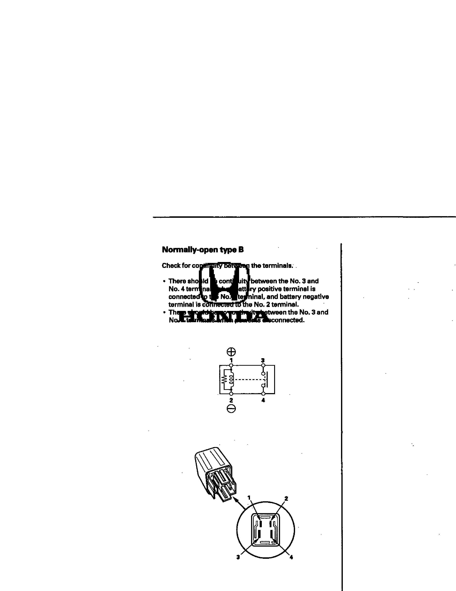

The source scan has a damaged text region; the continuity steps above are corroborated by OCR and the legible circuit diagram.

### Printed page 22-50

Source: [PDF p.1542](../page-images/p1542.png).

# Relays
## Power Relay Test (cont'd)
### Five-terminal type A
Check for continuity between the terminals.
* There should be continuity between the No. 1 and No. 2 terminals when battery positive terminal is connected to the No. 5 terminal, and battery negative terminal is connected to the No. 3 terminal.
* There should be continuity between the No. 1 and No. 4 terminals when power is disconnected.

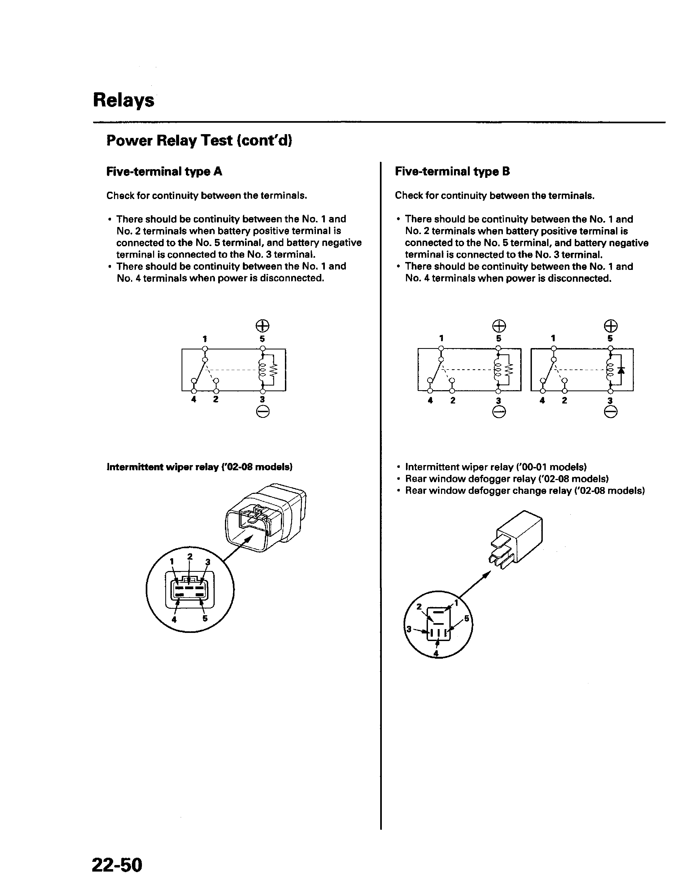

The type A test applies to the intermittent wiper relay ('02–08 models).

### Five-terminal type B
Check for continuity between the terminals.
* There should be continuity between the No. 1 and No. 2 terminals when battery positive terminal is connected to the No. 5 terminal, and battery negative terminal is connected to the No. 3 terminal.
* There should be continuity between the No. 1 and No. 4 terminals when power is disconnected.

The type B test applies to the intermittent wiper relay ('00–01 models), rear window defogger relay ('02–08 models), and rear window defogger change relay ('02–08 models).

### Printed page 22-51

Source: [PDF p.1543](../page-images/p1543.png).

# Ignition Switch

## Test

SRS components are located in this area. Review the SRS component locations (see page 23-11), and precautions, and procedures (see page 23-13) before performing repairs or service.

1. Make sure you have the anti-theft code for the audio system, then write down the audio presets.
2. Disconnect the battery negative cable.
3. Disconnect the 7P connector from the under-dash fuse/relay box.
4. Check for continuity between the terminals in each switch position according to the table.

| Switch position | Continuity shown in source table |
| --- | --- |
| 0 (LOCK) | None |
| I (ACC) | WHT/RED (ACC) ↔ WHT/BLK (BAT-B) |
| II (ON) | WHT/RED (ACC) ↔ WHT/BLK (BAT-B) ↔ BLK/RED (IG2-B); WHT (BAT-A) ↔ BLK/YEL (IG1-A/IG1-B) ↔ ORN (IG2-A) |

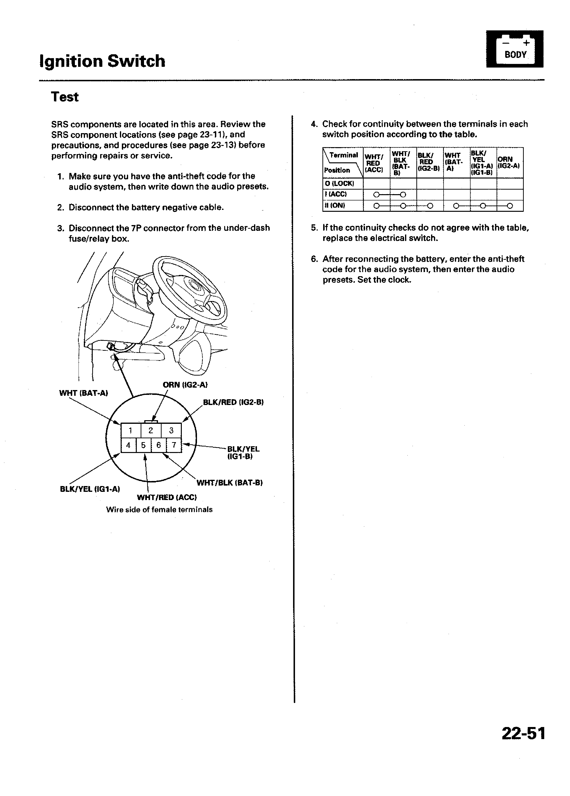

5. If the continuity checks do not agree with the table, replace the electrical switch.
6. After reconnecting the battery, enter the anti-theft code for the audio system, then enter the audio presets. Set the clock.

### Printed page 22-52

Source: [PDF p.1544](../page-images/p1544.png).

# Gauges — Component Location Index

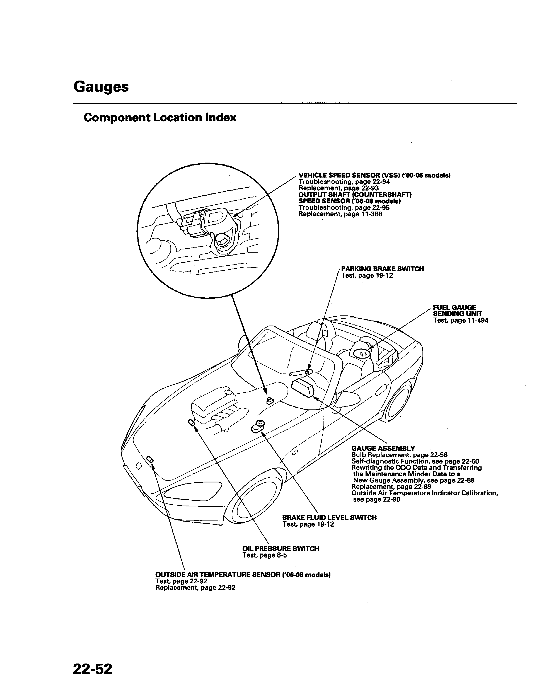

| Component | Source reference |
| --- | --- |
| Vehicle speed sensor (VSS), '00–05 models | Troubleshooting p.22-94; replacement p.22-93 |
| Output shaft (countershaft) speed sensor, '06–08 models | Troubleshooting p.22-95; replacement p.11-388 |
| Parking brake switch | Test p.19-12 |
| Fuel gauge sending unit | Test p.11-494 |
| Gauge assembly | Bulb replacement p.22-56; self-diagnostic function p.22-60; rewriting ODO data and transferring Maintenance Minder data to a new assembly p.22-88; replacement p.22-89; outside-air temperature indicator calibration p.22-90 |
| Brake fluid level switch | Test p.19-12 |
| Oil pressure switch | Test p.8-5 |
| Outside-air temperature sensor, '06–08 models | Test and replacement p.22-92 |

### Printed page 22-53

Source: [PDF p.1545](../page-images/p1545.png).

# Gauge/Terminal Location Index — '00–03 Models

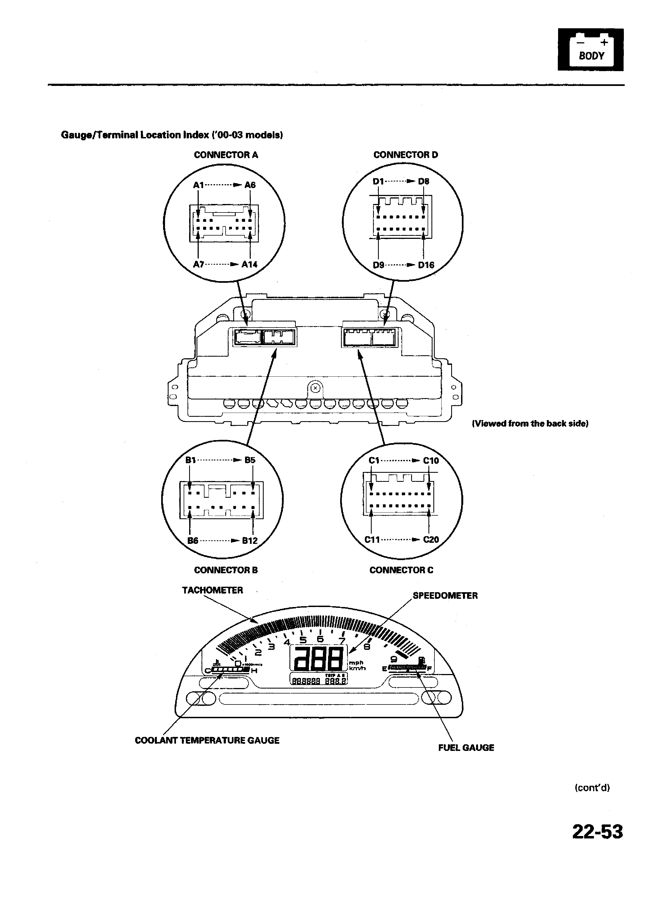

Viewed from the back of the gauge assembly: connector A spans A1–A14, connector B spans B1–B12, connector C spans C1–C20, and connector D spans D1–D16. The front display diagram labels the tachometer, speedometer, coolant temperature gauge, and fuel gauge. Use the image for pin orientation and physical locations.

### Printed page 22-54

Source: [PDF p.1546](../page-images/p1546.png).

# Gauges — Gauge/Terminal Location Index ('04–07 Models)

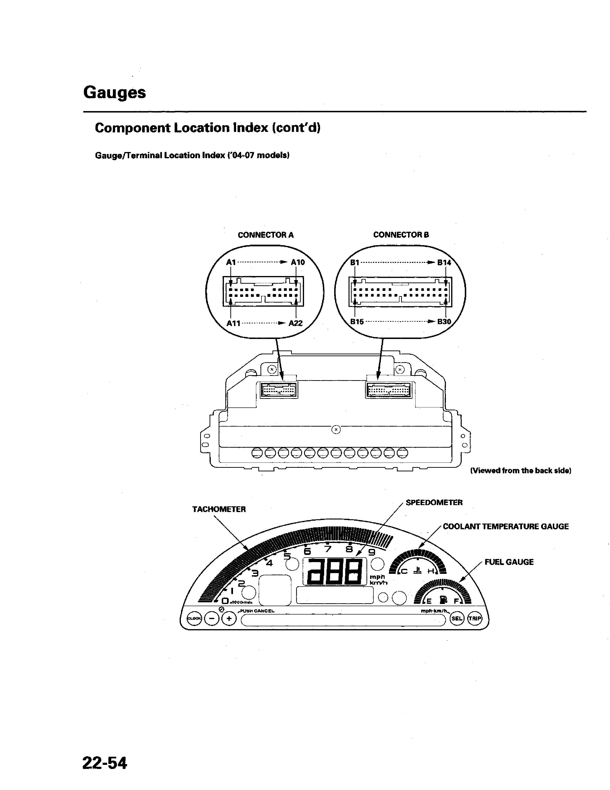

Viewed from the back: connector A spans A1–A22 and connector B spans B1–B30. The display diagram labels the tachometer, speedometer, coolant temperature gauge, and fuel gauge. Use the source image for pin orientation.

### Printed page 22-55

Source: [PDF p.1547](../page-images/p1547.png).

# Gauges — Gauge/Terminal Location Index ('08 Model)

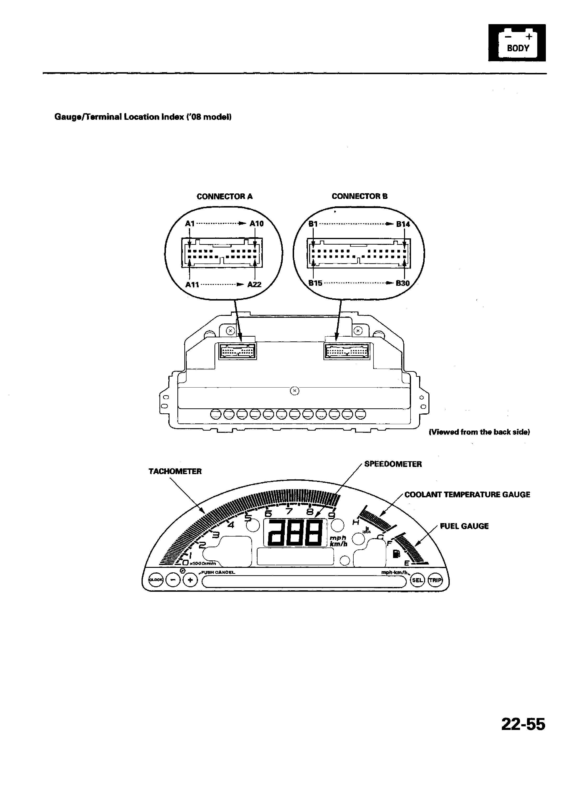

Viewed from the back: connector A spans A1–A22 and connector B spans B1–B30. The display diagram labels the tachometer, speedometer, coolant temperature gauge, and fuel gauge. Use the source image for pin orientation.

### Printed page 22-56

Source: [PDF p.1548](../page-images/p1548.png).

# Gauges — Gauge Bulb Replacement ('00–03 Models)

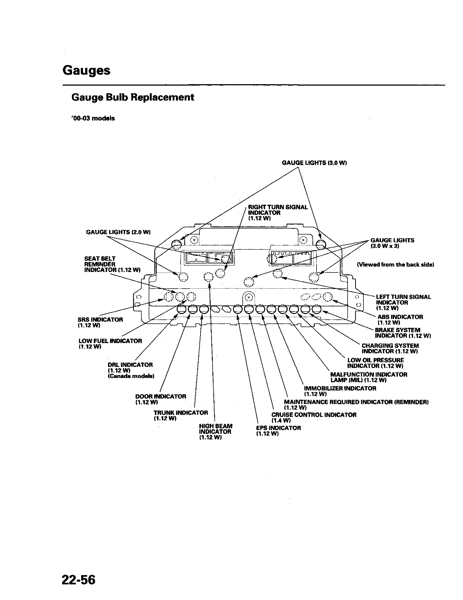

Viewed from the back. The source diagram identifies gauge lights rated 3.0 W (including a group of three) and 2.0 W, the cruise control indicator at 1.4 W, and the following indicators at 1.12 W: right and left turn signals, seat belt reminder, SRS, low fuel, DRL (Canada models), door, trunk, high beam, ABS, brake system, charging system, low oil pressure, malfunction indicator lamp (MIL), immobilizer, maintenance required reminder, and EPS. Follow the image for each bulb position and quantity.

### Printed page 22-57

Source: [PDF p.1549](../page-images/p1549.png).

# Gauges — Gauge Bulb Replacement ('04–05 Models)

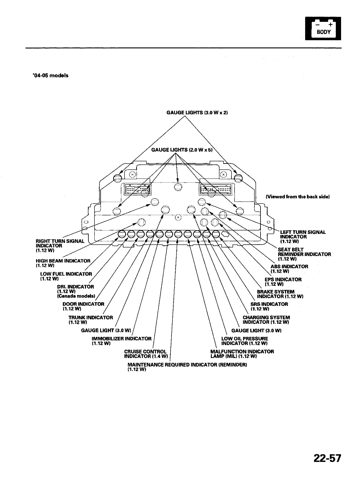

Viewed from the back. The source diagram identifies two upper 3.0 W gauge lights, five 2.0 W gauge lights, and two other 3.0 W gauge lights. The cruise control indicator is 1.4 W. Indicators rated 1.12 W are: right and left turn signals, high beam, low fuel, DRL (Canada models), door, trunk, seat belt reminder, ABS, EPS, brake system, SRS, charging system, low oil pressure, malfunction indicator lamp (MIL), immobilizer, and maintenance required reminder. Follow the image for each bulb position.

### Printed page 22-58

Source: [PDF p.1550](../page-images/p1550.png).

# Gauges — Gauge Bulb Replacement ('06–07 Models)

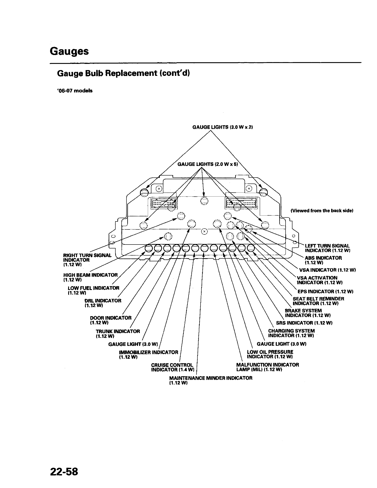

Viewed from the back. The source diagram identifies two upper 3.0 W gauge lights, five 2.0 W gauge lights, and two other 3.0 W gauge lights. The cruise control indicator is 1.4 W. Indicators rated 1.12 W are: right and left turn signals, high beam, low fuel, DRL, door, trunk, immobilizer, maintenance minder, malfunction indicator lamp (MIL), low oil pressure, charging system, SRS, brake system, seat belt reminder, EPS, VSA activation, VSA, and ABS. Follow the image for bulb positions.

### Printed page 22-59

Source: [PDF p.1551](../page-images/p1551.png).

# Gauges — Gauge Bulb Replacement ('08 Model)

### Bulb index

| Indicator Name | Power Rating | Notes |
| :--- | :--- | :--- |
| Gauge lights | 3.0 W × 2 (upper), 2.0 W × 5, plus two 3.0 W bulbs | See location diagram |
| TPMS Indicator | 1.12 W | Tire Pressure Monitoring System |
| Right Turn Signal Indicator | 1.12 W | |
| Low Tire Pressure Indicator | 1.12 W | (Note: Listed separately from TPMS in source text) |
| Low Fuel Indicator | 1.12 W | |
| DRL Indicator | 1.12 W | Daytime Running Light |
| High Beam Indicator | 1.12 W | |
| Door Indicator | 1.12 W | |
| Trunk Indicator | 1.12 W | |
| Immobilizer Indicator | 1.12 W | Engine security system status |
| Left Turn Signal Indicator | 1.12 W | |
| ABS Indicator | 1.12 W | Anti-lock Braking System |
| VSA Indicator | 1.12 W | Vehicle Stability Assist |
| VSA Activation Indicator | 1.12 W | Status of VSA activation |
| EPS Indicator | 1.12 W | Electric Power Steering |
| Seat Belt Reminder Indicator | 1.12 W | |
| Brake System Indicator | 1.12 W | |
| SRS Indicator | 1.12 W | Supplemental Restraint System |
| Charging System Indicator | 1.12 W | Alternator/Battery status |
| Low Oil Pressure Indicator | 1.12 W | Engine oil pressure monitoring |
| Malfunction Indicator Lamp (MIL) | 1.12 W | Emission system fault |
| Cruise Control Indicator | 1.4 W | Higher power consumption noted |
| Maintenance Minder Indicator | 1.12 W | Service interval reminder |

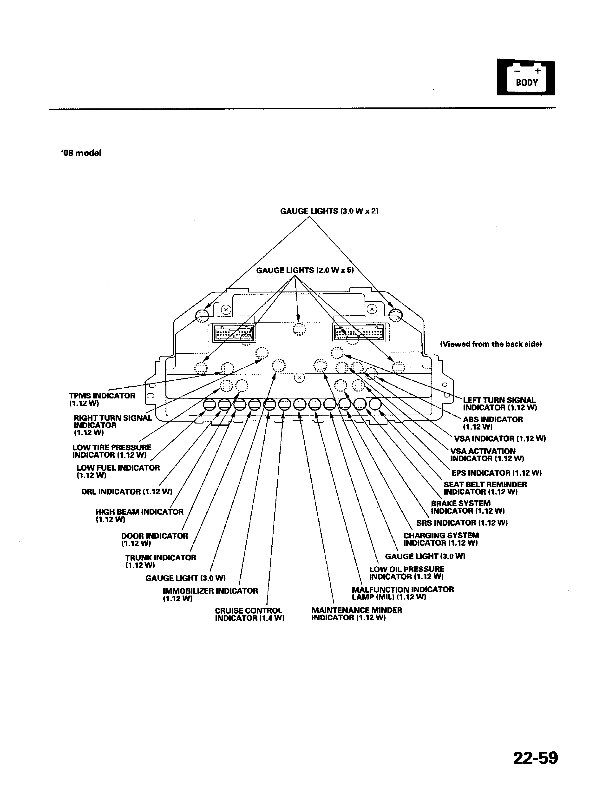

The diagram is viewed from the back; use it for bulb positions.

### Printed page 22-60

Source: [PDF p.1552](../page-images/p1552.png).

# Gauges

## Gauges: Self-diagnostic Function ('06-08 models)

The gauge assembly has a self-diagnostic function shown, and also has a customizable reset function.

### Diagnostic Checks Performed
* The beeper drive circuit check.
* The indicator drive circuit check.
* The switch input test.
* The LCD segments check.
* The communication line check covers engine coolant temperature signal, engine oil life index, fuel data request signal, CHECK FUEL CAP signal, charging system indicator ON/OFF signal, MIL ON/OFF signal, and cruise control system ON/OFF signal line between the gauge assembly and the ECM.

### Entering the Self-diagnostic Function
Before doing the self-diagnostic function, check the No. 5 (7.5 A) fuse and the No. 25 (7.5 A) fuse in the under-dash fuse/relay box.

1. Push and hold the TRIP button.
2. Turn the headlights ON.
3. Turn the ignition switch ON (II).
4. Within **5 sec**, turn the headlights OFF, then ON and OFF again.
5. Within **5 sec**, release the TRIP button, and then push and release the button three times repeatedly.

**NOTE:**
* While in the self-diagnostic mode, the dash lights brightness controller operates normally.
* While in the self-diagnostic mode, the TRIP button is used to start the Beeper Drive Circuit Test.
* If the vehicle speed exceeds **1.2 mph (2 km/h)** or the ignition switch is turned OFF, the self-diagnostic mode ends.

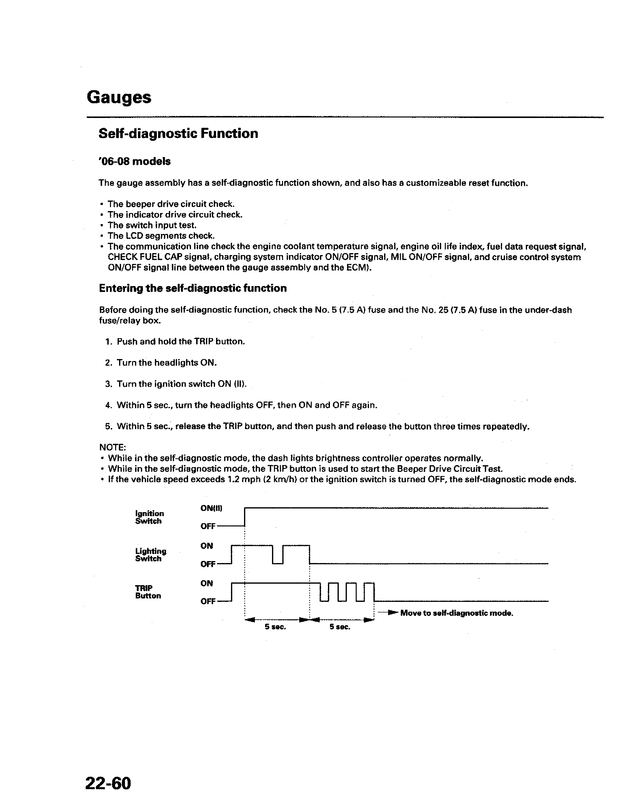

### Printed page 22-61

Source: [PDF p.1553](../page-images/p1553.png).

# The Indicator Drive Circuit Check
While in the self-diagnostic mode, the following indicators blink:
Brake system indicator, charging system indicator, cruise control indicator, low fuel indicator, low tire pressure indicator*1, maintenance minder indicator, malfunction indicator lamp (MIL), peak power indicator*2, seat belt reminder indicator, and TPMS indicator*1.

*1: '08 model
*2: '08 CR model

# Switch Input Check
After the intermittent beeper sounds at the initial stage of self-diagnosis, a beeper sounds continuously while any of the following switch inputs are switched from OFF to ON:
CLOCK button, driver's seat belt buckle switch, illumination (+) button, illumination (—) button, parking brake switch, rear window defogger switch, SEL button, TRIP button, windshield washer switch, and windshield wiper INT switch.

# The Beeper Drive Circuit Check
When entering the self-diagnostic mode, the beeper sounds five times.

# The LCD Segment Check
When entering the self-diagnostic mode, all segments blink five times.

### Printed page 22-62

Source: [PDF p.1554](../page-images/p1554.png).

# Self-diagnostic Function (cont'd)

## The Communication Line Check

### '06-'07 models
While in the self-diagnostic mode, the Communication Line Check starts after the LCD Segments Check.

If all segments come on, the communication line is OK. If there is a communication line error, the word "Error" will be indicated on the LCD display.

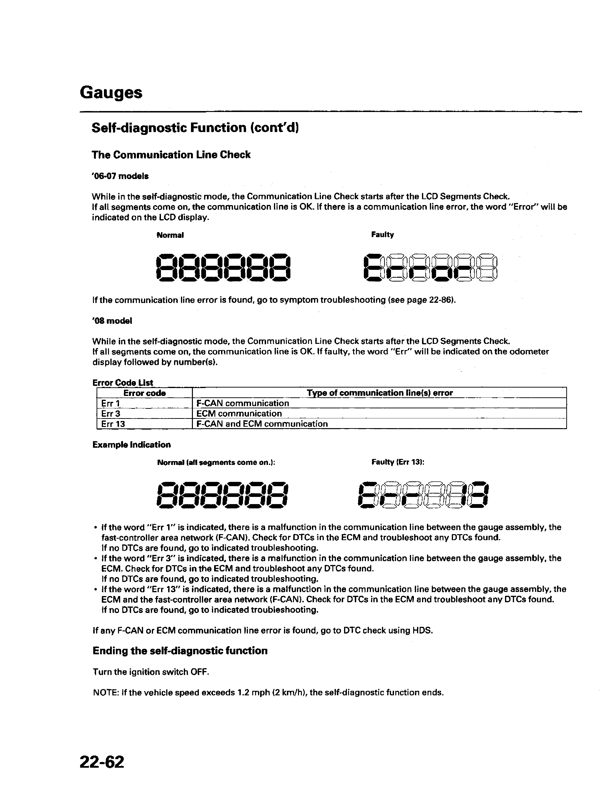

If the communication line error is found, go to symptom troubleshooting (see page 22-86).

### '08 model
While in the self-diagnostic mode, the Communication Line Check starts after the LCD Segments Check.

If all segments come on, the communication line is OK. If faulty, the word "Err" will be indicated on the odometer display followed by number(s).

## Error Code List

| Error code | Type of communication line(s) error |
| :---: | :--- |
| Err 1 | F-CAN communication |
| Err 3 | ECM communication |
| Err 13 | F-CAN and ECM communication |

## Example indication

The source image shows all segments lit for normal operation and an Err 13 example for a fault.

* If the word "Err 1" is indicated, there is a malfunction in the communication line between the gauge assembly, the fast-controller area network (F-CAN). Check for DTCs in the ECM and troubleshoot any DTCs found.
If no DTCs are found, go to indicated troubleshooting.

* If the word "Err 3" is indicated, there is a malfunction in the communication line between the gauge assembly, the ECM. Check for DTCs in the ECM and troubleshoot any DTCs found.
If no DTCs are found, go to indicated troubleshooting.

* If the word "Err 13" is indicated, there is a malfunction in the communication line between the gauge assembly, the ECM and the fast-controller area network (F-CAN). Check for DTCs in the ECM and troubleshoot any DTCs found.
If no DTCs are found, go to indicated troubleshooting.

If any F-CAN or ECM communication line error is found, go to DTC check using HDS.

## Ending the self-diagnostic function
Turn the ignition switch OFF.

> NOTE: If the vehicle speed exceeds 1.2 mph (2 km/h), the self-diagnostic function ends.

### Printed page 22-63

Source: [PDF p.1555](../page-images/p1555.png).

# Gauges — Circuit Diagram ('00–03 Models), Part 1

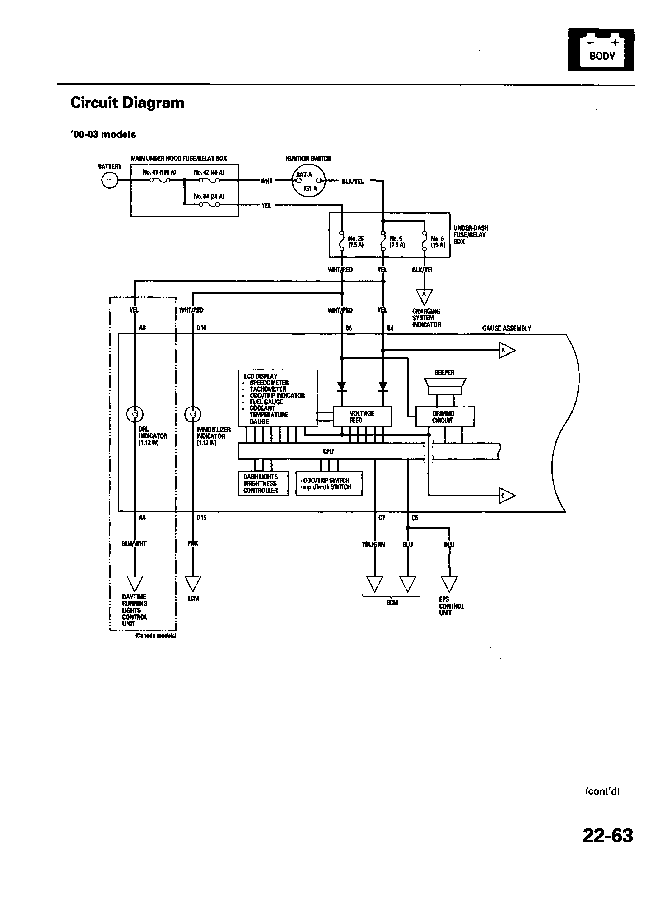

The diagram shows battery power through the main under-hood and under-dash fuse/relay boxes to the gauge assembly, including ignition switch, illumination, LCD display, beeper, CPU, ECM and EPS connections. Follow the source image for wire colors, connector pins, fuse ratings, and continuity.

### Printed page 22-64

Source: [PDF p.1556](../page-images/p1556.png).

# Gauges — Circuit Diagram ('00–03 Models), Part 2

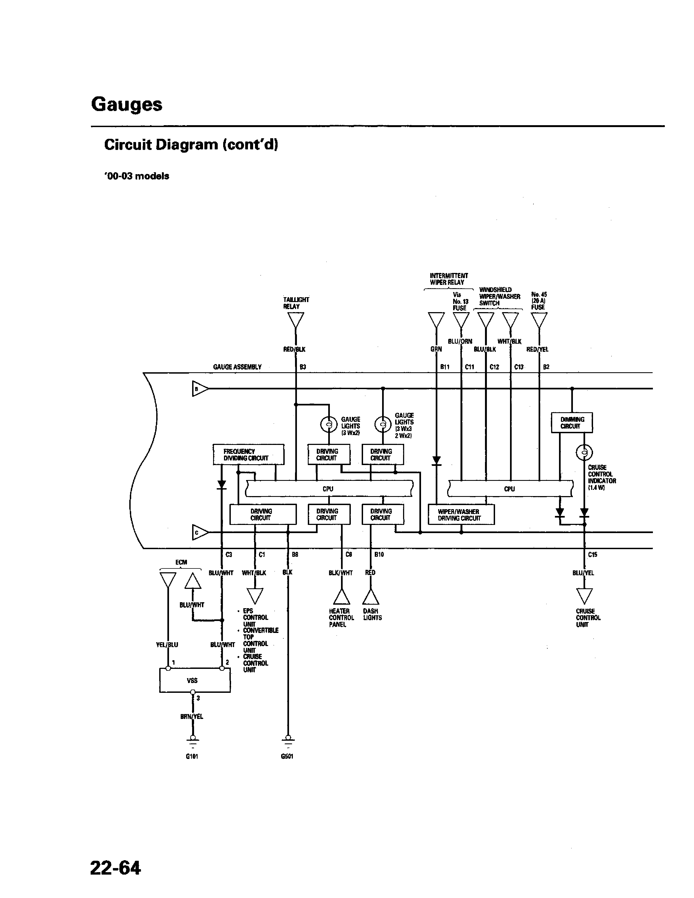

This continuation shows the gauge assembly connections to the taillight relay, intermittent wiper relay, windshield wiper/washer switch, VSS, ECM, EPS and cruise control units, heater control panel, and dash lights. Follow the source image for wire colors, pins, and grounds G101/G501.

### Printed page 22-65

Source: [PDF p.1557](../page-images/p1557.png).

# Gauges — Circuit Diagram ('00–03 Models), Part 3

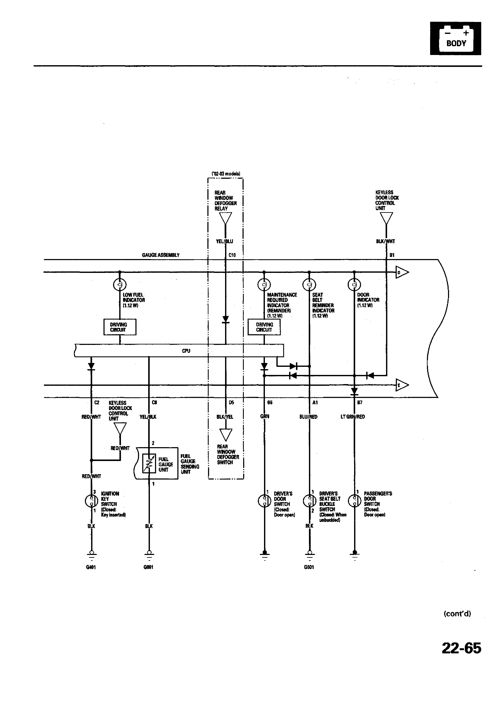

This continuation shows the low fuel, maintenance reminder, seat belt, and door indicators, plus fuel gauge sending unit, rear defogger circuit, keyless door lock control unit, ignition key and door switches, and driver's seat belt buckle switch. Follow the source image for model-year variants, wire colors, pins, and grounds.

### Printed page 22-66

Source: [PDF p.1558](../page-images/p1558.png).

# Gauges — Circuit Diagram

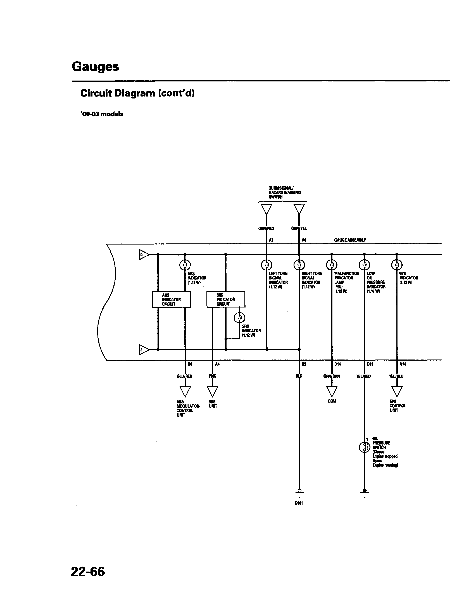

'00–03 models, part 4. The diagram shows turn signal/hazard switch inputs and the ABS, SRS, turn signal, MIL, oil pressure, and EPS indicators, with their control-unit connections and ground G501. Follow the source image for exact wire colors, connector pins, and circuit paths.

### Printed page 22-67

Source: [PDF p.1559](../page-images/p1559.png).

# Gauges — Circuit Diagram

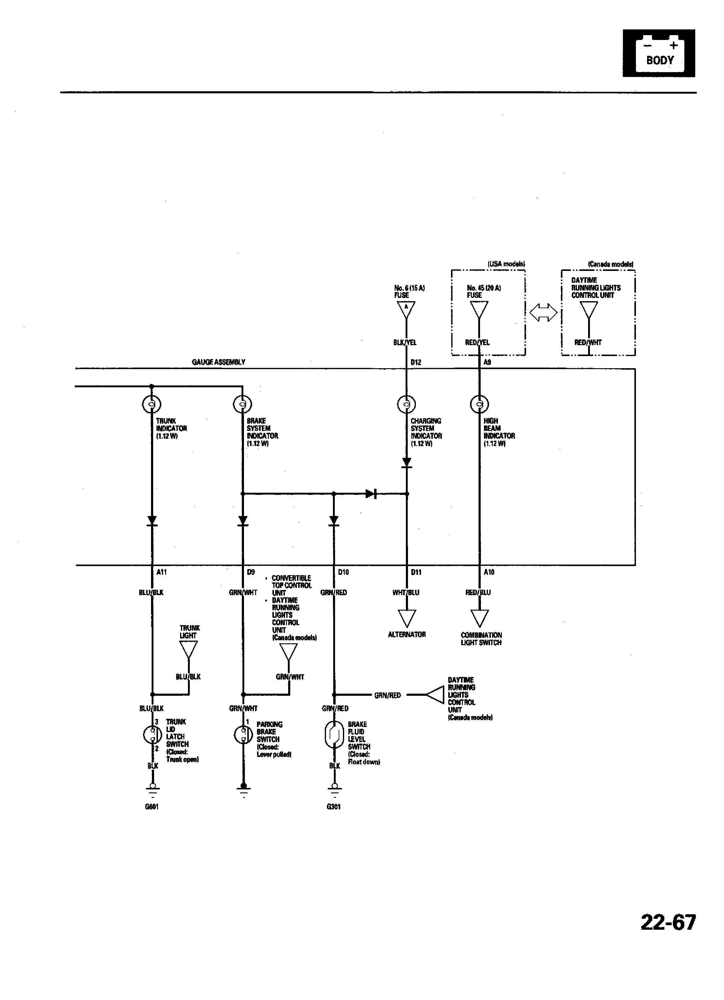

'00–03 models, part 5. The diagram shows the trunk, brake system, charging system, and high beam indicators, the USA/Canada daytime running lights variants, and the trunk, parking brake, and brake fluid level switches. Follow the source image for exact wire colors, connector pins, and circuit paths.

### Printed page 22-68

Source: [PDF p.1560](../page-images/p1560.png).

# Gauges — Circuit Diagram

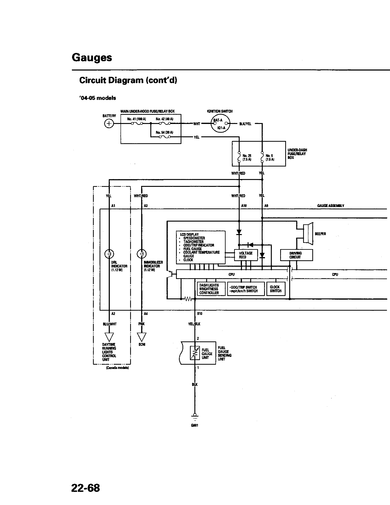

'04–05 models, part 1. The diagram shows power from the battery through main under-hood and under-dash fuses to the gauge assembly, including LCD display, beeper, DRL and immobilizer indicators, fuel gauge sending unit, and ECM. Follow the source image for exact wire colors, connector pins, and circuit paths.

### Printed page 22-69

Source: [PDF p.1561](../page-images/p1561.png).

# Gauges — Circuit Diagram

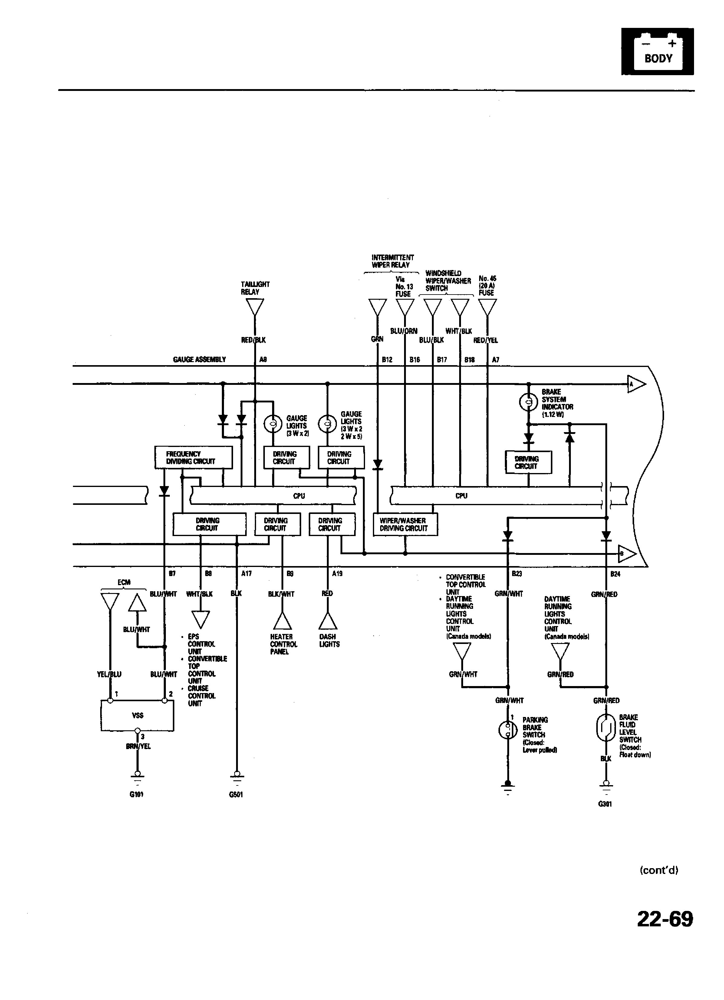

'04–05 models, part 2. The diagram shows the gauge assembly connections to taillight and intermittent wiper relays, windshield wiper/washer switch, VSS, ECM, lighting circuits, and brake system switch inputs. Follow the source image for exact wire colors, connector pins, and circuit paths.

### Printed page 22-70

Source: [PDF p.1562](../page-images/p1562.png).

# Gauges — Circuit Diagram

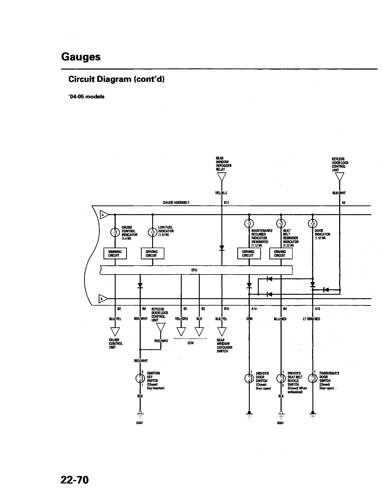

'04–05 models, part 3. The diagram shows cruise control, low fuel, maintenance required, seat belt reminder, and door indicators, plus rear defogger, keyless door lock, ignition key, door, and seat belt switch inputs. Follow the source image for exact wire colors, connector pins, and circuit paths.

### Printed page 22-71

Source: [PDF p.1563](../page-images/p1563.png).

# Gauges — Circuit Diagram

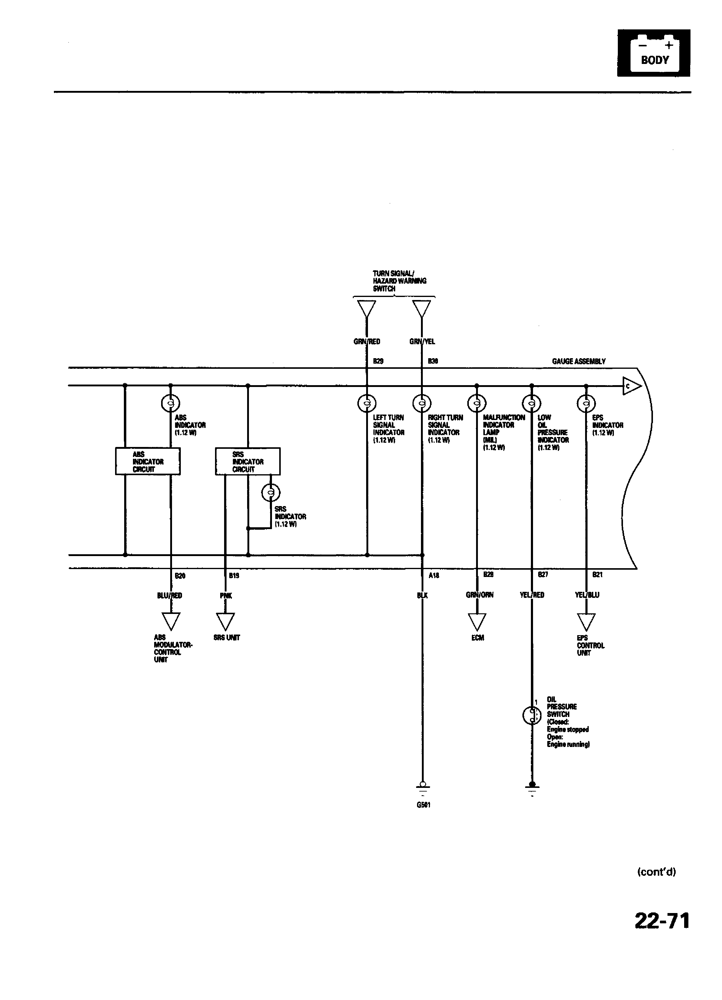

'04–05 models, part 4. The diagram shows the ABS, SRS, left and right turn signal, MIL, low oil pressure, and EPS indicators, with the turn signal/hazard switch, control units, and oil pressure switch. Follow the source image for exact wire colors, connector pins, and circuit paths.

### Printed page 22-72

Source: [PDF p.1564](../page-images/p1564.png).

# Gauges — Circuit Diagram

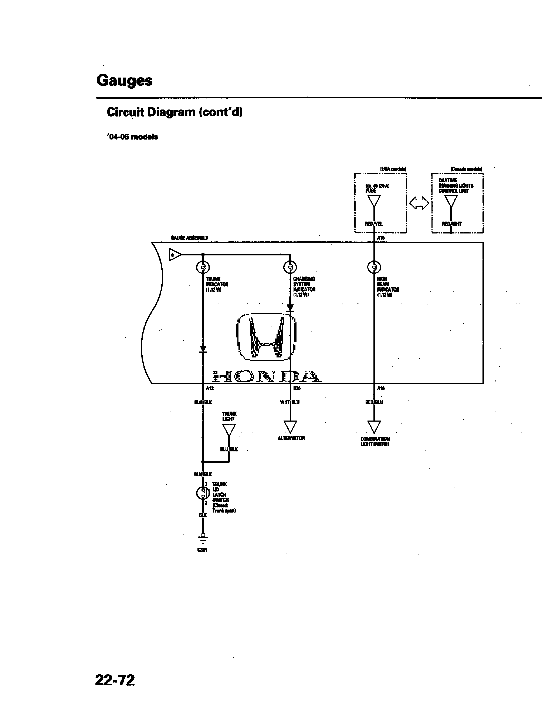

'04–05 models, part 5. The diagram shows trunk, charging system, and high beam indicators; USA and Canada daytime running lights variants; alternator, combination light switch, and trunk lid latch switch. Follow the source image for exact wire colors, connector pins, and circuit paths.

### Printed page 22-73

Source: [PDF p.1565](../page-images/p1565.png).

# Gauges — Circuit Diagram

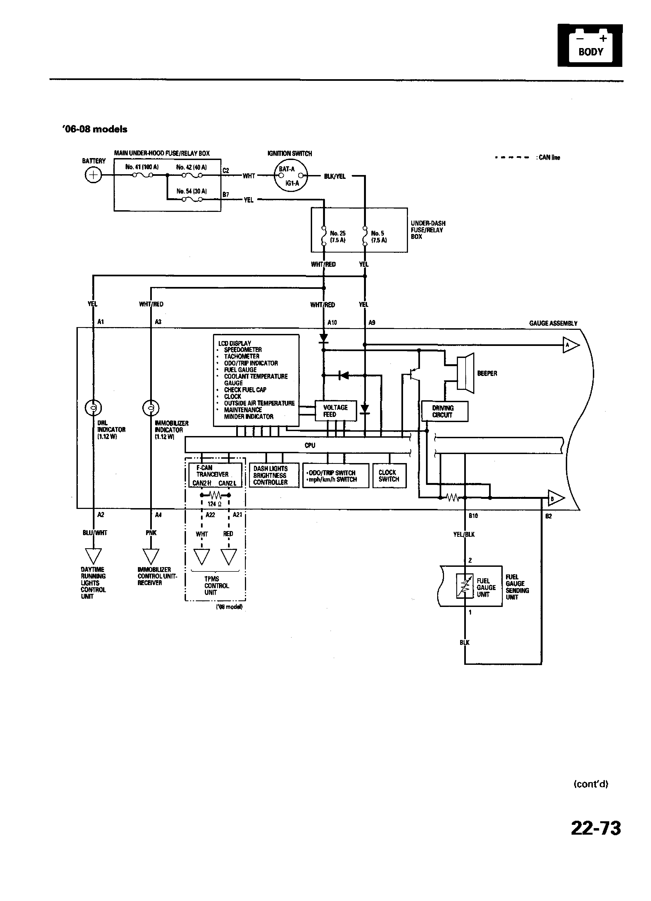

'06–08 models, part 1. The diagram shows the battery and fuse feeds to the gauge assembly; display, beeper, F-CAN transceiver, DRL and immobilizer indicators, TPMS control unit ('08), and fuel gauge sending unit. Follow the source image for exact wire colors, connector pins, and circuit paths.

### Printed page 22-74

Source: [PDF p.1566](../page-images/p1566.png).

# Gauges — Circuit Diagram

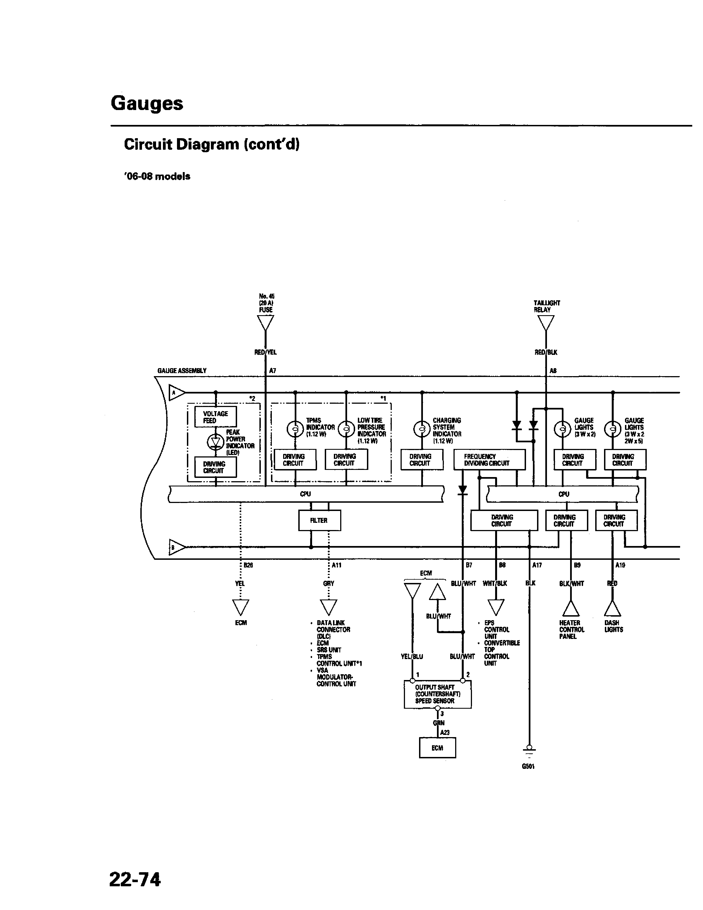

'06–08 models, part 2. The diagram shows gauge light circuits, the TPMS and low tire pressure indicators for '08, charging system indicator, peak power indicator for the CR model, F-CAN related lines, and output shaft speed sensor. Follow the source image for exact wire colors, connector pins, and circuit paths.

### Printed page 22-75

Source: [PDF p.1567](../page-images/p1567.png).

# Gauges — Circuit Diagram

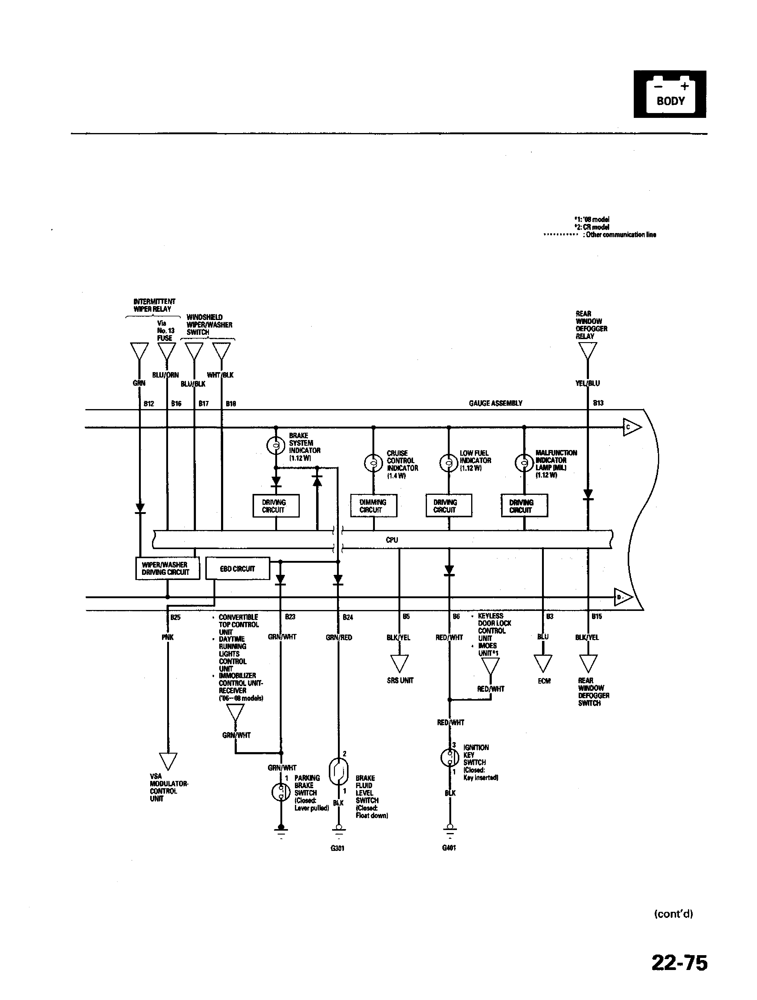

'06–08 models, part 3. The diagram shows intermittent wiper and rear defogger relays, brake and cruise control indicators, VSA, ignition key, parking brake, brake fluid, keyless door lock, and immobilizer inputs. Footnotes distinguish '08 and CR models. Follow the source image for exact wire colors, connector pins, and circuit paths.

### Printed page 22-76

Source: [PDF p.1568](../page-images/p1568.png).

# Gauges — Circuit Diagram

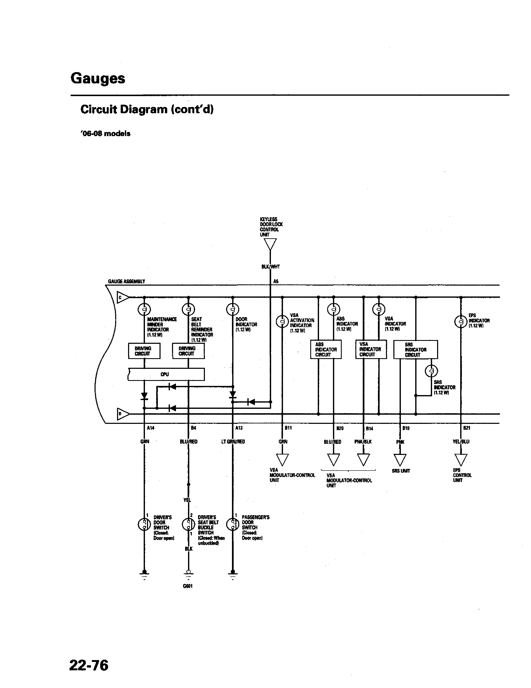

'06–08 models, part 4. The diagram shows maintenance minder, seat belt, door, VSA activation, ABS, VSA, SRS, and EPS indicators, along with door and seat belt switches and the related control units. Follow the source image for exact wire colors, connector pins, and circuit paths.

### Printed page 22-77

Source: [PDF p.1569](../page-images/p1569.png).

# Gauges — Circuit Diagram

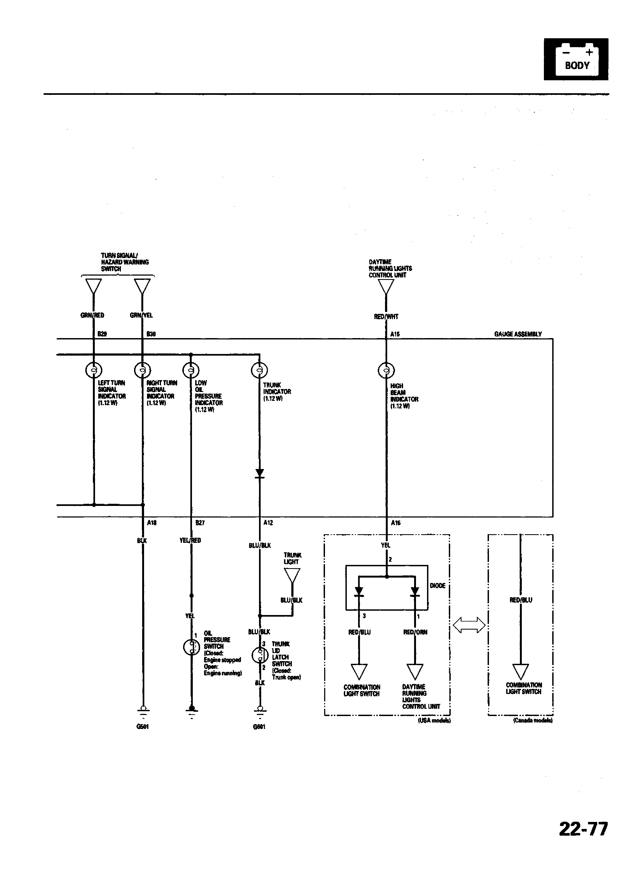

'06–08 models, part 5. The diagram shows turn signal, low oil pressure, trunk, and high beam indicators, the turn signal/hazard switch, oil pressure and trunk latch switches, and USA/Canada daytime running lights wiring variants. Follow the source image for exact wire colors, connector pins, and circuit paths.

### Printed page 22-78

Source: [PDF p.1570](../page-images/p1570.png).

# Gauge
## DTC Troubleshooting Index

| DTC | Description | Note |
| :--- | :--- | :--- |
| **B1152**1 | Gauge assembly CPU abnormality | See p.22-80 |
| **B1173**3 | Gauge assembly lost communication with TPMS control unit (TPMS message) | See p.22-80 |
| **B1175**1 | Fuel gauge unit circuit open | See p.22-82 |
| **B1176**1 | Fuel gauge unit circuit short | See p.22-83 |
| **B1177**2 | IG1 circuit low voltage | See p.22-84 |
| **B1178**3 | F-CAN communication line error | See p.22-80 |

* 1: '06-08 models
* 2: '06-07 models
* 3: '08 model

### Printed page 22-79

Source: [PDF p.1571](../page-images/p1571.png).

# Gauges — Symptom Troubleshooting Index

## '06-08 models

### Symptom and diagnostic procedure

**Error is indicated on the LCD display**
*Symptom Troubleshooting (see page 22-86)*

### Printed page 22-80

Source: [PDF p.1572](../page-images/p1572.png).

# Gauges

## Gauges
### DTC Troubleshooting

#### DTC B1152: Gauge Assembly CPU Abnormality

1. Turn the ignition switch ON (II).
2. Clear the DTC with the HDS.
3. Turn the ignition switch OFF, then turn it ON (II).
4. Check for DTCs with the HDS.

**Is DTC B1152 indicated?**
- **YES** — Replace the gauge assembly (see page 22-89).
- **NO** — Intermittent failure, the system is OK at this time. Check for poor connections or loose terminals at the gauge assembly.

---

#### DTC B1173: Gauge Assembly Lost Communication with TPMS Control Unit (TPMS message)

#### DTC B1178: F-CAN Communication Line Error

1. Clear the DTCs with the HDS.
2. Turn the ignition switch OFF, and then back ON (II).
3. Wait for 6 seconds or more.
4. Check for DTCs with the HDS.

**Are DTCs B1173 or 1178 indicated?**
- **YES** — Go to step 5.
- **NO** — Intermittent failure, the system is OK at this time. Check for loose or poor connections.

5. Check for TPMS DTCs with the HDS.

**Is any DTCs indicated?**
- **YES** — Go to the indicated DTCs, then recheck.
- **NO** — Go to step 6.

6. Turn the ignition switch OFF.
7. Disconnect gauge assembly connector A (22P).
8. Disconnect the TPMS control unit 20P connector.

### Printed page 22-81

Source: [PDF p.1573](../page-images/p1573.png).

# Gauges — DTC B1173/B1178 Troubleshooting (continued)

The previous page ends after disconnecting gauge assembly connector A (22P) and the TPMS control unit 20P connector.

9. Check each gauge assembly connector A terminal No. 21 (CAN2 L, RED) and No. 22 (CAN2 H, WHT) for continuity to body ground. **YES:** Repair the short to ground on the affected wire. **NO:** Go to step 10.
10. Check continuity between gauge assembly connector A terminals No. 21 and No. 22. **YES:** Repair the short between CAN2 L and CAN2 H wires. **NO:** Go to step 11.
11. Check continuity from gauge assembly connector A No. 21 to TPMS control unit connector 20P No. 1, and from gauge assembly No. 22 to TPMS connector No. 11, respectively. **YES:** Substitute a known-good TPMS control unit and recheck. If the indication clears, replace the original TPMS unit; if the DTC remains, replace the gauge assembly (p.22-89). **NO:** Repair the open wire.

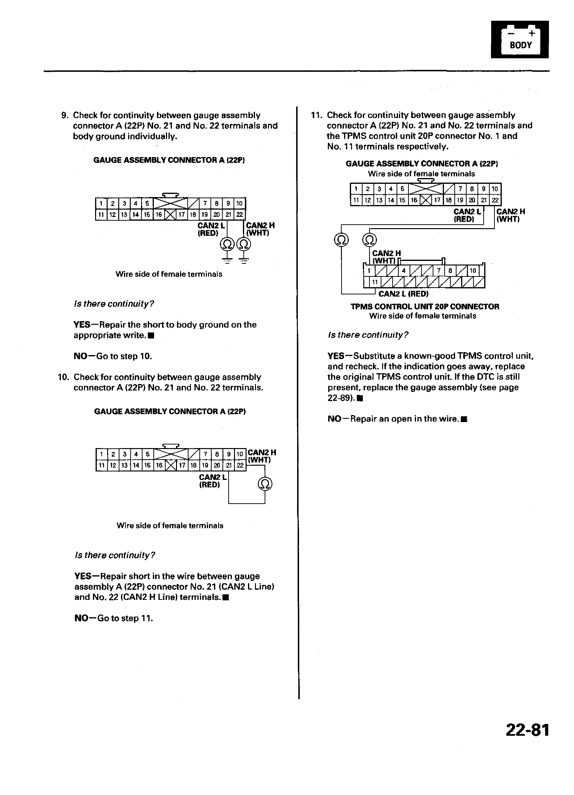

All connector views are from the wire side of the female terminals.

### Printed page 22-82

Source: [PDF p.1574](../page-images/p1574.png).

# DTC Troubleshooting (cont'd)

## DTC B1175: Fuel Gauge Unit Circuit Open

1. Turn the ignition switch ON (II).
2. Clear the DTC with the HDS.
3. Turn the ignition switch OFF, then turn it ON (II).
4. Wait more than 30 seconds.
5. Check for DTCs with the HDS.

**Is DTC B1175 indicated?**
- **YES — Go to step 6.**
- **NO—Intermittent failure, the system is OK at this time. Check for poor connections or loose terminals at the gauge assembly and the fuel gauge sending unit.**

---

### Step 6
Without disconnecting the gauge assembly or fuel gauge sending unit connector, measure the voltage between:
- Gauge assembly connector B (30P) No. 10 terminal and fuel gauge sending unit 5P connector No. 2 terminal.
- And between gauge assembly connector B (30P) No. 2 terminal and fuel gauge sending unit 5P connector No. 1 terminal.

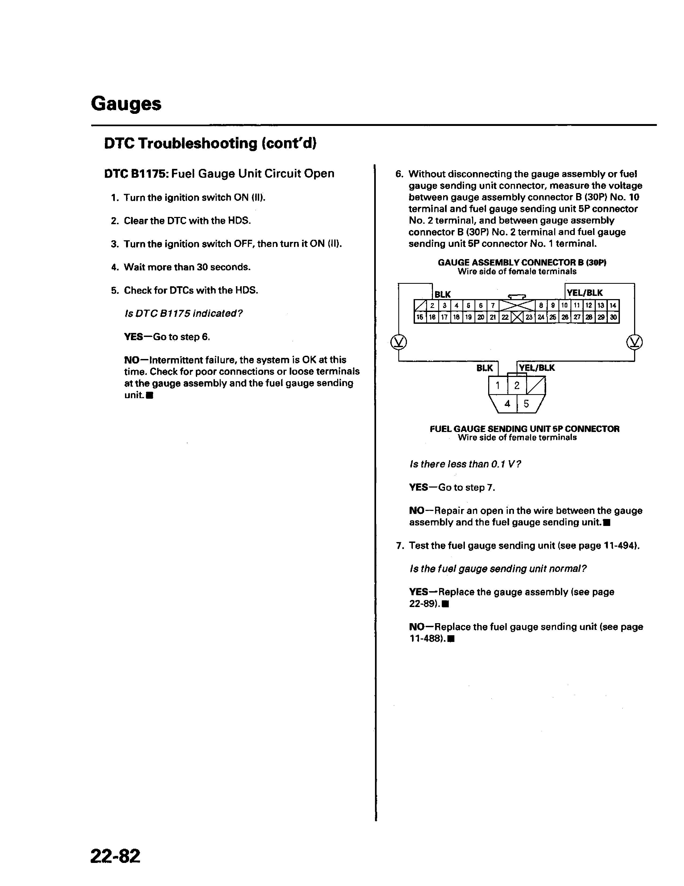

**Is there less than 0.1 V?**
- **YES — Go to step 7.**
- **NO—Repair an open in the wire between the gauge assembly and the fuel gauge sending unit.**

---

### Step 7
Test the fuel gauge sending unit (see page 11-494).

**Is the fuel gauge sending unit normal?**
- **YES—Replace the gauge assembly (see page 22-89).**
- **NO—Replace the fuel gauge sending unit (see page 11-488).**

### Printed page 22-83

Source: [PDF p.1575](../page-images/p1575.png).

# Gauges — DTC B1176: Fuel Gauge Unit Circuit Short
1. Turn the ignition switch ON (II).
2. Clear the DTC with the HDS.
3. Turn the ignition switch OFF, then turn it ON (II).
4. Wait more than 30 seconds.
5. Check for DTCs with the HDS.
Is DTC B1176 indicated?
YES — Go to step 6.
NO — Intermittent failure, the system is OK at this time. Check for poor connections or loose terminals at the gauge assembly and the fuel gauge sending unit.
6. Turn the ignition switch OFF.
7. Disconnect the fuel gauge sending unit 5P connector.
8. Turn the ignition switch ON (II).
9. Clear the DTCs with the HDS.
10. Wait more than 30 seconds.
11. Check for DTCs with the HDS.
Is DTC B1176 indicated?
YES — Go to step 12.
NO — Replace the fuel gauge sending unit (see page 11-488).
12. Turn the ignition switch OFF.
13. Disconnect gauge assembly connector B (30P).

### Printed page 22-84

Source: [PDF p.1576](../page-images/p1576.png).

# Gauges — DTC Troubleshooting

## DTC B1176: Fuel Gauge Unit Circuit Short (continued)

14. Check for continuity between gauge assembly connector B (30P) No. 10 (YEL/BLK) and body ground. **YES:** Repair the short to ground between gauge assembly and fuel gauge sending unit. **NO:** Replace the gauge assembly (p.22-89).

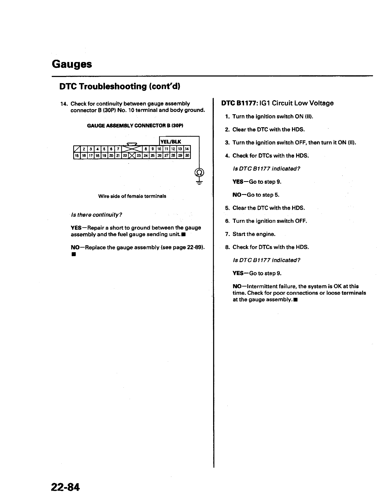

## DTC B1177: IG1 Circuit Low Voltage

1. Turn ignition switch ON (II).
2. Clear the DTC with HDS.
3. Turn ignition OFF, then ON (II).
4. Check for DTCs with HDS. **B1177 YES:** Go to step 9. **NO:** Go to step 5.
5. Clear the DTC with HDS.
6. Turn ignition OFF.
7. Start the engine.
8. Check for DTCs with HDS. **B1177 YES:** Go to step 9. **NO:** Intermittent failure; system OK at this time. Check for poor connections or loose terminals at gauge assembly.

Continue with step 9 on printed page 22-85.

### Printed page 22-85

Source: [PDF p.1577](../page-images/p1577.png).

# S2000 Body Electrical
## Step 9: Check the battery condition (see page 22-47)

**Is the battery normal?**
*   **YES** — Go to step 10.
*   **NO** — Charge the battery, or replace it.

---

## Step 10: Turn the ignition switch ON (II)

## Step 11: With the connectors connected, measure the voltage between gauge assembly connector A (22P) No. 9 terminal and body ground.

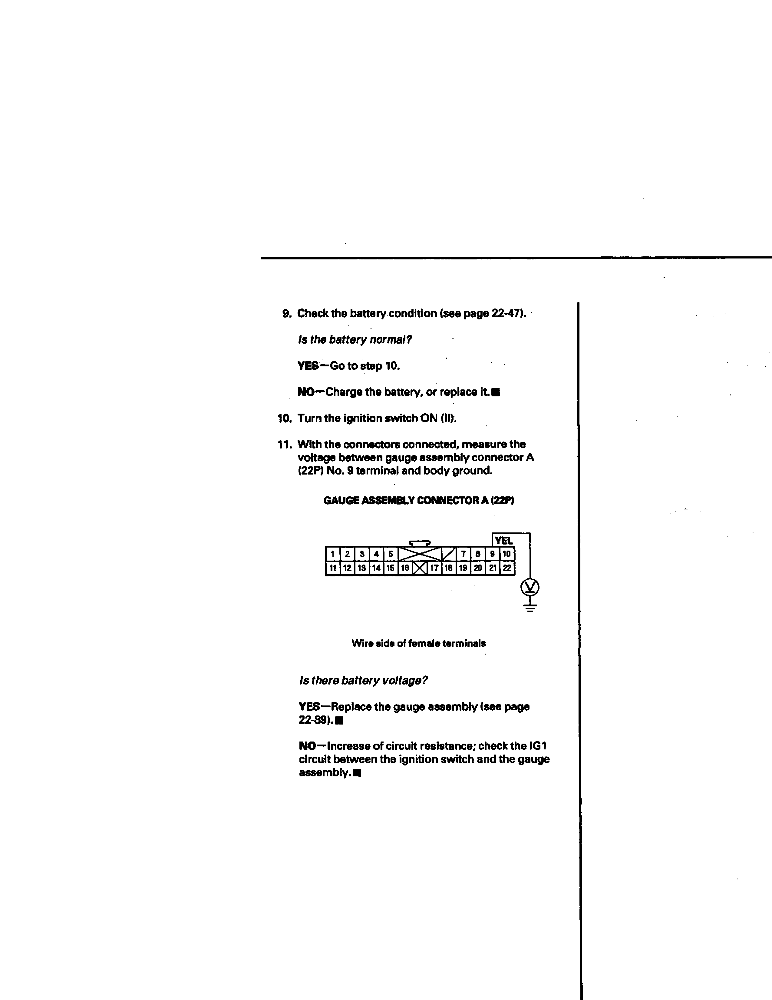

**Is there battery voltage?**
*   **YES** — Replace the gauge assembly (see page 22-89).
*   **NO** — Increase of circuit resistance; check the IG1 circuit between the ignition switch and the gauge assembly.

### Printed page 22-86

Source: [PDF p.1578](../page-images/p1578.png).

# Gauge Assembly Self-Diagnosis

**Symptom:** Error is indicated on the LCD display.

1. Turn the ignition switch ON (II).
2. Check for PGM-FI system DTCs with the HDS.

**Are there PGM-FI system DTCs?**
- **YES** — Do the DTC troubleshooting, then do the gauge assembly self-diagnosis (see page 22-60).
- **NO** — Go to step 3.

3. Turn the ignition switch OFF.
4. Disconnect gauge assembly connector B (30P).
5. Jump the SCS line with the HDS.
6. Disconnect ECM connector E (31P).
7. Check for continuity between gauge assembly connector B (30P) No. 26 terminal and ECM connector E (31P) No. 13 terminal.

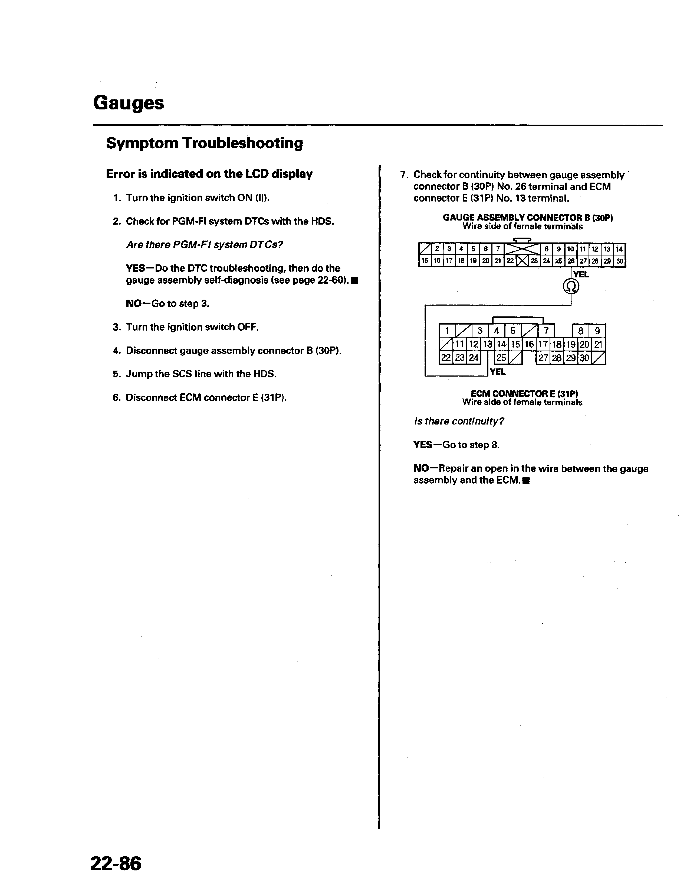

Both connector views are from the wire side of the female terminals.

**Is there continuity?**
- **YES** — Go to step 8.
- **NO** — Repair an open in the wire between the gauge assembly and the ECM.

### Printed page 22-87

Source: [PDF p.1579](../page-images/p1579.png).

# Gauges — Symptom Troubleshooting (continued)

Step 8: Check for continuity between gauge assembly connector B (30P) No. 26 terminal and body ground. [connector test diagram](../page-images/p1579.png). If YES, repair a short to ground in the wire between the gauge assembly and the ECM. If NO, go to step 9.

Step 9: Reconnect gauge assembly connector B (30P).

Step 10: Turn the ignition switch ON (II).

Step 11: Measure the voltage between gauge assembly connector B (30P) No. 26 terminal and body ground. [connector test diagram](../page-images/p1579.png). If YES, replace the ECM. Refer to page 11-115 for '00-05 models or page 11-389 for '06-08 models. If NO, replace the gauge assembly (see page 22-89).

### Printed page 22-88

Source: [PDF p.1580](../page-images/p1580.png).

# Gauges — Rewriting ODO Data and Transferring Maintenance Minder Data

## Before starting

- Obtain a new gauge assembly.
- Rewriting is impossible if the original assembly will not communicate with HDS.
- Confirm HDS displays the correct VIN.
- Once started, complete the procedure before disconnecting HDS from the DLC.
- Connect a battery jumper box, not a charger, to maintain battery voltage.

## Transfer to a new gauge assembly

1. Before replacing the assembly, connect HDS.
2. Select **GAUGES** from the **BODY ELECTRICAL** system menu.
3. Select **Gauge Assembly Replacement (ODO Rewrite)** from **ADJUSTMENT**, and follow the display to retrieve ODO and Maintenance Minder data.
4. Replace the gauge assembly.
5. Follow HDS instructions to write ODO and Maintenance Minder data to the new assembly. If transfer fails, use the release procedure below.

## Release locked odometer mileage to the original assembly

Use this if the new odometer shows dashes, garbled data, or an incorrect value after attempted transfer. The original assembly will be unlocked and restored to its original state.

1. Confirm the latest HDS software version.
2. Confirm HDS shows the correct vehicle VIN.
3. With ignition OFF, reconnect the original gauge assembly.
4. Completely reboot HDS.
5. Clear stored DTCs.
6. Navigate to **Body Electric / Gauges / Adjustment / Instrument Panel Replacement**.
7. Select **3. Releasing Locked ODO Value**.
8. Follow the prompts to restore odometer mileage.
9. Start over, following the screen prompts.

### Printed page 22-89

Source: [PDF p.1581](../page-images/p1581.png).

# Gauge Assembly Replacement

**NOTE:** Before replacing the gauge assembly, do the "Rewriting the ODO Data and Transferring the Maintenance Minder Data to a New Gauge Assembly" (see page 22-88).

1. Lower the steering column, and remove the driver's airbag, steering wheel, steering column covers, cable reel, and combination switch assembly (see page 17-9).
2. Remove the instrument panel (see page 20-84).
3. Remove the screws (A) from the gauge assembly (B), and spread a protective cloth (C) on the steering column.
   - See the [source diagram](../page-images/p1581.png) for A–D locations.
4. Disconnect the connectors (D), and remove the gauge assembly.
   - **NOTE:** '04-08 models only have two connectors.
5. Remove the screws and the gauge assembly brackets.
6. Install in the reverse order of removal.

### Printed page 22-90

Source: [PDF p.1582](../page-images/p1582.png).

# Outside Air Temperature Indicator Calibration

## Description
The outside temperature sensor is located behind the center of the front bumper. The gauge assembly uses measurements from this sensor to display the outside air temperature.

Because of the location of the sensor, it may be affected by heat, reflection from the road, engine and radiator heat or hot exhaust from surrounding traffic. These conditions can heat soak the outside air temperature sensor and cause inaccurate readings.

Logic has been written into the gauge assembly to help prevent abnormal or fluctuating outside air temperature indicator readings.

## Outside Air Temperature Indicator Logic

### Initial outside air temperature indication after the ignition switch is turned ON (II)
*   If the engine coolant temperature is 140 °F (60 °C) or higher when the ignition switch is turned ON (II), the outside air temperature will be indicated the last reading before the key was turned off regardless of the current temperature measured by the outside air temperature sensor.
*   If the engine coolant temperature is 139 °F (59 °C) or lower when the ignition switch is turned ON (II), the current temperature measured by the outside air temperature sensor will be indicated.

### Update to the outside air temperature indicator while driving
If the temperature measured by the outside air temperature sensor is greater than the temperature on the outside air temperature indicator, the outside temperature indicator will increase by 1 °F (1 °C) per 34 seconds (1 minute) after the vehicle speed is greater than 19 mph (30 km/h) for more than 30 seconds. It will continue to increase until the current outside air temperature is indicated. So, the first change to the outside air temperature indicator is 34 seconds (1 minute) after the vehicle speed is greater than 19 mph (30 km/h). If the vehicle speed drops below 19 mph (30 km/h), the indicator will not update again until the vehicle speed is increased to 19 mph (30 km/h) or more for more than 30 seconds again.

If the outside air temperature is less than 140 °F (60 °C), the temperature increases 1 °F (1 °C) every 2 seconds until the current outside air temperature.

If the outside air temperature is less than the indicated temperature, the temperature will decrease 1 °F (1 °C) every 2 seconds until the current outside air temperature is indicated regardless of vehicle speed.

## Troubleshooting
If the indicator displays "----" for more than 2 seconds after selecting the outside air temperature display mode, check the outside air temperature sensor, or gauge assembly self-diagnosis (see page 22-60).

Source wording pairs “34 seconds” with “1 minute”; both are retained because the source is internally inconsistent.

### Printed page 22-91

Source: [PDF p.1583](../page-images/p1583.png).

# Calibration

The outside air temperature indicator's displayed temperature can be recalibrated ± 5 °F (or ± 3 °C) to meet the customer's expectations.

1. Turn the ignition switch ON (II).
2. Select the outside air temperature display.
3. Press and hold the trip button for 10 seconds. While you continue to hold the button, the display will scroll through temperature settings from +5 °F to −5 °F (or +3 °C to - 3 °C) as shown.

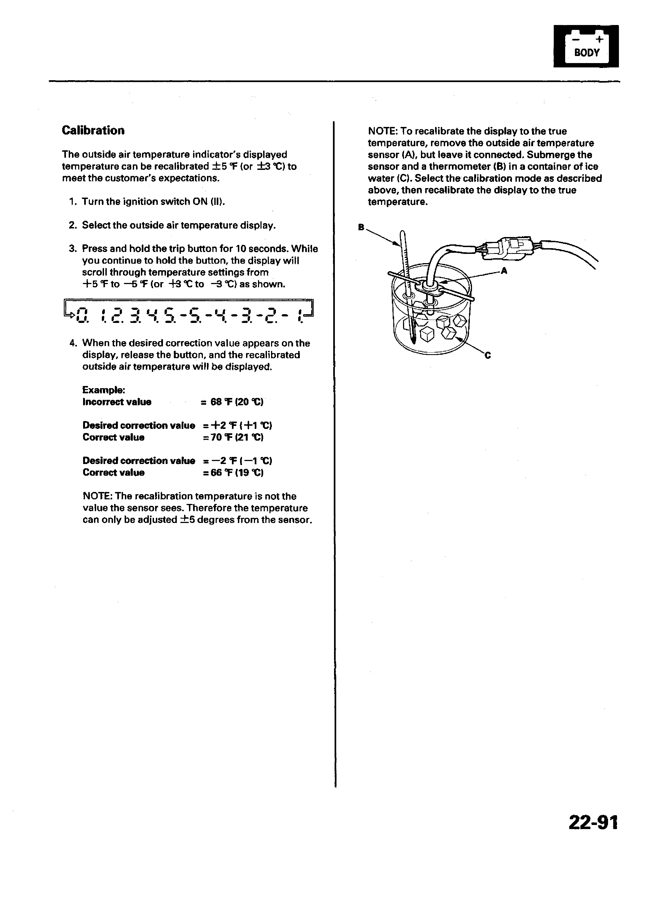

4. When the desired correction value appears on the display, release the button, and the recalibrated outside air temperature will be displayed.

**Example:**

Incorrect value = 68 °F (20 °C)
Desired correction value = + 2 °F (+1 °C)
Correct value = 70 °F (21 °C)

Desired correction value = −2 °F (−1 °C)
Correct value = 66 °F (19 °C)

**NOTE:** To recalibrate the display to the true temperature, remove the outside air temperature sensor (A), but leave it connected. Submerge the sensor and a thermometer (B) in a container of ice water (C). Select the calibration mode as described above, then recalibrate the display to the true temperature.

**NOTE:** The recalibration temperature is not the value the sensor sees. Therefore the temperature can only be adjusted ± 5 degrees from the sensor.

### Printed page 22-92

Source: [PDF p.1584](../page-images/p1584.png).

# Outside Air Temperature Sensor

## Test

**'06-08 models**

1. Remove the outside air temperature sensor (see page 22-92).
2. Dip the sensor in ice water, and measure the resistance. Then pour warm water on the sensor, and check for a change in resistance.
3. Compare the resistance reading between the No. 1 and No. 2 terminals of the outside air temperature sensor with the specifications shown in the graph; the resistance should be within the specifications.

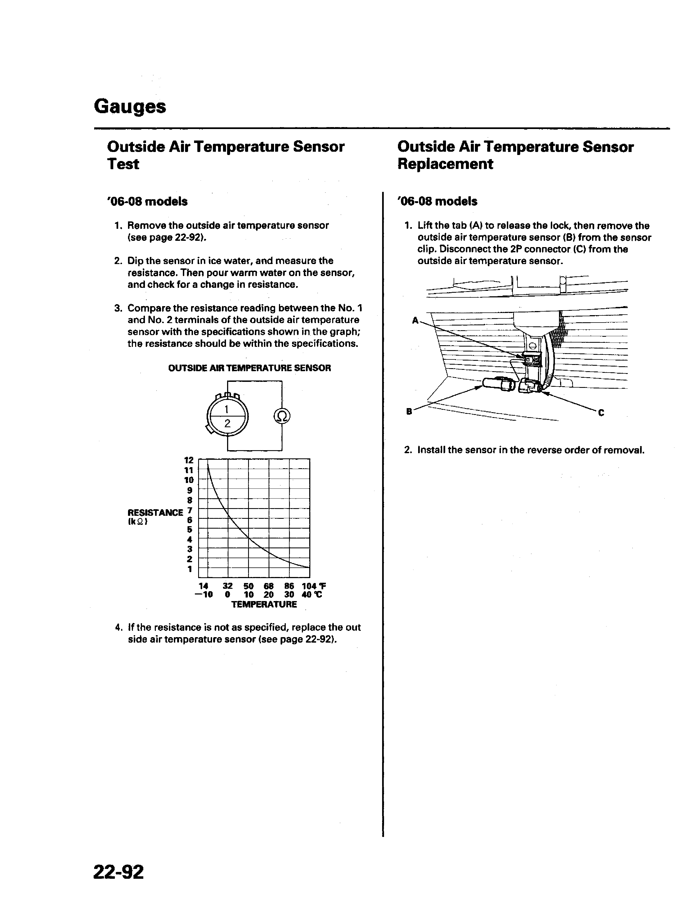

The source graph plots resistance (kΩ) against temperature (°F and °C).

4. If the resistance is not as specified, replace the outside air temperature sensor (see page 22-92).

## Replacement

**'06-08 models**

1. Lift the tab (A) to release the lock, then remove the outside air temperature sensor (B) from the sensor clip. Disconnect the 2P connector (C) from the outside air temperature sensor.
2. Install the sensor in the reverse order of removal.

The [source diagram](../page-images/p1584.png) labels tab A, sensor B, and connector C.

### Printed page 22-93

Source: [PDF p.1585](../page-images/p1585.png).

# VSS Replacement

**'00-05 models**

1. Raise the vehicle, and make sure it is securely supported.
2. Disconnect the 3P connector from the vehicle speed sensor (VSS).
3. Remove the mounting bolt, then remove the VSS.
4. Install in the reverse order of removal.

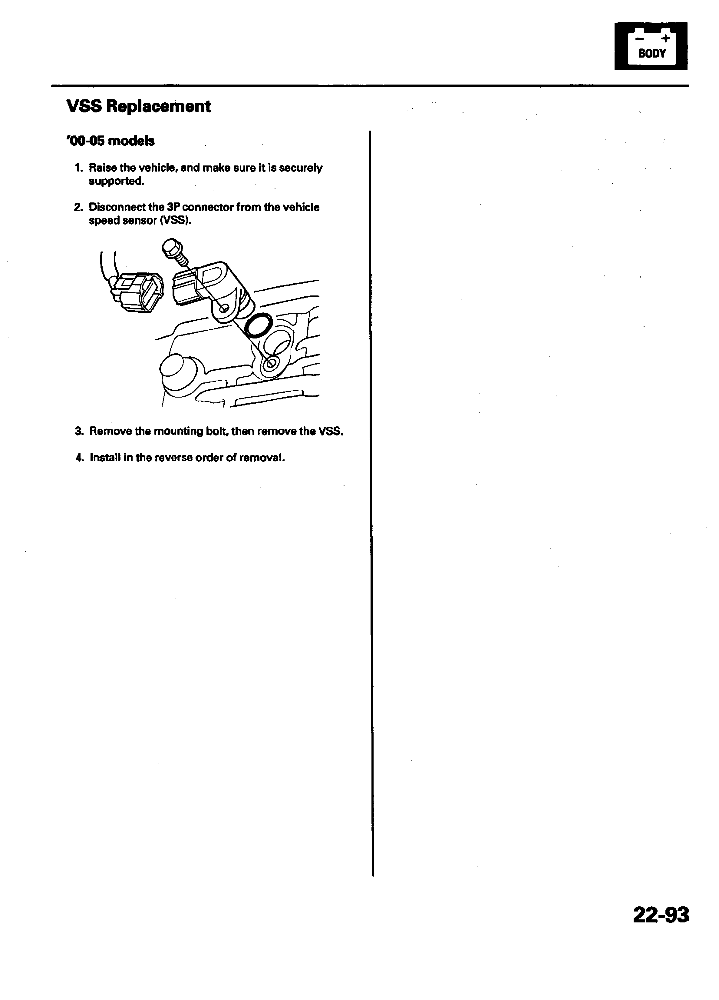

### Printed page 22-94

Source: [PDF p.1586](../page-images/p1586.png).

# Gauges
## Vehicle Speed Signal Circuit Troubleshooting
### '00-05 models

**NOTE:** If the MIL is ON, troubleshoot the PGM-FI problem first.

1. Raise the vehicle with the transmission in neutral, and make sure it is securely supported.
2. Disconnect the VSS 3P connector.
3. Turn the ignition switch ON (II).
4. Check for continuity between the VSS 3P connector No. 3 terminal and body ground.

**VSS 3P C O N N E C T O R**
Terminal side of male terminals

Is there continuity?
- **YES** — Go to step 5.
- **NO** — Repair an open or high resistance in the BRN/YEL wire between the VSS and G101.

5. Measure the voltage between the VSS 3P connector No. 1 terminal and body ground.

**VSS 3P C O N N E C T O R**
Terminal side of male terminals

Is there about 5 V?
- **YES** — Go to step 6.
- **NO** — Repair short or open in the YEL/BLU wire between the VSS and the ECM.

6. Reconnect the VSS 3P connector.
7. Slowly rotate the propeller shaft.

### Printed page 22-95

Source: [PDF p.1587](../page-images/p1587.png).

# Gauges — Vehicle Speed Signal Circuit Troubleshooting

## Gauge Assembly Voltage Measurement

Measure the voltage between gauge assembly connector C (20P) No. 3 terminal and body ground ('00-03 models) or between gauge assembly connector B (30P) No. 7 terminal and body ground ('04-05 models).

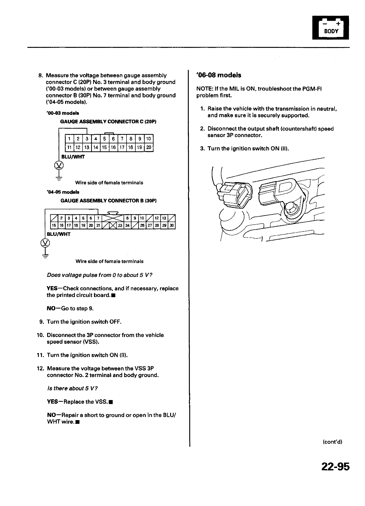

Connector C No. 3 applies to '00–03; connector B No. 7 applies to '04–05.oth use BLU/WHT wire.

**Does voltage pulse from 0 to about 5 V?**
*   **YES**—Check connections, and if necessary, replace the printed circuit board.
*   **NO**—Go to step 9.

---

## Step 9-12: VSS Voltage Check

9. Turn the ignition switch OFF.
10. Disconnect the 3P connector from the vehicle speed sensor (VSS).
11. Turn the ignition switch ON (II).
12. Measure the voltage between the VSS 3P connector No. 2 terminal and body ground.

**Is there about 5 V?**
*   **YES**—Replace the VSS .
*   **NO**—Repair a short to ground or open in the B L U / WHT wire.

---

## '06-08 Models

**NOTE:** If the MIL is ON, troubleshoot the PGM-FI problem first.

1. Raise the vehicle with the transmission in neutral, and make sure it is securely supported.
2. Disconnect the output shaft (countershaft) speed sensor 3P connector.
3. Turn the ignition switch ON (II).

Continues on printed page 22-96.

### Printed page 22-96

Source: [PDF p.1588](../page-images/p1588.png).

# Gauges — Vehicle Speed Signal Circuit Troubleshooting (continued)

Step 4: Check for continuity between the output shaft (countershaft) speed sensor 3P connector No. 3 terminal and ECM connector A (31P) No. 23 terminal using the GRN/YEL wire. If continuity exists, go to step 5; if not, repair an open or high resistance in the GRN/YEL wire between the output shaft (countershaft) speed sensor and the ECM.

Step 5: Measure the voltage between the output shaft (countershaft) speed sensor 3P connector No. 1 terminal and body ground using the YEL/BLU wire. If approximately 5 V is present, go to step 6; if not, repair a short or open in the YEL/BLU wire between the output shaft (countershaft) speed sensor and the ECM.

Step 6: Reconnect the output shaft (countershaft) speed sensor 3P connector.

Step 7: Slowly rotate the propeller shaft.

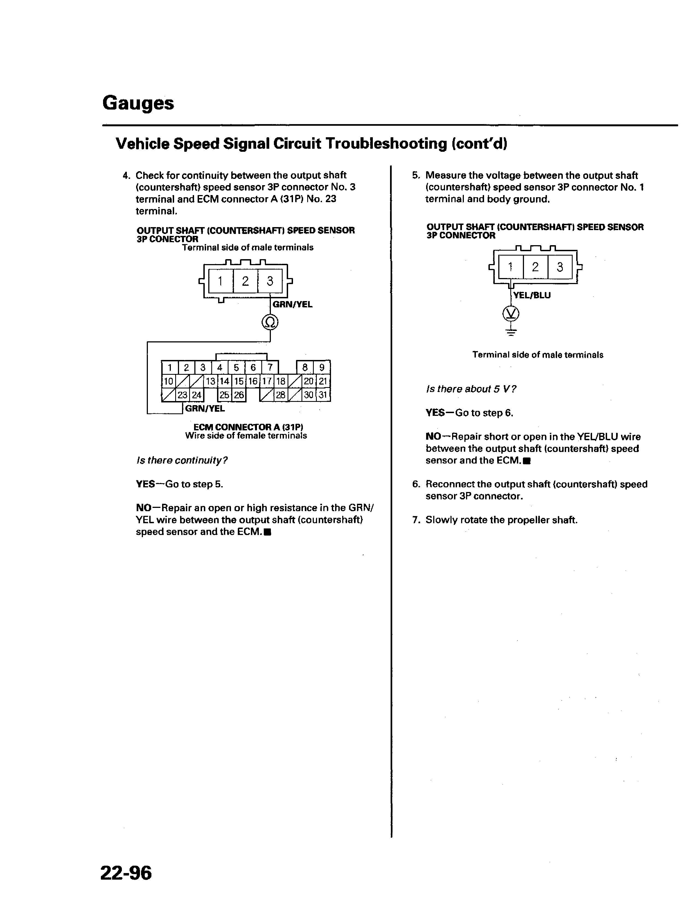

The source page ends at step 7; the next printed page continues the procedure.
