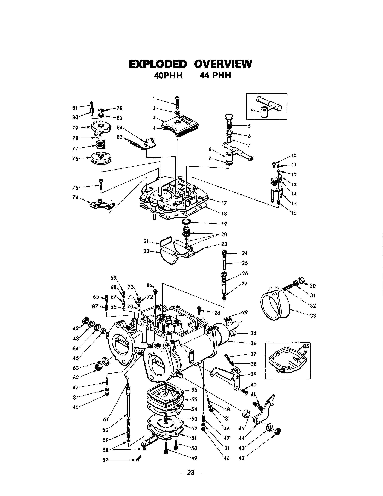

# Exploded Overview

> **Source transcription:** Text below is the PDF’s existing OCR layer, preserved verbatim. It contains recognition errors, especially in tables and part numbers. Open the linked page image before using any numeric value.

<a id="p24"></a>
**[PDF p.24](../page-images/p0024.png)**

## Exploded overview



Numbered callouts correspond to the parts lists on [PDF pp.25–26](09-parts-and-jetting.md).

```text
EXPLODED OVERVIEW
   40PHH   44 PHH


       -23-
```
